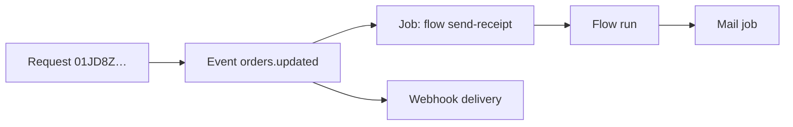

Much of what your project does happens **after** a request: a flow started by an event, an email, a webhook delivery, a scheduled sweep. The **Background work** and **Events and messages** groups of **Activity** show all of it. Every page has the same time buttons as the rest of Activity.

## Flow runs

**Activity → Flow runs** charts runs over time and lists **Recent failures**, then every run, newest first. Filter by flow and by status.

| Column | Meaning |
| --- | --- |
| **Flow** | Which flow ran |
| **Trigger** | What started it: `http`, `event`, `schedule`, `webhook`, `realtime`, `resource`, `job` or `manual` |
| **Status** | `succeeded` or `failed` |
| **Duration** | How long it took |
| **Error** | Why it failed |

Open a run to see its **trace**: every block in the order it ran, with its input, its output, the exit it took and how long it took, plus the run's **input**, its **result** and its **logs**. A run started by a request or a job links to them, so you can move between the request, the job and the run.

Traces are kept only for flows with **Record runs** on (see [flow settings](/automation/flow-editor#flow-settings)). How long they're kept depends on your plan.

### Reading a failed run

1. Find the last block in the trace. That's where it stopped.
2. Read its error. Common ones: a value that was empty because a path was wrong, a record that wasn't found, an HTTP call that failed, a run that hit its timeout.
3. Compare the block's input with what you expected. Look at the output of the block before it.
4. Fix the flow, then [retry the job](/automation/jobs#fix-and-re-run-failures) or run it again.

## Jobs

**Activity → Jobs** shows queue depth and counts per queue, jobs over time, and every job with its status (`queued`, `active`, `retrying`, `completed`, `failed`). **Gave up after retrying** lists permanent failures. **How failed work is retried** explains each kind's retry policy. Retry one job, or replay many after an outage. See [Background jobs](/automation/jobs).

## Events

**Activity → Events** lists recent events, newest first, with a filter by name (`orders.created`). Open one to see its full envelope and **every consumer it reached**: each flow, realtime channel and webhook, and whether handing it over worked.

**Send test event** emits an event of your own with a name and payload: the quickest way to test a subscription or a flow trigger.

### Event map

**Activity → Event map** draws which events exist, what emits them (tables, sign-in, flows, schedules, hooks), and what consumes each (subscriptions, flow triggers, webhooks). Use it to:

- see everything that happens when a table changes,
- spot events that nothing listens to,
- find which flow is reacting to something unexpectedly.

## Webhooks

**Activity → Webhooks** shows deliveries over time, **by endpoint** (with failures), the **busiest events** and where they come from, and recent failures. For every delivery and redelivery, see [Webhook deliveries](/automation/webhook-deliveries).

## Mail

**Activity → Mail** shows messages sent and failed **by template**. For individual messages, see [Mail activity](/mail/activity).

## Realtime

**Activity → Realtime** shows the **busiest channels**, the **latest deliveries**, and **policy errors**: subscriptions or publishes that a [channel rule](/realtime/channel-rules) refused. A burst of policy errors usually means an app is subscribing to channels its users aren't allowed on. See [Monitoring realtime](/realtime/monitoring).

## Follow one action everywhere

An action in your app can set off a chain: a request writes a record, the table emits an event, a subscription starts a flow, the flow sends an email and a webhook. Every link carries the same **request id**:



Start from whichever you have (a request id from your app's error, an event, a failed job) and follow the links to the rest. See [Requests and traces](/activity/requests).

## From code

<CodeGroup>
```typescript TypeScript
import { createClient } from "@pawabase/client";
import { manage } from "@pawabase/client/manage";

const m = manage(createClient({ url, project, apiKey: process.env.PAWABASE_SECRET_KEY!, environment }));

// flow runs
const failedRuns = await m.flows.runs({ flow: "send-receipt", status: "failed", limit: 50 });
const run = await m.flows.runDetail(runId);              // every step, its input, output and error

// events
const events = await m.events.list({ name: "orders.updated", limit: 50 });
const one = await m.events.detail(eventId);              // the payload, and what it started
const graph = await m.events.graph();                    // which events start which flows and webhooks

// jobs
const failedJobs = await m.jobs.list({ status: "failed" });
await m.jobs.retry(jobId);
await m.jobs.replay({ status: "failed", sinceMinutes: 60, dryRun: true });   // see what would run first
const queues = await m.jobs.queues();
const workers = await m.jobs.workers();
const policies = await m.jobs.retryPolicies();

// webhook deliveries
const bounced = await m.webhooks.deliveries({ status: "failed" });
await m.webhooks.redeliver(deliveryId);
await m.webhooks.redeliverMany({ status: "failed", sinceMinutes: 120, dryRun: true });
```

```python Python
import os
from pawabase import Pawabase

pb = Pawabase(url, os.environ["PAWABASE_SECRET_KEY"], project=project, environment=env)
m = pb.manage

failed_runs = m.flows.runs(flow="send-receipt", status="failed", limit=50)
run = m.flows.run_detail(run_id)

events = m.events.list(name="orders.updated", limit=50)
one = m.events.detail(event_id)
graph = m.events.graph()

failed_jobs = m.jobs.list(status="failed")
m.jobs.retry(job_id)
m.jobs.replay(status="failed", since_minutes=60, dry_run=True)
m.jobs.queues(); m.jobs.workers(); m.jobs.retry_policies()

bounced = m.webhooks.deliveries(status="failed")
m.webhooks.redeliver(delivery_id)
m.webhooks.redeliver_many(status="failed", since_minutes=120, dry_run=True)
```
</CodeGroup>

`replay` and `redeliverMany` with `dryRun` / `dry_run` list what they would send without sending it. Run them once that way before replaying for real, so a backlog of failures doesn't flood a service that just recovered.
