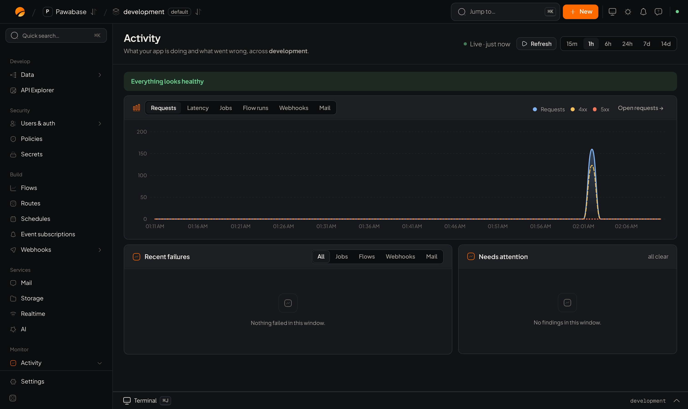

**Activity** is where you look when something is slow, failing or surprising, and where you check things are fine after a release. Open **Monitor → Activity** in Studio.

<Frame caption="Activity → Overview: traffic, recent failures and what needs attention.">
  
</Frame>

## The pages

| Group | Page | Use it to | Docs |
| --- | --- | --- | --- |
| **Overview** | Overview | See at a glance whether everything is healthy | below |
| **Requests** | Routes | Find your busiest, slowest and most failing endpoints | [Requests and traces](/activity/requests#routes) |
| | Errors | See failures grouped by what went wrong | [Errors](/activity/requests#errors) |
| | Requests | Search every call and open one end to end | [Requests](/activity/requests#requests) |
| | Bandwidth | Find what moves the most data | [Bandwidth](/activity/requests#bandwidth) |
| **Background work** | Jobs | Queues, failures, retry and replay | [Jobs](/activity/background-work#jobs) |
| | Flow runs | Every run with its trace | [Flow runs](/activity/background-work#flow-runs) |
| **Events and messages** | Events, Event map | What fired, and what reacted | [Events](/activity/background-work#events) |
| | Webhooks, Mail, Realtime | Deliveries, emails and live channels | [More](/activity/background-work#webhooks) |
| **Logs and alerts** | Logs, Alarms, Metrics | Search logs, chart metrics, get told | [Logs, metrics and alarms](/activity/alarms) |
| **Audit** | Audit log | Who changed what | [Audit log](/activity/audit-log) |

A dot next to a page means it has findings in the current window, so you know where to look before you click.

## Time windows

Pages that summarise a period share the time buttons **15m**, **1h**, **6h**, **24h**, **7d** and **14d**. **Live** keeps the page refreshing; **Refresh** updates it now. How far back you can look depends on how long your plan keeps request logs and runs ([Plans and limits](/cloud/plans-and-limits)).

## The Overview

1. **The banner** says *Everything looks healthy*, or what isn't.
2. **The chart** switches between **Requests**, **Latency**, **Jobs**, **Flow runs**, **Webhooks** and **Mail** over the window, with requests split into successes, client errors (4xx) and server errors (5xx). **Open requests** jumps to the matching requests.
3. **Recent failures** lists the latest failed jobs, flow runs, webhook deliveries and emails, filterable by kind.
4. **Needs attention** lists findings in plain words:

| Finding | What it means | Where to go |
| --- | --- | --- |
| Requests are being rate limited | Callers hit a key's or route's rate limit | [Requests](/activity/requests), the key's limits |
| Background jobs are failing | Jobs are failing in this window | [Jobs](/automation/jobs) |
| Schedule … failed on its last run | A schedule's last firing failed | The schedule, and its flow's runs |
| A webhook is not being delivered | Deliveries to an endpoint keep failing | [Deliveries](/automation/webhook-deliveries) |
| Email is not being sent | Messages are failing, or delivery isn't set up | [Mail activity](/mail/activity) |
| Usage close to a limit | Your plan's or environment's limit is nearly reached, or reached | [Usage & plan](/cloud/plans-and-limits) |

*Nothing needs attention in this window* means there are no findings.

## The environment overview

The environment's own **Overview** page (the first item in the sidebar) is a lighter summary: requests, average latency, bandwidth, flow runs, jobs and events over the last day, recent requests, and the project's id and API address. Use it as a home page; use Activity to dig in.

## Common investigations

### "A user says something failed"

1. Ask for the time, or better, the **request id** your app shows in its error (`error.requestId` in the SDKs).
2. **Requests**: search for it and open the trace.
3. Read the status and the access-rule decision. A `403` names the rule that refused.
4. Follow the trace to any jobs, flow runs or emails it started.

### "It's slow"

1. **Routes**: sort by slowness and open the slowest route.
2. **Where the time goes** splits time between the database, flows and other work.
3. Open one of the **slowest requests** and read its waterfall.
4. Look for many small database queries, a slow HTTP call in a flow, or a missing [index](/database/indexes).

### "Did the release break anything?"

1. **Overview** with a window starting before the release: compare error rate and latency.
2. **Errors**: any new groups?
3. **Flow runs** and **Jobs**: new failures?
4. **Audit log**: what changed, and who changed it.

### "Something happened that shouldn't have"

1. **Audit log**: which setting or definition changed?
2. **Events**: what fired, and what did it reach?
3. **Event map**: is something reacting to an event you didn't expect?

## Get told instead of looking

Activity shows you; [alarms](/activity/alarms) tell you. Set a few on error rate, latency, failed jobs and mail failures, and publish a [status page](/activity/status-page) so your users know too.

## Privacy

Activity holds request details, payloads, logs and email contents, which can include personal data. Limit who opens Studio in production, use scoped keys for integrations that read monitoring data (`monitoring:read`), and keep personal data out of what your flows log.

<CardGroup cols={2}>
  <Card title="Requests and traces" icon="route" href="/activity/requests">Follow one call end to end.</Card>
  <Card title="Flow runs, jobs and events" icon="list-checks" href="/activity/background-work">Watch background work.</Card>
  <Card title="Logs, metrics and alarms" icon="bell" href="/activity/alarms">Get told when something is wrong.</Card>
  <Card title="Status page" icon="activity" href="/activity/status-page">Tell your users how you're doing.</Card>
  <Card title="Audit log" icon="scroll-text" href="/activity/audit-log">Who changed what.</Card>
  <Card title="Debugging rules" icon="bug" href="/policies/debugging">Follow a refusal.</Card>
</CardGroup>
