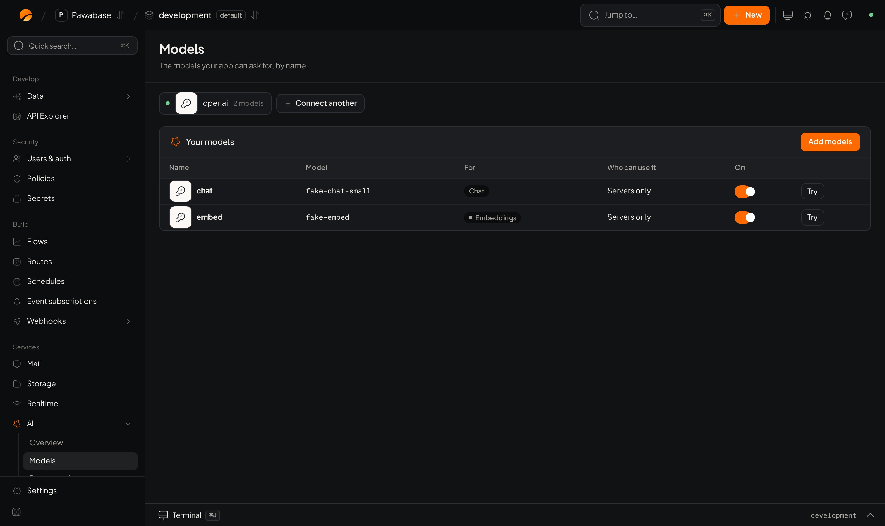

Pawabase gives you the pieces to put AI in a product without building the plumbing: one place for your model keys, a way to search by meaning, assistants that can read and change your data within the rules you set, and a way to let your own AI tools work with your project.

## What you can build

| You want to… | Use | Start here |
| --- | --- | --- |
| Answer a question, summarise, classify, or draft text | **Models**: ask a model by name from your app | [Chat and streaming](/ai/use-it) |
| Turn text into numbers so similar things sit close together | **Embeddings** | [Embeddings](/ai/embeddings) |
| Find records by what they mean, not which words they hold | **Vector search** | [Vector search](/ai/vector-search) |
| Let an assistant look things up and do tasks for your users | **Agents** | [Agents](/ai/agents/overview) |
| Let an assistant answer from your help articles, policies or notes | **Knowledge bases** | [Knowledge bases](/ai/knowledge/overview) |
| Let an assistant use Notion, GitHub, Stripe, Linear or the web | **Connections** | [Connections](/ai/apps/overview) |
| Add AI steps to a workflow | **AI blocks in flows** | [AI in flows](/ai/flows) |
| Let Claude, Cursor or another AI tool build and inspect your project | **AI tools (MCP)** | [Use your AI tools with Pawabase](/ai/mcp) |

## How it fits together

1. **Connect a provider** (OpenAI, Anthropic, Google, Mistral, Groq, or your own server) in **AI → Providers**. Your key is stored on the server and never shown again.
2. **Add models** with names your app uses, such as `chat` and `embed`. You can change which real model sits behind a name later without touching your code.
3. **Use them** from your app, from flows, or through agents. Who can use each model, agent and knowledge base is an [access rule](/policies/overview) you choose, the same way tables and files work.

<Frame caption="AI → Providers: pick who runs your models.">
  
</Frame>

## What stays in your control

- **Your provider keys never reach a browser or an app.** Your app only ever holds a Pawabase key.
- **Agents act as the person who asked.** By default an agent can only read and change what that person could, so it can never show someone a row they could not open themselves.
- **Changes wait for a person** unless you say otherwise. An agent that wants to delete, update or send something stops and asks.
- **Everything is on the record.** Each model call and agent run keeps its tokens, time and cost, and each agent step is listed, so you can see what happened and why.
- **Limits you set.** Cap how many steps, how long and how much an agent may spend on one run.

## A first model in two minutes

<Steps>
  <Step title="Connect a provider">
    Open **AI → Providers**, choose a provider and paste its API key.
  </Step>
  <Step title="Add a model">
    Open **AI → Models → Add models**, tick a chat model and give it the name `chat`.
  </Step>
  <Step title="Ask it from your server">
    <CodeGroup>
    ```typescript TypeScript
    const pawabase = createClient({ url, project, apiKey: "pb_sk_…", environment: "production" });
    const answer = await pawabase.ai.chat("chat", "Write a one-line description for a ceramic mug.");
    ```

    ```python Python
    pb = Pawabase(url, "pb_sk_…", project=project, environment="production")
    answer = pb.ai.chat("chat", "Write a one-line description for a ceramic mug.")
    ```
    </CodeGroup>
  </Step>
</Steps>

<CardGroup cols={2}>
  <Card title="Providers and models" icon="plug" href="/ai/gateway">Connect providers, name models, choose who may use them.</Card>
  <Card title="Agents" icon="bot" href="/ai/agents/overview">Assistants that use your tables, flows and apps.</Card>
  <Card title="Knowledge bases" icon="book-open" href="/ai/knowledge/overview">Documents an agent can search and quote.</Card>
  <Card title="Patterns" icon="lightbulb" href="/ai/patterns">Support assistant, document Q&A, semantic search and more.</Card>
</CardGroup>
