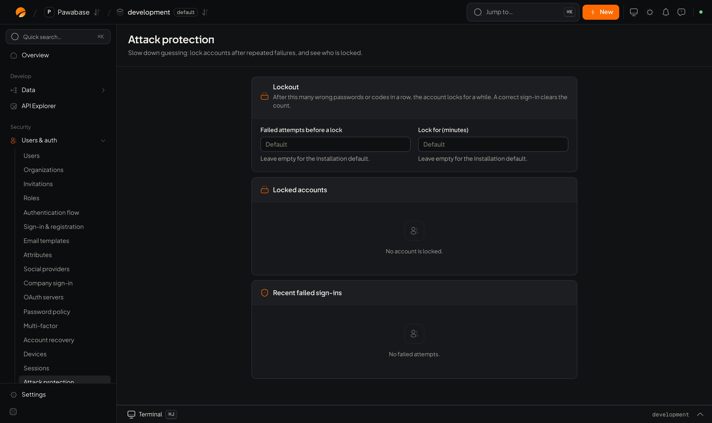

Two different attacks target sign-in, and Pawabase answers each separately:

| Attack | Protection | Counted per |
| --- | --- | --- |
| Guessing **one account's** password (or two-step code) | **Lockout**: after a run of failures the account refuses sign-in for a while | Account |
| Hammering the sign-in endpoints from one place (trying many accounts, sending floods of emails) | **Rate limits** on the sign-in, sign-up and email endpoints | Caller's address |

Both are always on. You tune lockout per environment; the endpoint limits are fixed.

<Frame caption="Users & auth → Attack protection: lockout settings, locked accounts and recent failed sign-ins.">
  
</Frame>

## Lockout

### How it works

Each account has a count of consecutive failures:

1. A **wrong password** on password sign-in, or a **wrong two-step code** when finishing a sign-in, adds one.
2. When the count reaches the **threshold**, the account is **locked** until the lock time passes, and the count starts again from zero.
3. A **successful** sign-in resets the count.

While an account is locked, sign-in is refused **before the password is checked**, so even the right password doesn't get in. The lock ends on its own; nothing needs to be cleared.

What doesn't count toward the lock:

- **Unknown email addresses.** There's no account to lock; the answer is the same "invalid email or password" as for a wrong password, so the response doesn't reveal which accounts exist.
- **Email codes and sign-in links.** They have their own expiry and single use, and the endpoints that send them are rate-limited per address (below).
- **Passkeys and social sign-in.** There's no secret to guess.

### Settings

**Users & auth → Protection → Attack protection**:

| Setting | Default | Meaning |
| --- | --- | --- |
| **Failed attempts before a lock** | 10 (installation default) | Consecutive failures that lock the account. Leave empty for the default |
| **Lock for (minutes)** | 15 (installation default) | How long a lock lasts. Leave empty for the default |

Below the settings:

- **Locked accounts**: who is locked now, until when, with **Unlock** to end a lock early (for example after confirming with the person that it was them).
- **Recent failed sign-ins**: time, account, address and reason (`wrong password`, `locked`, `unknown email`, `wrong code`), to spot an attack in progress.

In code (management client, infrastructure as code), the settings are `lockout_threshold` and `lockout_minutes` on the environment's auth configuration.

### Choosing numbers

| App | Threshold | Lock | Also |
| --- | --- | --- | --- |
| Consumer app | 10 | 15 minutes | Breach check in the [password policy](/auth/password-policy) |
| Business app | 5 | 30 minutes | Encourage [two-step verification](/auth/two-step-verification) |
| High risk (finance, admin) | 3–5 | 60 minutes | Require two-step verification |

The trade-off: a low threshold and a long lock stop guessing sooner, but make it easy for someone who knows an email address to lock its owner out on purpose. Keep the lock short enough that a locked-out person can simply wait, and rely on two-step verification, not lockout, as the real defence for valuable accounts.

## What your app receives

| Situation | Status | Message (`detail`) | TypeScript | Python |
| --- | --- | --- | --- | --- |
| Wrong password, or unknown email | `400` | `invalid email or password` | `ApiError` (`status === 400`) | `ValidationError` |
| Wrong two-step code | `400` | `the code is not valid` | `ApiError` | `ValidationError` |
| Account locked | `429` | `too many failed attempts; try again later` | `RateLimitError` | `RateLimitedError` |
| Too many requests from this address | `429` | the rate limit's message, with `Retry-After` | `RateLimitError` | `RateLimitedError` |
| Account disabled by an administrator | `403` | `this account is disabled` | `PermissionError` | `ForbiddenError` |
| Email not confirmed (when required) | `403` | `confirm your email address first` | `PermissionError` | `ForbiddenError` |
| Password expired (when the policy expires passwords) | `403` | code `password_expired` | `PermissionError` | `ForbiddenError` |

<CodeGroup>
```typescript TypeScript
import { ApiError, PermissionError, RateLimitError } from "@pawabase/client";

try {
  await pawabase.auth.signInWithPassword({ email, password });
} catch (error) {
  if (error instanceof RateLimitError) {
    show("Too many attempts. Wait a few minutes, or reset your password.");
  } else if (error instanceof PermissionError && error.code === "password_expired") {
    show("Your password has expired. Use “Forgot password” to choose a new one.");
  } else if (error instanceof PermissionError) {
    show(error.message);                       // disabled, or email not confirmed
  } else if (error instanceof ApiError && error.status === 400) {
    show("Wrong email or password.");
  } else {
    throw error;
  }
}
```

```python Python
from pawabase import ForbiddenError, RateLimitedError, ValidationError

try:
    pb.auth.sign_in_with_password(email=email, password=password)
except RateLimitedError:
    show("Too many attempts. Wait a few minutes, or reset your password.")
except ForbiddenError as error:
    show(error.message)                        # disabled, email not confirmed, or password expired
except ValidationError:
    show("Wrong email or password.")
```
</CodeGroup>

### Wording

The lockout answer is a `429`, different from the `400` for a wrong password, so a determined attacker can tell that an account exists while it is locked. Don't add to that in your interface: show the same neutral message for both cases ("We couldn't sign you in. Wait a few minutes or reset your password.") and always offer **Forgot password**: completing a password reset clears the failure count and **ends the lock**, so the real owner is never stuck waiting.

Don't retry sign-in automatically on `429`. Each automatic retry with a wrong password extends the trouble; with the right password it's refused anyway until the lock ends.

## Rate limits on sign-in endpoints

These endpoints share one limit of **30 requests per minute per caller address**:

| Endpoint | Used by |
| --- | --- |
| `POST /auth/v1/token` | Password sign-in **and token refresh** |
| `POST /auth/v1/signup` | Sign-up |
| `POST /auth/v1/email-code` | Sending sign-in codes |
| `POST /auth/v1/magic-link` | Sending sign-in links |
| `POST /auth/v1/recover` | Password reset emails |
| `POST /auth/v1/verify/request` | Confirmation emails |

Above it the answer is `429` with `Retry-After`. The client libraries wait and retry for you a few times.

This limit is separate from, and in addition to, your plan's per-key rate limit ([The life of a request](/concepts/request-lifecycle#rate-limits-and-quotas)). Two practical consequences:

- **Many people behind one address** (an office, a school, a mobile carrier's gateway) share the 30 per minute. Normal use stays far below it: a session refreshes about once every 15 minutes.
- **Don't refresh in a loop.** Code that calls refresh on every request can reach the limit. The client libraries refresh once, shortly before expiry, and browser tabs share the stored session, so a new token in one tab is picked up by the others.

For bots that sign up or request emails in bulk from many addresses, add [bot protection](/auth/bot-protection) to the sign-up, sign-in and recovery forms.

## Investigating an attack

1. **Users & auth → Records → Sign-in activity**: filter by `success = false`. Many failures for **one account** from many addresses is credential stuffing against that person; failures across **many accounts** from one address is a scan.
2. **Attack protection → Locked accounts** shows who has been locked out.
3. For a targeted account: confirm with the person, **Unlock** it (or let them reset their password, which also unlocks), and ask them to turn on two-step verification. If you think they were signed in by someone else, use **Sign out everywhere** on their page under **People → Users**.
4. Watch the `session.reuse_detected` event: it fires when a stolen refresh token is used, and Pawabase ends that session family. See [Sessions](/auth/sessions).

## Beyond lockout

- **[Password policy](/auth/password-policy)**: length, breach check against known leaked passwords, expiry.
- **[Two-step verification](/auth/two-step-verification)**: the defence that holds even when a password leaks.
- **[Devices](/auth/devices)**: email people when a new device signs in, so they notice a stranger.
- **[Bot protection](/auth/bot-protection)**: a challenge on sign-up and sign-in forms.
- **[Restrictions](/auth/sign-up-restrictions)**: limit sign-up to invited people or certain email domains.

<CardGroup cols={2}>
  <Card title="Sign-in activity" icon="activity" href="/auth/sign-in-activity">Investigate failures.</Card>
  <Card title="Two-step verification" icon="shield-check" href="/auth/two-step-verification">The strongest defence.</Card>
</CardGroup>
