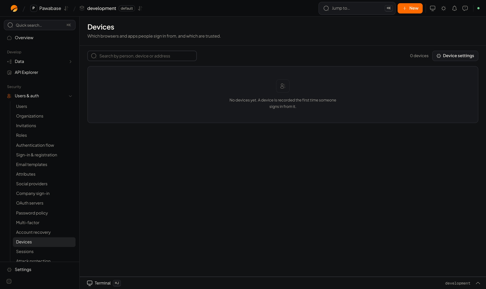

Sessions say *who* is signed in; **devices** say *from what*. Pawabase can remember the devices each person uses, email them when a new one signs in, let a device they've confirmed with two-step verification skip the second step for a while, and cap how many devices one person uses.

<Frame caption="Users & auth → Protection → Devices, with Configure devices.">
  
</Frame>

## How a device is recognised

On each sign-in Pawabase works out a device key, in this order:

1. The **`x-device-id`** request header, if it holds 16–64 letters, digits, `_` or `-`.
2. The **`pb_device`** cookie, set by Pawabase's [hosted sign-in pages](/auth/authentication-flow).
3. Otherwise a **fingerprint of the browser's user-agent string**.

The first two are **durable**: an id the device keeps. The fingerprint isn't: every Chrome on the same version of macOS has the same one, and it changes when the browser updates. Two consequences:

| | With a durable id | With only the fingerprint |
| --- | --- | --- |
| Device tracking and the list of devices | Accurate | Approximate (similar browsers merge) |
| New-device emails | Accurate | Sent when the browser updates; missed for a stranger on the same browser |
| **Remember this device** (skip the second step) | Works | **Never takes effect**: only a durable id can be remembered |

<Warning>
The client libraries don't send `x-device-id` on their own. If your app signs people in with the SDK (not the hosted pages) and you want devices to work properly, give each install a random id and send it as a header, as shown below.
</Warning>

### Sending a device id

<CodeGroup>
```typescript TypeScript
import { createClient } from "@pawabase/client";

function deviceId(): string {
  let id = localStorage.getItem("device-id");
  if (!id) {
    id = crypto.randomUUID().replaceAll("-", "");   // 32 characters
    localStorage.setItem("device-id", id);
  }
  return id;
}

export const pawabase = createClient({
  url, project, apiKey,
  headers: { "x-device-id": deviceId() },
});
```

```python Python
import secrets
from pathlib import Path

store = Path("~/.myapp/device-id").expanduser()
if not store.exists():
    store.parent.mkdir(parents=True, exist_ok=True)
    store.write_text(secrets.token_hex(16))

pb = Pawabase(url, key, project=project, headers={"x-device-id": store.read_text().strip()})
```
</CodeGroup>

Keep the id somewhere that lasts (local storage, the app's private files, the keychain on mobile). Clearing site data or reinstalling makes a new device, which is the intended behaviour: a fresh install should be confirmed again.

The id is not a secret and not proof of anything on its own: it only lets Pawabase tell your devices apart. It never replaces signing in.

## Settings

**Users & auth → Protection → Devices → Configure devices**:

| Setting | Default | Meaning | Key |
| --- | --- | --- | --- |
| **Track devices** | On | Record the device at each sign-in | `directory.devices.track` |
| **Email when a new device signs in** | Off | Send the **New sign-in** email for an unfamiliar device. Not sent for a person's very first sign-in | `directory.devices.notify_new` |
| **Remember a device after two-step verification** | 0 (always ask) | Days a confirmed device may skip the second step | `directory.devices.remember_days` |
| **Devices per person** | 0 (no limit) | Over the limit, the least recently used device is forgotten | `directory.devices.max_per_user` |

The page also lists **Recent devices** across the environment. The email's wording is the **New sign-in** message in [Email templates](/auth/email-templates).

## New-device emails

With **Email when a new device signs in** on, a sign-in from a device the person hasn't used before sends them "Your account was just signed in to from a new device: Chrome on Windows (203.0.113.7)". It's the fastest way for a real owner to notice a takeover. Pair it with a clear path in the email's wording: change your password, then sign out everywhere ([Sessions](/auth/sessions)).

## Remember this device

When a person with two-step verification signs in on a device and confirms the second step, your app can ask to remember the device. For the configured number of days, password sign-ins from that device don't ask for the second step again.

<CodeGroup>
```typescript TypeScript
const result = await pawabase.auth.signInWithPassword({ email, password, rememberDevice: true });
if (result.status === "mfa_required") {
  const session = await result.verify(code);   // the device is remembered after this succeeds
}
```

```python Python
result = pb.auth.sign_in_with_password(email=email, password=password, remember_device=True)
if result.status == "mfa_required":
    result.verify(code)          # the device is remembered after this succeeds
```
</CodeGroup>

It takes effect only when **all** of these hold: the setting is above 0, the person ticked "remember" (`rememberDevice`), the second step succeeded, and the device has a durable id. The response to the verify step then says for how many days (`device_trusted_days`).

### What a remembered device gives up

A sign-in that skips the second step is an ordinary **one-factor** session (`aal1`), not a two-step one (`aal2`). So:

- **Rules that require two-step verification** (the `mfa` rule) refuse requests from that session.
- **Organizations that require two-step verification** refuse it: switching into such an organization answers `403` with code `org_mfa_required`.

If your app or some of your customers' organizations require two-step verification, remembered devices won't help those people; keep `remember_days` at 0 there, or accept that they confirm each sign-in. Otherwise keep it modest (7–30 days): a remembered device is only as safe as the device itself.

## Showing and forgetting devices

Put the list on your account page next to [sessions](/auth/sessions):

<CodeGroup>
```typescript TypeScript
const devices = await pawabase.auth.devices.list();
await pawabase.auth.devices.forget(devices[0].id);   // asks for the second step again next time
```

```python Python
devices = pb.auth.devices.list()
pb.auth.devices.forget(devices[0]["id"])
```
</CodeGroup>

Forgetting a device ends its "remembered" status; it doesn't sign the device out. To sign it out too, end its session ([Sessions](/auth/sessions)). Administrators can forget a person's device from your server with the admin client (`users.forgetDevice` / `forget_device`).

## Device limits

**Devices per person** caps how many devices one account keeps. Over the limit, the least recently used device is forgotten, so the person isn't locked out, but each new device makes them confirm again. It discourages sharing one account between many people; it doesn't block it.

## Related

- [Two-step verification](/auth/two-step-verification): the second step that devices can skip.
- [Sessions](/auth/sessions): sign-outs and active sessions.
- [Attack protection](/auth/attack-protection): lockouts.
