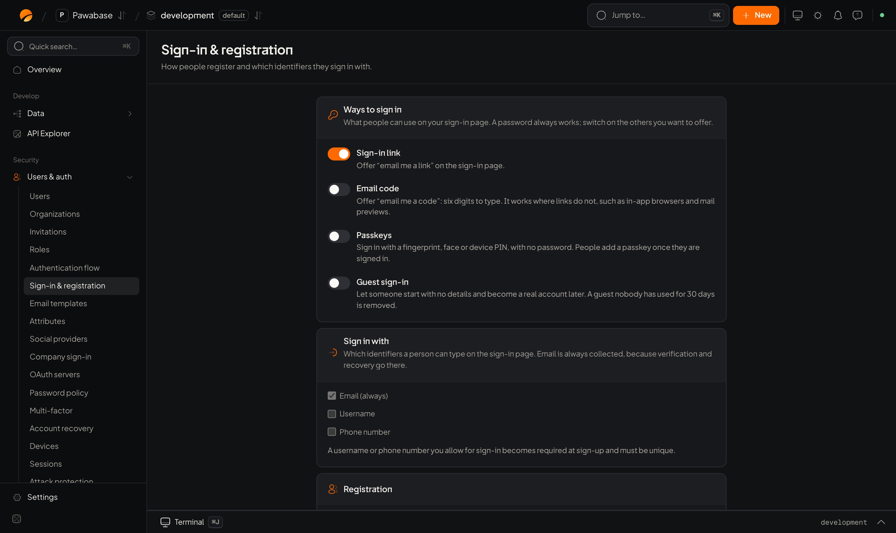

The classic method. A person gives an email and chooses a password; later they sign in with both. It works everywhere and needs no extra setup, and you can add [codes](/auth/email-codes), [links](/auth/sign-in-links), [social](/auth/social-sign-in) and [passkeys](/auth/passkeys) alongside it.

<Frame caption="Users & auth → Sign-in & registration: ways to sign in, identifiers and registration.">
  
</Frame>

## In Studio

**Users & auth → Sign-in → Sign-in & registration**.

The **Registration** card:

| Setting | Meaning | Key |
| --- | --- | --- |
| **Self-registration** | Anyone may create an account. Turn it off to create people yourself or by invitation | `signup_enabled` |
| **Verify email before sign-in** | A new account must open the link in its confirmation email first | `require_email_verification` |
| **Sign-up form layout** | *Two steps* puts the account on the first screen and the rest on the second. *Auto* does that when more than two details are asked | `signup_form.steps` |

How strong a password must be is on its own page: [Password policy](/auth/password-policy).

## Sign up

<CodeGroup>
```typescript TypeScript
const { user, session, verificationRequired } = await pawabase.auth.signUp({
  email: "ada@example.com",
  password: "a long passphrase",
  name: "Ada",
  username: "ada",
  data: { plan: "free" },                       // stored in user_metadata
  redirectTo: "https://myapp.com/welcome",     // where the confirmation link sends them
});
```

```python Python
result = pb.auth.sign_up(
    email="ada@example.com",
    password="a long passphrase",
    name="Ada",
    username="ada",
    data={"plan": "free"},
    redirect_to="https://myapp.com/welcome",
    accepted_terms=True,
)
result.user, result.session, result.verification_required
```
</CodeGroup>

Two outcomes:

- **Signed in at once.** `session` is set and the client stores it.
- **Confirmation first.** `verificationRequired` is `true` and `session` is `null`. Show "check your inbox". When they click the link they land on `redirectTo`, signed in. See [Email verification](/auth/email-verification).

Whether the second outcome happens depends on **Verify email before sign-in**. The `redirectTo` address must be on your [redirect list](/auth/redirect-urls).

Extra details your sign-up form collects (company, birthday, terms) go in `data` and are checked by the rules you set under [Attributes](/auth/sign-up-form-and-attributes).

## Sign in

<CodeGroup>
```typescript TypeScript
const result = await pawabase.auth.signInWithPassword({ email, password });

if (result.status === "mfa_required") {
  const session = await result.verify(codeFromUser);   // finish the second step
}
```

```python Python
result = pb.auth.sign_in_with_password(email=email, password=password, remember_device=True)

if result.status == "mfa_required":
    session = result.verify(code_from_user)
```
</CodeGroup>

If the account has [two-step verification](/auth/two-step-verification), the call does not finish; it returns `mfa_required` with a `verify` function. To sign in scoped to an [organization](/auth/organizations), add `org: "acme"`.

## Errors to handle

A wrong password and an unknown email give the **same** answer, `400` "invalid email or password", on purpose, so nobody can find out which addresses have accounts.

| Answer | Message | TypeScript | Python |
| --- | --- | --- | --- |
| `400` | "invalid email or password" | `ApiError`, `status` 400 | `ValidationError` |
| `400` | "email and password are required" | `ApiError`, `status` 400 | `ValidationError` |
| `403` | "this account is disabled" | `PermissionError` | `ForbiddenError` |
| `403` | "confirm your email address first" | `PermissionError` | `ForbiddenError` |
| `403` | `mfa_setup_required` | `PermissionError`, `code` `mfa_setup_required` | `ForbiddenError`, `detail["code"]` |
| `429` | "too many failed attempts; try again later" | `RateLimitError` | `RateLimitedError` |

An account that needs a second step doesn't fail: the result has `status: "mfa_required"`. See [Two-step verification](/auth/two-step-verification). When the environment requires a second step and the person has none yet, sign-in answers `mfa_setup_required` with a token to set one up; see [Required setup](/auth/two-step-verification#required-setup).

<CodeGroup>
```typescript TypeScript
import { ApiError, PermissionError, RateLimitError } from "@pawabase/client";

try {
  const result = await pawabase.auth.signInWithPassword({ email, password });
  if (result.status === "mfa_required") return askForCode(result);
} catch (e) {
  if (e instanceof RateLimitError) setMessage("Too many tries. Wait a moment and try again.");
  else if (e instanceof PermissionError && e.is("mfa_setup_required")) startMfaSetup(e.body);
  else if (e instanceof PermissionError) setMessage(e.message.includes("confirm") ? "Confirm your email first." : "This account can't sign in.");
  else if (e instanceof ApiError && e.status === 400) setMessage("Wrong email or password.");
  else throw e;
}
```

```python Python
from pawabase import ForbiddenError, RateLimitedError, ValidationError

try:
    result = pb.auth.sign_in_with_password(email=email, password=password)
    if result.status == "mfa_required":
        ask_for_code(result)
except RateLimitedError:
    message = "Too many tries. Wait a moment and try again."
except ForbiddenError as error:
    message = "Confirm your email first." if "confirm" in error.message else "This account can't sign in."
except ValidationError:
    message = "Wrong email or password."
```
</CodeGroup>

On sign-up:

| Answer | Meaning | Where the details are |
| --- | --- | --- |
| `409` "an account with this email already exists" / "that username is taken" | Already in use | `ConflictError` |
| `422` "the password does not meet the policy" | The [password policy](/auth/password-policy) refused it | The reasons are a list in `problems`: `error.body.problems` in TypeScript, `error.problems` in Python |
| `422` other | A missing or invalid field, such as a required [sign-up attribute](/auth/sign-up-form-and-attributes) | `error.byField()` in TypeScript |
| `403` | Sign-up is off, the address is [restricted](/auth/sign-up-restrictions), or the user limit is reached | `PermissionError` / `ForbiddenError` |

```typescript
catch (e) {
  if (e instanceof ValidationError) {
    const problems = (e.body as { problems?: string[] }).problems;
    if (problems?.length) setErrors({ password: problems });   // ["Password must contain an uppercase letter."]
    else setErrors(e.byField());
  }
}
```

After repeated failures the account **locks** for a while: see [Attack protection](/auth/attack-protection). Sign-up and sign-in share a rate limit, so never retry in a loop.

## A complete form

```tsx
function SignUp() {
  const [fields, setFields] = useState({ email: "", password: "" });
  const [errors, setErrors] = useState<Record<string, string[]>>({});
  const [sent, setSent] = useState(false);

  async function submit(e: React.FormEvent) {
    e.preventDefault();
    setErrors({});
    try {
      const { verificationRequired } = await pawabase.auth.signUp({
        ...fields,
        redirectTo: `${location.origin}/welcome`,
      });
      setSent(verificationRequired);               // otherwise onAuthStateChange signs them in
    } catch (err) {
      if (err instanceof ValidationError) setErrors((err.body as { problems?: string[] }).problems?.length ? { password: (err.body as { problems: string[] }).problems } : err.byField());
      else if (err instanceof ConflictError) setErrors({ email: ["That address already has an account."] });
      else throw err;
    }
  }

  if (sent) return <p>Check your inbox to confirm your email.</p>;
  return (
    <form onSubmit={submit}>
      <input type="email" autoComplete="email" onChange={(e) => setFields({ ...fields, email: e.target.value })} />
      {errors.email?.map((m) => <p key={m}>{m}</p>)}
      <input type="password" autoComplete="new-password" onChange={(e) => setFields({ ...fields, password: e.target.value })} />
      {errors.password?.map((m) => <p key={m}>{m}</p>)}
      <button>Create account</button>
    </form>
  );
}
```

## Create users yourself

With self-registration off, create people from the dashboard (**Users → New user**) . Leave the password empty to have the person set one through a recovery link.

## Good practice

- Set `autocomplete="email"`, `"current-password"` and `"new-password"` so password managers work, and allow paste.
- Prefer a long minimum length to complicated character rules.
- Offer a second way in ([passkeys](/auth/passkeys), [codes](/auth/email-codes)). Fewer passwords means fewer resets.
- Never log passwords. Never email them.

<CardGroup cols={2}>
  <Card title="Password policy" icon="lock" href="/auth/password-policy">Set the rules.</Card>
  <Card title="Account recovery" icon="rotate-ccw" href="/auth/account-recovery">Forgotten passwords.</Card>
</CardGroup>
