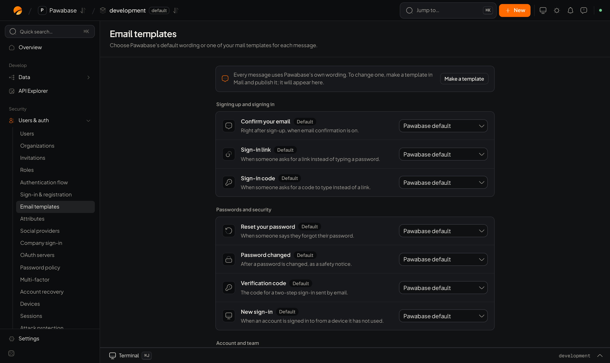

Auth sends email at nine moments: confirming an address, signing in with a link or code, resetting a password, security notices and invitations. Each message comes with Pawabase's default wording and design. You can replace any of them with a template you design in [Mail](/mail/overview).

<Frame caption="Users & auth → Sign-in → Email templates: nine messages, each with the default or one of your templates.">
  
</Frame>

## The nine messages

| Message | Sent when | Values it carries |
| --- | --- | --- |
| **Confirm your email** (`verify`) | After sign-up, and when someone asks for a new confirmation, while [email verification](/auth/email-verification) is required | `link` |
| **Sign-in link** (`magic`) | Someone asks for a [sign-in link](/auth/sign-in-links) | `link` (works once, for 15 minutes) |
| **Sign-in code** (`email_code`) | Someone asks for an [email code](/auth/email-codes) | `code`, `minutes` |
| **Reset your password** (`recovery`) | Someone uses **Forgot password** ([account recovery](/auth/account-recovery)) | `link`, `minutes` (the recovery link's lifetime) |
| **Password changed** (`password_changed`) | After a password is changed, as a safety notice | none beyond the common ones |
| **Verification code** (`mfa_code`) | A two-step sign-in uses an emailed code ([two-step verification](/auth/two-step-verification)) | `code`, `minutes` |
| **New sign-in** (`new_device`) | An account is signed in to from a device it hasn't used before, when [new-device alerts](/auth/devices) are on | `device` (the device's description and its address, e.g. "Chrome on macOS (203.0.113.7)") |
| **Confirm a new address** (`email_change`) | Someone changes their account's email; sent **to the new address** | `link` |
| **Invitation** (`invite`) | Someone is [invited to an organization](/auth/invitations) | `link`, `organization`, `role` |

Every message also has these common values:

| Value | Holds |
| --- | --- |
| `project` | The environment's app name (from the environment's settings) |
| `email` | The recipient's address |
| `brand.name`, `brand.primary`, `brand.background` | The app name and the two brand colours |

## The default design

Without any change, each message is sent as a clean HTML email with a heading, one or two lines, a single button (for links) or a large code (for codes), and a closing note such as "If you didn't ask to sign in, you can ignore this email", plus a plain-text version for clients that don't show HTML.

The default design takes your app's name and two colours: **primary** (the button) and **background**. Set them in the environment's auth settings as `branding: { primary, background }`, through [infrastructure as code](/iac/overview), a [blueprint](/developers/blueprints) (`auth.yml`) or the management API. Unset, the button is orange (`#ff6b47`) on a near-black header.

## Use your own template

1. In **Mail → Templates**, design a template with the visual editor (or HTML). Use the values from the table above, for example `{{ link }}` for the button's address or `{{ code }}` for a code, and `{{ project }}` for the app name. See [Template language](/mail/template-language).
2. **Publish** it. Drafts aren't used.
3. In **Users & auth → Sign-in → Email templates**, choose your template for the message. **Default** puts Pawabase's version back.

The template's own subject is used. One template per message is the clearest; a template shared between messages must make sense for each message's values (a shared template that shows `{{ code }}` would be empty for a link message).

### When your template can't be used

If the chosen template is deleted, or is a draft with no content, Auth doesn't fail: it sends the **default** message instead, and Studio marks the message **Template missing, using default**. A sign-in never breaks because of an email design.

### Changing only the wording

To keep the default design but change the subject or text, set an override in the environment's auth settings instead of choosing a template:

```yaml auth.yml (blueprint)
emails:
  verify:
    subject: "Confirm your {project} account"
    text: "Welcome to {project}! Confirm your address here: {link}"
```

Overrides use single braces (`{project}`, `{link}`, `{code}`, `{minutes}`, `{email}`, and for invitations `{organization}` and `{role}`). The text becomes the plain-text version, and the designed version keeps its layout: each paragraph (separated by a blank line) is shown, and a paragraph that is only `{link}` becomes the button. This is only available through settings in code, not in Studio.

## Delivery

Auth's emails are sent through the environment's mail settings, the same as any mail you send: your own provider if you've connected one, or Pawabase's built-in sender within its monthly allowance. They appear in **Mail → Activity** with their delivery status like every other message. See [Mail delivery](/mail/delivery).

- **Set up a provider before launch.** Confirmation, reset and code emails are how people get into their accounts; if they don't arrive, people are stuck.
- **Send from a domain you control**, with SPF and DKIM set up at your provider, or these messages land in spam. See [Deliverability](/mail/deliverability).
- **Codes and links expire.** If delivery is slow, people get expired codes; watch delivery times in **Mail → Activity**.

## Writing good security email

- **One action.** One button or one code; nothing else to click.
- **Say why they're getting it:** "You asked to sign in to Acme."
- **Say how long it lasts**, using `minutes`.
- **Say what to do if it wasn't them.** For the password-changed and new-sign-in notices, tell them to reset their password and sign out everywhere.
- **Never put other links or tracking** in sign-in and reset emails. People learn to trust only the one link that should be there.
- **Keep a plain-text version** (templates have one).

## Testing

Run the real flow in a development environment: sign up with your own address, request a sign-in link, use **Forgot password**. Then check **Mail → Activity** for each message and its delivery status. If a message doesn't arrive, the delivery status there says whether it was sent, refused by the provider, or held back by your plan's mail allowance.

## Related

- [Mail templates](/mail/templates): the editor and the template library.
- [Template language](/mail/template-language): values, conditions and loops.
- [Email verification](/auth/email-verification), [Sign-in links](/auth/sign-in-links), [Email codes](/auth/email-codes), [Account recovery](/auth/account-recovery).
