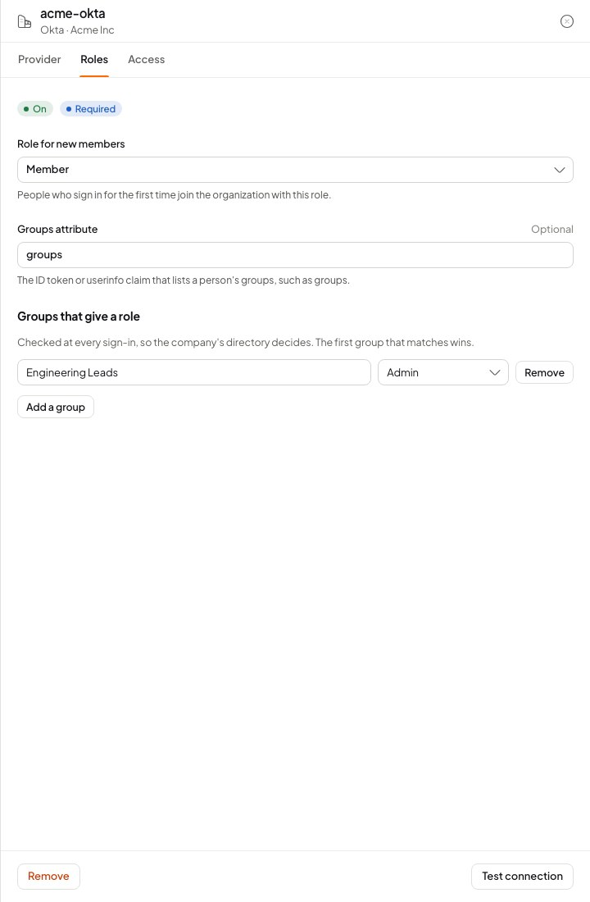

A connection is one organization's identity provider. Setting it up is an exchange with the company's administrator: you give them addresses that point at Pawabase, they give you the details of their provider.

<Frame caption="A connection's sheet: Provider, Roles and Access tabs, with Test connection.">
  
</Frame>

## Create a connection

**Users & auth → Enterprise sign-in → New connection.**

1. Pick the provider the company uses. **Microsoft Entra ID**, **Google Workspace**, **Okta** and **Keycloak** are OpenID Connect with their logo and a hint for their issuer; **Other OpenID Connect** and **SAML 2.0** cover everything else (OneLogin, Ping, JumpCloud, Auth0, ADFS, Authentik…).
2. Choose the **organization**. Organizations that already have a connection are not offered: one connection per organization.
3. Name it. Lowercase letters, digits and hyphens, such as `acme-okta`. The name is part of the addresses the company enters in their provider, so it cannot change later.

The connection starts **off**. Fill in the provider details on its **Provider** tab, test it, then switch it on under **Access**.

| Field | Where | Meaning |
| --- | --- | --- |
| Provider details | **Provider** | What the company's provider gives you (below) |
| **Trust the email address** | **Provider** | Treat the addresses this provider sends as confirmed. On by default |
| **Role for new members** | **Roles** | The role someone joins the organization with |
| **Groups attribute** and **Groups that give a role** | **Roles** | See [Group roles](/auth/enterprise-roles-and-access#roles-from-the-companys-groups) |
| **Connection on** | **Access** | Sign people in through it. Needs the provider details |
| **Require it** | **Access** | No other way in for people at the organization's domains. Needs the connection on |

## OpenID Connect

Most cloud identity providers speak OpenID Connect. The company registers your app as a "web application" (sometimes "OIDC app" or "app registration").

**Give the company:**

| Value | Example |
| --- | --- |
| **Redirect URI** (also "sign-in redirect URI", "callback URL", "reply URL") | `https://<your-gateway>/auth/v1/callback/<environment>/acme-okta` |

The exact address is on the connection's **Provider** tab with a copy button. It is built from your gateway's public address, the environment and the connection name.

**They give you:**

| Field | Meaning |
| --- | --- |
| **Issuer** | The provider's base address. Pawabase reads `<issuer>/.well-known/openid-configuration` to find the sign-in, token and user info endpoints. It must be `https://` |
| **Client ID** | Your app's id at the provider |
| **Client secret** | Your app's secret. Shown hidden once saved; enter `secret://NAME` to keep it in [Secrets](/secrets/overview) instead |

Pawabase asks for the `openid`, `email` and `profile` scopes. The provider must release the person's email address.

### Microsoft Entra ID

1. In the Entra admin center: **App registrations → New registration**. Supported account types: *this organizational directory only*. Redirect URI: **Web**, the Redirect URI from Pawabase.
2. **Certificates & secrets → New client secret.** Copy its **Value** (not its ID).
3. Issuer: `https://login.microsoftonline.com/<tenant-id>/v2.0`, with the tenant ID from the app's **Overview**. Client ID: the **Application (client) ID**.
4. For groups, add a **groups claim** under **Token configuration**. Entra sends group **object IDs** unless the app is set to send names, so map the IDs.

### Google Workspace

1. In Google Cloud Console, in a project the company controls: **APIs & Services → Credentials → Create credentials → OAuth client ID**, type **Web application**, with Pawabase's Redirect URI.
2. On the **OAuth consent screen**, choose **Internal**, so only the company's accounts can sign in.
3. Issuer: `https://accounts.google.com`.

Google does not send groups in its tokens, so leave **Groups attribute** empty and use **Role for new members**.

### Okta

1. **Applications → Create App Integration → OIDC → Web Application.** Sign-in redirect URI: Pawabase's Redirect URI. Assign the people or groups who may use it.
2. Issuer: the Okta domain, `https://acme.okta.com` (or a custom authorization server's issuer, `https://acme.okta.com/oauth2/default`).
3. For groups, add a **groups claim** (filter, for example, *Matches regex* `.*`) to the ID token, then use `groups` as the groups attribute.

### Keycloak

1. In the realm: **Clients → Create client**, type **OpenID Connect**, **Client authentication** on. Valid redirect URI: Pawabase's Redirect URI.
2. Issuer: `https://<host>/realms/<realm>`. The secret is under the client's **Credentials** tab.
3. For groups, add a **Group Membership** mapper to the client (claim name `groups`, *full group path* off).

### Endpoints without discovery

A provider without a discovery document can be described directly with `authorize_endpoint`, `token_endpoint` and `userinfo_endpoint` in the connection's settings (from code, below). Discovery is skipped when all three are present.

## SAML 2.0

SAML is older and common in large companies (ADFS, Entra ID's "Enterprise application", Okta's SAML apps, OneLogin, Ping).

**Give the company:**

| Value | Also called | Example |
| --- | --- | --- |
| **Entity ID** | Audience, SP entity ID, Identifier | `https://<your-gateway>/auth/v1/saml/<environment>/acme-saml` |
| **Reply URL** | ACS URL, Assertion consumer service, Single sign-on URL (in Okta) | `…/acme-saml/acs` |
| **Metadata URL** | SP metadata | `…/acme-saml/metadata` |

Most providers can read the **Metadata URL** and fill the rest in themselves. Ask for **NameID** in email format, or an email attribute.

**They give you:**

| Field | Meaning |
| --- | --- |
| **Identity provider entity ID** | The provider's issuer, such as `http://www.okta.com/exk…` or `https://sts.windows.net/<tenant>/` |
| **Sign-in URL** | The provider's single sign-on address (HTTP-Redirect binding) |
| **Signing certificate** | The provider's public certificate, PEM (`-----BEGIN CERTIFICATE-----`). Pawabase refuses one it cannot read, and shows when the saved one expires |

### Attributes

Pawabase reads the person's email from a standard attribute (`email`, `mail`, `emailaddress` and the claim URIs) or, failing that, from a NameID that looks like an address. Name and username come from the usual attributes too. To read other attributes into the person's profile, set `attribute_map` from code:

```json
{ "name": "displayName", "email": "mail", "department": "dept" }
```

Keys `email`, `name` and `username` fill those fields; any other key is stored in the person's `user_metadata`. Attribute names are matched without regard to case, by their `Name` or `FriendlyName`.

### What Pawabase checks in a SAML response

| Check | Refused with |
| --- | --- |
| The response or assertion is signed with the saved certificate | `saml_signature`, `saml_unsigned` |
| The issuer is the saved entity ID | `saml_issuer` |
| The audience is this connection's entity ID | `saml_audience` |
| It was sent to this connection's reply URL | `saml_destination` |
| It is inside its validity window | `saml_expired` |
| It answers the sign-in Pawabase started, once | `saml_replay`, `saml_state` |
| It is well-formed, small, with no DTD and one assertion | `saml_invalid` |
| The provider signed the person in | `saml_denied` |

Sign-ins start at your app (service provider initiated). A sign-in started from the company's app portal (identity provider initiated) is refused with `saml_state`: link the portal tile to your app's sign-in page instead.

### Rotating the certificate

Certificates expire, usually after one to three years. The **Provider** tab shows when the saved one expires. Ask the company for the new certificate before then, paste it in and save: the next sign-in uses it.

## Trust the email address

With **Trust the email address** on (the default), the address the provider sends is treated as confirmed:

- The new account starts with a confirmed email.
- If an account with that address already exists (someone who signed up with a password before the company got its connection), the company identity is **linked** to it, so the person keeps their account and data.

With it off, a provider's address counts only if the provider itself says it is verified (OpenID Connect's `email_verified` claim; SAML has no such flag, so a SAML address never counts). An existing account with the same address is then not joined, and the sign-in fails with `email_unverified_conflict`.

Leave it on for a company's own directory: the organization proved it owns the domain, and the provider only vouches for addresses at it.

## Test a connection

**Test connection** answers without signing anyone in:

| Type | What it checks | Answer |
| --- | --- | --- |
| OpenID Connect | The issuer's discovery document can be fetched and names the endpoints | `{ ok: true, authorize_endpoint }`, or `{ ok: false, problem }` such as `provider_unreachable` |
| SAML | The certificate can be read | `{ ok: true, certificate_expires_at }` |

Then have someone at the company sign in for real. Until a domain is verified the connection shows **Needs a verified domain** and nobody is routed to it.

## Manage connections from code

The admin client manages connections with the environment's **secret key**, for example so a customer can configure their own login from your app's settings page. Routes are under `/platform/v1/envs/<env>/auth/sso-connections`.

<CodeGroup>
```typescript TypeScript
import { createClient } from "@pawabase/client";
import { admin } from "@pawabase/client/admin";

const a = admin(createClient({ url, apiKey: process.env.PAWABASE_SECRET_KEY!, environment: "production" }));

await a.ssoConnections.create({
  name: "acme-okta",
  type: "oidc",
  organization: "acme",
  settings: { issuer: "https://acme.okta.com", client_id: "0oa1…", client_secret: "secret://ACME_OKTA", provider_brand: "okta" },
  defaultRole: "member",
});
const check = await a.ssoConnections.test("acme-okta");            // { ok: true, authorize_endpoint }
await a.ssoConnections.update("acme-okta", { enabled: true });
const one = await a.ssoConnections.getConnection("acme-okta");
const all = await a.ssoConnections.list();                          // { data: [...] }
await a.ssoConnections.remove("acme-okta");
```

```python Python
from pawabase import Pawabase

a = Pawabase(os.environ["PAWABASE_URL"], os.environ["PAWABASE_SECRET_KEY"], environment="production").admin

a.sso_connections.create(
    "acme-saml",
    type="saml",
    organization="acme",
    settings={"idp_entity_id": "https://idp.acme.com", "idp_sso_url": "https://idp.acme.com/sso", "idp_cert": pem},
    default_role="member",
)
a.sso_connections.test("acme-saml")              # {"ok": True, "certificate_expires_at": "2027-…"}
a.sso_connections.update("acme-saml", enabled=True)
a.sso_connections.get_connection("acme-saml")
a.sso_connections.list()
a.sso_connections.remove("acme-saml")
```
</CodeGroup>

`settings` keys a connection accepts:

| Type | Keys |
| --- | --- |
| `oidc` | `issuer`, `client_id`, `client_secret`, `scopes`, `authorize_params`, `authorize_endpoint`, `token_endpoint`, `userinfo_endpoint`, `attribute_map`, `provider_brand` |
| `saml` | `idp_entity_id`, `idp_sso_url`, `idp_cert`, `attribute_map`, `provider_brand` |

On `update`, `settings` are merged into what is stored, and a key sent as an empty string is removed. A `client_secret` sent back as the masked `••••••` keeps the stored one.

A connection reads back as:

```json
{
  "id": "01JD…",
  "name": "acme-okta",
  "type": "oidc",
  "organization": { "slug": "acme", "name": "Acme Inc" },
  "settings": { "issuer": "https://acme.okta.com", "client_id": "0oa1…", "client_secret": "secret://ACME_OKTA" },
  "enabled": true,
  "trust_email": true,
  "default_role": "member",
  "groups_attribute": "groups",
  "role_mapping": { "Engineering Leads": "admin" },
  "required": false,
  "domains": ["acme.com"],
  "state": "active",
  "addresses": { "redirect_uri": "https://…/auth/v1/callback/production/acme-okta" },
  "certificate_expires_at": null,
  "created_at": "2026-11-13T10:00:00+00:00"
}
```

A secret typed in directly reads back as `••••••`; a `secret://` reference reads back as itself. `state` is `active`, `disabled`, `needs_setup`, `needs_domain` or `needs_organization`. For SAML, `addresses` holds `entity_id`, `acs_url` and `metadata_url`, and `certificate_expires_at` the certificate's end.

The server refuses:

| Answer | When |
| --- | --- |
| `409` "that name belongs to a social sign-in provider" | The name is `google`, `github`, `microsoft`, `discord`, `apple`, another provider Pawabase ships, or one in your social providers |
| `409` "this organization already has a company login" | The organization has a connection |
| `409` "a connection with that name exists" | Names are unique in the environment |
| `404` "no such organization" | The organization's slug is wrong |
| `422` "unknown oidc settings: …" | A settings key that type does not take |
| `422` "idp_cert is not a PEM certificate" | The certificate cannot be read |
| `422` "add the issuer, client ID and client secret before switching the connection on" | Switching on an incomplete connection |
| `422` "switch the connection on before requiring it" | `required` on a connection that is off |
| `422` "a company login cannot hand out the owner role" | `owner` as the default role or in the role mapping |
| `422` "no such role: …" | A role the organization does not have |

<Note>
OpenID Connect and SAML connections no longer live in the environment's `auth.providers`. An environment update that puts one there is refused with `422`, pointing here. `auth.providers` holds social providers only.
</Note>

## Moved from Company sign-in

Before connections belonged to organizations, Studio had a **Company sign-in** tab whose connections were environment-wide and matched email domains typed into each one. When the server is upgraded:

- Each connection moves to the organization that **verified** one of its old domains, keeping its settings and its on/off switch.
- A connection whose domains no organization verified moves with **no organization**, switched off, and shows **Needs an organization**. Verify the domain on the right organization, remove the connection, and create it again for that organization. The provider-side addresses stay the same if you reuse the name.
- Your app's sign-in calls keep working: the connection name is unchanged, so `signInWithOAuth("acme-okta")` still starts the sign-in. Asking `findSSO` with the email is the better way to choose it.

<CardGroup cols={2}>
  <Card title="Enterprise sign-in" icon="building-2" href="/auth/enterprise-sign-in">How it fits together and the sign-in form.</Card>
  <Card title="Roles and access" icon="shield-check" href="/auth/enterprise-roles-and-access">Membership, group roles, requiring the company login.</Card>
</CardGroup>
