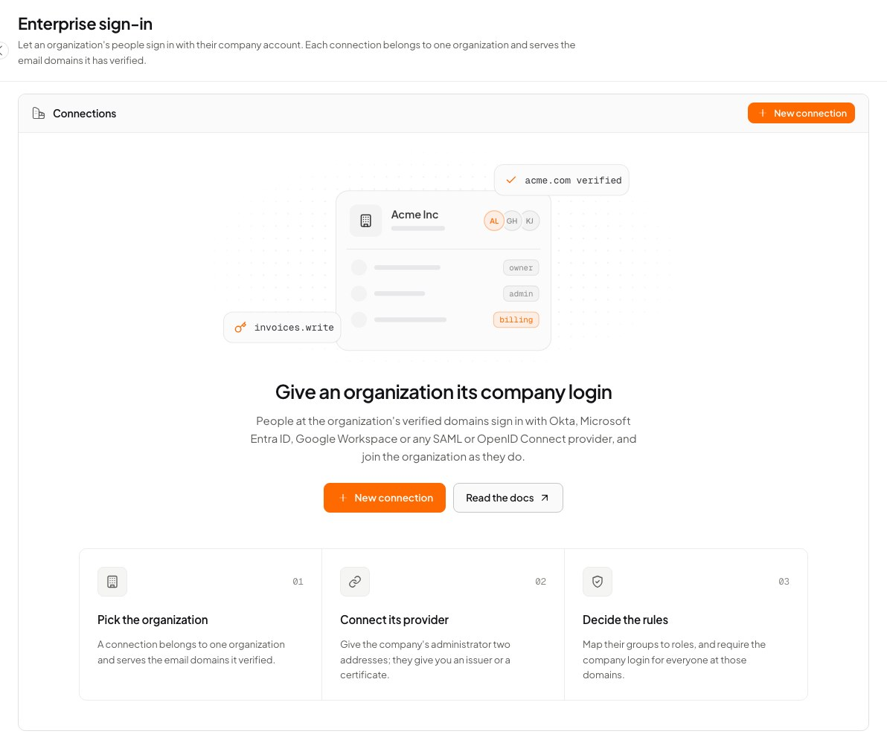

Business customers want their staff to use the login they already have, not another password. **Enterprise sign-in** (single sign-on, SSO) does that: you give a customer's [organization](/auth/organizations) a **connection** to its identity provider, and from then on everyone at the organization's company email domains signs in through it.

<Frame caption="Users & auth → Enterprise sign-in, before the first connection.">
  
</Frame>

It follows the model every major identity product uses:

| Piece | What it does |
| --- | --- |
| **Organization** | The customer. A connection belongs to exactly one organization, and an organization has at most one connection. |
| **Verified email domains** | The organization proves it owns `acme.com` with a DNS record ([Email domains](/auth/organizations#email-domains)). Those domains decide who is sent to the connection. Nobody types a connection name. |
| **Connection** | The organization's identity provider, over **OpenID Connect** or **SAML 2.0**. |
| **Just-in-time membership** | Someone signing in for the first time becomes a member of the organization, with a role you choose or one their groups map to. |
| **Required** | Optionally, people at those domains cannot get in any other way: no password, email link, code, passkey or social account. |

## How a sign-in goes

<Steps>
  <Step title="The person types their work email">
    Your sign-in form asks Pawabase which company login serves `ada@acme.com` (`findSSO`). If the answer is a connection, the form sends the browser there instead of asking for a password.
  </Step>
  <Step title="They sign in at their company">
    Okta, Entra ID or whatever Acme uses, with Acme's own rules: their password policy, their second factor, their device checks.
  </Step>
  <Step title="Pawabase checks the answer">
    The provider's answer is verified (signature, issuer, audience, expiry, and that it answers this sign-in). The email address must be at one of the organization's **verified** domains, or the sign-in is refused.
  </Step>
  <Step title="The account and the membership">
    Pawabase finds the account with that address, or creates one. It then makes the person a member of the organization if they are not yet, with the [right role](/auth/enterprise-roles-and-access).
  </Step>
  <Step title="They land in your app, inside the organization">
    The session is scoped to the organization: the token's `org` claim is its slug and `org_role` the person's role. Your [policies](/auth/organizations#rules-for-organizations) work as for any other member.
  </Step>
</Steps>

People need no invitation and no sign-up form, and an organization's own login creates its people even when [public sign-up](/auth/sign-up-restrictions) is off.

## Set it up

You need an organization with a verified email domain, and the company's identity provider administrator on the other end.

<Steps>
  <Step title="Create the organization and verify its domain">
    **Users & auth → People → Organizations**: create the organization, then on its **Domains** tab claim `acme.com` and publish the DNS record. See [Email domains](/auth/organizations#email-domains).
  </Step>
  <Step title="Create the connection">
    **Users & auth → Enterprise sign-in → New connection.** Choose the provider (Microsoft Entra ID, Google Workspace, Okta, Keycloak, other OpenID Connect, or SAML 2.0), then the organization and a connection name such as `acme-okta`.
  </Step>
  <Step title="Swap details with the company">
    The **Provider** tab shows the addresses to give the company's administrator, and the fields for what they give back. See [Connections](/auth/enterprise-connections) for each provider.
  </Step>
  <Step title="Test, then switch it on">
    **Test connection** checks the provider is reachable (OpenID Connect) or the certificate is readable (SAML). On the **Access** tab, turn **Connection on**. Ask someone at the company to sign in.
  </Step>
  <Step title="Optional: map groups and require it">
    On **Roles**, give a role to members of the company's groups. On **Access**, **Require it** once everyone has signed in through it.
  </Step>
</Steps>

The list shows each connection's state:

| State | Meaning |
| --- | --- |
| **On** | People at the organization's verified domains sign in through it |
| **Off** | Set up but switched off |
| **Needs provider details** | Issuer, client ID and secret (OIDC), or entity ID, sign-in URL and certificate (SAML) are missing |
| **Needs a verified domain** | The organization has no verified domain yet, so nobody is routed to it |
| **Needs an organization** | A connection moved from the old *Company sign-in* page whose domains no organization had verified. Remove it and create it again for the right organization |

## In your app

<Note>`findSSO`, `signInWithSSO`, `find_sso` and `sso_url` need `@pawabase/client` 0.7.0 or `pawabase` 0.9.0. With an older client, call `POST /auth/v1/sso/lookup` and start the sign-in with `signInWithOAuth(connection)`.</Note>

### Ask from the email field

The usual sign-in form asks for the email first, then either sends the person to their company or shows the password field.

<CodeGroup>
```typescript TypeScript
const found = await pawabase.auth.findSSO({ email });
if (found) {
  // { connection: "acme-okta", type: "oidc", organization: { slug: "acme", name: "Acme" }, required: true, url }
  pawabase.auth.signInWithOAuth(found.connection, { redirectTo: "https://myapp.com/welcome" });
} else {
  showPasswordField();
}
```

```python Python
found = pb.auth.find_sso(email=email)
if found:
    # {"connection": "acme-okta", "type": "oidc", "organization": {...}, "required": True, "url": ...}
    return redirect(pb.auth.oauth_url(found["connection"], redirect_to="https://myapp.com/welcome"))
return render_password_form()
```
</CodeGroup>

`findSSO` answers `null` (`None`) when no organization has verified the address's domain, the organization has no connection, the connection is off or incomplete, or the organization is suspended. Asking does not reveal whether an account exists; it only says which company owns a domain.

In a browser, `signInWithSSO` does both steps and resolves `false` when there is no company login, so the form can carry on:

```typescript
const sent = await pawabase.auth.signInWithSSO({ email, redirectTo: "https://myapp.com/welcome" });
if (!sent) showPasswordField();
```

From a server, `sso_url` answers the address to redirect to, or `None`:

```python
url = pb.auth.sso_url(email="ada@acme.com", redirect_to="https://myapp.com/welcome")
```

### "Sign in with your company" by organization

Some apps let people pick their company instead, or have a sign-in address per customer (`acme.myapp.com`). Ask by the organization's slug:

<CodeGroup>
```typescript TypeScript
await pawabase.auth.signInWithSSO({ organization: "acme", redirectTo: "https://acme.myapp.com/" });
```

```python Python
url = pb.auth.sso_url(organization="acme", redirect_to="https://acme.myapp.com/")
```
</CodeGroup>

### Coming back

The person returns to `redirectTo` exactly as from a [social sign-in](/auth/social-sign-in): the session is in the address and the client picks it up. `redirectTo` must be on the [redirect list](/auth/redirect-urls). If a sign-in fails, the address carries `error` instead:

| `error` | Meaning |
| --- | --- |
| `email_domain_not_allowed` | The provider vouched for an address outside the organization's verified domains |
| `connection_unavailable` | The connection is off, incomplete, or its organization is suspended |
| `organization_full` | The organization has no free seat for a new member |
| `email_unverified_conflict` | An account with that address exists and the provider's address is not trusted, so it was not joined to it (see [Trust the email address](/auth/enterprise-connections#trust-the-email-address)) |
| `account_disabled` | The account is disabled |
| `signup_restricted` | The address is refused by [sign-up restrictions](/auth/sign-up-restrictions) or the plan's user limit |
| `provider_unreachable`, `provider_misconfigured` | OpenID Connect discovery failed, or the provider's document is incomplete |
| `saml_signature`, `saml_unsigned`, `saml_issuer`, `saml_audience`, `saml_destination`, `saml_expired`, `saml_replay`, `saml_invalid`, `saml_denied`, `saml_state` | The SAML response was refused; see [SAML checks](/auth/enterprise-connections#what-pawabase-checks-in-a-saml-response) |

The error is in the address's fragment (after `#`), which only the browser sees:

```typescript
const params = new URLSearchParams(location.hash.slice(1));
if (params.get("error") === "email_domain_not_allowed") {
  show("Use your work address at your company.");
}
```

### When the company login is required

With **Require it** on, other ways in are refused for people at the organization's domains. A password sign-in or sign-up answers `403` with a body that names the connection, so your form can send them on:

```json
{
  "code": "sso_required",
  "message": "Acme signs its people in with its company login",
  "connection": "acme-okta",
  "organization": "acme"
}
```

<CodeGroup>
```typescript TypeScript
try {
  await pawabase.auth.signInWithPassword({ email, password });
} catch (error) {
  if (!(error instanceof ApiError) || !error.is("sso_required")) throw error;
  const { connection } = error.body as { connection: string };
  pawabase.auth.signInWithOAuth(connection, { redirectTo: location.href });
}
```

```python Python
from pawabase import ForbiddenError

try:
    pb.auth.sign_in_with_password(email=email, password=password)
except ForbiddenError as error:
    if error.code != "sso_required":
        raise
    return redirect(pb.auth.oauth_url(error.detail["connection"], redirect_to=next_url))
```
</CodeGroup>

Asking `findSSO` first avoids the round trip: its `required` field tells you the password field is pointless. See [Require the company login](/auth/enterprise-roles-and-access#require-the-company-login) for exactly what is refused.

## From your server

Connections can be managed with the environment's secret key, for example when a customer configures their own login from your app's admin screen. See [Manage connections from code](/auth/enterprise-connections#manage-connections-from-code).

## Events and activity

| Event | When | Payload |
| --- | --- | --- |
| `user.created` | Someone's first sign-in created their account | `user_id`, `email`, `method: "sso:<connection>"` |
| `organization.member_joined` | Someone joined the organization by signing in | `organization`, `user_id`, `via: "sso"` |
| `organization.sso_connected` | A connection was created | `organization`, `connection`, `type` |
| `organization.sso_disconnected` | A connection was removed | `organization`, `connection` |

Subscribe to them with [flows](/automation/overview) or [outbound webhooks](/automation/webhooks): for example, send a welcome message when `organization.member_joined` arrives with `via: "sso"`.

The organization's own [activity log](/auth/organizations#activity) records `sso.created`, `sso.updated` and `sso.deleted`, members who joined through it (`member.joined`, `via: "sso"`) and roles their groups changed (`member.role_changed`). Sessions started through a connection appear in **Sign-in activity** with the method `sso:<connection>`.

## Good to know

- One organization, one connection. A company with two identity providers needs two organizations.
- A domain belongs to one organization, so it routes to one connection.
- Public mail domains (gmail.com, outlook.com and the like) cannot be verified, so they can never be routed to a company.
- A person whose address moves to a domain of another organization is routed by the new domain at their next sign-in.
- The company's provider enforces its own second factor. A person who also turned on [two-step verification](/auth/two-step-verification) in your app is asked for it after the company login.
- Connections are part of [identity backups](/auth/import-and-export): each organization carries its connection.
- Connection names `google`, `github`, `microsoft`, `discord`, `apple` and the other social providers are reserved.

<CardGroup cols={2}>
  <Card title="Connections" icon="plug" href="/auth/enterprise-connections">Okta, Entra ID, Google Workspace, Keycloak and SAML, field by field.</Card>
  <Card title="Roles and access" icon="shield-check" href="/auth/enterprise-roles-and-access">Just-in-time membership, group mapping, requiring the company login.</Card>
  <Card title="Organizations" icon="building" href="/auth/organizations">Members, roles and verified domains.</Card>
  <Card title="Social sign-in" icon="globe" href="/auth/social-sign-in">Google, GitHub and friends for everyone else.</Card>
</CardGroup>
