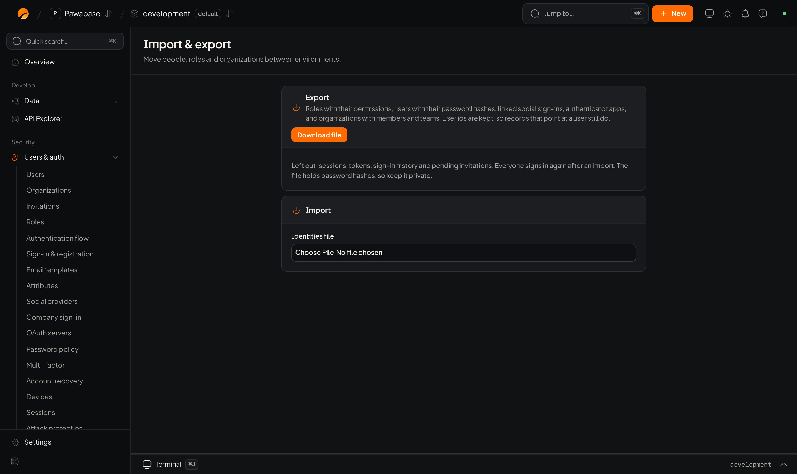

An **identities file** holds everything that makes up the people of one environment: users (with their password hashes, so they keep their passwords), roles and permissions, linked social and company accounts, two-step factors and recovery codes, and organizations with their members, teams, roles, domains and company-login connections. You can download it and import it into the same environment or another one.

Use it to:

- copy production's people into a staging environment to test against,
- move a project's users to a new environment or another Pawabase installation,
- keep your own copy of identities alongside [backups](/backups/overview),
- bring in users from another system (with some preparation, below).

<Frame caption="Users & auth → Records → Import & export.">
  
</Frame>

## What's in the file, and what isn't

| Included | Not included |
| --- | --- |
| Users: id, email, username, name, picture, phone, **password hash**, verified date, last sign-in, created date, disabled date, public and private metadata (`user_metadata`, `app_metadata`) | Sessions and refresh tokens: everyone signs in again after an import into a new place |
| Each user's roles and direct permissions | Sign-in history |
| Linked sign-ins (social and company accounts) | Pending invitations |
| Two-step factors (encrypted) and recovery codes (hashed) | Your app's data in tables (that's in [environment backups](/backups/overview)) |
| Roles and their permissions | Files in storage |
| Organizations: members and roles, teams, organization roles and permissions, email domains, company-login (SSO) connections, settings | API keys, secrets |

<Warning>
The file contains password hashes and two-step secrets. Treat it like a password database: store it encrypted, share it with no one, and delete copies you no longer need.
</Warning>

## Export

**Users & auth → Records → Import & export → Download file.** The download is a JSON document with a `format` number (currently `1`) that importing checks.

From code, with a secret key:

<CodeGroup>
```typescript TypeScript
import { createClient } from "@pawabase/client";
import { admin } from "@pawabase/client/admin";

const people = admin(createClient({ url, project, apiKey: process.env.PAWABASE_SECRET_KEY!, environment: "production" }));
const identities = await people.insight.backup();
await fs.writeFile("identities.json", JSON.stringify(identities));
```

```python Python
import json

pb = Pawabase(url, os.environ["PAWABASE_SECRET_KEY"], project=project, environment="production")
identities = pb.admin.insight.backup()
with open("identities.json", "w") as f:
    json.dump(identities, f)
```
</CodeGroup>

## Import

**Users & auth → Records → Import & export**: choose the **Identities file**, press **Check the file** to see what it holds, then **Import**.

There are two ways to apply a file:

| Mode | What happens |
| --- | --- |
| **Merge** (default: **Replace what is here** off) | Users are matched **by email**. A user already here is **updated** with the file's values, including the password hash, roles and metadata. A user who isn't here is **created**. Nothing that the file doesn't mention is removed |
| **Replace** (**Replace what is here** on) | First **every** user, organization and role in this environment is removed; then the file is applied. Afterwards the environment holds exactly what the file holds |

Either way the whole import happens in one transaction: if anything fails, nothing is changed.

<Warning>
**Replace what is here** deletes every person who isn't in the file, along with their sessions. Download a file of the current identities first, and use **Check the file** before importing.
</Warning>

From code:

<CodeGroup>
```typescript TypeScript
const identities = JSON.parse(await fs.readFile("identities.json", "utf8"));

const preview = await people.insight.restore(identities, { dryRun: true });   // counts only; changes nothing
console.log(preview);

const report = await people.insight.restore(identities, { replace: false });
console.log(report.users, report.warnings);
```

```python Python
with open("identities.json") as f:
    identities = json.load(f)

print(pb.admin.insight.restore(identities, dry_run=True))     # counts only; changes nothing

report = pb.admin.insight.restore(identities, replace=False)
print(report["users"], report["warnings"])
```
</CodeGroup>

The report counts roles, organizations, and users created and updated, and lists **warnings** for anything that couldn't be applied exactly. A file with an unknown `format` is refused with `422`.

### User ids

Your tables refer to people by **user id** (an owner field, an organization member). An import keeps each user's id **when it's free** in the target, so those references keep working.

If an id is already taken in the target (for example, by a different person in another environment of the same installation), the user gets a new id and the report warns: *"id … is in use, restored as …; records that refer to the old id will not follow"*. Data you copy separately won't line up for that person. Importing into an empty environment avoids this.

A **username** already taken in the target gets `-restored` appended, with a warning.

### Two-step verification after an import

Authenticator-app secrets are encrypted with the installation's key. Importing into another environment **of the same installation** keeps them working. Importing into a **different installation** (another region, or a self-hosted server) leaves the factors unreadable: those people should remove and add their authenticator again, which an administrator can allow by resetting their two-step verification from their page under **People → Users**. Recovery codes are stored as hashes and keep working.

## Copying production people into staging

1. In **production**, download the file.
2. In **staging**, choose it, **Check the file**, and import with **Replace what is here** on to mirror production exactly, or off to add production's people to staging's test accounts.
3. Think about whether you should: real people's data in a test environment may be covered by your privacy obligations. Consider anonymising emails and names in the file first. Staging's [mail settings](/mail/delivery) decide whether those people could receive real emails from tests.

## Migrating from another system

People can usually **keep their passwords**: Pawabase checks a password against its stored hash by recognising the hash's standard format, so hashes made by other systems work as they are when they're in one of these formats:

| Old system stored | Looks like | Carries over |
| --- | --- | --- |
| bcrypt (most Node, Ruby, PHP and many hosted auth services) | `$2a$…`, `$2b$…` | Yes |
| Argon2 | `$argon2id$…`, `$argon2i$…` | Yes |
| PBKDF2-SHA256 in the standard modular format | `$pbkdf2-sha256$…` | Yes |
| Anything else (unsalted SHA, MD5, a custom scheme, or plain text) | — | No: leave `password` empty |

Test this before migrating everyone: import one account with its real hash and sign in with its password.

1. Export your users from the old system, with their password hashes if it allows.
2. Write a file in the identities format. Download a file from Pawabase first to see the exact shape. For each user include `email`, `username` (the email is fine), `name`, `password` (the hash, or empty), `email_verified_at` if the old system verified them, `roles`, and your old id in `app_metadata` (for example `{"legacy_id": 4211}`) so you can join old records to new users.
3. People with an empty `password` can't sign in with a password until they set one: they use a [sign-in link](/auth/sign-in-links) or an [email code](/auth/email-codes), or **Forgot password**. Email them before you switch so they know what to expect.
4. Put organizations and their members in the same file (members refer to the user ids in the file), or create them afterwards.
5. **Check the file**, import a handful of test users, sign in as one, then import the rest.
6. Update your tables' references from old ids to the new user ids, using `app_metadata.legacy_id`.

Hashes keep their original strength (a bcrypt cost of 10 stays 10). Pawabase hashes new passwords with its own settings when people change them.

If you'd rather create users one by one (to send invitations, or to set temporary passwords), use the [admin client](/developers/admin-client)'s `users.create`.

## Related

- [Backups](/backups/overview): environment backups include identities **and** your tables' data.
- [Data requests](/auth/data-requests): export or erase one person's data on request.
- [Users](/auth/users): manage people individually.
