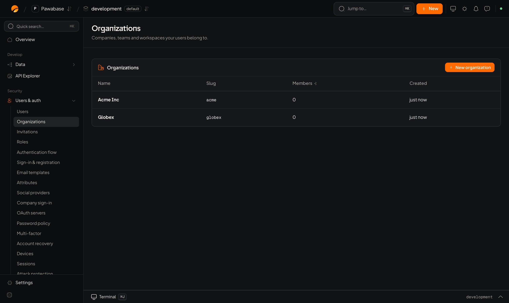

If your customers are companies or teams rather than individuals, use **organizations**. A person can belong to several, with a different role in each. Your access rules can then say "members of this organization can edit this project".

<Frame caption="Users & auth → Organizations: New organization.">
  
</Frame>

## In Studio

**Users & auth → People → Organizations.**

**New organization:**

| Field | Meaning |
| --- | --- |
| **Organization name** | What people see |
| **Slug** | Lowercase letters, digits and hyphens. It appears in URLs and in the organization claim of a session |
| **Owner's email** | An existing user to make the owner. Without one, the organization starts with no members |

Open an organization to manage:

- **Members:** add by **Email to add** with a **Role**, change a role, remove.
- **Teams:** smaller groups inside the organization.
- **Delete organization:** permanent.

To bring in people who don't have accounts yet, use [Invitations](/auth/invitations).

## Roles and permissions

Every member has one **role** in each organization, and every role grants **permissions**. Your access rules check permissions (or roles), and the session's token carries them, so a rule decides without a lookup.

### Built-in roles

| Role | Permissions |
| --- | --- |
| `owner` | Everything (`*`), including deleting the organization and making other owners. Cannot be changed |
| `admin` | Every `org:` permission except `org:delete` |
| `member` | None of the `org:` permissions: normal use of your app |
| `viewer` | None: look, don't change |

The environment can give `admin`, `member` and `viewer` different permissions, in **Users & auth → People → Organization roles**.

### Your own permissions and roles

Permissions are names your app decides, such as `invoices.read` or `projects.delete`. Declare them in **Organization roles**, and define roles every organization has (`billing`, `support`) that grant them. A role can grant `invoices.*` to mean every permission under `invoices.`.

When the environment allows it, an organization can also make **roles of its own** from the same permissions: an owner or anyone with `org:roles.manage` builds them in your app (see below).

### The organization's own permissions

These decide who may manage the organization itself. Your permissions cannot start with `org:`.

| Permission | Allows |
| --- | --- |
| `org:update` | Rename the organization and edit its details |
| `org:delete` | Delete the organization |
| `org:members.invite` | Invite people and withdraw invitations |
| `org:members.manage` | Change members' roles and remove members |
| `org:roles.manage` | Create and change the organization's own roles |
| `org:teams.manage` | Create teams and choose who is in them |
| `org:domains.manage` | Claim email domains and choose who joins through them |
| `org:security.manage` | Change the organization's security settings |
| `org:audit.read` | Read the organization's activity |

**No one hands out more than they hold.** Someone who manages roles or members can only create or assign a role whose permissions they have themselves. Only owners make owners.

These roles are separate from [global roles](/auth/roles).

## In your app

People can manage their own organizations through the client.

<CodeGroup>
```typescript TypeScript
const org = await pawabase.auth.orgs.create({ slug: "acme", name: "Acme Inc", metadata: { plan: "team" } });
const mine = await pawabase.auth.orgs.list();           // each has `role`: the caller's role in it
const one = await pawabase.auth.orgs.get("acme");
await pawabase.auth.orgs.update("acme", { name: "Acme Incorporated" });
await pawabase.auth.orgs.delete("acme");
```

```python Python
org = pb.auth.orgs.create(slug="acme", name="Acme Inc", metadata={"plan": "team"})
mine = pb.auth.orgs.list()
one = pb.auth.orgs.get("acme")
pb.auth.orgs.update("acme", name="Acme Incorporated")
pb.auth.orgs.delete("acme")
```
</CodeGroup>

### Members

<CodeGroup>
```typescript TypeScript
const members = await pawabase.auth.orgs.members("acme");
await pawabase.auth.orgs.setMemberRole("acme", userId, "admin");
await pawabase.auth.orgs.removeMember("acme", userId);
```

```python Python
members = pb.auth.orgs.members("acme")
pb.auth.orgs.set_member_role("acme", user_id, "admin")
pb.auth.orgs.remove_member("acme", user_id)
```
</CodeGroup>

Removing yourself leaves the organization. The last owner cannot leave or be removed: transfer ownership first.

The server refuses changes like these:

| Answer | Message | When |
| --- | --- | --- |
| `403` | "that member's role has permissions you do not have yourself" | Changing or removing someone whose role reaches further than yours |
| `403` | "only owners can make someone an owner", "only owners can change an owner's role", "only owners can remove an owner" | An admin acting on owners |
| `409` | "an organization keeps at least one owner" | Demoting or removing the last owner |
| `404` | "not a member" | The user isn't in the organization |

### Invitations

<CodeGroup>
```typescript TypeScript
const invitation = await pawabase.auth.orgs.invite("acme", {
  email: "grace@example.com",
  role: "member",
  redirectTo: "https://app.example.com/invitations/accept",
});
const pending = await pawabase.auth.orgs.invitations("acme");     // [{ id, email, role, expires_at }]
await pawabase.auth.orgs.revokeInvitation("acme", pending[0].id);

// on the page the email's link opens, signed in as the invited person
await pawabase.auth.orgs.acceptInvitation(new URL(location.href).searchParams.get("token")!);
```

```python Python
pb.auth.orgs.invite("acme", email="grace@example.com", role="member",
                    redirect_to="https://app.example.com/invitations/accept")
pending = pb.auth.orgs.invitations("acme")
pb.auth.orgs.revoke_invitation("acme", pending[0]["id"])
pb.auth.orgs.accept_invitation(token)
```
</CodeGroup>

Inviting needs `org:members.invite`. The full flow, including people who don't have an account yet, is on [Invitations](/auth/invitations).

### What I may do here

`get` answers with the caller's role, their permissions in this organization and the teams they are in. Use it to show or hide buttons; the server's rules still decide.

<CodeGroup>
```typescript TypeScript
const { role, permissions, my_teams } = await pawabase.auth.orgs.get("acme");
const canInvite = permissions.includes("*") || permissions.includes("org:members.invite");
```

```python Python
org = pb.auth.orgs.get("acme")
can_invite = "*" in org["permissions"] or "org:members.invite" in org["permissions"]
```
</CodeGroup>

### Roles of the organization's own

List the roles a member can have, and the permissions a role may grant. Create or change a role with `saveRole` (needs `org:roles.manage`).

<CodeGroup>
```typescript TypeScript
const roles = await pawabase.auth.orgs.roles("acme");            // built-in, the environment's and the organization's own
const catalog = await pawabase.auth.orgs.permissions("acme");    // [{ key, description, system }]

await pawabase.auth.orgs.saveRole("acme", "support", {
  name: "Support",
  description: "Answers customers",
  permissions: ["tickets.read", "tickets.reply"],
});
await pawabase.auth.orgs.setMemberRole("acme", userId, "support");
await pawabase.auth.orgs.deleteRole("acme", "support");          // refused (409) while members, teams, invitations or domains use it
```

```python Python
roles = pb.auth.orgs.roles("acme")
catalog = pb.auth.orgs.permissions("acme")

pb.auth.orgs.save_role("acme", "support", name="Support", description="Answers customers", permissions=["tickets.read", "tickets.reply"])
pb.auth.orgs.set_member_role("acme", user_id, "support")
pb.auth.orgs.delete_role("acme", "support")
```
</CodeGroup>

Each role in `roles()` says where it comes from in `source`: `built-in`, `environment` (every organization has it) or `organization` (this one made it), and how many members have it.

### Transfer ownership

<CodeGroup>
```typescript TypeScript
await pawabase.auth.orgs.transfer("acme", { userId: newOwnerId, keepRole: "admin" });   // "owner" keeps you an owner too
```

```python Python
pb.auth.orgs.transfer("acme", user_id=new_owner_id, keep_role="admin")
```
</CodeGroup>

### Teams

A team groups members, and can carry a role: everyone in the team gets that role's permissions on top of their own. Rules can also match on team membership.

<CodeGroup>
```typescript TypeScript
await pawabase.auth.orgs.createTeam("acme", { slug: "design", name: "Design", role: "support" });
await pawabase.auth.orgs.addTeamMember("acme", "design", userId);
const people = await pawabase.auth.orgs.teamMembers("acme", "design");
await pawabase.auth.orgs.updateTeam("acme", "design", { name: "Product design", role: null });   // null: no extra role
await pawabase.auth.orgs.removeTeamMember("acme", "design", userId);
await pawabase.auth.orgs.deleteTeam("acme", "design");
const teams = await pawabase.auth.orgs.teams("acme");
```

```python Python
pb.auth.orgs.create_team("acme", team_slug="design", name="Design", role="support")
pb.auth.orgs.add_team_member("acme", "design", user_id)
people = pb.auth.orgs.team_members("acme", "design")
pb.auth.orgs.update_team("acme", "design", name="Product design", role=None)
pb.auth.orgs.remove_team_member("acme", "design", user_id)
pb.auth.orgs.delete_team("acme", "design")
teams = pb.auth.orgs.teams("acme")
```
</CodeGroup>

A team cannot make its members owners.

### Email domains

An organization can claim its company's email domain. Once it is verified, people with a confirmed address at that domain can join without an invitation.

1. Claim the domain. The answer carries a DNS `TXT` record, named `_pawabase-verification.<domain>`.
2. Publish the record with the domain's DNS provider.
3. Verify. Pawabase looks the record up.

<CodeGroup>
```typescript TypeScript
const domain = await pawabase.auth.orgs.addDomain("acme", { domain: "acme.com", join: "suggest", role: "member" });
// domain.dns_record: { type: "TXT", name: "_pawabase-verification.acme.com", value: "pawabase-verification=…" }
await pawabase.auth.orgs.verifyDomain("acme", "acme.com");
await pawabase.auth.orgs.updateDomain("acme", "acme.com", { join: "join" });
await pawabase.auth.orgs.removeDomain("acme", "acme.com");
const domains = await pawabase.auth.orgs.domains("acme");   // [{ domain, verified, join, role, dns_record }]
```

```python Python
domain = pb.auth.orgs.add_domain("acme", domain="acme.com", join="suggest", role="member")
pb.auth.orgs.verify_domain("acme", "acme.com")
pb.auth.orgs.update_domain("acme", "acme.com", join="join")
pb.auth.orgs.remove_domain("acme", "acme.com")
pb.auth.orgs.domains("acme")
```
</CodeGroup>

| `join` | People with a confirmed address at the domain |
| --- | --- |
| `off` | Nothing changes; the claim only records ownership |
| `suggest` | See the organization under `joinable()` and can join with one call |
| `join` | Become members by themselves the next time they sign in (when a seat is free); use it when everyone at the company belongs |

They join with `role`. Public mail providers (gmail.com, outlook.com and the like) cannot be claimed.

A verified domain also routes people to the organization's [company login](/auth/enterprise-sign-in), when it has one: they sign in with their company account and join as they do.

On the person's side:

<CodeGroup>
```typescript TypeScript
const offers = await pawabase.auth.orgs.joinable();   // [{ slug, name, domain, role }]
await pawabase.auth.orgs.join(offers[0].slug);
```

```python Python
offers = pb.auth.orgs.joinable()
pb.auth.orgs.join(offers[0]["slug"])
```
</CodeGroup>

### Require a second factor

An organization can require its members to sign in with a [second factor](/auth/two-step-verification) while they work in it. The person who turns it on must be signed in with one themselves.

<CodeGroup>
```typescript TypeScript
await pawabase.auth.orgs.setSecurity("acme", { requireMfa: true });
```

```python Python
pb.auth.orgs.set_security("acme", require_mfa=True)
```
</CodeGroup>

### Activity

Every change to members, roles, teams, domains and settings is recorded. Reading it needs `org:audit.read`. Pages come newest first; pass `next` as `before` for older entries.

<CodeGroup>
```typescript TypeScript
const page = await pawabase.auth.orgs.audit("acme", { limit: 50 });
// page.data: [{ action: "member.role_changed", actor_email, target, data, created_at }]
const older = page.next ? await pawabase.auth.orgs.audit("acme", { before: page.next }) : null;
```

```python Python
page = pb.auth.orgs.audit("acme", limit=50)
older = pb.auth.orgs.audit("acme", before=page["next"]) if page["next"] else None
```
</CodeGroup>

## Work inside an organization

A session can be scoped to one organization. Rules can then match on it, and the token carries `org` and `org_role`.

<CodeGroup>
```typescript TypeScript
await pawabase.auth.signInWithPassword({ email, password, org: "acme" });   // sign in scoped to it
await pawabase.auth.switchOrg("globex");                                    // switch
await pawabase.auth.switchOrg(null);                                        // back to personal
```

```python Python
pb.auth.sign_in_with_password(email=email, password=password, org="acme")
pb.auth.switch_org("globex")
pb.auth.switch_org(None)
```
</CodeGroup>

Build an **organization switcher** from `orgs.list()` and call `switchOrg` when the person picks one. After switching, the session's `org` and `org_role` update and `TOKEN_REFRESHED` fires.

## What the token carries

While a session is scoped to an organization, its access token carries:

| Claim | Holds |
| --- | --- |
| `org` | The organization's slug |
| `org_id` | Its id |
| `org_role` | The member's role |
| `org_permissions` | Every permission they have here, from their role and their teams' roles |
| `org_teams` | The teams they are in |
| `org_app` | The organization's `app_metadata`, when it has any |

## Rules for organizations

Access rules have shorthands for these claims:

| Rule | Passes when |
| --- | --- |
| `{ "org": "org_id" }` | The record's `org_id` column is the organization the caller is working in. Lists are filtered in the database |
| `{ "org_role": ["admin", "owner"] }` | The caller's role here is one of these |
| `{ "org_permission": "invoices.write" }` | Their permissions include it (or `*`) |
| `{ "team": "finance" }` | They are in the team |

Two rules are built in: `org` (rows of the caller's organization, by `org_id`) and `org_member` (signed in to some organization).

## Keep data per organization

1. Add an `org_id` column to your tables.
2. Set it from the active session on create.
3. Give the table the built-in `org` rule, or combine it: *rows of my organization, and writes need `invoices.write`*.

See [Access rules recipes](/policies/recipes-teams) and the [Database](/database/overview).

## Plans, seats and suspension from your server

Members can edit an organization's `metadata`, so never keep billing state there. Keep it in `app_metadata`, which only your server (a secret key) or Studio can change; sessions carry it as `org_app`, so rules can read it. Set it, the number of seats, a required second step and suspension with the [admin client](/tools/admin-client):

<CodeGroup>
```typescript TypeScript
import { admin } from "@pawabase/client/admin";

await admin(server).orgs.update("acme", {
  appMetadata: { plan: "pro" },
  maxMembers: 25,          // null removes the limit
  requireMfa: true,
  suspended: false,        // true stops everyone working in it
});
```

```python Python
pb.admin.orgs.update("acme", app_metadata={"plan": "pro"}, max_members=25, require_mfa=True, suspended=False)
```
</CodeGroup>

`server` / `pb` are clients made with the **secret** key. `app_metadata` is replaced, not merged. Suspending and restoring send `organization.suspended` and `organization.restored`. These options need `@pawabase/client` 0.6.0 or `pawabase` 0.8.0.

## Events

`organization.created`, `organization.deleted` and `invitation.accepted` are available to [webhooks](/auth/auth-webhooks).

<CardGroup cols={2}>
  <Card title="Invitations" icon="send" href="/auth/invitations">Bring people in.</Card>
  <Card title="Token profiles" icon="key" href="/auth/token-profiles">Organization-aware tokens for other services.</Card>
</CardGroup>
