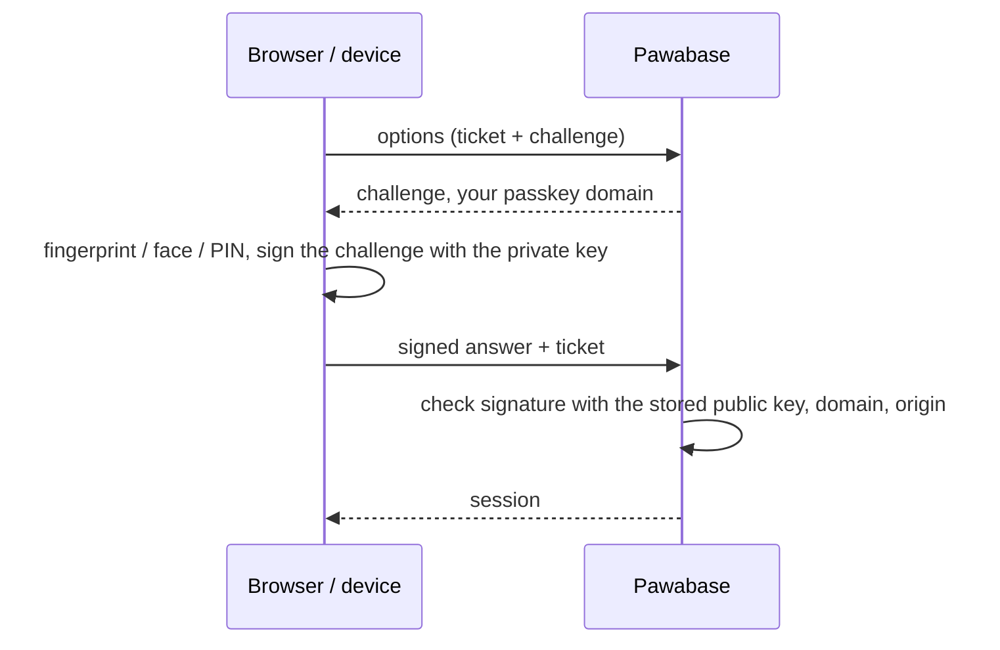

A **passkey** replaces the password with something the person's device already has: a fingerprint, a face scan or a PIN. It can't be phished (it only works on your domain), there's nothing to remember or leak, and it syncs between the person's devices through their platform (iCloud Keychain, Google Password Manager, 1Password and others). Passkeys use the WebAuthn standard, supported by every current browser.

## How a passkey works



The private key never leaves the device (or the person's password manager). Pawabase stores only the public key, so a database leak reveals nothing anyone could sign in with.

## Turn it on

**Users & auth → Sign-in → Sign-in & registration → Ways to sign in → Passkeys.**

| Setting | Meaning | Key |
| --- | --- | --- |
| **Passkeys** | Let people add passkeys once signed in, and sign in with them | `passkeys_enabled` |
| **Passkey domain** | The domain passkeys belong to, such as `example.com` | `passkey_rp_id` |

When the **Passkey domain** is empty, Pawabase uses the host of your **Site URL**, or your API address when there's no Site URL. With neither, passkey calls answer `409` "set a site URL (or a passkey domain)…".

<Warning>
Choose the passkey domain early, and pick your registrable domain (`example.com`), not a subdomain. A passkey is bound to the domain it was made for: `example.com` covers `app.example.com` and `www.example.com`, but a passkey made for `app.example.com` doesn't work on `example.com`. Changing the domain later makes every existing passkey stop working.
</Warning>

### Which pages may use passkeys

The browser tells Pawabase which page (origin) ran the ceremony, and Pawabase accepts only origins on the passkey domain taken from your **Site URL**, your **Additional redirect URLs** and your API address. To use passkeys on `https://www.example.com` as well as `https://app.example.com`, list both addresses ([Redirect URLs](/auth/redirect-urls)). Pages must be on `https://`, or `http://localhost` while developing.

For local development, set the development environment's Site URL to `http://localhost:5173` (or leave the passkey domain empty there): passkeys made on `localhost` belong to `localhost` only.

## Register a passkey

The person must be signed in, by any method. Call it from a button click; the browser shows its own prompt.

<CodeGroup>
```typescript TypeScript
try {
  const passkey = await pawabase.auth.passkeys.register({ name: "MacBook" });
  // { id, name, device_type, backed_up, transports, created_at, last_used_at }
} catch (error) {
  if (error instanceof DOMException && error.name === "NotAllowedError") {
    // the person dismissed the prompt, or it timed out
  } else {
    throw error;
  }
}
```

```python Python
# Python has no WebAuthn of its own: relay the two steps for a browser or app that does.
challenge = pb.auth.passkeys.register_options()          # {"ticket": …, "options": …}  → send options to the device
pb.auth.passkeys.register_verify(ticket=challenge["ticket"], credential=credential_from_device, name="MacBook")
```
</CodeGroup>

Pawabase asks for a **discoverable** passkey (stored on the device, so the person can sign in without typing an address) with **user verification** (fingerprint, face or PIN, not just a tap). Passkeys the account already has are excluded, so a device won't make a duplicate.

The name is up to 100 characters, and defaults to "Passkey". Suggest one from the device ("MacBook", "Work phone"), since people see it in their list.

Each registration fires `user.passkey_added` and writes `passkey_added` to [sign-in activity](/auth/sign-in-activity).

**Where to offer it:** right after a sign-in ("Sign in faster next time with your fingerprint?") and on the account page.

## Sign in with a passkey

<CodeGroup>
```typescript TypeScript
const session = await pawabase.auth.passkeys.signIn();                          // pick any passkey for this site
const same = await pawabase.auth.passkeys.signIn({ email: "ada@example.com" }); // only this account's passkeys
```

```python Python
challenge = pb.auth.passkeys.authenticate_options(email="ada@example.com")   # or no email
session = pb.auth.passkeys.authenticate_verify(ticket=challenge["ticket"], credential=credential_from_device)
```
</CodeGroup>

- **Without an email**, the device offers every passkey it holds for your domain, and the person picks one. This is the fastest flow: put a "Sign in with a passkey" button next to your normal form.
- **With an email**, only that account's passkeys are offered. An address with no account or no passkeys gets the open prompt, so the answer never reveals whether an account exists.

A passkey sign-in **counts as two-step verification** (`aal2`): the device proved possession of the key *and* checked the person's fingerprint, face or PIN. So the person isn't asked for their authenticator code afterwards, and the session passes rules and organizations that [require two-step verification](/auth/two-step-verification).

It also counts as a sign-in like any other: [organizations that require their company login](/auth/enterprise-sign-in) refuse it, and sign-in activity records `method: "passkey"`.

## Manage a person's passkeys

<CodeGroup>
```typescript TypeScript
const passkeys = await pawabase.auth.passkeys.list();
await pawabase.auth.passkeys.remove(passkeys[0].id);
```

```python Python
passkeys = pb.auth.passkeys.list()
pb.auth.passkeys.remove(passkeys[0]["id"])
```
</CodeGroup>

| Field | Meaning |
| --- | --- |
| `name` | What the person called it |
| `device_type` | `multi_device` (syncs through their platform) or `single_device` (a security key, or a device that doesn't sync) |
| `backed_up` | Whether it's currently synced, so losing one device doesn't lose it |
| `transports` | How the device talks to the browser: `internal`, `hybrid` (phone used for a laptop), `usb`, `nfc`, `ble` |
| `created_at`, `last_used_at` | When it was added and last used |

Removing a passkey on your side doesn't delete it from the person's device or password manager; it simply stops working. Tell people to remove it there too. Removal writes `passkey_removed` to sign-in activity.

Encourage a second way in: another passkey, a password, or [sign-in links](/auth/sign-in-links). A person whose only passkey was on a lost, non-syncing device can still recover through email.

## Other platforms

In a browser, `register` and `signIn` run the whole ceremony. Elsewhere (a native app, a test, a server relaying for a device), use the two steps directly: get `options` and a `ticket`, give the options to the platform's WebAuthn or passkey API, and send back what it returns with the ticket.

```typescript
const { ticket, options } = await pawabase.auth.passkeys.requestSignIn({ email });
// give `options` to the platform's passkey API, get a credential back (JSON with base64url fields)
const session = await pawabase.auth.passkeys.finishSignIn({ ticket, credential });

const reg = await pawabase.auth.passkeys.requestRegistration();
await pawabase.auth.passkeys.finishRegistration({ ticket: reg.ticket, credential, name: "iPhone" });
```

- A **ticket** is valid for 5 minutes and works once, for the kind of ceremony it was issued for.
- The credential is the standard WebAuthn JSON (`id`, `rawId`, `type`, `response` with base64url fields).
- **iOS** apps using associated domains report your web origin and work. **Android** native apps report an `android:apk-key-hash:` origin, which isn't on the allowed list, so ceremonies run from a native Android app are refused; use a web view or browser tab on your domain there.

## When it fails

| What you see | Meaning | Do |
| --- | --- | --- |
| `NotAllowedError` from the browser | The person dismissed the prompt, it timed out, or no passkey matched | Offer another way in |
| `SecurityError` from the browser | The page isn't on the passkey domain, or isn't HTTPS | Check the passkey domain and the page's address |
| `ConfigError` before any prompt | No WebAuthn in this browser or runtime | Use the two-step calls from a native app |
| `400` "the passkey could not be verified" | Unknown passkey (made for another domain or environment, or removed), or its answer didn't verify, including from a page that isn't an allowed origin | Remove and re-add it; check redirect URLs |
| `400` "the link is invalid or has expired" | The ticket is older than 5 minutes, already used, or for the other ceremony | Start again |
| `403` "passkeys are disabled" | Turned off in this environment | Turn it on |
| `403` "this account is disabled" | An administrator disabled the account | |
| `404` "no such passkey" | Removing an id that isn't theirs | Refresh the list |
| `409` "this passkey is already registered" | That credential is already on an account in this environment | Nothing to do |
| `409` "set a site URL (or a passkey domain)…" | Neither is set | Set a Site URL |
| `501` "passkeys are not available…" | A self-hosted server is missing the `webauthn` package | Reinstall the server with its dependencies |
| All passkeys stopped working | The passkey domain or Site URL host changed | Change it back, or have people add new passkeys |

Ceremony calls are limited to 30 a minute per address.

## Related

<CardGroup cols={2}>
  <Card title="Two-step verification" icon="shield-check" href="/auth/two-step-verification">Why a passkey counts as both steps.</Card>
  <Card title="Redirect URLs" icon="link" href="/auth/redirect-urls">The addresses that decide allowed origins.</Card>
  <Card title="Sessions" icon="monitor-smartphone" href="/auth/sessions">After sign-in.</Card>
  <Card title="Sign-in activity" icon="activity" href="/auth/sign-in-activity">Passkey sign-ins and failures.</Card>
</CardGroup>
