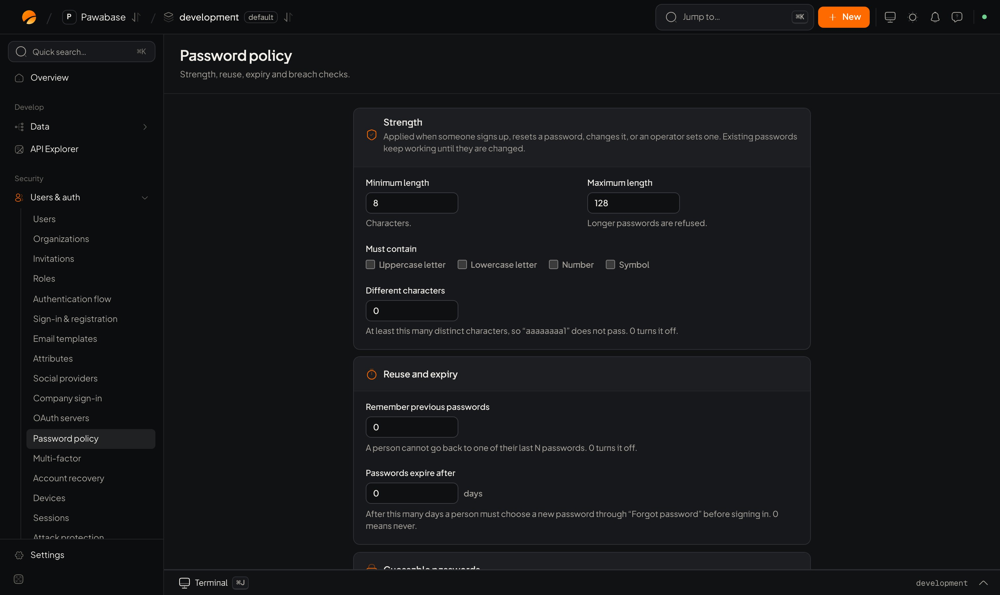

The password policy decides which passwords people may choose in this environment. It's checked by the server whenever a password is set, so every app and script gets the same rules, and an attacker can't skip them.

<Frame caption="Users & auth → Protection → Password policy: Strength, Reuse and expiry, Guessable passwords.">
  
</Frame>

## The rules

**Users & auth → Protection → Password policy**, three cards.

### Strength

| Setting | Default | Meaning | Key |
| --- | --- | --- | --- |
| **Policy** | *Length and character rules* | *Length and character rules* checks only the rules on this page. *Also refuse common passwords* adds a check against a list of the most common passwords (`password`, `12345678`, `qwerty123`…) | `password_policy`: `basic` or `strict` |
| **Minimum length** | 8 | 6 to 128 characters | `password_min_length` |
| **Maximum length** | 128 | 16 to 1024. Longer passwords are refused | `directory.passwords.max_length` |
| **Must contain** | none | Any of: an uppercase letter, a lowercase letter, a number, a symbol | `password_rules`: `upper`, `lower`, `digit`, `symbol` |
| **Different characters** | 0 (off) | At least this many distinct characters, so `aaaaaaa1` fails | `directory.passwords.min_unique` |

### Reuse and expiry

| Setting | Default | Meaning | Key |
| --- | --- | --- | --- |
| **Remember previous passwords** | 0 (off) | A person can't change back to one of their last N passwords | `directory.passwords.history` |
| **Passwords expire after** | 0 (never) | After this many days a person must choose a new password through **Forgot password** before they can sign in with a password | `directory.passwords.max_age_days` |

### Guessable passwords

| Setting | Default | Meaning | Key |
| --- | --- | --- | --- |
| **Refuse passwords containing the person's name, username or email** | Off | Stops `ada2026` for Ada | `directory.passwords.forbid_personal` |
| **Refuse passwords found in known data breaches** | Off | Checked against haveibeenpwned's range service (below) | `directory.passwords.breach_check` |

### How the breach check works

The password is hashed with SHA-1 on your Pawabase server and only the **first five characters** of the hash are sent to the breach service, which returns every leaked hash that starts with them; the match is made on the server. The password itself, and its full hash, never leave Pawabase. If the service doesn't answer within about three seconds, the password is treated as not breached: someone else's outage never blocks a sign-up or a password change.

## When the rules are checked

| Moment | Length & character rules, common & personal | Breach check | Previous passwords |
| --- | --- | --- | --- |
| Sign-up with a password | ✓ | ✓ | — |
| Changing the password while signed in | ✓ | ✓ | ✓ |
| Resetting it with **Forgot password** | ✓ | ✓ | ✓ |
| A guest account adding a password | ✓ | ✓ | ✓ |
| An administrator setting it (Studio, admin client) | ✓ | ✓ | ✓ |
| **Signing in** | — | — | — |

Rules are checked when a password is **chosen**, never when someone signs in: tightening the policy doesn't lock anyone out. Existing passwords stay valid until they're changed, or until they expire if you set an expiry.

## What your app receives

A password that breaks a rule is refused with `422` and a list of every problem at once:

```json
{
  "message": "the password does not meet the policy",
  "problems": [
    "Password must be at least 12 characters.",
    "Password must contain a number."
  ]
}
```

Show all the problems, not only the first, so people fix everything in one go:

<CodeGroup>
```typescript TypeScript
import { ValidationError } from "@pawabase/client";

try {
  await pawabase.auth.signUp({ email, password });
} catch (error) {
  if (error instanceof ValidationError) {
    const problems = (error.body as { problems?: string[] })?.problems ?? [error.message];
    showPasswordProblems(problems);
  } else {
    throw error;
  }
}
```

```python Python
from pawabase import ValidationError

try:
    pb.auth.sign_up(email=email, password=password)
except ValidationError as error:
    show_password_problems(error.problems or [error.message])
```
</CodeGroup>

The problems aren't attached to a form field: `fieldError("password")` returns nothing for them. Read `problems` from the error's body as above.

The specific messages:

| Rule | Message |
| --- | --- |
| Minimum length | Password must be at least N characters. |
| Maximum length | Password must be at most N characters. |
| Must contain | Password must contain an uppercase letter / a lowercase letter / a number / a symbol. |
| Different characters | Password must use at least N different characters. |
| Personal details | Password must not contain your name, username or email. |
| Previous passwords | You cannot reuse your last N passwords. |
| Breached | That password has appeared in a data breach. Choose another. |

### Expired passwords

When a person's password is older than **Passwords expire after**, password sign-in is refused with `403` and code `password_expired` ("your password has expired; use “Forgot password” to choose a new one"). Other ways in (sign-in links, codes, social sign-in, passkeys) keep working.

<CodeGroup>
```typescript TypeScript
import { PermissionError } from "@pawabase/client";

try {
  await pawabase.auth.signInWithPassword({ email, password });
} catch (error) {
  if (error instanceof PermissionError && error.code === "password_expired") {
    await pawabase.auth.requestPasswordReset({ email, redirectTo: `${location.origin}/auth/callback` });
    show("Your password has expired. We've emailed you a link to choose a new one.");
  }
}
```

```python Python
from pawabase import ForbiddenError

try:
    pb.auth.sign_in_with_password(email=email, password=password)
except ForbiddenError as error:
    if error.code == "password_expired":
        pb.auth.request_password_reset(email=email)
```
</CodeGroup>

## Showing the rules before people type

The environment's public settings include the policy kind and the minimum length:

```typescript
const { password_policy } = await pawabase.auth.settings();   // { kind: "basic" | "strict", min_length: 8 }
```

Use them to show "At least 8 characters" under the field. The other rules aren't public; list them in your app's copy if you use them. Never rely on your own checks instead of the server's: they're there to help people, the server's are what count.

## Recommended settings

| Setting | Recommendation | Why |
| --- | --- | --- |
| Minimum length | 12 or more | Length is what makes a password hard to guess |
| Must contain | Off | Forced symbols produce `Password1!`; length does more |
| Breach check | On | The most effective single rule: attackers try leaked passwords first |
| Common passwords (*strict*) | On | Cheap protection against the obvious |
| Personal details | On | Stops `ada2026` |
| Previous passwords | 3–5, if you require periodic changes | Otherwise people alternate two passwords |
| Expiry | Off, unless a regulation requires it | Forced rotation makes people choose weaker passwords |

Also: allow pasting into password fields (password managers depend on it), and offer [two-step verification](/auth/two-step-verification) or [passkeys](/auth/passkeys), which protect accounts even when a password is reused elsewhere.

## Related

- [Account recovery](/auth/account-recovery): resetting a forgotten or expired password.
- [Attack protection](/auth/attack-protection): lockout after wrong passwords.
- [User profile](/auth/user-profile): changing a password while signed in.
