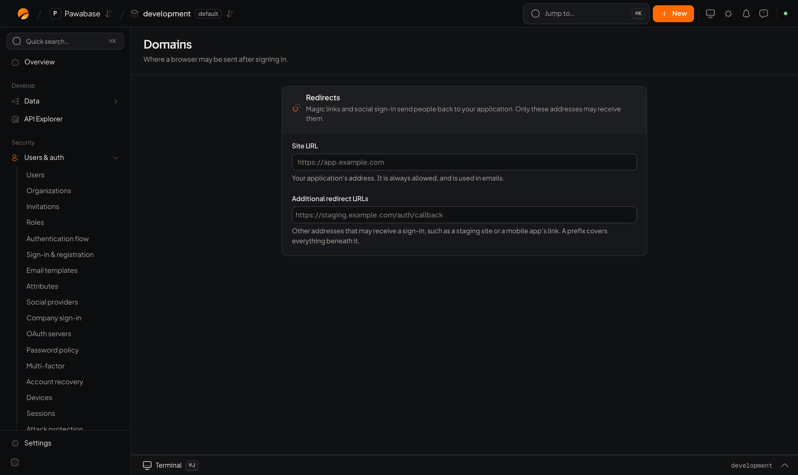

Several sign-in flows send a person **away from your app and back**: they click a link in an email (confirm address, sign-in link, password reset, invitation, new address), or they sign in at Google and return. Pawabase only ever sends people back to addresses you've allowed. Otherwise an attacker could craft a link that delivers someone's session to a site they control.

This page explains the allow-list, the **Site URL** (which decides where email links go), and how your app finishes each flow when the person comes back. If a link from an email or a social sign-in doesn't return to your app, start here.

<Frame caption="Users & auth → Protection → Domains: the Redirects card.">
  
</Frame>

## The settings

**Users & auth → Protection → Domains**, **Redirects** card:

| Setting | Meaning |
| --- | --- |
| **Site URL** | Your app's main address, such as `https://app.example.com`. Always allowed. When set, **email links go to your app** (below). Social sign-in returns here when no other address is given |
| **Additional redirect URLs** | Other addresses that may receive people: a staging site, `http://localhost:5173`, a path such as `https://example.com/auth`, or a mobile app's address (`myapp://auth`) |

Each environment has its own list. Keep `localhost` in `development` only, and put your real addresses in `production`.

## How matching works

An address is allowed when it is the **Site URL** or one of the **additional URLs**, or **starts with** one of them at a path or query boundary:

| Allowed entry | Allows | Doesn't allow |
| --- | --- | --- |
| `https://app.example.com` | `https://app.example.com`, `https://app.example.com/welcome`, `https://app.example.com/?next=1` | `https://app.example.com.evil.net`, `http://app.example.com` (other scheme), `https://app.example.com:8443` (other port) |
| `https://example.com/auth` | `https://example.com/auth`, `https://example.com/auth/callback` | `https://example.com/authority`, `https://example.com/` |
| `http://localhost:5173` | `http://localhost:5173/anything` | `http://localhost:3000`, `http://127.0.0.1:5173` |
| `myapp://auth` | `myapp://auth/callback` | `myapp://other` |

There are no wildcards: list each origin you use. A shorter entry covers more, so prefer the most specific entry that works.

A call that names an address that isn't allowed is refused with `400` "redirect_to is not an allowed URL", before any email is sent.

## Where email links go

The **Site URL** decides how email links work:

<Tabs>
  <Tab title="Site URL set (recommended)">
    Email links point at **your app**: `https://app.example.com/auth/callback?token=…&type=verify` (with `&redirect_to=…` if you passed one). Your app's `/auth/callback` page reads `type` and `token` and finishes the flow with one call (next section). People stay on your domain the whole time, which looks trustworthy and works with your own design.
  </Tab>
  <Tab title="No Site URL">
    Email links point at a **Pawabase page** on your API address. It finishes the flow itself, then:

    - if the original call had an allowed `redirectTo`, sends the person there with the new session in the URL fragment (`#access_token=…&refresh_token=…`), which the client libraries pick up automatically;
    - otherwise shows a plain "You're all set" page.

    Password reset links open a small built-in page for choosing a new password. This mode is fine while prototyping; set a Site URL before launch.
  </Tab>
</Tabs>

## Handling `/auth/callback` in your app

With a Site URL, add one route, `/auth/callback`, that handles every email link:

<CodeGroup>
```typescript TypeScript
import { pawabase } from "./pawabase";

export async function handleAuthCallback() {
  const params = new URLSearchParams(location.search);
  const token = params.get("token") ?? "";
  const next = params.get("redirect_to") ?? "/";

  switch (params.get("type")) {
    case "verify":                                   // "Confirm your email"
      await pawabase.auth.verifyEmail(token);        // confirms the address and signs them in
      return location.replace(next);
    case "magic": {                                  // "Sign-in link"
      const result = await pawabase.auth.verifyMagicLink(token);
      if (result.status === "mfa_required") return showTwoStepForm(result.verify);
      return location.replace(next);
    }
    case "email_change":                             // "Confirm a new address"
      await pawabase.auth.confirmEmailChange(token);
      return location.replace(next);
    case "recovery":                                 // "Reset your password": ask for the new password first
      return showNewPasswordForm(async (password) => {
        await pawabase.auth.resetPassword({ token, password });   // sets it and signs them in
        location.replace(next);
      });
    case "invite":                                   // "Invitation": the person must be signed in to accept
      return showInvitation(token);                  // then pawabase.auth.acceptInvitation(token)
    default:
      return showError("This link isn't valid.");
  }
}
```

```python Python
# A server-rendered app (Flask shown): finish the flow on the server, then keep the session for this person.
from flask import request, redirect, render_template

@app.get("/auth/callback")
def auth_callback():
    token, kind = request.args.get("token", ""), request.args.get("type")
    nxt = request.args.get("redirect_to", "/")
    pb = new_client_for_this_browser()                # a client with this person's session store
    if kind == "verify":
        pb.auth.verify_email(token)
    elif kind == "magic":
        result = pb.auth.verify_magic_link(token)
        if result.status == "mfa_required":
            return render_template("two_step.html")
    elif kind == "email_change":
        pb.auth.confirm_email_change(token)
    elif kind == "recovery":
        return render_template("new_password.html", token=token)   # posts to a route that calls pb.auth.reset_password(token=…, password=…)
    else:
        return render_template("error.html"), 400
    return redirect(nxt)
```
</CodeGroup>

What to know about these tokens:

- **Each works once.** A second click (or an email scanner that opens links) uses it up. Show a friendly "this link has already been used; sign in or request a new one" message.
- **They expire**: sign-in links after 15 minutes, codes after their `minutes`, reset links after your recovery setting. See [Email templates](/auth/email-templates) for each message's lifetime.
- **Read the token and remove it from the address bar** after using it (`history.replaceState`), so it doesn't end up in screenshots or analytics.

## Passing `redirectTo`

Every call that sends an email or starts a social sign-in accepts the address to return to:

<CodeGroup>
```typescript TypeScript
await pawabase.auth.signUp({ email, password, redirectTo: "https://app.example.com/welcome" });
await pawabase.auth.signInWithMagicLink({ email, redirectTo: "https://app.example.com/inbox" });
await pawabase.auth.requestPasswordReset({ email, redirectTo: "https://app.example.com/settings" });
await pawabase.auth.signInWithOAuth("google", { redirectTo: "https://app.example.com/" });
```

```python Python
pb.auth.sign_up(email=email, password=password, redirect_to="https://app.example.com/welcome")
pb.auth.sign_in_with_magic_link(email=email, redirect_to="https://app.example.com/inbox")
pb.auth.request_password_reset(email=email, redirect_to="https://app.example.com/settings")
```
</CodeGroup>

With a Site URL, `redirectTo` travels inside the email link as `redirect_to`, for your `/auth/callback` to send the person on to after it finishes. Without a Site URL, Pawabase's page sends them there itself. Leave it out and email links finish at `/auth/callback` (your app decides where to go), and social sign-in returns to the Site URL.

## Social sign-in returns

After the provider (Google, GitHub, a company login), Pawabase sends the person to the `redirectTo` address (or the Site URL) with the outcome in the **URL fragment**, never in the query string, so it isn't sent to your server or kept in server logs:

| Fragment | Meaning |
| --- | --- |
| `#access_token=…&refresh_token=…&expires_in=…` | Signed in |
| `#mfa_required=true&mfa_token=…` | The person has two-step verification: ask for their code |
| `#mfa_setup_required=true&mfa_token=…` | Their organization requires two-step verification and they have none yet |
| `#linked=google` | A provider was linked to the signed-in person's account |
| `#error=…` | Refused: `signup_disabled`, `signup_restricted`, `account_disabled`, `email_unverified_conflict`, `identity_already_linked`, `email_domain_not_allowed`, … |

The browser client reads the fragment on page load by itself (`detectSessionInUrl`, on by default), stores the session and clears the address bar. To handle the other outcomes, call `getSessionFromUrl()`:

```typescript
const result = await pawabase.auth.getSessionFromUrl();
if (result.status === "mfa_required") showTwoStepForm(result.verify);
else if (result.status === "error") showError(result.error);
```

See [Social sign-in](/auth/social-sign-in).

## Mobile apps

Register a custom scheme in your app (`myapp://`), add `myapp://auth` under **Additional redirect URLs**, and pass `redirectTo: "myapp://auth/callback"`. The operating system opens your app with the link; read `token`/`type` (email links) or the fragment (social sign-in) as above. Universal links (`https://app.example.com/auth/...`) work the same way and are harder to hijack than custom schemes.

## Troubleshooting

| Symptom | Cause | Fix |
| --- | --- | --- |
| `400` "redirect_to is not an allowed URL" | The address isn't in the list, or differs in scheme, port or host | Add the exact origin (and path prefix) |
| Email links open a 404 on your site | A Site URL is set but your app has no `/auth/callback` route | Add the route, or remove the Site URL while prototyping |
| "This link cannot be used" | Already used (also by an email scanner) or expired | Ask for a new link; for scanners, prefer email codes |
| Social sign-in lands on the Site URL instead of the page you wanted | `redirectTo` wasn't passed | Pass it to `signInWithOAuth` |
| Works locally, fails in production | Production's list lacks your real address | Add it to the production environment |
| Social sign-in shows the provider's error page | The provider's own settings must allow Pawabase's callback | See [Social sign-in](/auth/social-sign-in) |

## Related

- [Email templates](/auth/email-templates): the messages that carry these links.
- [Sign-in links](/auth/sign-in-links), [Email verification](/auth/email-verification), [Account recovery](/auth/account-recovery), [Invitations](/auth/invitations).
