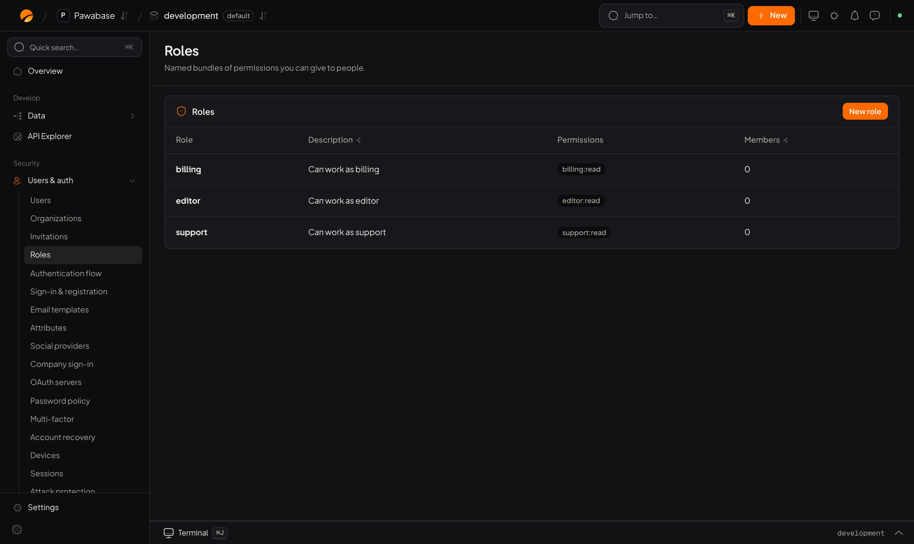

A **role** is a named bundle of **permissions**, such as `editor` with `posts.write` and `posts.publish`. You give people roles; your [access rules](/policies/overview) check for a role or a permission. Rules stay short, and changing what "editor" may do is one edit in one place.

These are **environment-wide** roles: an `admin` here is an admin of your whole app. For roles **inside a customer's organization** (a member who is `billing` at Acme but not at Globex), use [organization roles](/auth/organizations#roles-and-permissions).

<Frame caption="Users & auth → People → Roles: New role.">
  
</Frame>

## Permissions

A permission is a name you choose. Pawabase doesn't interpret it; your rules decide what it allows. A dotted `area.action` style reads well and is what the examples use:

| Permission | Could mean |
| --- | --- |
| `posts.write` | Create and edit posts |
| `posts.publish` | Publish posts |
| `billing.manage` | Change the plan and payment details |
| `*` | Everything (every permission check passes) |

Permissions match **exactly**. The only wildcard is a permission that is literally `*`, which satisfies every check. `posts.*` does **not** cover `posts.write`: list each permission a role needs.

## Define roles

**Users & auth → People → Roles → New role**:

| Field | Rules |
| --- | --- |
| **Name** | Lowercase letters, digits, `_`, `-` and `:`, starting with a letter, up to 63 characters: `editor`, `support_agent`, `org:billing` |
| **Description** | For your team |
| **Permissions** | The permissions the role grants |

From code, with a secret key:

<CodeGroup>
```typescript TypeScript
import { admin } from "@pawabase/client/admin";

const people = admin(secretClient);
await people.roles.define("editor", ["posts.write", "posts.publish"], { description: "Writes and publishes posts" });
await people.roles.list();
await people.roles.remove("editor");
```

```python Python
pb.admin.roles.put("editor", ["posts.write", "posts.publish"], description="Writes and publishes posts")
pb.admin.roles.list()
pb.admin.roles.remove("editor")
```
</CodeGroup>

Defining a role that already exists replaces its permissions. Roles are part of the environment's definitions in [blueprints](/developers/blueprints) and [infrastructure as code](/iac/roles), so `development` and `production` can share the same set.

## Give people roles

**In Studio:** **People → Users**, open the person, **Access**: click a role to give or take it. **Direct permissions** adds single permissions on top of their roles, for a one-off exception.

**At sign-up:** **Protection → Restrictions → Roles for new accounts** (`default_roles`) are given to every new account. See [Sign-up restrictions](/auth/sign-up-restrictions).

**From your server**, for example when billing says a customer upgraded:

<CodeGroup>
```typescript TypeScript
await people.users.update(userId, { roles: ["member", "pro"] });   // replaces the person's roles
await people.users.revokeSessions(userId);                         // optional: apply it now (see below)
```

```python Python
pb.admin.users.update(user_id, roles=["member", "pro"])   # replaces the person's roles
pb.admin.users.revoke_sessions(user_id)                   # optional: apply it now
```
</CodeGroup>

`roles` **replaces** the list: read the person's current roles first if you mean to add one.

## Check roles and permissions in rules

In Studio's rule picker:

- **Users with role** `editor`: the caller has the role (pick several to accept any of them).
- **Users with permission** `posts.publish`: the caller has the permission, through any role, directly, or through `*`.

As rule shorthands (in JSON, infrastructure as code or policy references):

```json
{ "role": "editor" }
{ "role": ["editor", "admin"] }
{ "permission": "posts.publish" }
{ "permission": ["posts.write", "posts.publish"] }
```

A list of roles passes when the caller has **any** of them; a list of permissions passes only when the caller has **all** of them. In conditions you can also read `$auth.roles` and `$auth.permissions` directly. See [Rule shorthands](/policies/operators).

**Prefer permissions in rules.** "Who may publish" is stable; which roles include it changes as your business grows. With rules that check `posts.publish`, giving a new `marketing` role that permission is one change, not an edit to every rule.

## Roles in the token, and in your app

When someone signs in, their roles and permissions are written **into their access token** (as `roles` and `perms`). That's why rules can check them on every request without a database lookup.

In your app, the signed-in person's roles are on `user.roles`. Use them only to decide what to **show** (hide the Publish button from people who can't publish); the server's rules are what protect the data.

<CodeGroup>
```typescript TypeScript
const user = await pawabase.auth.getUser();
const canPublish = user.roles.includes("editor") || user.roles.includes("admin");
```

```python Python
user = pb.auth.get_user()
can_publish = "editor" in user["roles"]
```
</CodeGroup>

### When changes take effect

Because roles travel in the token, a change reaches a signed-in person when their **access token is renewed**: within the access token's lifetime (15 minutes by default) as the client refreshes it, or when they sign in again.

- **Giving** a role: usually fine to wait. To show it at once in your app, call `pawabase.auth.refreshSession()` after your server makes the change.
- **Taking away** a role (someone left, a subscription ended): end their sessions with `revokeSessions` (TypeScript) / `revoke_sessions` (Python), or **Sign out everywhere** on their page in Studio. Their next request is refused and they sign in again with the new roles.
- **Changing a role's permissions** affects everyone with that role at their next renewal.

## Who may change roles

Only an administrator can: Studio, or your server with a secret key through the admin client. A person can't give themselves a role from your app; `user_metadata`, which people can edit, is never used for authorization.

## Roles and secret keys

Secret keys don't have user roles: they act with the `service` role and pass access rules. A rule like **Users with role** `admin` refuses publishable-key requests from people without the role, but a secret-key request passes anyway.

## Common mistakes

| Symptom | Cause |
| --- | --- |
| A rule on `posts.*` never passes | Permissions match exactly; list `posts.write`, `posts.publish`… |
| Someone still has access after their role was removed | Their access token still carries the old roles; end their sessions |
| A new role works in Studio but not in the app | The app's token was issued before the change; refresh the session |
| Roles differ between development and production | Roles are per environment; define them in both, or deploy them with IaC or a blueprint |

## Related

- [Users](/auth/users): give and take roles.
- [Organization roles](/auth/organizations#roles-and-permissions): roles inside each customer's organization.
- [Recipes: roles](/policies/recipes-roles): admin areas, editors and moderators.
