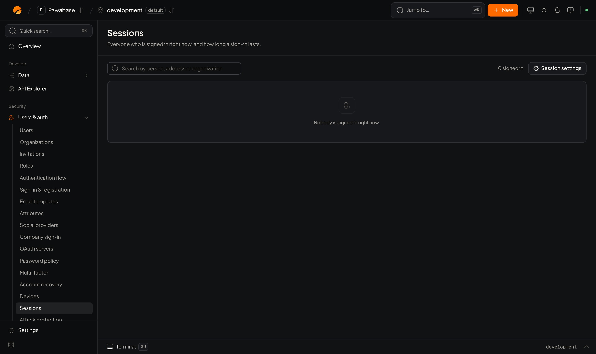

A **session** is one signed-in browser or device. The client keeps it for you, refreshes it before it expires and uses it for every request. This page covers what a session is made of, how long it lasts, how it ends, how many a person may have, and what you do with sessions in your app.

<Frame caption="Users & auth → Protection → Sessions: active sessions, with Session settings.">
  
</Frame>

## What a session is made of

Every sign-in (password, link, code, social, passkey, guest) returns the same thing:

| Part | What it does | Lifetime |
| --- | --- | --- |
| **Access token** | Sent with every request as `Authorization: Bearer …`. Carries who the person is, their roles and permissions, the active organization and how they signed in (`aal1` or `aal2`) | **Access token lifetime** (15 minutes by default) |
| **Refresh token** | Exchanged for a new access token and a new refresh token. **Each works once** | **Refresh token lifetime** (30 days by default), from the moment it was issued |
| **Session id** | `session_id`, and `sid` inside the access token. Names the session in lists and for revoking | As long as the session lives |

Exchanging the refresh token is called **rotation**: the old refresh token is used up, and a new pair is issued under the same session. All the refresh tokens a session ever had form one **family**, and the session id is that family.

## How long a session lasts

A session stays alive as long as its refresh token is used before it expires. Each rotation issues a new refresh token with a full **Refresh token lifetime** ahead of it, so the window **slides forward** whenever the app is used:

- Someone who opens your app at least once every 30 days stays signed in indefinitely.
- Someone who doesn't open it for 30 days must sign in again: their last refresh token has expired.

There's no fixed maximum session length on top of this. If you need people to sign in again periodically regardless of activity (every 12 hours on a shared kiosk, for example), make the refresh token lifetime that short, or sign them out from your app.

Roles, permissions and the active organization are read **again at every rotation**, so a change reaches the person's token within one access-token lifetime, without them signing out.

## When a session ends

| Cause | What happens |
| --- | --- |
| The person signs out | That session's refresh tokens are revoked |
| Sign out of other devices / everywhere | Every other session, or every session, is revoked |
| An administrator ends it (Studio, admin client) | Revoked |
| More sessions than **Sessions per user** | The oldest sessions are revoked when a new one starts |
| The refresh token expires | The next refresh is refused |
| A used refresh token is presented again | The **whole session** is revoked (theft protection, below) |
| The account is disabled or deleted | Refreshes are refused |
| The password is reset | Every session is revoked, unless **Sign out everywhere after a reset** is off ([Account recovery](/auth/account-recovery)) |

An ended session can't refresh any more, but **its current access token keeps working until it expires**: access tokens are checked by signature, not looked up on each request. That's the reason to keep the access token lifetime short. With the default, a revoked session can be used for at most 15 more minutes.

When a refresh is refused, the client clears the stored session and fires `SIGNED_OUT` (below), so your app shows the sign-in screen.

### Theft protection

If someone copies a refresh token and uses it, either they or the real device will later present a token that was already used. Pawabase treats a second use as theft: it revokes the whole session, so both the thief and the real device are signed out, records a failed refresh in **Sign-in activity** and fires `session.reuse_detected`.

<Note>
Two tabs refreshing at the same moment would trigger this, because refresh tokens are single-use. The client prevents it by sharing one refresh across calls and, in browsers, across tabs. If you call the refresh endpoint yourself (a custom client, a mobile app), make sure only one refresh runs at a time and always store the newest refresh token.
</Note>

## Settings

**Users & auth → Protection → Sessions → Session settings**:

| Setting | Meaning | Key | Default |
| --- | --- | --- | --- |
| **Access token lifetime** | Seconds, at least 60. How long one access token is valid | `access_ttl` | 900 (15 minutes) |
| **Refresh token lifetime** | Seconds, at least 3600. How long someone stays signed in **without using the app** | `refresh_ttl` | 2,592,000 (30 days) |
| **Sessions per user** | 0 is unlimited. Over the limit, the oldest session ends when a new one starts | `max_sessions` | 0 |

Your plan can also cap sessions per person; the smaller of the two limits applies. Changes apply to tokens issued afterwards: existing tokens keep the lifetime they were issued with until their next rotation.

The page also lists **Active sessions** across the environment (person, method, device, last active), with a way to end each one.

### Choosing lifetimes

| App | Access token | Refresh token | Sessions per user |
| --- | --- | --- | --- |
| Consumer app, social, shopping | 15 minutes | 30–90 days | 0 |
| Business tool | 15 minutes | 7–14 days | 0, or a few per seat |
| Admin panel, finance, health | 5 minutes | 8–12 hours | 1–2 |
| Shared or public devices | 5 minutes | 1 hour | — |

A shorter access token means a change (a revoked session, a removed role, a disabled account) takes effect sooner, at the cost of more refreshes. Below 5 minutes the extra traffic rarely buys anything.

## Read the session in your app

<CodeGroup>
```typescript TypeScript
const session = await pawabase.auth.getSession();     // null when signed out; refreshes first if about to expire
const user = await pawabase.auth.getUser();           // fresh from the server, updates the stored copy
const token = await pawabase.auth.getAccessToken();  // for calling your own backend
```

```python Python
session = pb.auth.session            # None when signed out
user = pb.auth.get_user()
token = pb.auth.access_token
```
</CodeGroup>

A session holds `access_token`, `refresh_token`, `expires_at` (Unix seconds), `session_id`, the active `org` and `org_role`, and the `user`.

`getSession()` only goes to the network when the access token is about to expire (within `refreshMarginSeconds`, 60 by default). If that refresh fails because you're offline or the server had an error, it returns the stored session while it's still valid and throws only once it has expired. If the refresh token was refused, it returns `null`: the person is signed out.

To check a person's token on **your own server**, see [Verify tokens on your server](/auth/how-auth-works#verify-tokens-on-your-server).

## React to changes

Subscribe once, near the top of your app:

<CodeGroup>
```typescript TypeScript
const { unsubscribe } = pawabase.auth.onAuthStateChange((event, session) => {
  if (event === "SIGNED_OUT") navigate("/sign-in");
  if (event === "SIGNED_IN") navigate("/");
});
```

```python Python
stop = pb.auth.on_auth_state_change(lambda event, session: print(event))
```
</CodeGroup>

| Event | When |
| --- | --- |
| `INITIAL_SESSION` | Right after subscribing, with whatever was stored |
| `SIGNED_IN` | A sign-in or sign-up finished |
| `SIGNED_OUT` | Signed out on this device, or a refresh was refused (expired, revoked, disabled) |
| `TOKEN_REFRESHED` | The tokens were rotated |
| `USER_UPDATED` | The profile changed |

## Sign out

<CodeGroup>
```typescript TypeScript
await pawabase.auth.signOut();                         // this device
await pawabase.auth.signOut({ scope: "others" });      // every other device; this one stays signed in
await pawabase.auth.signOut({ scope: "global" });      // everywhere, including this device
```

```python Python
pb.auth.sign_out()
pb.auth.sign_out(scope="others")
pb.auth.sign_out(scope="global")
```
</CodeGroup>

With `local` and `global`, this device is signed out even if the server can't be reached, and `SIGNED_OUT` fires. `others` leaves this device's session as it is.

A `session.revoked` event fires with the `scope`.

## Show "where you're signed in"

<CodeGroup>
```typescript TypeScript
const sessions = await pawabase.auth.sessions.list();
// [{ id, method, aal, ip, user_agent, created_at, last_refreshed_at, current }]

await pawabase.auth.sessions.revoke(sessions[1].id);     // sign out one device
const history = await pawabase.auth.sessions.history();   // recent sign-ins and failures
```

```python Python
sessions = pb.auth.sessions.list()
pb.auth.sessions.revoke(sessions[1]["id"])
history = pb.auth.sessions.history()
```
</CodeGroup>

Put this on the account page:

- `method` is how the session started (`password`, `magic_link`, `google`, …), and `aal` whether it passed [two-step verification](/auth/two-step-verification).
- `last_refreshed_at` is the last time the device used the session: a good "last active".
- `current` marks the session making the request. Don't offer to revoke that one; use sign-out instead.

Only live sessions are listed: revoked and expired ones disappear. Revoking an id that isn't the person's answers `404`.

## Revoke as an administrator

In Studio: **Users & auth → Protection → Sessions** lists live sessions, and a person's own page (**Users →** the person) can end theirs. From your server, with a secret key:

<CodeGroup>
```typescript TypeScript
import { admin } from "@pawabase/client/admin";

const people = admin(secretClient);
await people.sessions.list({ limit: 100 });            // live sessions across the environment
await people.sessions.revoke(sessionId);              // end one
await people.users.revokeSessions(userId);            // sign one person out everywhere
```

```python Python
pb.admin.sessions.list(limit=100)
pb.admin.sessions.revoke(session_id)
pb.admin.users.revoke_sessions(user_id)
```
</CodeGroup>

Disabling a user also ends their sessions. Remember the access-token window: for an urgent lock-out, disable the account (refreshes and [auth routes](/auth/users) refuse it at once) rather than only revoking sessions.

## Where the session is stored

| Where | Default |
| --- | --- |
| Browser | `localStorage` |
| Node, server | Memory (gone when the process ends) |
| Python | Memory, or a file with `FileSessionStore` |

Change it in the client options. React Native passes AsyncStorage; a cookie-based framework passes its own object with `getItem`, `setItem` and `removeItem`:

```typescript
const pawabase = createClient({
  url, apiKey,
  project,
  auth: { storage: asyncStorage, persistSession: true, autoRefreshToken: true, refreshMarginSeconds: 60 },
});
```

Set `persistSession: false` for a script that should remember nothing. In Python: `Pawabase(url, key, project=project, session_store=FileSessionStore("~/.myapp/session.json"))`.

On a server that handles many people, never share one client's session between them: make a client per request with that person's tokens (`as_user` in Python, `accessToken` in TypeScript).

## Events

| Event | When |
| --- | --- |
| `session.revoked` | A session was ended by signing out, by the person revoking it, or by an administrator |
| `session.reuse_detected` | A used refresh token came back and the session was revoked |

Expiry doesn't fire an event: an expired session simply can't refresh. See [Auth webhooks](/auth/auth-webhooks).

## Troubleshooting

| Symptom | Cause | Fix |
| --- | --- | --- |
| People are signed out after a few minutes | The session isn't persisted (`persistSession: false`, or a server-side client keeping it in memory) | Use `localStorage` in browsers, or a session store that lasts |
| Signed out at random, often with several tabs or a custom client | A refresh token used twice: two refreshes raced, or an old refresh token was kept | Let the client refresh; in your own code, serialize refreshes and store the newest token |
| `401` "invalid refresh token" | Expired, revoked, already used, or the account is disabled | Sign in again. **Sign-in activity** shows the reason |
| `401` "the session was revoked" | Ended by sign-out elsewhere, an administrator or the session limit | Sign in again |
| A removed role still works for a few minutes | The current access token still carries it | Expected; it's gone at the next rotation |
| A revoked session still reads data | Its access token hasn't expired yet | Shorten **Access token lifetime**; disable the account for urgent cases |
| A token from one environment is refused in another | Each environment signs its own tokens | Sign in to the environment you're calling |

## Related

<CardGroup cols={2}>
  <Card title="Devices" icon="smartphone" href="/auth/devices">Track and remember devices.</Card>
  <Card title="Auth in React" icon="atom" href="/auth/react">Use sessions in components.</Card>
  <Card title="Attack protection" icon="shield" href="/auth/attack-protection">Lockouts and rate limits.</Card>
  <Card title="Sign-in activity" icon="history" href="/auth/sign-in-activity">Every sign-in, refresh and failure.</Card>
</CardGroup>
