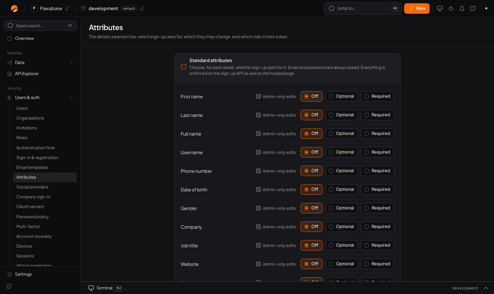

Sign-up can collect more than an email and a password. **Attributes** are the details you ask for: name, company, date of birth, your own questions. You decide which are asked and which are required, and Pawabase checks them on the sign-up API itself, so a hand-built form, a script or an old app version can't skip a required one.

<Frame caption="Users & auth → Sign-in → Attributes: each detail is Off, Optional or Required.">
  
</Frame>

## Where the settings are

| What | Studio | Key |
| --- | --- | --- |
| Which identifiers people sign in with | **Users & auth → Sign-in → Sign-in & registration → Sign in with** | `signup_form.sign_in_with` |
| Form layout (one or two steps) | **Sign-in & registration → Registration → Sign-up form layout** | `signup_form.steps` |
| Standard attributes | **Users & auth → Sign-in → Attributes → Standard attributes** | `signup_form.attributes` |
| Your own questions | **Attributes → Custom attributes** | `signup_form.custom` |
| Admin-only attributes | The lock switch on each attribute | `signup_form.locked` |
| Attributes in the token | **Attributes → Access token contents**, and the token switch on each attribute | `directory.claims.mode`, `signup_form.claims` |
| Profile pictures | **Attributes → Profile pictures** | `directory.avatars` |

## Sign-in identifiers

**Email** is always an identifier: confirmation and recovery go there. You can add **Username** and **Phone number**. An identifier you add:

- becomes a **required** attribute at sign-up, and must be unique in the environment (`409` "that username is taken" / "an account with this phone number already exists");
- is accepted in the sign-in `email` field: `signInWithPassword({ email: "ada", password })` works for a username.

Usernames are 3 to 40 characters of lowercase letters, digits, `.`, `-` and `_`, starting with a letter or digit, and are stored lowercase. Phone numbers are stored as digits with an optional leading `+` (`+44 20 7946 0958` becomes `+442079460958`) and matched the same way at sign-in, so people can type spaces, dashes or brackets.

## Standard attributes

Each is **Off** (not asked), **Optional** or **Required**. Email and password are always asked.

| Attribute | Key | Type | Stored as |
| --- | --- | --- | --- |
| First name | `given_name` | Text | `user_metadata.given_name` |
| Last name | `family_name` | Text | `user_metadata.family_name` |
| Full name | `name` | Text | The account's `name` |
| Username | `username` | Text | The account's `username` |
| Phone number | `phone` | Phone | The account's `phone` |
| Date of birth | `birthdate` | Date | `user_metadata.birthdate` |
| Gender | `gender` | Choice: Female, Male, Non-binary, Prefer not to say | `user_metadata.gender` |
| Company | `company` | Text | `user_metadata.company` |
| Job title | `job_title` | Text | `user_metadata.job_title` |
| Website | `website` | Web address | `user_metadata.website` |
| Country | `country` | Choice from a built-in list | `user_metadata.country` |
| Address | `address` | Long text | `user_metadata.address` |

With nothing configured, sign-up asks for an optional **Full name**. When **Full name** isn't asked but first and last names are, the account's `name` is set to "First Last".

## Custom attributes

**Add attribute** for your own questions, up to 12:

| Field | Rules |
| --- | --- |
| **Label** | What the person sees. Up to 80 characters |
| **Key** | The name in `user_metadata`. Lowercase letters, digits and `_`, starting with a letter, up to 32 characters; not `email`, `password` or `accepted_terms` |
| **Type** | Short text, Long text, Number, Date, Phone, Web address, Choice, Checkbox |
| **Choices** | For Choice: up to 30 values |
| **Minimum / Maximum** | Text: fewest and most characters. Number: smallest and largest value |
| **Help text** | A hint under the input, up to 160 characters |
| **Required** | Must be answered (for a Checkbox: must be ticked) |

In settings, a custom attribute can also have `"ask": false`: it's part of the profile and checked when the person edits it, but not asked at sign-up.

## How answers are checked

| Type | Accepted |
| --- | --- |
| Short text | Up to 200 characters, within Minimum/Maximum |
| Long text | Up to 1,000 characters, within Minimum/Maximum |
| Number | A number within Minimum/Maximum; stored as a number |
| Date | `YYYY-MM-DD`. Date of birth must be between 1900-01-01 and today |
| Phone | A digit followed by digits, spaces, `()`, `-` or `.` (6 to 23 characters), with an optional leading `+` |
| Web address | `https://…`, or `http://localhost` while developing |
| Choice | Exactly one of the choices |
| Checkbox | `true`, or `"true"`, `"on"`, `"1"` |

Text is trimmed; an empty answer counts as not given. Every problem is reported at once.

## Sending answers from your app

Standard and custom attributes go in `data`. `name` and `username` can also be sent on their own:

<CodeGroup>
```typescript TypeScript
await pawabase.auth.signUp({
  email, password,
  name: "Ada Lovelace",
  username: "ada",
  data: { company: "Analytical Engines", team_size: 12, country: "United Kingdom" },
  acceptedTerms: true,     // when legal documents are required
});
```

```python Python
pb.auth.sign_up(
    email=email, password=password, name="Ada Lovelace", username="ada",
    data={"company": "Analytical Engines", "team_size": 12, "country": "United Kingdom"},
    accepted_terms=True,
)
```
</CodeGroup>

Answers are stored on the account: `name`, `username` and `phone` in their own fields, everything else in `user_metadata`, normalised (numbers as numbers, phones as digits, usernames lowercase). Other keys you put in `data` are kept in `user_metadata` as sent, unchecked. Read them back from `user.user_metadata`.

The form isn't published to clients, so build your sign-up form to match what you configured, and let the server's answer catch anything you missed.

### Errors

When answers don't pass, sign-up answers `422` with **every** problem as a list of messages:

```json
{ "message": "the sign-up form is incomplete",
  "problems": ["Company is required", "Team size must be at most 500", "Website must be a web address starting with https://"] }
```

The messages start with the attribute's label, so show them above the form. They aren't tied to field names: `fieldError("company")` returns nothing.

<CodeGroup>
```typescript TypeScript
import { ValidationError } from "@pawabase/client";

try {
  await pawabase.auth.signUp({ email, password, data });
} catch (error) {
  if (error instanceof ValidationError) {
    const problems = (error.body as { problems?: string[] })?.problems;
    showFormErrors(problems ?? [error.message]);
  } else throw error;
}
```

```python Python
from pawabase import ValidationError

try:
    pb.auth.sign_up(email=email, password=password, data=data)
except ValidationError as error:
    show_form_errors(error.problems or [error.message])
```
</CodeGroup>

The [password policy](/auth/password-policy) answers in the same shape ("the password does not meet the policy"), so one handler covers both. A taken username or phone number is `409`.

## Admin-only attributes

Lock an attribute (**Only an administrator can change it once it has a value**) for things people shouldn't edit after sign-up, such as an employee number or the plan they signed up for.

- The person sets it at sign-up (or it's empty).
- Once it has a value, their own profile update ([User profile](/auth/user-profile)) is refused with `422` "the profile is not valid" and the problem "`<key>` can only be changed by an administrator". Sending the same value is fine.
- Your server and Studio can still change it.

A locked attribute is still in `user_metadata`, which travels in the token as `meta` and which the person could set at sign-up. For anything that grants access or decides billing, use **private metadata** (`app_metadata`), which only your server sets ([Users](/auth/users#public-and-private-metadata)).

## Attributes in the access token

The person's `user_metadata` is copied into their access token as the `meta` claim, so your API can read it without a lookup. **Access token contents → Attributes in the token**:

| Mode | In the token |
| --- | --- |
| `all` (default) | All of `user_metadata` |
| `listed` | Only the attributes whose token switch is on |

Prefer `listed` when people's metadata grows: everything in the token is sent with every request. Changes reach the token at the next refresh.

Treat `meta` as **what the person said**, not as a fact you can rely on: they can edit most of it. [Access rules](/policies/overview) should use roles, permissions and `$auth.claims.app` (private metadata) for decisions.

## Form layout

**Sign-up form layout** (`steps`): **One page** (`single`), **Two steps** (`two`) (email and password first, the other details second), or **Auto** (`auto`, two steps when more than two details are asked). It applies to Pawabase's [hosted pages](/auth/authentication-flow); your own form can do as it likes.

## Changing the form later

- Making an attribute **required** doesn't affect existing people until they edit their profile, and profile edits never require a value: only the keys sent are checked.
- Removing an attribute keeps the values people already gave in `user_metadata`.
- Adding username or phone as an identifier makes it required for new sign-ups only. Existing people without one can't sign in with it until they set one.

## Designing the form

- Ask for the minimum. Every extra required field loses people. Ask the rest later, in the app, when it's needed.
- Use **Choice** where you'll filter or segment later; free text can't be grouped.
- Put long forms across two steps.
- Mark anything that drives permissions or billing as admin-only, and better, keep it in private metadata.

## Related

<CardGroup cols={2}>
  <Card title="User profile" icon="id-card" href="/auth/user-profile">Editing attributes after sign-up.</Card>
  <Card title="Email and password" icon="key" href="/auth/email-and-password">The sign-up call.</Card>
  <Card title="Sign-up restrictions" icon="ban" href="/auth/sign-up-restrictions">Control who can join.</Card>
  <Card title="Users" icon="users" href="/auth/users">Public and private metadata.</Card>
</CardGroup>
