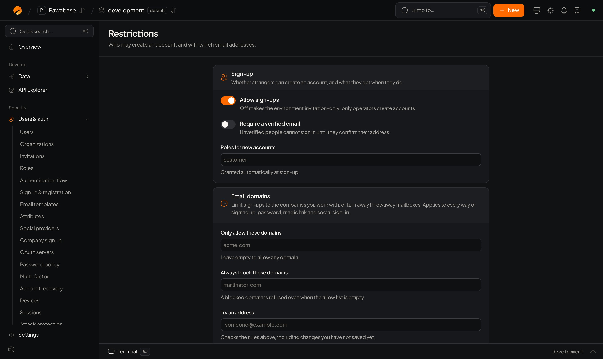

Restrictions decide **who can get an account** in an environment. They apply to every way an account is created: password sign-up, sign-in links and codes that create accounts, guest upgrades and social sign-in. They don't touch accounts that already exist.

<Frame caption="Users & auth → Protection → Restrictions: sign-up and email domains.">
  
</Frame>

## The settings

**Users & auth → Protection → Restrictions**.

### Sign-up

| Setting | Default | Meaning | Key |
| --- | --- | --- | --- |
| **Allow sign-ups** | On | Off makes the environment **invitation-only**: nobody can create their own account; people arrive by [invitation](/auth/invitations), by an administrator creating them, or through [enterprise sign-in](/auth/enterprise-sign-in) | `signup_enabled` |
| **Require a verified email** | Off | New accounts get no session until they confirm their address; unconfirmed accounts can't sign in with a password | `require_email_verification` |
| **Roles for new accounts** | none | [Roles](/auth/roles) every new account receives | `default_roles` |

### Email domains

| Setting | Meaning | Key |
| --- | --- | --- |
| **Only allow these domains** | When set, only addresses at these domains may sign up. Empty allows any domain | `allowed_email_domains` |
| **Always block these domains** | Addresses at these domains are refused, even when the allow list is empty | `blocked_email_domains` |
| **Try an address** | Checks an address against the rules on screen, including changes not yet saved | — |

Domains are compared with the part of the address after `@`, ignoring case and a leading `@` you may have typed. A subdomain is a different domain: allowing `example.com` doesn't allow `eu.example.com`. The block list is checked first.

Use **Try an address** before saving a change: type `someone@gmail.com` and `someone@yourcompany.com` and see which would be let in.

## What your app receives

| Situation | Status | Message (`detail`) |
| --- | --- | --- |
| Sign-ups are off | `403` | `sign-up is disabled` |
| The domain is blocked | `403` | `sign-ups from that email domain are not allowed` |
| The domain isn't in the allow list | `403` | `sign-ups are limited to specific email domains` |
| The environment has reached its user limit | `403` | `the environment user limit has been reached` |
| An account already exists for the address | `409` | `an account with this email already exists` |
| The sign-up form is incomplete or the password is too weak | `422` | the problems, field by field |

<CodeGroup>
```typescript TypeScript
import { ConflictError, PermissionError, ValidationError } from "@pawabase/client";

try {
  const result = await pawabase.auth.signUp({ email, password });
  if (result.verificationRequired) show("Check your email to confirm your address.");
} catch (error) {
  if (error instanceof PermissionError) show(error.message);           // closed, domain refused, or user limit
  else if (error instanceof ConflictError) show("You already have an account. Sign in instead.");
  else if (error instanceof ValidationError) showFieldErrors(error.byField());
  else throw error;
}
```

```python Python
from pawabase import ConflictError, ForbiddenError, ValidationError

try:
    result = pb.auth.sign_up(email=email, password=password)
except ForbiddenError as error:
    show(error.message)                              # closed, domain refused, or user limit
except ConflictError:
    show("You already have an account. Sign in instead.")
except ValidationError as error:
    show(error.message)
```
</CodeGroup>

Social sign-in can't throw in your code (the person is at Google, then back at your app), so its refusals arrive in the return address's fragment instead: `#error=signup_disabled` or `#error=signup_restricted`. See [Redirect URLs and email links](/auth/redirect-urls#social-sign-in-returns).

To show or hide **Create account**, read the environment's public settings:

<CodeGroup>
```typescript TypeScript
const settings = await pawabase.auth.settings();
showCreateAccount(settings.signup_enabled);
```

```python Python
settings = pb.auth.settings()
show_create_account(settings["signup_enabled"])
```
</CodeGroup>

The domain lists aren't part of the public settings: they'd tell a stranger which companies you serve.

### A note on "already exists"

A `409` for an existing address tells the caller that the address has an account. That's normal for most apps (people need to know to sign in instead), but if the existence of an account is itself sensitive, turn on **Require a verified email** and word your screens so a sign-up attempt always ends with "check your email", and use [email codes](/auth/email-codes) or [sign-in links](/auth/sign-in-links), which answer the same way whether or not an account exists.

## Common set-ups

| Goal | Settings |
| --- | --- |
| Public consumer app | Sign-ups on; require a verified email; block throwaway-mailbox domains; [bot protection](/auth/bot-protection) on the sign-up form |
| Internal tool for one company | Sign-ups on; only allow the company's domain; `default_roles: ["member"]` |
| Invite-only beta | Sign-ups off; [invite people](/auth/invitations) or create them from your server |
| B2B where each customer uses their own company login | Sign-ups off; [enterprise sign-in](/auth/enterprise-sign-in) per customer organization (it creates their people even with sign-ups off) |
| Free tier with a cap | Sign-ups on; your plan's user limit refuses new accounts once reached |

## Things to know

- **Tightening a rule never removes anyone.** Existing accounts keep working. To remove people, disable or delete them in [Users](/auth/users).
- **Default roles apply at creation only.** Changing **Roles for new accounts** doesn't change existing people; update them in [Users](/auth/users) or from your server.
- **Administrators aren't restricted.** Accounts created in Studio or with the admin client ignore the domain lists and the **Allow sign-ups** switch.
- **Restrictions are per environment.** Development can stay open while production is invitation-only.

## Related

- [Invitations](/auth/invitations): bring people in when sign-ups are off.
- [Email verification](/auth/email-verification): what "Require a verified email" changes.
- [Bot protection](/auth/bot-protection): stop automated sign-ups.
