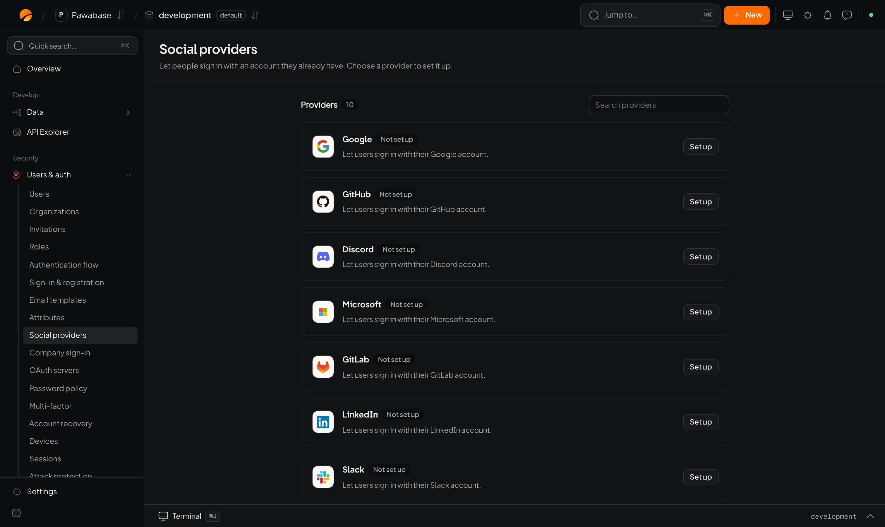
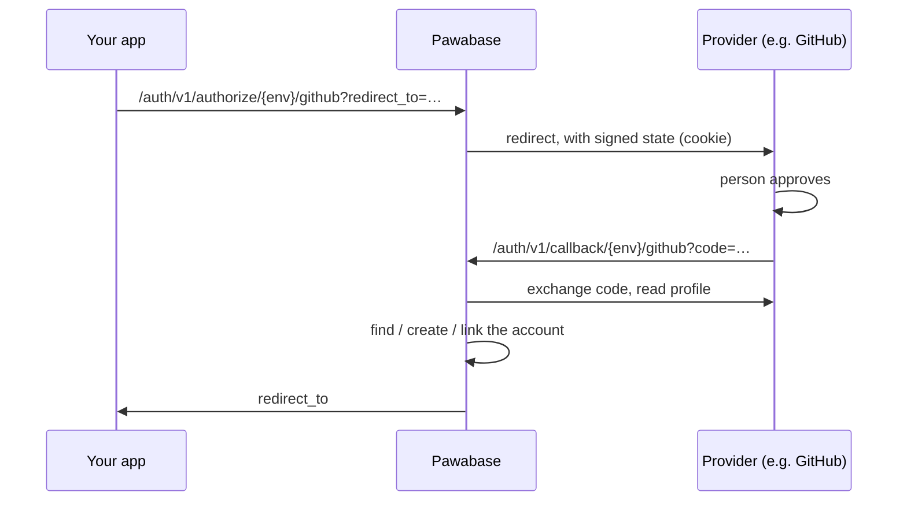

With social sign-in, people use an account they already have. You set a provider up once (credentials from its developer console), and add a button. Pawabase runs the OAuth round trip, finds or creates the account, and hands your app a session.

<Frame caption="Users & auth → Sign-in → Social providers: each provider with its status.">
  
</Frame>

Built in: **Google, GitHub, Discord, Microsoft, GitLab, LinkedIn, Slack, Facebook, Twitch and Apple.** For anything else that speaks OAuth 2.0, add your own [OAuth server](#your-own-oauth-server). For a customer's company login (Okta, Entra ID, SAML), use [enterprise sign-in](/auth/enterprise-sign-in).

## How the round trip works



The result travels in the URL **fragment** (`#…`), which browsers never send to servers, so tokens don't end up in your server's or any proxy's logs.

## Set up a provider

<Steps>
  <Step title="Create an app at the provider">
    In the provider's developer console (Google Cloud, GitHub Developer settings, and so on), create an OAuth application, and note its **Client ID** and **Client secret**.
  </Step>
  <Step title="Open the provider in Studio">
    **Users & auth → Sign-in → Social providers**, then the provider.
  </Step>
  <Step title="Copy the redirect address to the provider">
    The **Redirect address** tab shows `https://<your API address>/auth/v1/callback/<environment>/<provider>`. Add it to the provider's allowed callback URLs, exactly. Each environment has its own, so add the production one before launch.
  </Step>
  <Step title="Enter the credentials and enable">
    **Client ID**, **Client secret** (as `secret://NAME`, see below), optionally **Scopes**, and turn on **Enable sign-in**. Save.
  </Step>
  <Step title="Allow your app's address">
    Put the page people return to on the [redirect list](/auth/redirect-urls), or set your **Site URL**.
  </Step>
</Steps>

### The fields

| Field | Meaning |
| --- | --- |
| **Enable sign-in** | Offer this provider |
| **Client ID** | From the provider |
| **Client secret** | From the provider. Store it under [Secrets](/secrets/overview) and enter `secret://NAME`, so it never sits in plain text in settings or blueprints |
| **Scopes** | What to ask the provider for, one per entry. Empty uses the provider's defaults (enough for name, email and picture) |
| **Redirect address** | Read-only: the callback to register at the provider |

Provider extras:

- **Apple:** **Services ID** (as the client ID), **Team ID**, **Key ID** and **Private key** (the `.p8` file's contents, as a secret). Pawabase signs Apple's client secret itself. Apple posts the person back with a form, and only sends their name on the first sign-in; Pawabase keeps it then.
- **GitLab:** **GitLab address** for a self-hosted server; empty for gitlab.com.

A provider is **ready** when enabled with a client ID (and, for Apple, team ID, key ID and private key). The list shows **Enabled**, **Disabled**, **Needs credentials** or **Not set up**. Your app can read the ready ones from the public settings: `(await pawabase.auth.settings()).providers`.

## Add a button

<CodeGroup>
```typescript TypeScript
import { createClient } from "@pawabase/client";

export const pawabase = createClient({
  url: "https://api.example.com",
  project: "01JC4…",
  apiKey: "pb_pk_…",
  environment: "production",          // needed to build the sign-in address
});

githubButton.onclick = () =>
  pawabase.auth.signInWithOAuth("github", { redirectTo: `${location.origin}/dashboard` });
```

```python Python
# A server-rendered app sends the browser to this address.
url = pb.auth.oauth_url("github", redirect_to="https://app.example.com/auth/finish")
```
</CodeGroup>

`signInWithOAuth` sends the browser to the provider. `signInWithOAuthUrl(provider, { redirectTo })` returns the address instead, for a link or a popup.

`redirectTo` must be [allowed](/auth/redirect-urls); otherwise starting answers `400` "redirect_to is not an allowed URL". Leave it out to return to the **Site URL**.

## Finish on return

**In a browser**, nothing to do: on page load the client reads the fragment (`detectSessionInUrl`, on by default), stores the session, cleans the address bar and fires `SIGNED_IN`.

To handle every outcome yourself, on the page you return to:

```typescript
const result = await pawabase.auth.getSessionFromUrl();

switch (result.status) {
  case "signed_in":    navigate("/dashboard"); break;
  case "mfa_required": showTwoStepForm(result.verify); break;      // their second step
  case "linked":       toast(`Linked ${result.provider}`); break;  // a provider added to a signed-in account
  case "error":        showError(result.error); break;             // e.g. "signup_disabled"
  case "none":         break;                                      // not a sign-in return
}
```

When the person's organization or your environment requires two-step verification and they have none, the fragment carries `mfa_setup_required=true&mfa_token=…`: start [required setup](/auth/two-step-verification#required-setup) with that token.

### Server-rendered apps

Fragments never reach your server. Return to a small page whose script reads the fragment and posts the tokens to your server, which keeps them in its session:

```html
<script>
  const params = new URLSearchParams(location.hash.slice(1));
  history.replaceState(null, "", location.pathname);
  fetch("/auth/finish", { method: "POST", headers: { "content-type": "application/json" },
    body: JSON.stringify(Object.fromEntries(params)) }).then(() => location.replace("/"));
</script>
```

On the server, treat the posted values as untrusted until used: call Pawabase with the access token (`getUser`) to confirm who it is.

### Mobile apps

Pass your app's address as `redirectTo` (a custom scheme like `myapp://auth/callback`, on the redirect list), open the sign-in address in the system browser (ASWebAuthenticationSession, Custom Tabs), and when the OS hands the link back, call `getSessionFromUrl(link)`.

## What happens to the account

| Situation | Result |
| --- | --- |
| This provider account signed in before | The same person is signed in |
| New provider account, the provider **vouches** for its email, and an account with that email exists | The provider is **linked** to that account, and they're signed in |
| New provider account, the provider doesn't vouch, and an account with that email exists | Refused: `email_unverified_conflict`. They sign in the usual way and [link the provider](/auth/linked-accounts) from their account |
| No account with that email | A new account (if sign-up is allowed), its email verified only if the provider vouched |
| The provider shares no email | Refused: `email_required` |

New accounts get the provider's name, username (where it has one) and picture, fire `user.created` with `method: "oauth:<provider>"`, and are subject to [sign-up restrictions](/auth/sign-up-restrictions). Each provider account appears in `user.identities`, and `identity.linked` fires when one is added.

### Which providers vouch for email

| Provider | Email treated as verified |
| --- | --- |
| Google, Apple | When the provider says it's verified |
| GitHub | The primary address, when GitHub has verified it |
| Discord | When Discord has verified it |
| GitLab, LinkedIn, Slack, Twitch | When the provider's `email_verified` says so |
| Microsoft, Facebook | **Never**: they don't state it |
| Your OAuth servers | When its user info says `email_verified: true` |

So someone who signed up with a password can't sign in with Microsoft with the same address until they link it from their account. That's deliberate: otherwise anyone able to create a Microsoft account with your user's address could take their account over.

## Your own OAuth server

**Users & auth → Sign-in → Social providers → OAuth servers → Add OAuth server** for any OAuth 2.0 provider:

| Field | Meaning |
| --- | --- |
| **Name** | Lowercase, used in the address: `signInWithOAuth("acme-id")` |
| **Authorize endpoint**, **Token endpoint**, **Userinfo endpoint** | The provider's three addresses |
| **Client ID**, **Client secret** | From the provider |
| **Scopes** | Usually `openid email profile` |

The user info must include a stable id (`sub`, `id`, `user_id` or `uid`) and `email`; `name`, `picture` and `email_verified` are used when present.

## Errors

Refusals come back to your page as `#error=<code>`, read by `getSessionFromUrl` as `{ status: "error", error }`:

| Code | Meaning | What to show |
| --- | --- | --- |
| `signup_disabled` | No account yet, and sign-up is off | "Ask for an invitation" |
| `signup_restricted` | No account yet, and the address is refused (domain rules, user limit) | "This address can't sign up" |
| `email_required` | The provider shared no email | "Allow access to your email, or use another way to sign in" |
| `email_unverified_conflict` | An account has this email; the provider didn't vouch for it | "Sign in with your password, then link this provider" |
| `identity_already_linked` | Linking: that provider account belongs to someone else | "That account is already used by another person" |
| `account_disabled` | The account is disabled | "This account can't sign in" |
| `denied` | The person cancelled at the provider | Nothing, or "Sign-in was cancelled" |
| `state_mismatch`, `state_expired` | The round trip was interrupted, took too long, or crossed browsers | "Please try again" |
| `exchange_failed`, `profile_failed`, `provider_error` | The provider refused or failed | "Please try again"; check the credentials |
| `provider_misconfigured` | The provider isn't set up (no client ID, disabled) | Fix it in Studio |

Errors from the provider side (the last three rows and `denied`, `state_*`) return to the **Site URL** rather than your `redirectTo`, because the state that named it couldn't be read. Handle `#error=` on your Site URL page too. Failed attempts appear in [sign-in activity](/auth/sign-in-activity) with `method: "oauth:<provider>"` and the code as the reason.

## Troubleshooting

| Symptom | Cause | Fix |
| --- | --- | --- |
| "redirect_uri mismatch" at the provider | The provider doesn't have Studio's **Redirect address**, exactly (scheme, environment, trailing slash) | Copy it again |
| `400` "redirect_to is not an allowed URL" | `redirectTo` isn't on the list | [Redirect URLs](/auth/redirect-urls) |
| Back on the Site URL with `#error=state_mismatch` | Cookies blocked, or the sign-in started in another browser or app | Start and finish in the same browser |
| `ConfigError` about the environment | The client has no `environment` | Pass `environment` to `createClient` |
| Returns signed in but the app shows signed out | `detectSessionInUrl` off, or the page with the fragment never loads the client | Call `getSessionFromUrl()` on that page |
| Existing users can't use Microsoft or Facebook | Those providers don't vouch for email | Have them link it from their account |
| Works in development, not production | Production's callback isn't registered at the provider, or its redirect list lacks your address | Register both |

## Related

<CardGroup cols={2}>
  <Card title="Linked accounts" icon="link" href="/auth/linked-accounts">More than one way into one account.</Card>
  <Card title="Redirect URLs" icon="link" href="/auth/redirect-urls">Where people may land, and the fragment.</Card>
  <Card title="Enterprise sign-in" icon="building" href="/auth/enterprise-sign-in">An organization's own SAML or OIDC login.</Card>
  <Card title="Two-step verification" icon="shield-check" href="/auth/two-step-verification">The second step after a provider.</Card>
</CardGroup>
