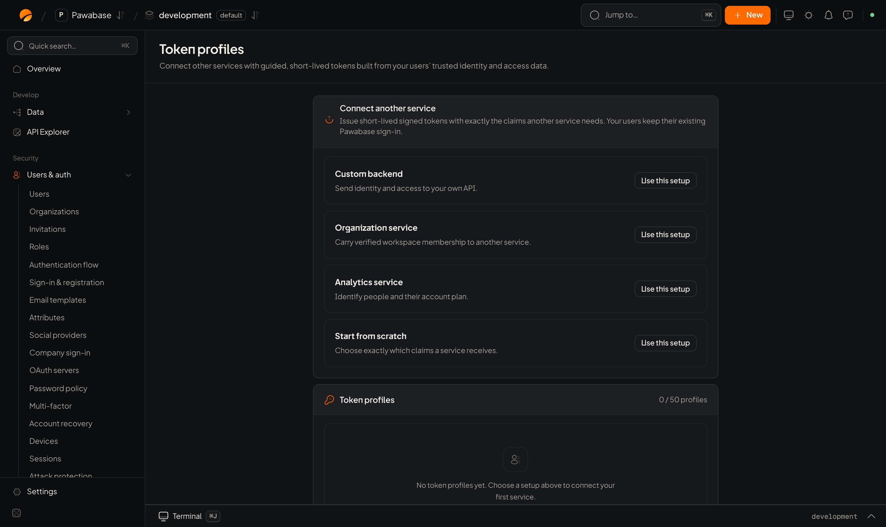
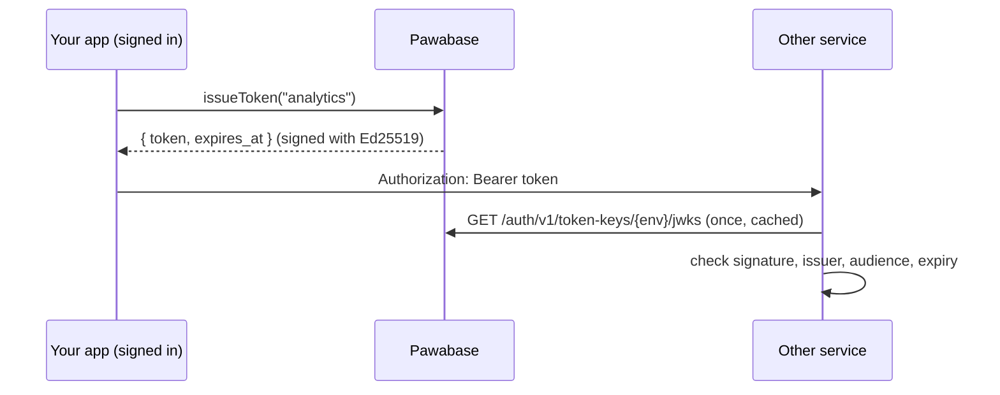

Sometimes another service needs to know who your user is: an analytics tool, a support widget, a separate API you run, a partner's system. You don't want to hand it the person's Pawabase access token, which can read and change their data. A **token profile** lets a signed-in person ask for a **separate, short-lived token** that carries only the facts that service needs, signed with a key the service can check without ever talking to Pawabase.

<Frame caption="Users & auth → Access → Token profiles: start from a setup.">
  
</Frame>

| | Pawabase access token | Token-profile token |
| --- | --- | --- |
| Accepted by | Your Pawabase API | Only the service named in its audience |
| Signed with | The environment's secret key (HMAC) | An Ed25519 key; anyone can verify it with the public key |
| Carries | Everything Pawabase needs | Only the claims you chose |
| Lifetime | Access token lifetime | 30 seconds to 1 hour (5 minutes by default) |
| Can call Pawabase | Yes | **No** |

## How it works



## Create a profile

**Users & auth → Access → Token profiles → Connect another service.** Pick a starting point (**Custom backend**, **Organization service**, **Analytics service** or **Start from scratch**), then fill in three tabs.

### Settings

| Field | Meaning | Rules |
| --- | --- | --- |
| **Profile name** | What your app asks for, such as `analytics` | Lowercase letters, digits and `-`, starting with a letter; unique |
| **Description** | What the connection is for | Up to 300 characters |
| **Audience** | What the receiving service checks it's the intended recipient: an API name or URL such as `https://analytics.example.com` | Required, up to 255 characters, no surrounding spaces |
| **Token lifetime** | How long each token is valid | 30–3,600 seconds; default 300 |
| **Enabled** | Off stops new tokens. Tokens already issued stay valid until they expire | |
| **Require an organization** | Only issue when the session is in an organization the person belongs to | |
| **Require multi-factor authentication** | Only issue from a session that passed [two-step verification](/auth/two-step-verification) (`aal2`) | |

Renaming a profile breaks apps that still ask for the old name.

### Claims

A **claim** is one named fact in the token. Up to 32 per profile.

| Field | Meaning |
| --- | --- |
| **Claim name** | What the service reads. Letters, digits and `_`, starting with a letter, up to 64 characters. The names Pawabase sets itself (below) can't be used |
| **Value comes from** | A source (table below), or a **Fixed value** |
| **Value type** (fixed values) | Text, object, true/false, or a list |
| **Require a value** | Refuse to issue when the source is empty and there's no fallback |
| **Fallback** | Used only when the source is empty |

Sources:

| Source | Value |
| --- | --- |
| `user.id`, `user.email`, `user.name`, `user.avatar_url` | The person |
| `user.email_verified` | `true` or `false` |
| `user.app_metadata.<path>` | Any field of the person's **private metadata**, such as `user.app_metadata.billing.plan` |
| `organization.slug`, `organization.id` | The session's active organization (empty without one) |
| `organization.app_metadata` | The organization's private metadata, as an object |
| `membership.role`, `membership.permissions`, `membership.teams` | The person's role, permissions and teams in that organization |
| `roles`, `permissions` | The person's environment roles and permissions (lists) |
| `session.aal` | `aal1` or `aal2` |

**Public metadata (`user_metadata`) isn't a source**: the person can edit it, so it could be used to forge a claim. Put anything a service trusts in private metadata, which only your server and Studio can change.

### Preview & connect

**Find a test user**, optionally choose an **Organization context**, then **Preview as** to see the **Resolved payload**: exactly what that person's token would carry, unsigned and without issuing anything. Use it to check every claim resolves and that nothing private leaks. Errors show here as they would at issue time (a required claim with no value, a person no longer in the organization).

The same tab shows the JWKS address and code for both halves.

## What a token contains

Your claims, plus these, which Pawabase always sets:

| Claim | Value |
| --- | --- |
| `sub` | The person's user id |
| `iss` | `<your API address>/auth/v1/token-profiles/<environment>` |
| `aud` | The profile's audience |
| `iat`, `nbf`, `exp` | Issued, valid from, expires (Unix seconds) |
| `jti` | A unique id for this token |
| `sid` | The session it was issued from |
| `env` | The environment |
| `typ` | `integration` |
| `profile` | The profile name |
| `aal` | `aal1` or `aal2` |

Header: `alg: EdDSA` and a `kid` matching the published key. Example payload for the **Analytics service** setup:

```json
{
  "user_id": "01JD4N…", "name": "Ada", "plan": "pro",
  "sub": "01JD4N…", "iss": "https://api.example.com/auth/v1/token-profiles/acme-production",
  "aud": "https://analytics.example.com", "iat": 1763548800, "nbf": 1763548800, "exp": 1763549100,
  "jti": "Qm9…", "sid": "5f2c…", "env": "acme-production", "typ": "integration", "profile": "analytics", "aal": "aal1"
}
```

Resolved claims are limited to 8 KB. Include ids and flags, not whole documents.

## In your app: request a token

<CodeGroup>
```typescript TypeScript
const { token, expires_at } = await pawabase.auth.issueToken("analytics");

await fetch("https://analytics.example.com/ingest", {
  method: "POST",
  headers: { authorization: `Bearer ${token}` },
  body: JSON.stringify(event),
});
```

```python Python
issued = pb.auth.issue_token("analytics")
# {"token", "token_type": "bearer", "expires_in", "expires_at", "audience"}
requests.post("https://analytics.example.com/ingest", headers={"authorization": f"Bearer {issued['token']}"}, json=event)
```
</CodeGroup>

Ask for a token when you need one, and reuse it until shortly before `expires_at`. Don't store it beyond the session.

| Refusal | When |
| --- | --- |
| `401` "an active sign-in session is required" | Not signed in, the session was revoked or expired, or the caller is using a [user API key](/auth/user-api-keys) (keys have no sign-in session) |
| `403` "this route is for people, not machines" | Called with a [machine](/auth/machines) identity |
| `404` "no such token profile" | No profile with that name in this environment |
| `422` "this token profile is disabled" | **Enabled** is off |
| `422` "this profile requires an organization session" | **Require an organization** is on and the session has none: [switch organization](/auth/organizations) first |
| `422` "this profile requires multi-factor authentication" | The session is `aal1` |
| `422` "required claim '…' has no value" | A required source is empty for this person |
| `422` "the user is no longer a member of this organization" | The session's organization dropped them |
| `429` | More than 60 requests a minute from one address |

Each issued token fires `token_profile.issued` with the `profile` and `audience`.

## In your service: verify

Fetch the public keys from `GET <your API address>/auth/v1/token-keys/<environment>/jwks` (no key needed), cache them, and verify each token:

<CodeGroup>
```typescript TypeScript
import { createRemoteJWKSet, jwtVerify } from "jose";

const API = "https://api.example.com";
const ENV = "acme-production";
const keys = createRemoteJWKSet(new URL(`${API}/auth/v1/token-keys/${ENV}/jwks`));

export async function verify(token: string) {
  const { payload } = await jwtVerify(token, keys, {
    issuer: `${API}/auth/v1/token-profiles/${ENV}`,
    audience: "https://analytics.example.com",
    algorithms: ["EdDSA"],
  });
  if (payload.typ !== "integration") throw new Error("not an integration token");
  return payload;   // payload.sub, payload.plan, …
}
```

```python Python
import jwt   # pip install "pyjwt[crypto]"

API, ENV = "https://api.example.com", "acme-production"
jwks = jwt.PyJWKClient(f"{API}/auth/v1/token-keys/{ENV}/jwks")

def verify(token: str) -> dict:
    key = jwks.get_signing_key_from_jwt(token).key
    payload = jwt.decode(token, key, algorithms=["EdDSA"],
                         audience="https://analytics.example.com",
                         issuer=f"{API}/auth/v1/token-profiles/{ENV}")
    if payload.get("typ") != "integration":
        raise ValueError("not an integration token")
    return payload
```
</CodeGroup>

Check all four: **signature, issuer, audience and expiry**. The audience is what stops a token meant for one service being replayed to another. Pin the algorithm to `EdDSA`. Copy the exact issuer from **Preview & connect** (**Expected issuer**). The environment in the URL may be its short or full name; the issuer always uses the full name.

From a client you can also read the keys with `pawabase.auth.jwks()` (TypeScript) or `pb.auth.jwks()` (Python).

### Keys and revocation

- Each environment has one signing key, derived from the installation's master secret. It doesn't rotate on its own, and only changes if the installation's secret does: always look keys up by `kid` from the JWKS rather than hard-coding one.
- Tokens can't be revoked individually. Disabling a profile, signing the person out or disabling them stops **new** tokens; issued ones stay valid until `exp`. Keep lifetimes short for that reason.
- Tokens are bound to a session (`sid`). A service that keeps its own state can drop it when it sees a new `sid` for the same `sub`.

## Managing profiles as code

Profiles are part of the environment's auth settings, under `token_profiles` (a list of up to 50), so they travel with [blueprints](/developers/blueprints) and [IaC](/iac/overview):

```json
{
  "name": "analytics",
  "description": "Product analytics",
  "audience": "https://analytics.example.com",
  "ttl": 300,
  "enabled": true,
  "require_org": false,
  "require_mfa": false,
  "claims": [
    { "name": "user_id", "kind": "source", "source": "user.id", "required": true },
    { "name": "plan", "kind": "source", "source": "user.app_metadata.plan", "fallback": "free" },
    { "name": "app", "kind": "value", "value": "web" }
  ]
}
```

Unknown fields are refused, and each profile is limited to 16 KB.

## Design guidance

- **One profile per receiving service**, each with its own audience and the fewest claims that service needs.
- **Short lifetimes** (1–5 minutes for server-to-server calls, up to an hour for a widget), requested on demand.
- **Authorization facts in private metadata**, never public metadata.
- **Require an organization** for anything organization-scoped, and **require MFA** for profiles that expose sensitive data or unlock privileged actions in the other service.
- Prefer ids over personal data. Send `user.email` only to a service that must contact the person.

## Related

<CardGroup cols={2}>
  <Card title="Sessions" icon="monitor-smartphone" href="/auth/sessions">The person's own tokens.</Card>
  <Card title="Users" icon="users" href="/auth/users">Private metadata, the source for trusted claims.</Card>
  <Card title="Organizations" icon="building" href="/auth/organizations">Organization claims and switching.</Card>
  <Card title="Machines and agents" icon="bot" href="/auth/machines">Services that act as themselves, not as a person.</Card>
</CardGroup>
