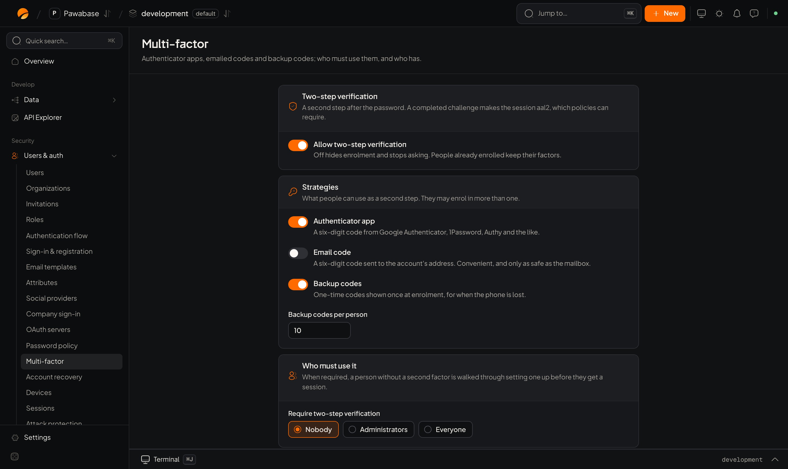

Two-step verification (also called MFA or 2FA) asks for a second proof after the first: a six-digit code from an authenticator app (1Password, Google Authenticator, Authy), a code sent by email, or a one-time backup code. Even if a password leaks, the account stays safe.

<Frame caption="Users & auth → Protection → Multi-factor: strategies and who must use them.">
  
</Frame>

## Assurance levels

Every session carries how strongly the person proved who they are, as `aal` in the access token:

| Level | Means | Comes from |
| --- | --- | --- |
| `aal1` | One factor | A password, sign-in link, email code, social sign-in, guest, [user API key](/auth/user-api-keys), or a [remembered device](/auth/devices#remember-this-device) that skipped the second step |
| `aal2` | Two factors | Any first factor followed by a second step, or a [passkey](/auth/passkeys) (the device holds the key *and* checks the person) |

[Access rules](/policies/overview) can require `aal2` for sensitive actions, and [organizations](/auth/organizations) can require it from their members.

## Settings

**Users & auth → Protection → Multi-factor.**

| Setting | Meaning | Default | Key |
| --- | --- | --- | --- |
| **Allow two-step verification** | Off stops asking for a second step at sign-in and stops new enrolment. Enrolled factors are kept and come back when it's on again | On | `mfa_enabled` |
| **Authenticator app** | People may use an authenticator app | On | `directory.mfa.totp` |
| **Email code** | People may use codes sent to their address. Convenient, and only as safe as the mailbox | Off | `directory.mfa.email` |
| **Backup codes** | One-time codes issued at enrolment, for a lost phone | On | `directory.mfa.backup_codes` |
| **Backup codes per person** | How many | 10 | `directory.mfa.backup_code_count` |
| **Emailed code lifetime** | Minutes | 10 | `directory.mfa.email_code_minutes` |
| **Require two-step verification** | `off` (nobody), `admins`, or `all` (everyone) | `off` | `directory.mfa.require` |
| **Grace period** | Days after an account is created before the requirement applies to it. 0 asks at the first sign-in | 0 | `directory.mfa.grace_days` |

**Administrators**, for `admins`, means people with the `admin`, `owner` or `superadmin` role, staff and superuser accounts, and owners or admins of any organization.

The page also lists people as **Enrolled** or **Not enrolled**, with **Reset** (below). Your plan may limit how many factors one person can have.

## Strategies

A person can have one authenticator app **and** email codes at the same time; enrolling a second authenticator replaces the first.

| | Authenticator app | Email code | Backup code |
| --- | --- | --- | --- |
| Code | 6 digits, changes every 30 seconds | 6 digits, emailed when needed | `ab12c-3de45` (10 characters) |
| Accepted | The current code, or one 30 seconds either side (clock drift). A code can't be reused | Only the newest code, until it expires. Single use | Each once. Case and the dash don't matter |
| Stored | Encrypted secret | Hash of the code | Hash of each code |
| Good for | Everyone | People without a smartphone; low-risk apps | Getting back in |

## Enrol: authenticator app

<Steps>
  <Step title="Start">
    The server makes a secret. Show it as a QR code (from `otpauth_uri`) and as text for manual entry.
  </Step>
  <Step title="Confirm with a code">
    The person scans the QR code and types the code their app shows. Two-step is on from here.
  </Step>
  <Step title="Save backup codes">
    The first enrolment returns the backup codes, once. Make the person save them before moving on.
  </Step>
</Steps>

<CodeGroup>
```typescript TypeScript
const { otpauth_uri, secret } = await pawabase.auth.mfa.enroll();
showQrCode(otpauth_uri);          // any QR library; the label is your project name and the person's email
showForManualEntry(secret);

const { enabled, recovery_codes } = await pawabase.auth.mfa.verifyEnrollment(codeFromUser);
if (recovery_codes.length) showOnce(recovery_codes);
await pawabase.auth.refreshSession();   // the session is now aal2; refresh to carry it in the token
```

```python Python
enrollment = pb.auth.mfa.enroll()                 # {"factor_id", "secret", "otpauth_uri"}
result = pb.auth.mfa.verify_enrollment(code_from_user)
if result["recovery_codes"]:
    show_once(result["recovery_codes"])
pb.auth.refresh_session()
```
</CodeGroup>

- Starting again before confirming replaces the unconfirmed secret: scanning an old QR code won't work.
- `recovery_codes` is **empty** when the person already has unused backup codes (adding a second strategy), or when backup codes are off.
- Confirming marks the **current session** as two-step (`aal2`) from its next refresh, so the person doesn't have to sign in again to reach `aal2`-only features.

## Enrol: email codes

<CodeGroup>
```typescript TypeScript
const { sent_to } = await pawabase.auth.mfa.enrollEmail();   // "a***@example.com"
const { recovery_codes } = await pawabase.auth.mfa.verifyEnrollment(codeFromEmail);
```

```python Python
started = pb.auth.mfa.enroll_email()
result = pb.auth.mfa.verify_enrollment(code_from_email)
```
</CodeGroup>

The message is **Verification code** in [Email templates](/auth/email-templates).

## Sign in with a second step

When the account has two-step verification, the first factor doesn't finish. It answers `mfa_required` with a `verify` function:

<CodeGroup>
```typescript TypeScript
const result = await pawabase.auth.signInWithPassword({ email, password });

if (result.status === "mfa_required") {
  result.factors;                                    // e.g. ["totp", "email", "recovery_code"]
  if (result.factors.includes("email")) offerEmailCode(() => pawabase.auth.mfa.challenge(result.mfaToken));
  const session = await result.verify(codeFromUser); // an app code, emailed code or backup code
}
```

```python Python
result = pb.auth.sign_in_with_password(email=email, password=password)

if result.status == "mfa_required":
    session = result.verify(code_from_user)
```
</CodeGroup>

- `factors` lists what the person can answer with: `totp`, `email`, and `recovery_code` while they have unused backup codes.
- A person whose **only** strategy is email gets the code automatically. With an authenticator app too, send it on request: `pawabase.auth.mfa.challenge(mfaToken)` (`pb.auth.mfa.challenge(mfa_token)`).
- `verify` accepts any of them; you don't say which.
- The challenge (`mfaToken`) lasts **5 minutes**. A wrong code keeps it usable for another try. `result.verify(code)` is short for `pawabase.auth.verifyMfa({ mfaToken, code })`, which you can call yourself if the token crosses a page change.
- Pass `rememberDevice: true` to the first factor or to `verifyMfa` to remember the device ([Devices](/auth/devices#remember-this-device)).

Every first factor can answer this way: [`signInWithPassword`](/auth/email-and-password), [`verifyEmailCode`](/auth/email-codes), [`verifyMagicLink`](/auth/sign-in-links), the [social sign-in](/auth/social-sign-in) return (`#mfa_required=true&mfa_token=…`) and [enterprise sign-in](/auth/enterprise-sign-in). Handle it in one place. [Passkeys](/auth/passkeys) never ask: they're already two-step.

### Wrong codes

A wrong code answers `400` "the code is not valid" (`ValidationError` in both SDKs), and counts toward the account's [lockout](/auth/attack-protection) like a wrong password. After the threshold, sign-in answers `429` until the lock expires. Second-step routes are also limited to 10 requests a minute. Allow a couple of retries, then offer "use a backup code" or "email me a code".

## Required setup

With **Require two-step verification** applying to a person who has no factor, the first factor doesn't give them a session. Sign-in (and sign-up) answers `403` with `mfa_setup_required`, a setup token and the strategies they may choose:

```json
{ "code": "mfa_setup_required", "message": "set up a second factor to finish signing in",
  "mfa_token": "…", "methods": ["totp", "email"] }
```

Start with that token, finish with the first code. Finishing returns the backup codes and an `aal2` session.

<CodeGroup>
```typescript TypeScript
import { PermissionError } from "@pawabase/client";

try {
  await pawabase.auth.signInWithPassword({ email, password });
} catch (error) {
  if (!(error instanceof PermissionError && error.is("mfa_setup_required"))) throw error;
  const { mfa_token, methods } = error.body as { mfa_token: string; methods: string[] };

  const started = await pawabase.auth.mfa.startSetup({ mfaToken: mfa_token, method: "totp" });
  showQrCode(started);                                    // otpauth_uri and secret
  const done = await pawabase.auth.mfa.completeSetup({ mfaToken: mfa_token, code: await askForCode() });
  showOnce(done.recovery_codes);
  await pawabase.auth.setSession(done as { access_token: string; refresh_token: string });
}
```

```python Python
from pawabase import ForbiddenError

try:
    pb.auth.sign_in_with_password(email=email, password=password)
except ForbiddenError as error:
    if error.detail.get("code") != "mfa_setup_required":
        raise
    token = error.detail["mfa_token"]
    started = pb.auth.mfa.start_setup(mfa_token=token, method="totp")
    done = pb.auth.mfa.complete_setup(mfa_token=token, code=input("Code: "))   # the session is kept for you
    print(done["recovery_codes"])
```
</CodeGroup>

- `method: "email"` emails a code instead of returning a QR code.
- A method the environment doesn't offer answers `422` "that method is not available".
- The setup token lasts **15 minutes** and works until setup is finished; a wrong code (`400`) leaves it usable.
- TypeScript's `completeSetup` returns the tokens without storing them, so adopt them with `setSession`. Python stores the session.
- In Python, read the code from `error.detail["code"]`.

<Warning>
If you require two-step verification, keep at least one of **Authenticator app** or **Email code** on. With neither, nobody can enrol, so Pawabase ignores the requirement rather than locking everyone out.
</Warning>

A [grace period](#settings) lets new people in for a few days before asking. It counts from account creation, not from when you turned the requirement on: turning on `all` with a 7-day grace still asks existing accounts older than 7 days at their next sign-in.

## Status, turning off and new backup codes

<CodeGroup>
```typescript TypeScript
const status = await pawabase.auth.mfa.status();
// { enabled, aal, factors, methods, required, recovery_codes_remaining }

await pawabase.auth.mfa.disable(currentCode);
const { recovery_codes } = await pawabase.auth.mfa.regenerateRecoveryCodes(currentCode);
```

```python Python
status = pb.auth.mfa.status()
pb.auth.mfa.disable(current_code)
codes = pb.auth.mfa.regenerate_recovery_codes(current_code)["recovery_codes"]
```
</CodeGroup>

| Field | Meaning |
| --- | --- |
| `enabled` | The person has two-step verification |
| `aal` | The current session's level |
| `factors` | What they've set up (`totp`, `email`, `recovery_code`) |
| `methods` | What the environment offers for enrolment |
| `required` | Whether the environment requires it (for anyone) |
| `recovery_codes_remaining` | Unused backup codes. Prompt for new ones when it's low |

- **Turning off** needs a current code (an app code, emailed code or backup code) and removes every factor and backup code. If the environment requires two-step for this person, they'll be asked to set it up again at their next sign-in.
- **New backup codes** need an app or emailed code (not a backup code), and replace all previous ones.

Both ask for a code so that someone at an unlocked, signed-in laptop can't weaken the account.

## Lost phone: recovery

| Situation | What the person does |
| --- | --- |
| Has backup codes | Signs in with a backup code, then removes the old app (`disable` with a backup code) and enrols again |
| Has email codes as a second strategy | Chooses "email me a code" at the challenge |
| Has neither | Contacts you. After confirming who they are through another channel, **Reset** them |

**Reset** is on the person's page (**Users & auth → People → Users →** the person **→ Security → Second factor**) and on the **Multi-factor** page, or from your server:

<CodeGroup>
```typescript TypeScript
await admin(secretClient).users.resetMfa(userId);
```

```python Python
pb.admin.users.reset_mfa(user_id)
```
</CodeGroup>

Reset removes every factor and backup code and fires `user.mfa_reset`. The person signs in with one factor, and is asked to set up again if the environment requires it. Be strict about confirming identity before a reset: it's exactly what an attacker who has the password would ask for.

## Require it for sensitive actions

In an [access rule](/policies/overview), add **Signed in with 2FA** (the `mfa` condition) next to the other conditions. For example, deleting a project: choose **All** of **Users with role** `admin` and **Signed in with 2FA**.

A person with an `aal1` session gets `403` from that rule. There's no separate step-up call: either they set up two-step (enrolling raises their current session to `aal2`), or they sign in again and pass the second step. Read `status().aal` first so your app can explain before they press the button.

## Events

| Event | When |
| --- | --- |
| `user.mfa_enabled` | A person confirmed a second factor |
| `user.mfa_disabled` | A person turned it off |
| `user.mfa_reset` | An administrator reset it |

Use them to email the person ("Two-step verification was turned off on your account"), which helps them notice changes they didn't make. Sign-in activity also records `mfa_challenge`, `mfa_verify` failures and `mfa_enrolled` ([Sign-in activity](/auth/sign-in-activity)).

## Troubleshooting

| Symptom | Cause | Fix |
| --- | --- | --- |
| Every app code is "not valid" | The phone's clock is off by more than 30 seconds | Turn on automatic time on the phone |
| The same code fails the second time | Codes can't be reused | Wait for the next code |
| Never asked for a second step | **Allow two-step verification** is off, or a remembered device skipped it | Check the setting and [Devices](/auth/devices) |
| `403` "authenticator apps are not available" | The **Authenticator app** strategy is off | Turn it on, or enrol email codes |
| `mfa_setup_required` for an admin in a test environment | `require` is `admins` | Expected; set up a factor or use a grace period |
| `org_mfa_required` when switching organization | The organization requires `aal2` and the session is `aal1` | Set up two-step, or sign in again with it |

## Related

<CardGroup cols={2}>
  <Card title="Passkeys" icon="fingerprint" href="/auth/passkeys">Two factors in one step.</Card>
  <Card title="Devices" icon="smartphone" href="/auth/devices">Remember confirmed devices.</Card>
  <Card title="Attack protection" icon="shield-alert" href="/auth/attack-protection">Lockouts after wrong codes.</Card>
  <Card title="Account recovery" icon="rotate-ccw" href="/auth/account-recovery">Lost passwords.</Card>
</CardGroup>
