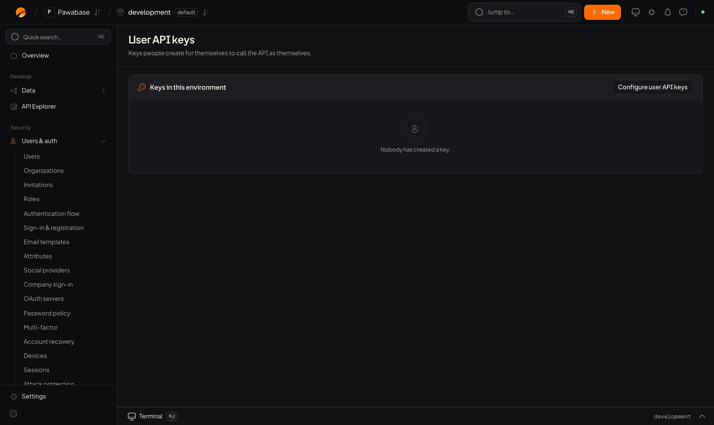

A **user API key** lets a person call your app's API from a script, a spreadsheet, a CI job or another tool, without their password: the "create an API key" page in your app's account settings. The key **acts as its owner**: the same identity, roles and organization, and the same or fewer permissions.

| | User API key | Project key (publishable / secret) | [Machine](/auth/machines) |
| --- | --- | --- | --- |
| Belongs to | One person | The project | A service or AI agent with its own identity |
| Acts as | That person | The app (`anon`) or a trusted server (`service`) | Itself |
| Created by | The person, from your app | You, in Studio | You, in Studio or from your server |
| Looks like | `pbu_…` | `pb_pk_…`, `pb_sk_…` | `pbm_…` |

<Frame caption="Users & auth → Access → User API keys.">
  
</Frame>

## Turn it on

**Users & auth → Access → User API keys → User API key configuration**:

| Setting | Default | Meaning | Key |
| --- | --- | --- | --- |
| **Let people create API keys** | Off | Off also stops existing keys from working | `directory.api_keys.enabled` |
| **Keys per person** | 10 | The most active keys one person may hold | `directory.api_keys.max_per_user` |
| **Longest a key may live** | 365 days | Caps each key's expiry. 0 allows keys that never expire | `directory.api_keys.max_days` |
| **Allow scoped keys** | On | A key may be limited to some of its owner's permissions | `directory.api_keys.scoped` |

The page also lists **Keys in this environment**: owner, name, scopes, status, last used, with **Revoke**.

## Creating keys from your app

The person must be signed in (with a session, not with another API key: a key can't create keys).

<CodeGroup>
```typescript TypeScript
const created = await pawabase.auth.apiKeys.create({
  name: "Reporting script",
  scopes: ["reports.read"],    // optional: a subset of the person's permissions
  expiresInDays: 90,            // optional, capped by the environment's maximum
});
showOnce((created as { key?: string }).key);   // the full key, in this answer only

const keys = await pawabase.auth.apiKeys.list();   // never includes the key itself
await pawabase.auth.apiKeys.revoke(keys[0].id as string);
```

```python Python
created = pb.auth.api_keys.create(name="Reporting script", scopes=["reports.read"], expires_in_days=90)
show_once(created["key"])      # the full key, in this answer only

keys = pb.auth.api_keys.list()
pb.auth.api_keys.revoke(keys[0]["id"])
```
</CodeGroup>

| Option | Meaning |
| --- | --- |
| `name` | A label the person will recognise later |
| `scopes` | Permissions to keep (see below). Empty: everything the owner has |
| `expiresInDays` / `expires_in_days` | Days until it stops working; capped by **Longest a key may live** |
| `org` | Tie the key to one of the owner's organizations: requests act in that organization |

The answer contains the full key as **`key`**, once. Only a hash is stored; show it to the person with a copy button and "you won't see this again", and never keep it yourself.

Each key in `list()` has `id`, `name`, `prefix` (the first characters, to recognise it), `scopes`, `org`, `status` (`active`, `expired`, `revoked`), `created_at`, `expires_at`, `last_used_at`, `last_ip` and `use_count`.

Creation is refused with `422` when keys are off, the person has reached **Keys per person**, the expiry is longer than allowed, or scopes are given while scoped keys aren't allowed.

## Using a key

The key goes in the `Authorization` header as a bearer token, **alongside** your app's publishable key in `apikey`. With the client libraries, pass it where a person's access token would go:

<CodeGroup>
```typescript TypeScript
const client = createClient({ url, project, apiKey: "pb_pk_…", accessToken: process.env.MY_PAWABASE_KEY });
const { data } = await client.from("reports");
```

```python Python
pb = Pawabase(url, "pb_pk_…", project=project).as_user(os.environ["MY_PAWABASE_KEY"])
reports = pb.from_("reports").execute().data
```
</CodeGroup>

The gateway recognises the `pbu_` key, checks it, and replaces it with a short-lived access token for the owner before the request reaches your app. So **every route that accepts a signed-in person accepts a key**, with the same access rules, and nothing in your tables or flows needs to know keys exist.

## What a key can and can't do

**Scopes narrow permissions, not roles.** With scopes, the key's token keeps only the owner's permissions that the scopes cover (in the organization too, for organization permissions). The owner's **roles** stay as they are. So:

- Rules that check a **permission** (`posts.publish`) respect the key's scopes.
- Rules that check a **role** (`editor`) pass for a scoped key whenever the owner has the role.

If you want people to make narrow keys, write your rules with permissions. See [Roles](/auth/roles).

How scopes match: a scope covers a permission with the same name, and a scope ending in `:*` covers every permission that starts with the part before `*` (`reports:*` covers `reports:read` and `reports:export`). A dotted scope like `reports.*` doesn't act as a wildcard.

Other limits:

- **One-factor only.** A key's session counts as a password-strength sign-in (`aal1`): rules and organizations that require [two-step verification](/auth/two-step-verification) refuse it.
- **No new keys.** A key can't create other keys.
- **It stops working** when it's revoked or expires, when its owner is disabled or deleted, or when the environment turns user keys off. A revoked key is refused within about 45 seconds (the gateway remembers checked keys briefly).

## Managing keys as an administrator

In Studio: **Users & auth → Access → User API keys** lists every key with **Revoke**. From your server, with a secret key:

<CodeGroup>
```typescript TypeScript
import { admin } from "@pawabase/client/admin";

const people = admin(secretClient);
await people.users.apiKeys(userId);        // one person's keys
await people.apiKeys.list({ limit: 100 }); // every key in the environment
await people.apiKeys.revoke(keyId);
```

```python Python
pb.admin.users.api_keys(user_id)
pb.admin.api_keys.list(limit=100)
pb.admin.api_keys.revoke(key_id)
```
</CodeGroup>

`user.api_key_created` and `user.api_key_revoked` events (with `user_id` and `key_id`) let a flow email the person "a new API key was created on your account", which helps them notice keys they didn't make. See [Auth webhooks](/auth/auth-webhooks).

## An account page for keys

1. List the person's keys: name, prefix, scopes, created, expires, last used.
2. A **Create key** form with a name, optional scopes (show the person's own permissions to pick from) and an expiry.
3. After creating, show the key once, with a copy button.
4. **Revoke** on each key.

## Good practice

- Encourage scoped keys and short lifetimes (30–90 days); set **Longest a key may live** to enforce a ceiling.
- Revoke keys unused for months; `last_used_at` tells you which.
- Tell people a key is a password: never commit it or paste it into a shared document.

## Related

- [Machines and agents](/auth/machines): identities for services that aren't a person.
- [Keys and security](/reference/keys-and-security): the project's own keys.
- [Roles](/auth/roles): permissions that scopes narrow.
