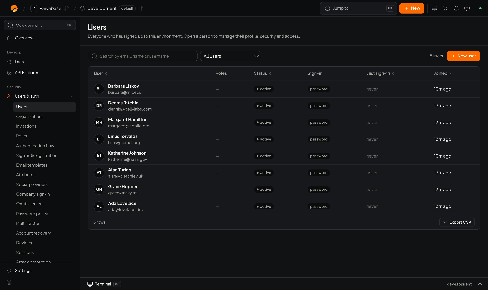

**Users** is everyone who can sign in to an environment. You use it for support (find a person, unlock them, reset their second factor), onboarding (create accounts yourself), and housekeeping (disable, delete, erase). Each environment has its own users: the same address in `development` and `production` is two different people.

## In Studio

<Frame caption="Users & auth → People → Users: search, status filter and the list.">
  
</Frame>

**Users & auth → People → Users.**

### Find people

Search matches part of the **email, username or name** (not case-sensitive). The status filter narrows the list:

| Filter | Shows |
| --- | --- |
| **All** | Everyone except deleted accounts |
| **Unverified** | Email address not confirmed |
| **Disabled** | Blocked by an administrator |
| **Locked** | Temporarily locked after wrong passwords ([Attack protection](/auth/attack-protection)) |
| **MFA on** / **MFA off** | With or without a second factor |

Newest accounts come first. **Export** downloads the current page of the list as CSV or JSON. Click a row to open the person.

### Create a user

**New user** asks for an **Email**, a **Name** and an optional **Password**. Accounts you create:

- skip [sign-up restrictions](/auth/sign-up-restrictions) (allowed domains, sign-up turned off), but **not** the [password policy](/auth/password-policy);
- count toward your plan's user limit;
- have their email marked **verified** (you vouch for it), unless you create them from code with `emailVerified: false`;
- fire `user.created` with `method: "admin"`.

<Note>
Creating a user sends **no email**. Without a password, the person gets in with **Forgot password**, a [sign-in link](/auth/sign-in-links), an [email code](/auth/email-codes) or [social sign-in](/auth/social-sign-in) with the same address. To welcome them with an email, send an [invitation](/auth/invitations) instead, or trigger your own message from `user.created`.
</Note>

### A person's page

| Tab | What's there |
| --- | --- |
| **Profile** | Name and picture, email and username (read-only), **Public metadata** and **Private metadata** |
| **Security** | **Account** status with **Disable account** / **Enable account** and **Unlock**; **Password** (set a new one); **Second factor** (see and reset); **Sessions** (with **Sign out everywhere**); **Data requests**; **Delete user** |
| **Access** | **Roles**, and **Direct permissions** on top of what the roles allow |
| **Organizations** | The organizations they belong to and their role in each |
| **Activity** | What they did: a year grid, a summary and a timeline (below) |

## What each action does

| Action | Effect | Reversible | Event |
| --- | --- | --- | --- |
| **Disable** | Can't sign in or refresh; every session ends | Yes: **Enable** | `user.disabled` / `user.enabled` |
| **Unlock** | Clears a lockout and the wrong-password count | n/a | — |
| **Set password** | Replaces the password, checked against the policy. Sessions stay; the person isn't told | n/a | — |
| **Reset second factor** | Removes their second factors and recovery codes, so they sign in with one factor and can set up again | n/a | — |
| **Sign out everywhere** | Ends every session | n/a | — |
| **Delete** | Ends sessions, removes linked accounts and the second factor, deletes an uploaded picture, frees the address for a new sign-up | **No** | `user.deleted` |
| **Erase** | Everything delete does, and clears what could identify them from history and mail logs | **No** | `user.erased` |

A disabled person's current access token keeps working until it expires (15 minutes by default); see [Sessions](/auth/sessions). Delete keeps the row as a deleted account so history stays attributable; erase clears it. For "delete my data" requests, use **erase**: see [Data requests](/auth/data-requests).

## From your server

The [admin client](/developers/admin-client) does everything Studio does. It needs a **secret key**.

<CodeGroup>
```typescript TypeScript
import { createClient } from "@pawabase/client";
import { admin } from "@pawabase/client/admin";

const a = admin(createClient({ url, project, apiKey: process.env.PAWABASE_SECRET_KEY, environment: "production" }));

const { data, total } = await a.users.search({ search: "ada", status: "unverified", limit: 50, offset: 0 });
const person = await a.users.getUser(userId);        // includes live `sessions`

const created = await a.users.create({
  email: "ada@example.com",
  name: "Ada",
  roles: ["editor"],
  appMetadata: { plan: "pro" },
  // password, username, userMetadata, emailVerified (default true)
});

await a.users.update(userId, { disabled: true });     // block; also ends sessions
await a.users.update(userId, { unlock: true });
await a.users.update(userId, { roles: ["viewer"] });  // replaces the whole list
await a.users.resetMfa(userId);
await a.users.deleteUser(userId);
```

```python Python
import os
from pawabase import Pawabase

pb = Pawabase(url, os.environ["PAWABASE_SECRET_KEY"], project=project, environment="production")

page = pb.admin.users.search(search="ada", status="unverified", limit=50, offset=0)
person = pb.admin.users.get_user(user_id)

pb.admin.users.create(email="ada@example.com", name="Ada", roles=["editor"], app_metadata={"plan": "pro"})
pb.admin.users.update(user_id, disabled=True)
pb.admin.users.update(user_id, unlock=True)
pb.admin.users.update(user_id, roles=["viewer"])
pb.admin.users.reset_mfa(user_id)
pb.admin.users.delete_user(user_id)
```
</CodeGroup>

| Option | Notes |
| --- | --- |
| `search`, `status` | As in Studio. `status` is `unverified`, `disabled`, `locked`, `mfa` or `no_mfa` |
| `limit`, `offset` | Up to 200 per page; the answer's `total` counts every match |
| `roles` (update) | **Replaces** the person's roles: roles not listed are taken away |
| `userMetadata`, `appMetadata` (update) | **Replace** the whole object; read, change and send back the full object |
| `emailVerified` | Mark the address confirmed (`true`) or not (`false`) |

The email address can't be changed from the admin API. The person changes it themselves, with confirmation ([User profile](/auth/user-profile)).

Refusals: `404` "no such user" for an unknown or deleted id; `409` when the email (or username) already exists in the environment; `422` for a password that breaks the policy; `403` when the plan's user limit is reached.

## Public and private metadata

| | Who can change it | Where it shows | Use it for |
| --- | --- | --- | --- |
| **Public metadata** (`user_metadata`) | The person, and your server | Their profile; your app | Preferences, display settings, onboarding state |
| **Private metadata** (`app_metadata`) | Only your server and Studio | Their profile (read-only), and their access token as `app` | Plan, entitlements, customer ids, anything an access rule trusts |

Never base access on public metadata: the person can set it to anything. Private metadata travels in the token, so rules can read it as `$auth.claims.app.plan`. The person sees the change after their next refresh. Keep it small (ids and flags, not documents), since it's sent with every request.

## A person's activity

The **Activity** tab shows what this person did, not only when they signed in:

| Kind | Covers |
| --- | --- |
| **Sign-ins** | Signing in and out, failed refreshes, lockouts and second-factor checks, including failures |
| **Account** | Editing their profile, changing or resetting their password, setting up a second factor or passkey, recovery requests |
| **Requests** | Calls they made to your API with their token: reads, writes and routes |

- **Filter chips** (Everything, Sign-ins, Account, Requests), each with a count. The chip also changes the grid.
- **A year grid**, one square per day, darker for busier days. A red mark means some of that day's activity failed.
- **A summary**: last seen, active days, failures and failure rate, busiest hour (UTC), number of different IP addresses.
- **Most used**: their five most-called endpoints, with ids folded together (`GET /rest/v1/orders/{id}`).
- **A timeline**, newest first, one line per event with its IP. **Show older** goes further back.

Days are counted in UTC. How far back requests go depends on your plan's request-log retention; sign-in history follows its own retention.

<CodeGroup>
```typescript TypeScript
const summary = await a.users.activity(userId, { weeks: 53 });
const page = await a.users.timeline(userId, { type: "request", limit: 50 });
const older = await a.users.timeline(userId, { type: "request", before: page.next_before });
const signIns = await a.users.history(userId);
```

```python Python
summary = pb.admin.users.activity(user_id, weeks=53)
page = pb.admin.users.timeline(user_id, type="request", limit=50)
older = pb.admin.users.timeline(user_id, type="request", before=page["next_before"])
sign_ins = pb.admin.users.history(user_id)
```
</CodeGroup>

## Support recipes

| The person says | Do this |
| --- | --- |
| "I can't sign in" | Open them. **Locked**? Unlock. **Disabled**? Check why first. Unverified and your environment requires verification? Mark verified, or ask them to use the confirmation email. Then check **Activity → Sign-ins** for the failure reason |
| "I lost my phone" (second factor) | Confirm who they are through another channel, then **Reset second factor**. They sign in with their password and set up again |
| "Someone else is in my account" | **Sign out everywhere**, set a temporary password or ask them to reset it, reset the second factor if needed, then review **Activity** for what happened |
| "Delete my account" | [Data requests](/auth/data-requests) → **Erase** |
| "I never got the email" | Check **Mail** in Studio for the message and its status, and [Redirect URLs](/auth/redirect-urls) if the link fails |

## Many users at once

To move or seed many accounts, use [Import and export](/auth/import-and-export). For a few hundred, a script that calls `users.create` in a loop is fine. Mind the plan's user limit.

## Events

| Event | When |
| --- | --- |
| `user.created` | Any new account (`method` says how: `password`, `admin`, a provider, …) |
| `user.updated` | The person changed their own profile |
| `user.disabled`, `user.enabled` | An administrator blocked or unblocked them |
| `user.deleted` | Deleted |
| `user.data_exported`, `user.erased` | [Data requests](/auth/data-requests) |

Admin edits to name, metadata or roles don't fire `user.updated`. See [Auth webhooks](/auth/auth-webhooks) for the full list.

## Related

<CardGroup cols={2}>
  <Card title="Roles" icon="badge-check" href="/auth/roles">What roles and permissions allow.</Card>
  <Card title="Sessions" icon="monitor-smartphone" href="/auth/sessions">How sign-outs and disables take effect.</Card>
  <Card title="Data requests" icon="shield-check" href="/auth/data-requests">Export or erase a person.</Card>
  <Card title="Admin client" icon="terminal" href="/developers/admin-client">Every admin call.</Card>
</CardGroup>
