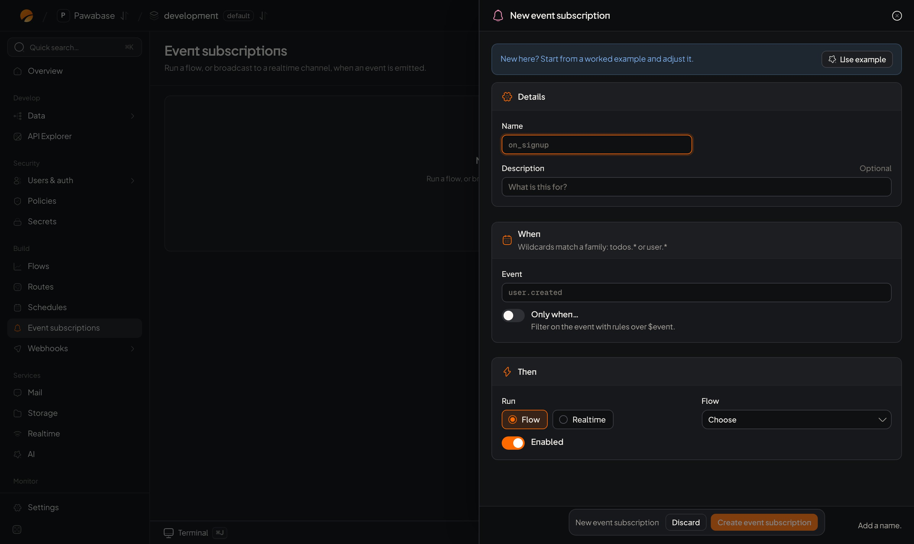

An **event** is a named announcement that something happened: `orders.created`, `user.signed_in`, `invoice.overdue`. Something **emits** it; anything **subscribed** reacts. The emitter never waits for the reactions and never needs to know who is listening, so you can add a reaction without touching the code or flow that caused it.

Events are the backbone of automation in Pawabase: they start [flows](/logic/flows), drive [outbound webhooks](/automation/webhooks), and can be pushed to [realtime channels](/realtime/overview).

## What emits events

You get most events without writing anything.

| Source | Events | Turn on or off |
| --- | --- | --- |
| **Your tables** | `<table>.created`, `<table>.updated`, `<table>.deleted` after each successful write through the API | **Emit events** in the table's [Settings](/database/table-settings) |
| **Sign-in and accounts** | `user.created`, `user.signed_in`, `user.verified`, `session.revoked` and [many more](/automation/event-catalogue#sign-in-and-accounts) | Always on |
| **Agents** | `agent.run.finished`, `agent.run.waiting` | Always on |
| **Alarms** | `alarm.state_changed` when an alarm fires or recovers | Always on |
| **Realtime** | `realtime.message` when a client publishes to a channel a flow listens to | When a flow has a Realtime trigger |
| **Your flows** | Any name you choose, with the **Emit event** block | You decide |
| **Schedules** | Any name, on the clock | See [Schedules](/automation/schedules) |
| **Inbound hooks** | Any name, when another service calls you | See [Inbound hooks](/automation/inbound-hooks) |
| **You** | Any name, from Studio or the management API | See [Emit your own](#emit-your-own-events) |

The full list, with each event's payload, is in the [event catalogue](/automation/event-catalogue).

## The event envelope

Every event, whatever emitted it, has the same fields:

| Field | Example | Meaning |
| --- | --- | --- |
| `id` | `01JD8Z6Q0000EVENT` | Unique per event. Use it to skip events you've already handled. |
| `name` | `orders.updated` | The event's name |
| `env` | `production` | The environment it happened in |
| `payload` | `{ "resource": "orders", "change": "updated", "record": { … } }` | The data it carries |
| `source` | `api` | What emitted it |
| `actor` | `01JD7…` | Who caused it: a user id, `service`, `system`, `scheduler`, or empty |
| `occurred_at` | `2026-11-06T14:02:11+00:00` | When it happened (UTC) |
| `request_id` | `01JD8Z…` | The request that caused it, when there was one. Ties the event to everything else in [Activity](/activity/requests). |

### Table events

A table's events carry the record:

```json
{
  "name": "orders.updated",
  "payload": {
    "resource": "orders",
    "change": "updated",
    "record": { "id": "01JD8…", "status": "paid", "total": 42.5, "customer_id": "01JD7…" }
  }
}
```

- `record` is the record **after** the change for `created` and `updated`, and the record **as it was** for `deleted`.
- Fields that are **write only** (and vector fields) are left out.
- Events are emitted for writes made **through the API** (your app, flows, Studio's table editor). Writes made directly in the database with the SQL editor don't emit events, unless the table's **Capture changes made outside the API** setting is on.
- An update event doesn't include the previous values. If a reaction needs to know what changed, store what it needs (for example a `previous_status` field) or compare in the flow.

## Subscribe: run something when an event happens

An **event subscription** connects an event to a reaction. Open **Event subscriptions → New event subscription**.

<Frame caption="New event subscription: a name, the event, an optional condition, and what runs.">
  
</Frame>

| Field | Meaning |
| --- | --- |
| **Name** | Letters, digits, dashes and underscores: `receipt-on-paid` |
| **Description** | For your team |
| **Event** | The event's name or a pattern with `*` (see [Wildcards](#wildcards)) |
| **Only when…** | An optional condition over the event, built with the [condition builder](/policies/condition-builder) |
| **Then** | **Flow**: start a flow. **Realtime**: publish the event to a channel. |
| **Flow** or **Channel** | Which flow, or which channel (see below) |
| **Enabled** | Off pauses it without deleting |

Save, and it applies to events **from now on**. Past events aren't replayed to a new subscription.

### When the reaction is a flow

The flow is started as a background job, and receives the whole event as its input:

```json
{
  "event": {
    "id": "01JD8Z6Q0000EVENT",
    "name": "orders.updated",
    "payload": { "resource": "orders", "change": "updated", "record": { "id": "01JD8…", "status": "paid" } },
    "actor": "01JD7…",
    "occurred_at": "2026-11-06T14:02:11+00:00",
    "request_id": "01JD8Z…"
  }
}
```

So in the flow you read `{{ input.event.payload.record.status }}`, `{{ input.event.actor }}` and `{{ input.event.id }}`. The run is a **system** run: it isn't signed in as the person who caused the event. Use `input.event.actor` if you need to know who that was.

### When the reaction is a realtime channel

The event is published to a [realtime channel](/realtime/channels), with the event's name as the message type and its payload as the message. Leave the channel empty to use `events:<event name>`. The channel can use values from the event, for example `orders:{{ event.payload.record.customer_id }}`, so each customer hears only about their own orders.

People still need permission to subscribe to that channel: see [Channel rules](/realtime/channel-rules).

### Conditions

**Only when…** filters events before anything runs. It's an [access rule](/policies/overview) evaluated over the event, which you read as `$event`:

| You want | Condition |
| --- | --- |
| Only paid orders | `$event.payload.record.status` **equals** `paid` |
| Only large orders | `$event.payload.record.total` **greater than** `100` |
| Only sign-ins with a passkey | `$event.payload.method` **equals** `passkey` |
| Only changes made by people, not by flows | `$event.actor` **is not** empty |

In JSON:

```json
{ "eq": ["$event.payload.record.status", "paid"] }
```

A condition is cheaper and clearer than a flow that starts and immediately exits.

### Triggers inside a flow

A flow can also own its own reactions, without a subscription, by adding trigger blocks:

| Trigger block | Fires on |
| --- | --- |
| **Event** | Any event matching a name or pattern |
| **Resource change** | A table's `created`, `updated` or `deleted` events, for the operations you tick |
| **Realtime message** | A client publishing to a channel matching a pattern |

They receive the same `{ "event": … }` input. Use a subscription when you want to see and switch reactions in one list; use a trigger when the flow and its trigger belong together. See [Triggers](/logic/blocks/triggers).

## Wildcards

In a subscription's **Event**, a webhook's **Events** and an Event trigger, `*` stands for any run of characters, **including dots**.

| Pattern | Matches |
| --- | --- |
| `orders.created` | Only that event |
| `orders.*` | `orders.created`, `orders.updated`, `orders.deleted`, and `orders.line.added` |
| `*.created` | `orders.created`, `customers.created`, `user.created` |
| `user.*` | Every account event |
| `*` | Everything |

Matching is **case-sensitive**, and there is no wildcard for exactly one segment.

## Emit your own events

Your own event names describe your business: `order.paid`, `invoice.overdue`, `trial.ending`.

**From a flow:** add the **Emit event** block with a name and a payload. It continues straight away.

**From Studio:** in **Activity → Events**, **Send test event** emits one, which is the easiest way to try a subscription.

**From your server:** use the management API with a secret key:

<CodeGroup>
```typescript TypeScript
import { manage } from "@pawabase/client/manage";

const m = manage(pawabase);
await m.events.emit("invoice.overdue", { invoice_id: "inv_123", days: 7 });
```

```python Python
pb.manage.events.emit("invoice.overdue", {"invoice_id": "inv_123", "days": 7})
```

```bash curl
curl -X POST "$PAWABASE_URL/platform/v1/envs/production/events" \
  -H "apikey: $PAWABASE_SECRET_KEY" -H "content-type: application/json" \
  -d '{"name": "invoice.overdue", "payload": {"invoice_id": "inv_123", "days": 7}}'
```
</CodeGroup>

Names can be up to 128 characters. Emitting from the API is recorded in the [audit log](/activity/audit-log).

### Naming events

- Use `noun.verb`, lowercase, past tense: `invoice.overdue`, `order.shipped`.
- Don't reuse a table's name for a business event: `orders.updated` is the table's; `order.paid` is yours.
- Put **ids and a little context** in the payload, not whole records. A reaction can load the current record by id, and it will then see the latest data.

## How events are delivered

- **At least once.** Every reaction will run, but in rare cases (a restart part-way through) one may run twice. Make reactions safe to repeat: skip an event `id` you've already handled, or use unique keys.
- **Each reaction once per event.** If routing an event is interrupted and resumed, reactions that already started aren't started again, and webhooks never deliver the same event to the same endpoint twice.
- **Independent.** Each reaction runs separately. A slow or failing one doesn't delay the emitter or the others.
- **Not in order.** Reactions run in the background and may finish in any order. Don't rely on `orders.created` being handled before `orders.updated`; load the current record instead.
- **Per environment.** Events in `production` never reach `development`.
- **From now on.** A new subscription doesn't see past events.

A flow started by an event gets **one attempt**. Retrying arbitrary work could, say, charge a card twice, so Pawabase doesn't guess. Wrap anything that can fail for a passing reason in a **Retry** block, and re-run what failed from [Jobs](/automation/jobs).

## Inspect what happened

**Activity → Events** lists recent events, filterable by name (`orders.created`). Open one to see:

- its full envelope, and
- **every consumer it reached**: each flow, realtime channel and webhook, and how each went.

**Activity → Event map** draws where events come from and what consumes them, so you can see at a glance what reacts to what, and spot events nobody listens to.

<CodeGroup>
```typescript TypeScript
const recent = await m.events.list({ name: "orders.updated", limit: 20 });
```

```python Python
recent = pb.manage.events.list(name="orders.updated", limit=20)
```
</CodeGroup>

## Limits

Event subscriptions and the flow runs they start count towards your plan's **flow runs per month**. See [Plans and limits](/cloud/plans-and-limits).

## Troubleshooting

| Problem | Check |
| --- | --- |
| The flow never runs | Is the subscription **Enabled**? Does the **Event** match exactly (`orders.created`, not `order.created`)? Is **Emit events** on for the table? Did the write go through the API? |
| The condition never matches | Paths start at `$event`: the record is at `$event.payload.record`, not `$event.data` |
| The flow runs but finds nothing in `input` | Read from `input.event.payload…` |
| It ran twice | At-least-once delivery. Deduplicate on `input.event.id`. |
| Updates arrive before creates | Reactions aren't ordered. Load the current record by id. |
| An event is in Activity with no consumers | Nothing subscribes to that name. Check the [Event map](#inspect-what-happened). |

<CardGroup cols={2}>
  <Card title="Event catalogue" icon="list" href="/automation/event-catalogue">Every built-in event and its payload.</Card>
  <Card title="Webhooks" icon="webhook" href="/automation/webhooks">Send events to other systems.</Card>
</CardGroup>
