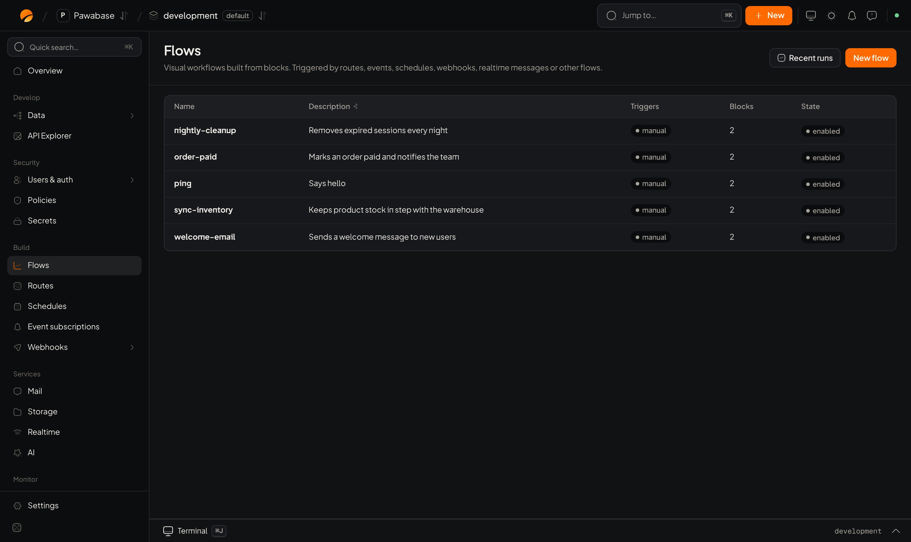

A **flow** is a visual automation: blocks joined by arrows, starting from a **trigger** (an HTTP call from your app, an event, a schedule, an inbound webhook, a realtime message, a record change, or a person pressing run). You build it in Studio, and changing it never needs a deploy. This page is about the **editor**; for what flows are and how your app calls them, see [Flows](/logic/flows), and for every block, the [block reference](/logic/blocks/overview).

<Frame caption="Flows: the list of flows, Recent runs and New flow.">
  
</Frame>

## Open it

**Flows** in the sidebar lists your flows with their description, triggers, number of blocks and state. Click one to edit it, or **New flow** to start one.

## The parts of the editor

| Area | Use it to |
| --- | --- |
| **Blocks** panel | Find a block to add. **Search blocks…** matches names and descriptions. Drag a block onto the canvas or click it. |
| **Canvas** | Place blocks and connect them: drag from a block's exit to the next block. **Arrange** tidies everything top to bottom. |
| **Block panel** | Opens when you select a block: its **Label**, its **Node id**, and its settings. **Remove block** deletes it. |
| **Validate** | Check the flow and list problems, block by block |
| **Test run** | Run the flow as it is in the editor, with sample input |
| **Save** | Store your changes. Until you save, real triggers keep using the saved version. |
| **Run saved flow** | Run the **saved** version. Save first to test changes. |
| **Last run** | The most recent real run, with its outcome |

### Flow settings

| Setting | Meaning | Default |
| --- | --- | --- |
| **Name** | How the flow is called and referenced: lowercase letters, digits, dashes and underscores | required |
| **Description** | What it does, for your team | empty |
| **Enabled** | Off stops every trigger from starting it | on |
| **Record runs (with traces)** | Keep each run's step-by-step trace in [Flow runs](/activity/background-work#flow-runs). Turn off for very frequent, simple flows to save space. | on |
| **Timeout (seconds)** | How long a run may take before it's stopped: more than 0, up to 900 | 60 |

## Blocks, exits and node ids

Each block has **exits**. Most have one, `next`. Blocks that decide something have one per answer: **If** has `true` and `false`, **Get record** has `next` and `missing`, **Check policy** has `allowed` and `denied`. Connect each exit to what should happen in that case. An exit with nothing connected simply ends that path.

Each block has a **Node id**, such as `load_customer`. Later blocks read its output as `steps.<node id>.output`, so give important blocks short, clear ids **before** you reference them; renaming later means updating every reference.

## Use values from earlier steps

Any setting can use values from the run. Type `{` or use **Pick a value with { }** to choose from what's available:

| You want | Write |
| --- | --- |
| Something the trigger received | `{{ input.email }}` |
| An event's record (from a subscription or Event trigger) | `{{ input.event.payload.record.status }}` |
| An earlier block's output | `{{ steps.load_customer.output.email }}` |
| A variable from **Set variables** | `{{ vars.total }}` |
| Who is calling | `{{ auth.user_id }}` |

A setting that is **only** a value (`"{{ input.items }}"`) passes the value itself: a list stays a list, a number stays a number. A value **inside text** (`"Order {{ input.id }}"`) becomes text. A missing value becomes empty, so test with realistic data. Filters like `| default:"friend"` and `| upper` are listed on the [block reference](/logic/blocks/overview#filters).

**Use a value from the flow instead** switches a field that normally takes a fixed choice (a table, a template) to one picked at run time.

## Build one: a receipt when an order is paid

<Steps>
  <Step title="Choose the trigger">
    Add an **Event** trigger with the event `orders.updated`. (Or use a **Resource change** trigger for `orders`, ticking *updated*.) The run's input is `{ "event": { … } }` with the order at `input.event.payload.record`.
  </Step>
  <Step title="Only continue for paid orders">
    Add an **If** block with the condition "`input.event.payload.record.status` equals `paid`". Connect its `true` exit onwards; leave `false` empty.
  </Step>
  <Step title="Load the customer">
    Add **Get record** with id `customer`, table `customers`, id `{{ input.event.payload.record.customer_id }}`. Connect `missing` to a **Log** block so you notice orders without a customer.
  </Step>
  <Step title="Send the email">
    Add **Send email**: **To** `{{ steps.customer.output.email }}`, **Template** `receipt`, **Data** `{"order": "{{ input.event.payload.record }}", "customer": "{{ steps.customer.output }}"}`. See [Sending email](/mail/sending#from-a-flow).
  </Step>
  <Step title="Validate and save">
    **Validate**, fix anything it lists, then **Save**.
  </Step>
</Steps>

**Send email** queues the message and retries it if your provider fails, so you don't need a Retry block around it. Use **Retry** for blocks that call other services directly, such as **HTTP request**.

## Validate

**Validate** checks that the flow can run and lists each problem with the block it belongs to:

| Problem | Fix |
| --- | --- |
| *a flow needs at least one node* | Add blocks |
| *a flow needs a trigger block* | Add a trigger: without one, nothing can start it |
| *duplicate node id* | Give each block its own id |
| *uses unknown block* | The flow was made for a block that no longer exists; replace it |
| *references a missing node* | An arrow points at a block you removed; delete the arrow |
| *block … has no … output* | An arrow leaves from an exit that block doesn't have |

Saving also checks the flow, so a flow that can't run is never saved.

## Test run

1. Click **Test run**.
2. Fill **Input (JSON)** with what the trigger would carry. For an event trigger, that's `{"event": {"name": "orders.updated", "payload": {"record": {…}}}}`; for an HTTP trigger, the request body.
3. Optionally set **Run it as**: a user id and roles. Rules and **Require sign-in** blocks then behave as they would for that person. Leave it empty to run as a system run.
4. Optionally pick **Start from** a particular trigger, when the flow has more than one.
5. Run it. You get the **Result**, the **Trace** (every block's input, output and chosen exit, in order, with timing) and the **Logs**.

A test run really runs: blocks that write records, send email or call other services **do** those things. Test against `development`, and pause [mail delivery](/mail/delivery#pause-delivery) there.

### Read the trace

Read from the top and find the first block whose output isn't what you expected. That's nearly always the bug: a wrong path (`input.record` instead of `input.event.payload.record`), a value that's text when you needed a number, or an exit connected to the wrong place.

## Run and watch it for real

Once saved and enabled, a flow runs whenever its trigger fires. Each run appears under **Activity → Flow runs** with its trace (if **Record runs** is on). Flows started by events, schedules and hooks run as [background jobs](/automation/jobs); a failure shows there too.

## Call a flow from your app

A flow with an **HTTP request** trigger that has no path can be called by name; with a path, it's a [route](/logic/routes):

<CodeGroup>
```typescript TypeScript
const quote = await pawabase.flows.run("price-quote", { sku: "A1", quantity: 3 });
```

```python Python
quote = pb.flows.invoke("price-quote", sku="A1", quantity=3)
```

```bash curl
curl -X POST "$PAWABASE_URL/flows/v1/price-quote" \
  -H "apikey: $PAWABASE_KEY" -H "authorization: Bearer $ACCESS_TOKEN" \
  -H "content-type: application/json" -d '{"sku": "A1", "quantity": 3}'
```
</CodeGroup>

See [Flows](/logic/flows) for who may call a flow and what it returns.

## Common mistakes

| Mistake | Result | Fix |
| --- | --- | --- |
| Reading `input.record` in an event flow | Empty values | Event flows get `input.event.payload.record` |
| Testing changes with **Run saved flow** | The old version runs | Use **Test run**, or save first |
| Referencing a block by its label | Empty value | Use its **Node id**: `steps.<id>.output` |
| Not connecting `missing` or `false` | The run silently ends | Connect it, even to a **Log** block |
| A flow your app calls with no sign-in check | Anyone with your public key can run it | Start with **Require sign-in**, or set who may call it |
| A secret pasted into a block | It shows in traces and to anyone who can edit flows | Use `secret://NAME` or **Read secret** |
| A long loop doing one HTTP call per item | Hits the timeout | Queue one job per item with **Queue flow** |

## Good practice

- One purpose per flow; name it for what it does (`send-receipt`).
- Give blocks meaningful node ids.
- Make every flow with side effects safe to repeat: check a marker before acting.
- Keep secrets in [Secrets](/secrets/overview).
- Test in `development`, then [promote](/environments/promote).

<CardGroup cols={2}>
  <Card title="Flows" icon="workflow" href="/logic/flows">What flows are and how they're called.</Card>
  <Card title="Block reference" icon="blocks" href="/logic/blocks/overview">Every block and setting.</Card>
  <Card title="Events" icon="bolt" href="/automation/events">Start flows from events.</Card>
  <Card title="Background jobs" icon="list-checks" href="/automation/jobs">Retries and failures.</Card>
</CardGroup>
