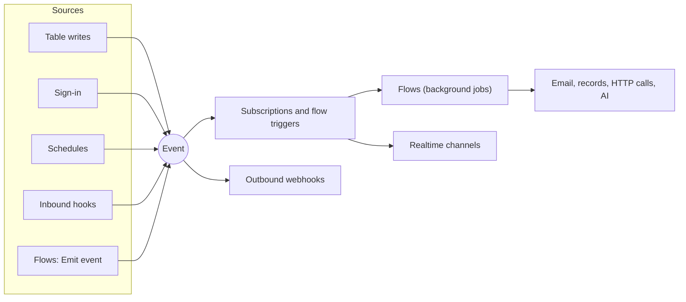

Some work should happen **because something happened**, not because a person pressed a button: send a receipt when an order is paid, tell a partner's system when a record changes, sweep for overdue invoices every night, process a file after it's uploaded, react when Stripe says a payment succeeded.

In Pawabase you build this in Studio, from a few pieces that fit together. Your app usually just writes data; the rest follows.

## The pieces

| Piece | What it does | Docs |
| --- | --- | --- |
| **Events** | Named announcements that something happened: `orders.created`, `user.signed_in`, or your own `invoice.overdue` | [Events](/automation/events), [Event catalogue](/automation/event-catalogue) |
| **Event subscriptions** | "When this event happens (and this condition holds), run this flow" or "publish it to this channel" | [Events](/automation/events#subscribe-run-something-when-an-event-happens) |
| **Flows** | Visual automations: blocks for records, email, HTTP calls, AI, branches, loops and retries | [Flow editor](/automation/flow-editor), [Flows](/logic/flows), [Block reference](/logic/blocks/overview) |
| **Schedules** | Run a flow or emit an event on a cron or an interval | [Schedules](/automation/schedules) |
| **Outbound webhooks** | Send events to other systems, signed and retried | [Webhooks](/automation/webhooks), [Deliveries](/automation/webhook-deliveries) |
| **Inbound hooks** | URLs other services call, verified, that start a flow or emit an event | [Inbound hooks](/automation/inbound-hooks) |
| **Background jobs** | Where the slow work runs, with retries, history and replay | [Background jobs](/automation/jobs) |
| **Mail** | Email from flows, with templates and delivery tracking | [Mail](/mail/overview) |

## How they connect



Everything that reacts runs **in the background**, so the request that caused the event returns straight away, and a slow or failing reaction never slows your app.

## Where it is in Studio

| Sidebar | What's there |
| --- | --- |
| **Build → Flows** | Your flows, the editor, and recent runs |
| **Build → Routes** | Your own API endpoints, each running a flow ([Routes](/logic/routes)) |
| **Build → Schedules** | Clock-driven runs |
| **Build → Event subscriptions** | What reacts to which event |
| **Build → Webhooks** | Endpoints, deliveries and inbound hooks |
| **Services → Mail** | Templates, delivery and the mail log |
| **Monitor → Activity** | Events, the event map, flow runs, jobs, webhooks and mail, with failures |

## A typical feature, end to end

**"Email a receipt when an order is paid."**

1. Your app marks the order paid with a normal [database](/database/overview) update. The `orders` table emits `orders.updated`.
2. An event subscription on `orders.updated`, **only when** `$event.payload.record.status` equals `paid`, runs the `send-receipt` flow.
3. The flow loads the customer with **Get record** and sends the `receipt` template with **Send email**.
4. The email is queued, sent through your provider, retried if the provider fails, and logged in [Mail activity](/mail/activity).
5. If anything fails, you see it under **Activity**, fix it, and retry or replay.

Nothing in your payment code knows about receipts. "Also tell the warehouse" later is another subscription or an outbound webhook, not a code change.

## What your app does

Your app doesn't configure any of this. It causes events by writing data, and it can call flows and routes directly when it wants an answer:

<CodeGroup>
```typescript TypeScript
await pawabase.from("orders").update(order.id, { status: "paid" });     // emits orders.updated
const quote = await pawabase.flows.run("price-quote", { sku: "A1" });    // runs a flow and waits for its answer
```

```python Python
pb.from_("orders").update(order["id"], status="paid")
quote = pb.flows.invoke("price-quote", sku="A1")
```
</CodeGroup>

## Choosing the right piece

| You want | Use |
| --- | --- |
| Do something every time a record changes | An event subscription on `<table>.created/updated/deleted`, or a **Resource change** trigger |
| Do something on a business moment your app decides | **Emit event** in a flow, or emit from your server |
| Do something at 3am every day | A schedule |
| Answer your app with a computed result | A flow called with `flows.run`, or a [route](/logic/routes) |
| Tell another system | An outbound webhook |
| Be told by another system | An inbound hook |
| Do slow work without making the user wait | **Queue flow** |
| Show a change live in the browser | A subscription that publishes to a [realtime channel](/realtime/overview), or [record changes](/realtime/record-changes) |

## Reliability in one paragraph

Events are delivered **at least once**, reactions run **independently** and **not in a fixed order**, flows get **one attempt** unless you add a **Retry** block, emails get three, and webhooks get up to ten over days. Every failure is visible and can be retried or replayed. Design reactions to be safe to run twice. See [Reliability and failures](/automation/reliability).

## Limits

Plans include a number of **flow runs per month**, **scheduled tasks**, **inbound webhooks**, **outbound webhooks** and **emails per month**. See [Plans and limits](/cloud/plans-and-limits).

<CardGroup cols={2}>
  <Card title="Events" icon="bolt" href="/automation/events">Subscribe to what happens.</Card>
  <Card title="Flow editor" icon="waypoints" href="/automation/flow-editor">Build the steps.</Card>
  <Card title="Schedules" icon="calendar-clock" href="/automation/schedules">Run by the clock.</Card>
  <Card title="Webhooks" icon="webhook" href="/automation/webhooks">Talk to other systems.</Card>
  <Card title="Background jobs" icon="list-checks" href="/automation/jobs">Retry and replay.</Card>
  <Card title="Reliability" icon="shield-check" href="/automation/reliability">Design for failure.</Card>
</CardGroup>
