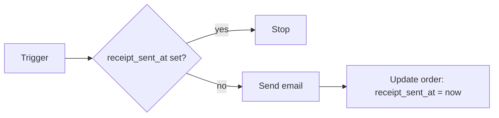

Automations fail: a partner API is down, a provider rejects a key, a bug slips through. Pawabase is built so that failures are **visible** and **recoverable**, but whether recovering is *safe* depends on how you design your flows. This page brings the rules together.

## The guarantees

| Thing | Delivery | Attempts | Where failures show |
| --- | --- | --- | --- |
| An **event** reaching its consumers | At least once; each consumer started once per event | Routing is retried until every consumer has been handed its work | [Activity → Events](/automation/events#inspect-what-happened) |
| A **flow** started by an event, schedule, hook or **Queue flow** | Runs as a background job | **1**, plus whatever **Retry** blocks you add | [Activity → Flow runs](/activity/background-work#flow-runs) and [Jobs](/automation/jobs) |
| A **flow** called by your app (`flows.run`, a route) | Runs during the request | 1; the caller gets the error | The caller, and Flow runs |
| An **email** from a flow or sign-in | Background job | **3**, a few seconds apart, growing | [Mail activity](/mail/activity) and Jobs |
| An email sent over HTTP | During the request | 1 | Mail activity, and the response |
| An **outbound webhook** | Background job, once per event per endpoint | **1 to 10** (default 5), from 10 seconds to a day apart | [Deliveries](/automation/webhook-deliveries) |
| A **schedule** firing | Queued as a job or emitted as an event | 1 per firing; missed firings only if **Catch up** is on | Schedule history and Flow runs |

"At least once" means a reaction can, rarely, run twice: for example, if a worker restarts part-way through. "Once per event per endpoint" means Pawabase never deliberately sends the same event to the same webhook twice; retries after a failure are the same delivery, with the same event `id`.

## Design rule 1: make reactions safe to repeat

A reaction is **idempotent** when running it twice has the same effect as running it once. Ways to get there:

| Technique | Example |
| --- | --- |
| **Remember what you've handled** | Store the event `id` in a `processed_events` table with a unique index on it, and stop if it's already there |
| **Use natural unique keys** | Give `invoices` a unique `order_id`, so creating the invoice for an order twice fails with `409` instead of making two |
| **Check before acting** | "If the order already has `receipt_sent_at`, stop"; then set it after sending |
| **Update if it exists** | **Get record** first: its `missing` exit leads to **Create record**, its `next` exit to **Update record** |
| **Pass ids, load fresh data** | A repeated run loads the current record and sees the work is done |
| **Use the partner's idempotency key** | Many payment APIs accept an idempotency key: send the event `id` |

## Design rule 2: retry only what's safe and transient

Flows get **one** attempt because a blind retry could charge a card or email someone twice. Add a **Retry** block around the specific step that can fail for a passing reason and is safe to repeat, usually an **HTTP request** to another service. It runs its `attempt` branch up to 10 times with a doubling wait (starting at **Base delay**, at most 30 seconds between tries).

Don't wrap a whole flow in Retry. Don't retry a step that already succeeded at the other end: if a partner's API timed out, it may still have done the work, so use its idempotency key.

## Design rule 3: answer fast, work in the background

- A **route** or flow your app calls should do the minimum, then **Queue flow** the slow part and return.
- A **webhook receiver** of yours should store the event, answer `2xx` within 15 seconds, and process afterwards.
- A flow has a **timeout** (60 seconds by default, up to 900). Long loops over many items should queue one job per item instead.

## Design rule 4: don't depend on order

Reactions run in the background and may finish in any order. If `orders.updated` is handled before `orders.created`, your flow must still do the right thing. Load the **current** record by id rather than trusting the event's copy, and compare states rather than assuming a sequence.

## Design rule 5: keep payloads small

Events and job inputs should carry **ids and a little context**. A job that runs later should read fresh data, and small payloads are cheaper to store and retry.

## Recovering from an outage

When a dependency was down (your mail provider, a partner API, your own webhook receiver):

1. **Find the scope.** In Activity, filter failures by time. Read two or three errors to confirm they share a cause.
2. **Fix the cause.** Replace the expired key, wait for the partner to recover, deploy the fix.
3. **Preview the recovery.** Every bulk action has a **dry run**:
   - flows and other jobs: [Jobs → Replay](/automation/jobs#many-jobs-after-an-outage), filtered by queue, job kind and **since** minutes;
   - webhooks: [Deliveries → Redeliver](/automation/webhook-deliveries#redeliver), filtered by endpoint, event and since;
   - emails: **Retry** each failed message in [Mail activity](/mail/activity#retry-a-failed-message).
4. **Run it**, then watch queues drain and spot-check results.
5. **Write down what happened**, and add an [alarm](/activity/alarms) so you hear about it sooner next time.

Because replay re-runs work with its **original input**, rules 1 and 4 are what make recovery safe.

## Know before your users do

| Watch | How |
| --- | --- |
| Failed jobs and flow runs | An alarm on job failures |
| Webhook deliveries failing | An alarm on webhook failures; a subscription to `alarm.state_changed` that posts to chat |
| Mail failures | An alarm on mail failures |
| Queues growing | The queue depth in Activity → Jobs |
| A status page for your users | [Status page](/activity/status-page) |

See [Logs, metrics and alarms](/activity/alarms).

## A checklist for every automation

- [ ] It's safe to run twice (it checks, uses unique keys, or records the event id).
- [ ] Steps that call other services are wrapped in **Retry**, and use idempotency keys where offered.
- [ ] Every exit is connected, including `missing`, `false` and `failed`.
- [ ] It reads ids from the event and loads current data.
- [ ] It finishes well inside its timeout, or queues the slow part.
- [ ] Failures alert someone.
- [ ] You've tried recovering it: fail it on purpose in development, then replay.
