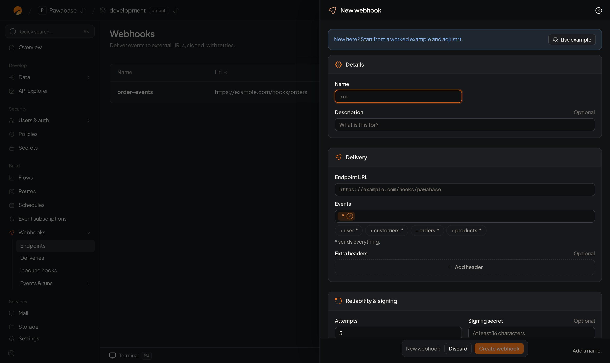

A webhook is an HTTP call between systems when something happens. Pawabase supports both directions:

| Direction | What it is | Docs |
| --- | --- | --- |
| **Outbound** | Pawabase sends your project's [events](/automation/events) to a URL you control: your backend, a partner, a chat tool, a CRM | This page, [Deliveries](/automation/webhook-deliveries), [Verify signatures](/automation/webhook-signatures) |
| **Inbound** | Another service calls a Pawabase URL, which verifies the request and starts a flow or emits an event | [Inbound hooks](/automation/inbound-hooks) |

Studio's **Webhooks** section has three pages: **Endpoints** (events sent to your URLs), **Deliveries** (every attempt, with retries) and **Inbound hooks** (URLs other services call).

## When to use an outbound webhook

- Keep another system in sync: a CRM, a data warehouse, a search index.
- Notify a partner when an order changes.
- Post to a chat tool when something important happens.
- Trigger your own backend without polling.

If you only need to react **inside** Pawabase, use an [event subscription](/automation/events) and a flow instead: there's no HTTP hop and the flow can read and write your data directly.

## Create an endpoint

<Frame caption="Webhooks → Endpoints → New webhook.">
  
</Frame>

**Webhooks → Endpoints → New webhook.**

| Field | Meaning | Default |
| --- | --- | --- |
| **Name** | Letters, digits, dashes and underscores: `partner-orders` | required |
| **Description** | For your team | empty |
| **Endpoint URL** | Where to send. Must start with `http://` or `https://`; use `https`. Addresses on private networks are refused. | required |
| **Events** | Event names or patterns. `*` is everything, `orders.*` every order event. See [Wildcards](/automation/events#wildcards). | `*` |
| **Extra headers** | Headers sent with every request, for example an `Authorization` header your receiver expects. Use `secret://NAME` for values that are secret. | none |
| **Attempts** | How many times to try before a delivery is marked failed: 1 to 10 | 5 |
| **Signing secret** | Signs every request so your receiver can check it came from you. At least 16 characters. Leave empty and Pawabase makes one (`whsec_…`). | generated |
| **Enabled** | Pause without deleting | on |

When Pawabase generates the signing secret, it's **shown once** after saving. Copy it into your receiver's configuration. Editing the endpoint later keeps the existing secret unless you enter a new one.

## What your endpoint receives

A `POST` with a JSON body:

```http
POST /hooks/pawabase HTTP/1.1
content-type: application/json
Pawabase-Event: orders.created
Pawabase-Delivery: 01JD8Z6Q4G2X…
Pawabase-Signature: t=1731000000,v1=9f2c…
```

```json
{
  "id": "01JD8Z6Q0000EVENT",
  "event": "orders.created",
  "env": "production",
  "data": {
    "resource": "orders",
    "change": "created",
    "record": { "id": "01JD8Z…", "total": 42.5, "status": "pending" }
  },
  "sent_at": 1731000000
}
```

| Field | Meaning |
| --- | --- |
| `id` | The event id. Retries and redeliveries send the **same** id: use it to ignore repeats. |
| `event` | The event name |
| `env` | The environment it came from |
| `data` | The event's payload. For a table event: `resource`, `change` and `record`. For other events, see the [catalogue](/automation/event-catalogue). |
| `sent_at` | When this attempt was sent, in Unix seconds |

| Header | Meaning |
| --- | --- |
| `Pawabase-Signature` | `t=<time>,v1=<hex HMAC-SHA256>` over `<time>.<raw body>`. See [Verify signatures](/automation/webhook-signatures). |
| `Pawabase-Event` | The event name, so you can route before parsing the body |
| `Pawabase-Delivery` | This delivery's id, shown in Studio |

## Answer quickly

Reply with any **2xx** status within **15 seconds**. Anything else (a 4xx, a 5xx, a timeout, a connection error) is a failed attempt and is retried on a schedule from about 10 seconds up to a day apart. See [Retries](/automation/webhook-deliveries#retries).

If your receiver has slow work to do, store the event, answer `200` at once, and process it in the background.

## Test an endpoint

Choose **Send test** on the endpoint. It sends one event named `pawabase.test`, with the payload `{"message": "Test delivery from Pawabase Studio"}`, **once**, without retries, so you see at once whether your receiver answers and accepts the signature. The result appears in [Deliveries](/automation/webhook-deliveries).

To test with real data, emit an event that matches the endpoint from **Activity → Events → Send test event**.

## A minimal receiver

<CodeGroup>
```typescript TypeScript
import crypto from "node:crypto";
import express from "express";

const app = express();
const seen = new Set<string>(); // use a database table in production

app.post("/hooks/pawabase", express.raw({ type: "application/json" }), (req, res) => {
  const header = req.get("Pawabase-Signature") ?? "";
  const parts = Object.fromEntries(header.split(",").map((p) => p.split("=", 2)));
  const t = Number(parts.t);
  if (!t || Math.abs(Date.now() / 1000 - t) > 300) return res.sendStatus(401);
  const expected = Buffer.from(
    crypto.createHmac("sha256", process.env.WEBHOOK_SECRET!).update(`${t}.`).update(req.body).digest("hex"),
  );
  const given = Buffer.from(String(parts.v1 ?? ""));
  if (given.length !== expected.length || !crypto.timingSafeEqual(given, expected)) return res.sendStatus(401);

  const event = JSON.parse(req.body.toString());
  if (seen.has(event.id)) return res.sendStatus(200);   // a retry we've already handled
  seen.add(event.id);

  if (event.event === "orders.created") {
    // queue your own work here, then answer
  }
  res.sendStatus(200);
});
```

```python Python
import hashlib, hmac, json, os, time
from fastapi import FastAPI, HTTPException, Request

app = FastAPI()
seen: set[str] = set()  # use a database table in production

@app.post("/hooks/pawabase")
async def hook(request: Request):
    body = await request.body()
    parts = dict(p.split("=", 1) for p in request.headers.get("Pawabase-Signature", "").split(",") if "=" in p)
    stamp = int(parts.get("t", "0") or 0)
    expected = hmac.new(os.environ["WEBHOOK_SECRET"].encode(), f"{stamp}.".encode() + body, hashlib.sha256).hexdigest()
    if abs(time.time() - stamp) > 300 or not hmac.compare_digest(expected, parts.get("v1", "")):
        raise HTTPException(status_code=401)
    event = json.loads(body)
    if event["id"] in seen:
        return {"ok": True}
    seen.add(event["id"])
    # handle event["event"] and event["data"]
    return {"ok": True}
```
</CodeGroup>

The full explanation, with edge cases, is on [Verify webhook signatures](/automation/webhook-signatures).

## Send from a flow

To send an event **only** to webhooks, without emitting it to subscriptions, add the **Send webhook** block to a flow with an event name and payload. It delivers to every enabled endpoint subscribed to that name, and outputs `{ "deliveries": <how many were queued> }`. Each use gets its own event id. To send to webhooks **and** everything else listening, use **Emit event** instead.

## Manage endpoints from code

<CodeGroup>
```typescript TypeScript
import { manage } from "@pawabase/client/manage";

const m = manage(pawabase); // a secret key with webhooks:* scope
const created = await m.webhooks.create({
  name: "partner-orders",
  url: "https://partner.example.com/hooks/pawabase",
  events: ["orders.*"],
  headers: { "x-partner-id": "acme" },
  max_attempts: 8,
});
// created.secret is returned once, when Pawabase generated it: store it now
```

```python Python
created = pb.manage.webhooks.create({
    "name": "partner-orders",
    "url": "https://partner.example.com/hooks/pawabase",
    "events": ["orders.*"],
    "headers": {"x-partner-id": "acme"},
    "max_attempts": 8,
})
```
</CodeGroup>

| Endpoint | Does |
| --- | --- |
| `GET`, `POST …/webhooks` | List and create endpoints |
| `GET`, `PUT`, `DELETE …/webhooks/{name}` | Read, replace and delete one |
| `POST …/webhooks/{name}/test` | Send a test event, one attempt |
| `GET …/webhook-deliveries` | Delivery history |
| `POST …/webhook-deliveries/{id}/redeliver` | Send one again |
| `POST …/webhook-deliveries/redeliver` | Send many again (see [Deliveries](/automation/webhook-deliveries#redeliver)) |

Endpoints are definitions, so [promote](/environments/promote) copies them between environments and [infrastructure as code](/tools/iac/webhooks) can define them.

## Rotate a signing secret

1. Edit the endpoint and enter a new **Signing secret** (or clear it to have one generated).
2. Update your receiver. During the switch, have the receiver accept **either** the old or new secret.
3. Once deliveries pass with the new one, remove the old secret from the receiver.

## Security

- Always **verify the signature** and reject requests older than five minutes.
- Use **https** endpoints.
- Don't trust `data` blindly: if an action matters, load the current record from your API using the id in the event.
- Send only what the receiver should see. Events carry whole records (minus write-only fields); if a partner shouldn't get all of a record, send a smaller event from a flow with **Send webhook**.

## Limits

Each plan includes a number of **outbound webhooks** (endpoints): 5 on Free up to 2,000 on Scale. See [Plans and limits](/cloud/plans-and-limits).

<CardGroup cols={2}>
  <Card title="Deliveries" icon="send" href="/automation/webhook-deliveries">Retries, history and redelivery.</Card>
  <Card title="Verify signatures" icon="shield-check" href="/automation/webhook-signatures">Check each request came from Pawabase.</Card>
  <Card title="Inbound hooks" icon="inbox" href="/automation/inbound-hooks">Receive from other services.</Card>
  <Card title="Event catalogue" icon="list" href="/automation/event-catalogue">What you can send.</Card>
</CardGroup>
