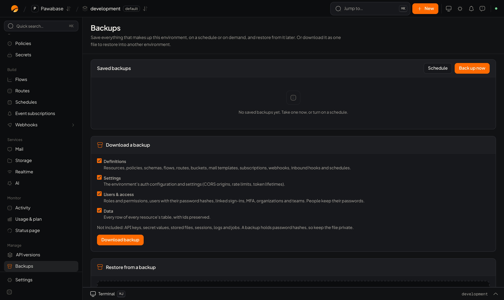

A **backup** saves what makes up an environment, so you can restore it later or move it to another environment.

<Frame caption="Project → Backups: the state of your backups at the top, then every backup.">
  
</Frame>

## Where

**Project → Backups.** Three buttons sit at the top: **Back up now**, **Schedule**, and **File** (download a backup, or restore from a file).

Under them, a banner says in words whether this environment can be restored right now:

| Banner | Meaning |
| --- | --- |
| **On schedule** | Automatic backups are on and the last one was taken when it should have been |
| **Automatic backups are off** | You have backups, taken by hand, and nothing is taking more |
| **No backups yet** | Nothing is saved and no schedule is on |
| **A backup is overdue** | A schedule is on, but no good backup has been saved when it should have been |
| **The last automatic backup failed** | The reason is shown. Your older backups are untouched |
| **A backup needs attention** | The newest backup did not read back whole. Take another before you rely on it |

Beneath the banner: **Last good backup**, **Next automatic**, **Schedule** and **Stored**. Then the list of backups. Click one to see what it holds, check it again, download it, keep it or delete it.

## What a backup holds

Four parts, each a checkbox:

| Part | Contains |
| --- | --- |
| **Definitions** | Resources, policies, schemas, flows, routes, buckets, mail templates, subscriptions, webhooks, inbound hooks and schedules |
| **Settings** | The environment's auth configuration and settings (CORS origins, rate limits, token lifetimes) |
| **Users & access** | Roles and permissions, users with their password hashes, linked sign-ins, MFA, organizations and teams. People keep their passwords |
| **Data** | Every row of every resource's table, with ids preserved |

**Not included:** API keys, secret values, stored files, sessions, logs and jobs. A backup holds password hashes, so keep the file private.

## Back up now

1. **Back up now.**
2. Give it a name if you like, and choose what to include.
3. It appears in the list, and is **checked as soon as it is written**: Pawabase reads it back the way a restore would. The **State** column says **Checked**, or **Damaged** if it could not be read back.

A backup that cannot be read back is marked **Failed**, so you find out today and not on the day you need it.

Turn on **Keep this one** in a backup's panel to keep it forever. Kept backups are never removed by automatic cleanup.

## Schedule backups

Click **Schedule**: turn on **Back up automatically**, choose **How often** (hourly, daily or weekly), the hour (UTC), how many to keep and for how many days. See [Automatic backups](/backups/automatic).

You can be told when a backup finishes or fails. See [Hear about every backup](/backups/automatic#hear-about-every-backup).

## Restore

Click **Restore** on a backup, or **File → Restore from a file**. Studio shows what the backup holds **next to what the environment holds now**, so you can see what would change. Tick the parts, choose **How**:

- **Merge** adds and updates.
- **Replace** deletes current rows, users and definitions in the chosen parts first.

<Warning>
**Replace** deletes what is there. Leave **Save the environment as it is first** on: it saves what will be overwritten as a backup called *Before a restore*, so a restore can be undone.
</Warning>

See [Restore](/backups/restore).

## Download

Click **File → Download a backup**, tick the parts and click **Download** to get one file you can keep or restore into another environment. For people alone, use [Import and export](/auth/import-and-export).

## A sensible plan

1. Automatic daily backups, keeping the last 14.
2. A pinned backup before every release or risky migration.
3. Test a restore into a non-production environment once a quarter. A backup you haven't restored is a hope, not a backup.
