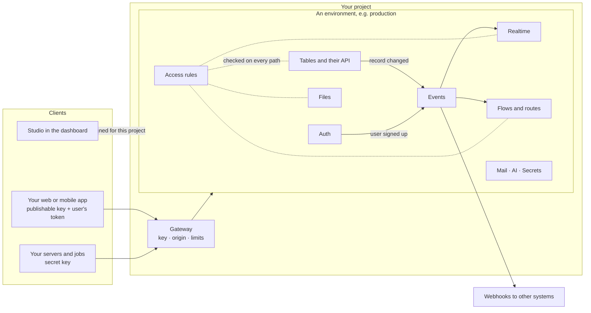

Pawabase is a complete backend you configure instead of write. You describe what your app needs (tables, who may do what, what should happen when something changes) and Pawabase serves it as an API with sign-in, files, live updates, server logic, email and AI built in. Your app talks to it through the TypeScript or Python client, or plain HTTP.

This page explains the model that every other page builds on. If you read one conceptual page before starting, read this one. Each section ends with where the subject is covered in depth.

## The pieces at a glance

Everything in the diagram is one system. There is no separate auth service to keep in sync with your database, and no queue you wire up yourself: a record created through the API emits an event, the event starts a flow, the flow sends an email and publishes a realtime message, and all of it is checked against the same access rules and recorded in the same activity log.

## Projects and environments

A **project** is one backend: one product's data, users and logic. It is what you create in the dashboard and what you pay for.

Each project has one or more **environments**: `development`, `staging`, `production`, and short-lived previews. An environment is the unit of isolation. Two environments of the same project share **nothing** at runtime: not data, users, files, secrets, keys' reach (unless you allow it), signing keys, queues or logs. A user who signs up in `development` doesn't exist in `production`; a test email template can't be sent from production's mail settings.

You build in one environment and **promote** the definitions to the next, so production changes are reviewed and repeatable. Data never moves with a promotion; only definitions do.

Read more: [Projects and environments](/concepts/projects-and-environments), [Environments](/environments/overview), [Promote](/environments/promote).

## Who is calling: keys and users

Every request answers two questions: **which app** is calling, and **which person** (if any) it acts for.

| Credential | Looks like | Where it lives | What it means |
| --- | --- | --- | --- |
| **Publishable key** | `pb_pk_…` | In your web or mobile app; public | "This request comes from this project's app." Every rule applies. Alone, it acts as an anonymous visitor |
| **User access token** | A JWT in `Authorization: Bearer …` | Issued to a person when they sign in; the client keeps and refreshes it | "…on behalf of this signed-in person." Rules see their id, roles and organization |
| **Secret key** | `pb_sk_…` | Only on your servers, CI and scripts | "This is a trusted server." It acts with the `service` role and passes access rules for the environments it reaches |

A browser request normally carries the publishable key **and** the user's token. A server request carries a secret key (and, when acting for a particular person, that person's token).

Because a publishable key is public, it grants nothing on its own: what a visitor can do is entirely decided by your access rules. Because a secret key passes the rules, it must never reach a browser; the TypeScript client refuses to start with one in a browser.

Read more: [Keys and security](/reference/keys-and-security), [How auth works](/auth/how-auth-works).

## Definitions become APIs

You don't write endpoint code for ordinary data. You write **definitions**, and Pawabase turns them into a running API.

A **table** (a *resource* in the API) is a definition: its fields, relations, indexes, which operations are switched on (list, get, create, update, delete) and the access rule for each. When you save it, Pawabase creates or changes the database table and serves `/rest/v1/<table>` with filtering, sorting, paging, full-text search, validation and generated documentation, and the client libraries get typed methods for it.

Other definitions work the same way: **access rules**, **flows**, **routes**, **buckets**, **mail templates**, **schedules**, **webhooks**, **realtime channel rules**, **agents**. Studio is a set of editors for definitions; infrastructure as code and blueprints are other ways to write the same definitions.

The distinction between **definitions** (the shape and behaviour of the backend) and **data** (the records, files and users people create) runs through the whole platform: definitions are versioned, promoted between environments, exported as blueprints and written as code; data stays in its environment and is backed up separately.

Read more: [Definitions and data](/concepts/definitions-and-data), [Tables and resources](/database/tables-and-resources).

## One set of rules everywhere

An **access rule** (a *policy*) answers "may this caller do this?". It can look at who is calling (signed in, their id, roles, organization, the key's scopes), at the record (its owner, its status) and at the request.

The same rule language guards every path into your data:

| Where | Example |
| --- | --- |
| Table operations | People list only their own orders |
| Files | Only the uploader can replace an avatar |
| Realtime channels | Only members of a room can join `room:42` |
| Flows and routes | Only admins can call `/rest/v1/x/refund` |
| Agents and models | An agent acts with the rights of the person who asked |

Rules run on the server, before any data is read or written, and rules that compare record fields with the caller are turned into SQL, so a filtered page of 50 is a correct page of 50, not 50 rows with some hidden. Nothing is public unless you make it so: a new table exposes no operations, and an enabled operation defaults to signed-in users only.

Read more: [Access rules](/policies/overview), [How rules work](/policies/how-rules-work).

## Things that happen: events and automation

When something changes, Pawabase records an **event**: `orders.created`, `user.created`, `file.uploaded`, a webhook arriving, a schedule firing. Events are kept (you can inspect each one and what it triggered) and delivered to what you subscribe:

- **Flows**: server logic you build from blocks: validate, read and write records, call other services, send mail, ask a model, publish to realtime.
- **Webhooks**: signed HTTP calls to your other systems, retried with backoff.
- **Realtime**: tables with realtime on publish their changes to subscribed clients.

Flows also run directly: behind a custom **route** your app calls, on a **schedule**, or from an **inbound hook** another service calls. Work that runs after an event happens in the background, so your API answers stay fast and a slow email provider doesn't slow a checkout.

Read more: [Automation](/automation/overview), [Server logic](/logic/overview).

## Files, live updates, mail and AI

These use everything above rather than standing beside it:

- **Storage** keeps files in buckets with per-action rules (read, upload, list, replace, delete), stable URLs, signed and share links, and image resizing. See [Storage](/storage/overview).
- **Realtime** carries channel messages, presence and record changes over WebSockets, with channel rules written in the same rule language. See [Realtime](/realtime/overview).
- **Mail** sends templated email from flows and auth, with delivery history. See [Mail](/mail/overview).
- **AI** gives you models through one gateway, vector search on your tables, and **agents** that use your tables, flows and connected apps as tools, with the rights of the person who asked and approvals before they change things. See [AI](/ai/overview).

## You can see everything

Each request gets a **request id** at the gateway. Activity shows requests, flow runs, jobs, events, webhook deliveries and mail, and you can follow one action through all of them with that id. Alarms watch error rates and latencies; a status page can publish your uptime. See [Activity](/activity/overview).

## What Pawabase does, and what your app does

| Pawabase | Your app |
| --- | --- |
| Stores data, files and users; serves the API | Decides what to show and when to call |
| Enforces access rules on every request | Writes the rules (once) |
| Signs people in, keeps sessions, sends verification and reset emails | Shows the sign-in screens (or uses hosted pages) |
| Runs flows, webhooks, schedules and agents | Defines what they do |
| Keeps environments isolated and versions definitions | Decides when to promote |
| Rate-limits, validates and records requests | Handles errors the API returns |

Anything you'd rather write as code can still be code: custom routes run flows, mounted Python routers run beside the generated API on self-hosted installations, and your own servers call Pawabase with a secret key.

## Words used across the docs

| Term | Meaning |
| --- | --- |
| **Project** | One backend; contains environments |
| **Environment** | An isolated copy of the backend: its own data, users, files, keys' reach, secrets and logs |
| **Definition** | A piece of the backend's configuration: a table, rule, flow, bucket, template, … |
| **Resource / table** | A definition that becomes a database table and its API. Studio says *table*; the API and SDKs say *resource* |
| **Access rule / policy** | A server-side condition deciding whether a caller may do something. These docs say *access rule*; Studio's menu (**Security → Policies**) and the API say *policy* |
| **Flow** | Server logic built from blocks, started by a route, an event, a schedule, a hook or by hand |
| **Event** | A recorded fact ("this record was created") that subscriptions react to |
| **Publishable / secret key** | The app's credential: public and rule-bound, or server-only and trusted |
| **Access token** | A signed-in person's short-lived credential; refreshed with a refresh token |
| **Promote** | Copy definitions from one environment to the next, with a review |
| **Blueprint** | A whole backend's definitions in one file, to install elsewhere |

## Where to go next

<CardGroup cols={2}>
  <Card title="Build something" icon="rocket" href="/quickstarts/javascript">A quickstart takes about ten minutes and ends with a working signed-in app.</Card>
  <Card title="Projects and environments" icon="layers" href="/concepts/projects-and-environments">How isolation, names and promotion work.</Card>
  <Card title="The life of a request" icon="route" href="/concepts/request-lifecycle">What happens between your app and your data.</Card>
  <Card title="Definitions and data" icon="file-code" href="/concepts/definitions-and-data">What is versioned and promoted, and what is not.</Card>
</CardGroup>
