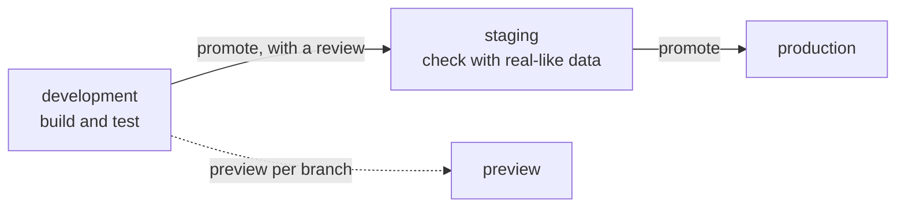

A **project** is one backend. An **environment** is one isolated, running copy of it. Almost every decision you make in Pawabase (where to test a change, which key an app uses, why a user "doesn't exist") comes back to these two ideas.

## A project

You create projects in the dashboard, inside an organization. A project has:

- a **name** you choose and an **id** Pawabase generates (`01JC4…`), shown in Studio → **Overview → Connect**,
- an **API address** where its environments are served,
- one or more **environments**, starting with `development`,
- **API keys** that belong to the project and reach some or all of its environments,
- the **plan limits** of its organization (requests, storage, environments, …).

Projects in the same organization share nothing except the team and the bill. Moving a project to another organization keeps its address, data and keys.

## An environment

An environment is where everything actually lives: tables and their records, users and their sessions, files, flows and their runs, secrets, mail settings, realtime channels, logs and usage. Two environments of the same project are as separate as two projects:

| Separate per environment | Why it matters |
| --- | --- |
| **Data** (records, files) | Testing never touches production data |
| **Users and sessions** | A user who signed up in development doesn't exist in production. A token from one environment is refused by another, because each environment signs tokens with its own key |
| **Definitions** (tables, rules, flows, …) | You change development freely; production changes only when you promote |
| **Secrets and provider settings** | Production can use the live Stripe key while development uses the test key |
| **Queues, jobs, schedules, events** | A runaway test flow can't delay production's jobs |
| **Activity and usage** | Production's logs aren't drowned in test traffic |

### Typical set-ups

| Environments | Use |
| --- | --- |
| `development` only | Prototypes and side projects |
| `development` → `production` | Most apps: build and test, then promote |
| `development` → `staging` → `production` | Teams that review changes against production-like data before release |
| + **previews** | A short-lived environment per branch or pull request, deleted when it's merged |

The number of environments a project may have depends on the plan. See [Environments](/environments/overview) and [Previews](/environments/previews).

## Names

An environment has two names, and both appear in the docs and the dashboard:

| Name | Example | Used by |
| --- | --- | --- |
| **Name in the project** | `production` | You: the SDK's `environment` option, the `x-environment` header, Studio's environment picker |
| **Full name** | `acme-shop-x7k2-production` | Places that must name an environment with no project around it: keyless file URLs, the Management API's Studio paths, logs |

The full name is unique across the whole installation. You rarely type it; Studio's **Connect** dialog and the Management API show it when it's needed.

## Which environment a request uses

A key belongs to one project and may reach **all** its environments or only some. On every request the gateway decides the environment like this:

1. If the request **names** one (the SDK's `environment` option, sent as the `x-environment` header, or `?environment=` on a URL), that environment is used, provided the key reaches it. Otherwise the request is refused.
2. If it names none, the project's **default environment** is used.
3. If the project has no default among the environments the key reaches, but the key reaches exactly one, that one is used.
4. Otherwise the request is refused with a message asking you to name one.

<CodeGroup>
```typescript TypeScript
import { createClient } from "@pawabase/client";

// The project's default environment
const pawabase = createClient({ url: "https://api.example.com", project: "01JC4…", apiKey: "pb_pk_…" });

// A named environment
const staging = createClient({ url: "https://api.example.com", project: "01JC4…", apiKey: "pb_pk_…", environment: "staging" });

// The same settings, another environment: a separate client with its own session
const production = staging.withEnvironment("production");
```

```python Python
from pawabase import Pawabase

# The project's default environment
pb = Pawabase("https://api.example.com", "pb_sk_…", project="01JC4…")

# A named environment
staging = Pawabase("https://api.example.com", "pb_sk_…", project="01JC4…", environment="staging")
```
</CodeGroup>

Two consequences worth remembering:

- **A session belongs to one environment.** Switching a client to another environment means signing in again there.
- **A hostname can serve one environment.** If you map a custom domain to `production`, a key used on that domain must be for production; a development key gets `403 host_environment_mismatch`. See [Custom domains](/environments/custom-domains).

## Keys and environments

When you create a key you choose which environments it reaches: the one you're in (the default), a list, or all of them. Use that to keep blast radius small:

- A **publishable key** for your production web app should reach only `production`.
- A **secret key** for CI that deploys to every environment may reach all of them.
- A **secret key** for a production job should reach only `production`.

A key can never create or rotate keys that reach more than it does itself. See [API keys](/environments/api-keys) and [Keys and security](/reference/keys-and-security).

## Moving changes forward

You never edit production directly if you can avoid it. The safe path is:



**Promote** compares the definitions of two environments and copies the differences you approve: new tables, changed rules, edited flows, templates. On the database side only **additions** are made automatically (new tables, columns and indexes); renames, type changes and removals are listed for you to handle, so a promote can never drop a column that holds real data. Records, users, files and secrets never move with a promotion: production keeps its own.

Other ways to move definitions:

- **API versions**: serve `/rest/v2` beside `/rest/v1` while clients upgrade. See [API versions](/environments/api-versions).
- **Blueprints**: export a whole environment's definitions to one file and install it into an empty environment, in this project or another. See [Blueprints](/developers/blueprints).
- **Infrastructure as code**: keep definitions in a Git repository and deploy them from CI. See [Infrastructure as code](/iac/overview).

## Settings that belong to an environment

Each environment has its own settings page, because production and development usually differ:

- allowed web origins for publishable keys,
- maintenance mode (refuses everything except secret keys while it's on),
- an address allow-list for secret keys,
- sign-in settings (methods, password policy, redirect addresses, token lifetimes),
- mail sender and provider,
- custom domains.

See [Environment settings](/environments/settings).

## Common questions

**A user can sign in to development but not production.** They're different user stores. Create the account in production (or invite them there).

**My app gets "this key does not reach environment 'staging'".** The key was created for another environment. Make a key that reaches staging, or widen the existing one.

**My key reaches several environments and requests fail without an environment.** Either set a default environment for the project or name one in the client (`environment: "production"`).

**I promoted, but the new table is empty in production.** Promotion copies definitions, never records. Load data with an import, a script using a secret key, or a flow.

## Next

- [The life of a request](/concepts/request-lifecycle): what the gateway checks before your rules run.
- [Definitions and data](/concepts/definitions-and-data): what is versioned, promoted and backed up.
- [Environments](/environments/overview): creating, promoting and previewing in Studio.
