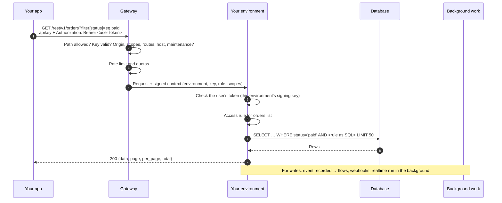

Knowing the path a request takes explains most of what you'll see in practice: why a request is refused before your rules run, why a page of results is always complete, why an email arrives a moment after the API answered, and which error comes from where.

## 1. The gateway

Every request from outside reaches the **gateway** first. It is the only way into an environment, for HTTP and WebSocket alike, and it decides before your environment sees a single byte.

### The path

The gateway only forwards the public API paths:

| Path | What it serves |
| --- | --- |
| `/rest/v1/…` | Your tables, custom routes and extension routes |
| `/auth/v1/…` | Sign-up, sign-in, sessions, profiles, organizations |
| `/storage/v1/…` | Files and buckets |
| `/flows/v1/…` | Flows your app calls directly |
| `/realtime/v1/…` | Realtime over WebSocket and HTTP |
| `/hooks/v1/…` | Inbound webhooks from other services |
| `/ai/v1/…` | The AI gateway |
| `/docs/v1/…` | Your environment's generated API documentation |
| `/platform/v1/…`, `/mcp/v1` | Management (secret keys only) |

Anything else is `404`; malformed paths are `400 bad_path`.

### The key

The key is read from the `apikey` header (the client libraries send it for you). The gateway looks it up and works out:

- which **project** it belongs to (if the request names a project with `x-project-id`, they must match),
- which **environment** the request is for (see [which environment a request uses](/concepts/projects-and-environments#which-environment-a-request-uses)),
- its **role**: `anon` for a publishable key, `service` for a secret key,
- its **scopes**, address limits and route limits, if you set any.

| Problem | Answer |
| --- | --- |
| No key | `401 missing_api_key` |
| Unknown, revoked, expired, wrong project, or an environment it doesn't reach | `401 invalid_api_key` |
| The key lookup itself failed (the database is briefly unavailable) | `503 key_service_unavailable`, unless the key was seen recently (below) |

Keys are looked up once and remembered for about 30 seconds, so a burst of requests doesn't become a burst of database lookups. Two consequences:

- **Revoking a key takes effect within about 30 seconds**, not instantly.
- If the database fails over, a key seen in the last minute or so keeps working for that long, so a short outage doesn't turn every client away.

### The key's own rules

Then the gateway checks the restrictions you can put on a key and on an environment, in this order:

| Check | Applies to | Refusal |
| --- | --- | --- |
| **Allowed web origins**: a publishable key used from a browser must come from an origin the environment lists (if it lists any) | Publishable keys | `403 origin_not_allowed` |
| **Key address limits**: the key may only be used from listed IPs or ranges | Keys with limits | `403 ip_not_allowed` |
| **Key scopes**: the key may only call the API areas its scopes cover | Keys with scopes | `403 scope_not_allowed` |
| **Key route limits**: rules like `GET /rest/v1/orders` or `/flows/v1/*` | Keys with route rules | `403 route_not_allowed` |
| **Hostname**: a custom domain mapped to one environment refuses keys for another | Custom domains | `403 host_environment_mismatch` |
| **Maintenance mode**: refuses everything except secret keys (if you allow them) | The environment | `503 maintenance`, with `Retry-After` |
| **Secret key address allow-list** | Secret keys | `403 ip_not_allowed` |

See [API keys](/environments/api-keys) and [Environment settings](/environments/settings).

### Rate limits and quotas

After the key is known, the request must fit within limits:

| Limit | Counted per | Refusal |
| --- | --- | --- |
| **Rate limit**: requests per window (usually per minute) | **API key** (or, for requests without a valid key, the caller's address) | `429 rate_limit_exceeded`, with `Retry-After` |
| **Monthly request quota** | Project | `429 request_quota_exceeded` |
| **Monthly bandwidth quota** | Project | `429 bandwidth_quota_exceeded` |
| **Concurrent realtime connections** | Project | `429 connection_limit` (WebSocket refused) |
| **Request body size** | Request | `413 payload_too_large` |

The limits come from your plan; see [Plans and limits](/cloud/plans-and-limits).

<Warning>
The rate limit is counted per **key**, not per person. Every browser using your publishable key shares one budget. A busy public app that makes many requests per page view reaches it sooner than the plan's number suggests; cache on your side, batch reads, use realtime instead of polling, and consider a separate key per app or platform.
</Warning>

The client libraries retry `429` (honouring `Retry-After`), `502`, `503`, `504` and network errors by default, with backoff.

### The hand-over

Finally the gateway removes any `X-Pawabase-*` headers the caller sent, attaches a short-lived **signed context** (environment, key, role, scopes) and hands the request to your environment in the same process. Your environment trusts only this signed context, never a raw key or a header a client could forge.

The gateway also assigns a **request id** (or keeps a well-formed `X-Request-ID` you send). It's in the response headers, in every log line, and on every event, flow run and job the request causes. Quote it when you investigate anything in [Activity](/activity/overview).

## 2. Who the person is

If the request has `Authorization: Bearer <access token>`, the token is checked with **this environment's** signing key. Each environment signs with its own key, so a token from development is meaningless in production.

| Token | Result |
| --- | --- |
| None | The caller is anonymous (`anon`) with a publishable key, or `service` with a secret key |
| Valid | The caller is that person: rules see `auth.user_id`, roles, permissions, organization and claims |
| Expired | `401`; the client libraries refresh it with the refresh token and retry once |
| Invalid, or from another environment | `401` |

A secret key **with** a user's token acts as that person (useful on your server when handling a request for someone). See [How auth works](/auth/how-auth-works).

## 3. The access rule

Each operation has an access rule (a policy): `orders.list`, `orders.create`, a bucket's `upload`, a route's rule, a channel's rule. The rule is evaluated with:

- **who**: `auth` (user id, roles, permissions, organization, key role and scopes),
- **what**: the record being read or written (for reads, the stored row; for writes, also the new values),
- **how**: the request (method, address, headers you allow rules to see).

Secret keys pass rules for the environments they reach. Publishable keys never do.

For lists, rules that compare record fields with the caller (`owner_id = auth.user_id`, `organization = auth.org_id`) are **turned into SQL** and added to the query, so paging and counts are correct: `per_page=50` returns 50 rows you're allowed to see, and `total` counts only those. Parts of a rule that can't be expressed in SQL are checked row by row afterwards.

| Outcome | Answer |
| --- | --- |
| Allowed | Continue |
| Refused, not signed in | `401` |
| Refused, signed in | `403` |
| A read of a record you may not see | Usually `404`: the record doesn't exist for you |

See [How rules work](/policies/how-rules-work).

## 4. Validation and the database

Writes are validated against the table's definition: unknown fields, read-only fields, wrong types and missing required fields are refused with `422` and a list of problems, before anything is written. Unique and other database constraints answer `409 unique_violation` or `422 constraint_violation`.

Reads apply your filters, sort, page and search, together with the rule's SQL, in one query.

## 5. After the answer

For a write, the change is committed and the API answers. **Then**, in the background:

1. an **event** is recorded (`orders.created`),
2. subscriptions react: **flows** run on workers, **webhooks** are delivered (and retried), tables with **realtime** publish the change to subscribed clients,
3. each of those is recorded with the same request id.

That's why a confirmation email or a webhook arrives a moment after the API answered, and why a slow external service never slows your API. Delivery is at-least-once: build flows and webhook receivers so that handling the same event twice is harmless. See [Events](/automation/events) and [Patterns](/logic/patterns).

Flows behind a **custom route** are different: they run **during** the request, and the route answers with the flow's result.

## Reading an error

Use the status and the `error` code to tell where a refusal came from:

| Status / code | From | Look at |
| --- | --- | --- |
| `401 missing_api_key`, `invalid_api_key` | Gateway: the key | The key, its environments, the client's `project` and `environment` |
| `403 origin_not_allowed`, `scope_not_allowed`, `route_not_allowed`, `ip_not_allowed`, `host_environment_mismatch` | Gateway: key or environment rules | API keys, environment settings |
| `429 rate_limit_exceeded`, `*_quota_exceeded` | Gateway: limits | Plan, request patterns |
| `401` without those codes | Your environment: the user's token | Session, refresh, environment |
| `403` | Your environment: an access rule | The operation's rule, the person's roles |
| `404` on a record | Not found, or not visible to you | The rule for `get` |
| `422` | Validation | `details`/`problems` in the body |
| `409` | A unique value already exists, or a conflicting state | `details.columns` |
| `5xx` | A failure on Pawabase's side, or a flow that failed | Activity, by request id |

The full list of error shapes and codes is in [Errors](/reference/errors).

## Next

- [Definitions and data](/concepts/definitions-and-data)
- [Access rules](/policies/overview)
- [Activity](/activity/overview): follow a request id through everything it caused.
