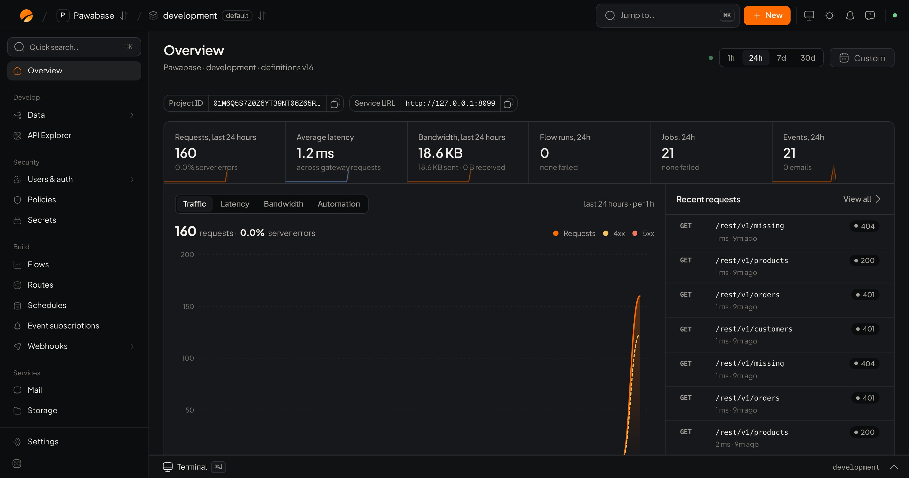

**Studio** is where you build and run a project. Open it from your project in the dashboard. The left sidebar groups everything by what you are doing. At the top is the **environment picker**, a **Jump to…** search (press <kbd>⌘K</kbd>), and a **New** button for creating things quickly.

<Frame caption="The Overview: traffic, latency, bandwidth, background work and recent requests for the environment.">
  
</Frame>

## Overview

A summary of the environment: requests, average speed, bandwidth, flow runs, jobs and events over the last day, with recent requests. It also shows your project id and API address.

## Develop

| Page | What you do there | Docs |
| --- | --- | --- |
| **Data** | Create tables, edit rows, add columns, indexes and relations, run SQL, see migration history | [Database](/database/overview) |
| **API Explorer** | Read and try every endpoint your project serves | [API Explorer](/database/api-explorer) |

## Security

| Page | What you do there | Docs |
| --- | --- | --- |
| **Users & auth** | People, roles, organizations, sign-in methods, security settings, tokens | [Auth](/auth/overview) |
| **Policies** | Write the access rules you reuse everywhere | [Access rules](/policies/overview) |
| **Secrets** | Keep keys and passwords out of code | [Secrets](/secrets/overview) |

## Build

| Page | What you do there | Docs |
| --- | --- | --- |
| **Flows** | Build workflows visually | [Flows](/logic/flows) |
| **Routes** | Add your own API endpoints that run a flow | [Routes](/logic/routes) |
| **Schedules** | Run flows on a timer | [Schedules](/automation/schedules) |
| **Event subscriptions** | React to events | [Events](/automation/events) |
| **Webhooks** | Send signed calls and receive them | [Webhooks](/automation/webhooks) |

## Services

| Page | What you do there | Docs |
| --- | --- | --- |
| **Mail** | Connect a provider, design templates, send, see delivery | [Mail](/mail/overview) |
| **Storage** | Buckets, files, share links | [Storage](/storage/overview) |
| **Realtime** | Channels, rules, a live playground | [Realtime](/realtime/overview) |
| **AI** | Providers, models, agents, knowledge, connections, AI tools | [AI](/ai/overview) |

## Monitor

| Page | What you do there | Docs |
| --- | --- | --- |
| **Activity** | Requests, errors, jobs, flow runs, logs, alarms, audit log | [Activity](/activity/overview) |
| **Usage & plan** | What you've used against your plan | [Plans and limits](/cloud/plans-and-limits) |
| **Status page** | A public page showing how you're doing | [Status page](/activity/status-page) |

## Manage

| Page | What you do there | Docs |
| --- | --- | --- |
| **API versions** | Serve v1 and v2 side by side | [API versions](/environments/api-versions) |
| **Backups** | Back up, restore, download | [Backups](/backups/overview) |
| **Settings** | Defaults, API access, API keys, maintenance, delete | [Settings](/environments/settings) |

## Handy things

- **Jump to…** (<kbd>⌘K</kbd>) finds any page, environment or action.
- **New** creates a table, flow, bucket, key or other thing from anywhere.
- **Sheets**: creating or editing something opens a side panel with a bar at the bottom that says what will change, with **Discard** and **Save**. Nothing changes until you save.
- **Switch environment** in the top bar. Notice the name: the same page in `production` changes real data.
