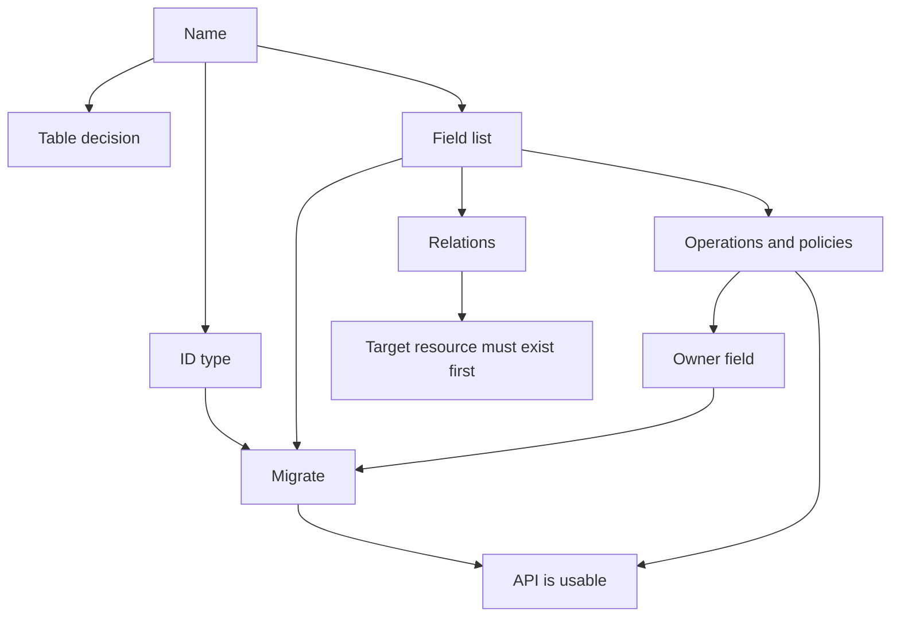

A single reference for the whole form, so nothing has to be remembered from the walkthrough above.

| Section | Control | Writes | Default |
| --- | --- | --- | --- |
| Details | **Name** | `name` | — |
| Details | **Table** | `table` | the resource name |
| Details | **Primary key** | `primary_key` | `id` |
| Details | **ID type** | `id_type` | `integer` |
| Details | **Description** | `description` | `""` |
| Fields | Row name | `name` | — |
| Fields | Type select | `type` | `string` |
| Fields | **Required** | `required` | absent |
| Fields | **More options → Description** | `description` | absent |
| Fields | **More options → Default** | `default` | absent |
| Fields | **More options → Example** | `example` | absent |
| Fields | **More options → Min length** | `min_length` | absent |
| Fields | **More options → Max length** | `max_length` | 255 on a `string` |
| Fields | **More options → Pattern** | `pattern` | per-type for `email` and `url` |
| Fields | **More options → Minimum / Maximum** | `minimum`, `maximum` | absent |
| Fields | **More options → Allowed values** | `enum` | absent |
| Fields | **More options → Schema** | `schema` | required for `ref` |
| Fields | **More options → Item type** | `items` | absent, on `array` |
| Fields | **Nested fields** | `fields` | absent, on `object` |
| Fields | **Nullable** | `nullable` | `not required` |
| Fields | **Read only** | `read_only` | absent |
| Fields | **Write only** | `write_only` | absent |
| Access | **Which operations are public?** | flips all five | all off |
| Access | Per-operation switch | `operations.<op>.enabled` | off |
| Access | **Who may** | `operations.<op>.policy` | `authenticated` |
| Relations | **Name** | `name` | — |
| Relations | **Kind** | `type` | `belongs_to` |
| Relations | **Resource** | `resource` | — |
| Relations | Foreign key picker | `field` | — |
| Caching & limits | **Cache responses** | `cache_ttl` | `0` |
| Caching & limits | **Rate limit** and its two inputs | `rate_limit` | `{}`, or 60/60 when switched on |
| Events & realtime | **Emit events on change** | `events` | `true` |
| Events & realtime | **Publish changes to realtime** | `realtime` | `false` |
| — | **Owner field** | `owner_field` | `null` |
| — | **Timestamps** | `timestamps` | `true` |

<Note>
Keys the form does not surface still exist and still work. `indexed` and `unique` are the two you will meet immediately; the general rule is that anything you write in the **JSON** tab survives editing in the form, because unknown keys are carried through untouched.
</Note>


## Two worked shapes

### A resource that clients fully own

For a resource where clients are the only writers and the rows are simple, the definition stays small on purpose.

```json
{
  "name": "notes",
  "description": "Personal notes.",
  "fields": [
    {"name": "title", "type": "string", "required": true, "max_length": 200},
    {"name": "body", "type": "text", "required": true},
    {"name": "pinned", "type": "boolean", "default": false},
    {"name": "tags", "type": "array", "items": {"type": "string", "max_length": 40}, "default": []}
  ],
  "operations": {
    "list": {"enabled": true, "policy": "owner:user_id"},
    "get": {"enabled": true, "policy": "owner:user_id"},
    "create": {"enabled": true, "policy": "authenticated"},
    "update": {"enabled": true, "policy": "owner:user_id"},
    "delete": {"enabled": true, "policy": "owner:user_id"}
  },
  "owner_field": "user_id",
  "cache_ttl": 0,
  "events": true,
  "realtime": false,
  "timestamps": true,
  "tags": ["personal"]
}
```

`owner_field` plus `"owner:user_id"` on all four owner-facing operations is the whole access model. `create` is `authenticated` because ownership is assigned server-side, and there is no record to compare against yet. Everything else is the shorthand for "this row is mine".

`tags` has a default of `[]` set in the JSON tab, because the form cannot express a default for an `array`. `pinned` defaults to `false`, which the form *can* express through the three-way boolean control.

Note what is absent: no `unique`, no `indexed`, because there is nothing to look up except the primary key and the owner column — and the owner column is indexed by migrate automatically because it is the owner field.

### A resource the backend owns

For a resource whose rows are written by flows and read by clients, almost everything about the *shape* is declared and almost everything about *access* is closed.

```json
{
  "name": "invoices",
  "description": "Issued invoices. Read-only to clients.",
  "fields": [
    {"name": "customer_id", "type": "uuid", "required": true, "indexed": true},
    {"name": "status", "type": "string", "enum": ["draft", "issued", "paid", "void"], "default": "draft"},
    {"name": "total_cents", "type": "integer", "required": true, "minimum": 0, "read_only": true},
    {"name": "issued_at", "type": "datetime", "nullable": true},
    {"name": "internal_note", "type": "text", "write_only": true, "max_length": 2000}
  ],
  "operations": {
    "list": {"enabled": true, "policy": "own_invoices"},
    "get": {"enabled": true, "policy": "own_invoices"},
    "create": {"enabled": false, "policy": null},
    "update": {"enabled": false, "policy": null},
    "delete": {"enabled": false, "policy": null}
  },
  "owner_field": "user_id",
  "cache_ttl": 0,
  "rate_limit": {"limit": 120, "window": 60},
  "events": true,
  "realtime": true,
  "timestamps": true
}
```

`total_cents` is `required` and `read_only` together, which reads oddly until you know both models: the create model demands it from whoever creates the row, and drops it from the request body — so a flow supplies it and a client could not even if it tried.

`internal_note` is the mirror image: accepted on writes, never returned.

`rate_limit` is set even though the read side is cheap, because this is the resource a customer-facing screen polls.

`realtime` is on because a status change is exactly the thing a payment screen wants pushed, and `cache_ttl` is `0` because the issuing flow invalidates on every write — a cached read here would be wrong within a second.

<Warning>
The `required` and `read_only` combination is a real and useful pattern, but it is not a security control. A flow's `resource.*` block goes through the store rather than the compiled request model, so a flow can write `internal_note` into a `write_only` field and read it back through the store. Model-level protection applies to HTTP requests.
</Warning>


## When the form is not enough

There are four situations where the answer is the **JSON** tab rather than a control, and knowing they exist saves rediscovering them one at a time.

**Defaults on structured types.** `json`, `array`, `object` and `ref` fields have no default input in the form, and the panel says so. `[]` and `{}` are perfectly ordinary defaults and they go in the JSON.

**`indexed` and `unique`.** These affect DDL and nothing else. On builds where the field panel offers **Indexed** and **Unique** switches for scalar types, they are here; on builds where it does not, they are JSON keys. Either way the effect is the same and it is the same effect: an index created by migrate, and nothing at all until then.

**Anything a future release added.** The form carries unknown keys through untouched, so a definition written by a newer Studio survives an older form intact. That is also why a definition that a colleague edited by hand will not lose its contents when you open it.

**Shape the form deliberately does not model.** A second `tags`-like key, a comment, an experimental field you will remove next week. The form will carry it; it just will not show it.

```json
{
  "name": "notes",
  "fields": [
    {"name": "title", "type": "string", "required": true, "max_length": 200},
    {"name": "tags", "type": "array", "items": {"type": "string", "max_length": 40}, "default": []},
    {"name": "slug", "type": "string", "unique": true},
    {"name": "body", "type": "text", "write_only": true}
  ]
}
```

`default: []` on the array, `unique: true` on the slug, and `write_only` on the body — three different reasons to reach for the tab, in four lines.


## The order things have to happen in

Not a checklist of clicks, but the dependencies between decisions that are easy to discover late.



The dependencies that actually bite:

**The ID type is needed before the first migration,** because migrate creates the key column. Changing it afterwards is manual DDL.

**The field list is needed before migrate,** because that is what migrate acts on. Saving without migrating leaves requests referencing a column that does not exist.

**The owner field must be a declared field,** or at least a column that exists — it is written on create regardless of whether the field list mentions it, and an unknown column is a failed write.

**A relation's target resource must exist before the relation is useful.** It saves either way, but the expansion cannot work until both sides resolve.

**Policies must exist before the operation that references them.** A dangling reference is refused at save time, which is the one class of cross-definition error that is caught for you.

<Note>
Nothing in that diagram requires a deploy, and nothing in it is undone by saving again. The only irreversible-feeling step is the migration, and only because of what it does to data rather than to configuration.
</Note>


## Reading the compiled result

Every resource contributes to one OpenAPI document, and reading it is the fastest way to confirm that the form did what you meant.

| Scope | Endpoint |
| --- | --- |
| The whole environment | `GET .../openapi` |
| One resource | `GET .../resources/<name>/openapi` |

Three things the document settles that the form cannot show you:

**Which paths exist.** An operation that is off contributes no path at all — not a path that refuses, not a path that 404s. If a method is missing from the spec, the switch is off.

**Which fields are visible in each direction.** The `create` model is published for requests, the `read` model for responses. A `write_only` field appears in one and not the other; a `read_only` field in the other. Seeing that once removes the need to reason about `read_only` again.

**Which status codes are real.** Each route registers the responses it can actually produce, so the document tells you that `create` returns `201`, that `delete` returns `204` with no body, and which errors are possible for that specific operation.

<Info>
`create` documents its `201` through the responses mapping rather than through a response model, because a response model is always published under `200`. Same result in the document; a different route to get there.
</Info>


## Why a save can be accepted and still wrong

The API validates that a definition is well-formed. It cannot validate that it matches your intentions, and the gap produces a specific set of outcomes worth recognising.

| What you wrote | Why it saved | What you will see |
| --- | --- | --- |
| A relation pointing at a resource that does not exist | Only presence and the `type` value are checked | `400` on `?expand=` |
| A relation whose `field` is not a column | Same | An expansion that is always empty, or a query error |
| A policy that exists but means the wrong thing | Only the reference is checked | Rows you did not intend to expose |
| An `enum` narrower than the data | Nothing reads the table at save time | Existing rows still readable, only new values writable |
| `unique` on a column with duplicates | The index is created at migrate time | The migration fails |
| `owner_field` naming an undeclared field | The key is a string, not a validated field | Writes fail at the database |
| A transformer name that does not resolve | A name reference is not validated at save time | `TransformerError` on the first read |
| `cache_ttl` on a table written on every request | Nothing about write frequency is known | A cache that never hits and evicts on every write |

Each of those is a decision you made rather than a bug, and each is cheaper to catch by reading the JSON than by watching production.

<Warning>
The most common version of this is a relation. It is the only declaration on the form that names two other objects by name and is not checked against either. Treat the relations array as the part of the definition most worth re-reading after saving.
</Warning>


## What the definition is worth

The reason a resource form is short is that the expensive parts are already built. Everything below is derived from the definition rather than written by you, and each item is something you would otherwise be maintaining by hand.

| Derived from the definition | What you would otherwise write |
| --- | --- |
| The field list | A model class, a serializer, a migration and a schema |
| `required`, enums, lengths, patterns | A validation layer per endpoint |
| `indexed`, `unique` | Index management, and the migrations that create them |
| `owner_field` | Ownership stamping on create and stripping on update |
| `timestamps` | Two columns maintained on every write path |
| Per-operation policies | An authorization check in every handler |
| The five routes, when enabled | A router, and the 404s for the ones you did not want |
| The list envelope, sorting, pagination | A pagination helper, and a `total` |
| `?expand=` | A loader to avoid N+1 |
| Cache keys including identity | A cache layer that does not leak between users |
| `after_write` | Event emission wired into every write path, including the ones you forget |
| The OpenAPI document | Documentation that is wrong by the second sprint |

That list is the case for resources as a concept. The form is not the product; the compilation behind it is.

<Note>
The corollary is that a resource is the wrong place for anything on the right-hand side of that table that is *not* derivable. Business rules, state transitions, cross-row invariants and anything that needs to notify a third party are what [flows](/flows/overview) and [custom routes](/data/custom-routes/overview) are for.
</Note>
