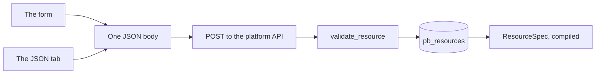

A resource form in Studio is a structured editor over one JSON body. That is the whole mental model, and everything on this page follows from it: what each control writes, what the editor strips, what it carries through untouched, and what the API refuses at save time.

The form is not a friendlier abstraction over something more expressive. It is a projection of the definition, and the **JSON** tab is the same object. When a control seems to be missing something you need, that is usually because the JSON accepts a shape the form does not surface — not the other way round.

## Where the editor lives

**Build → Resources** in the left nav. The list shows **name**, **table** and **description**. The empty state reads **No resources yet** with a **Create the first one**; the button that opens the editor is **New resource**.

The form has six sections, in this order:

| Section | What it decides |
| --- | --- |
| **Details** | Identity: name, table, primary key, id type, description |
| **Fields** | The field list |
| **Access** | Which of the five operations exist, and each one's policy |
| **Relations** | Declared navigations for `?expand=` |
| **Caching & limits** | Response cache lifetime and request throttling |
| **Events & realtime** | Whether changes are published, and where |

<Info>
Older builds label these **Operations** and **Behaviour** rather than **Access** and one combined behaviour section. The settings and their order are the same; only the headings moved.
</Info>

Above the sections sit two controls that belong to no single section, because they describe a row rather than a section of behaviour: **Owner field** and **Timestamps**. Both are covered below.

### What the client checks before it saves

Two guards run in the browser, so you can hit them without a round trip:

| Guard | Message | What it catches |
| --- | --- | --- |
| Name present | The name field is required | An unnamed resource, which has no URL |
| Every field named | "Every field needs a name." | A row with an empty name input, including fields nested inside an `object` |

The field-name guard is recursive. An `object` field whose nested fields include one unnamed entry blocks the save of the whole resource, not just that row — which is the right behaviour, because a nested field without a name cannot be validated, stored or returned.

There is a third, quieter guard: the name input turns its `.invalid` styling when the text does not match `^[A-Za-z_][A-Za-z0-9_]*$`. It does not block the save on its own; the API does that, with a `422`. The styling is there to show you before you leave the page.

## Details, field by field

### Name

The **Name** input is monospace, autofocused while the resource is new, and carries the hint "Served at /rest/v1/`<name>`" — so the consequence of the field is visible while you type it.

Once the resource exists, the input is disabled with a different hint: "The URL segment; fixed once created." That is not a limitation of the form; it reflects a real constraint. Relations, event subscriptions, flow blocks and custom-route policy references all address the resource by name, and those references are resolved by name when the environment compiles. Renaming would silently break every one of them.

The pattern is `^[a-z][a-z0-9_]{0,62}$`. Lower-case letters, digits and underscores, starting with a letter, at most 63 characters.

| Accepted | Refused |
| --- | --- |
| `orders` | `Orders` |
| `invoice_lines` | `invoice-lines` |
| `v2_reports` | `2fa_codes` |
| `a` | `""` |

### Table

**Table** is optional, with the hint "Defaults to the name." Leave it blank and `table` is stored as the resource name — the API applies `body.table or body.name`, so a blank field and a field matching the name produce the same stored value.

Setting it explicitly is what lets a resource expose a table that already exists. The pattern is wider than the name's: `^[A-Za-z_][A-Za-z0-9_]{0,62}$`, so `CustomerOrders`, `_audit` and `legacy_invoices` are all legal table names attached to a lower-case resource name.

The choice deserves a moment's thought, because the name is a contract and the table is an implementation detail:

| | Resource name | Table |
| --- | --- | --- |
| Who sees it | Every client | Nobody outside Studio and the console |
| Changing it later | Not possible in place | One field edit |
| Constrained by | The URL shape | SQL identifier rules |

Rename the resource to match a bad table name you are stuck with, or keep the API name clean and point `table` at the mess. The second is what the separate field is for.

### Primary key

**Primary key** defaults to `id` and takes the wide identifier pattern. It names the column that identifies a record, and it appears in every response, in every `get` and `update` and `delete` path, and in every expansion.

It is included in the `field_map` whether or not you declare it as a field, so it is always filterable, sortable and selectable, and `select` always appends it.

### ID type

A two-way choice, rendered as a segmented control: **Auto-increment** or **UUID**.

| | Auto-increment | UUID |
| --- | --- | --- |
| Stored value | `integer` | `uuid` |
| Assigned by | The database | Python, `uuid.uuid4()`, at create time |
| In JSON | a number | a string |
| A malformed id | `404`, because non-digits are refused | passed through, and simply does not match |
| Good for | Internal ids, cheapest key, stable ordering | Distributed creation, ids in shared URLs, ids you do not want to leak volume through |

The choice is close to irreversible in practice. Migrate creates the column one way or the other and never retypes it, so changing your mind means writing DDL yourself in the Database console and rewriting every id that points at the table.

### Description

**Description** is optional, placeholder "What rows live here?", and it becomes the route summary in OpenAPI. It costs nothing and it is the first thing a new integrator reads.

<Note>
There is no separate "public docs" toggle per resource. Whether the environment's OpenAPI document is served publicly is an environment-level setting; the description is what goes in it either way.
</Note>
