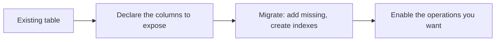
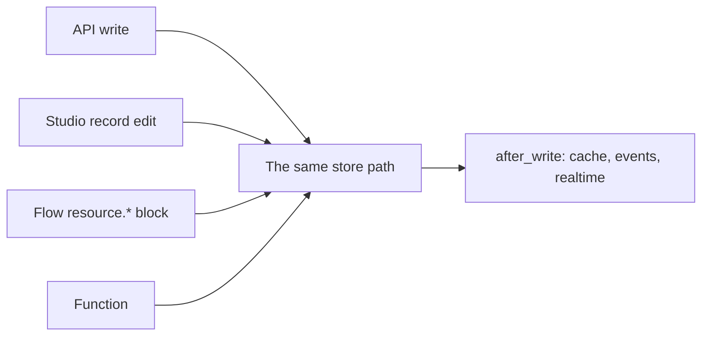

The **Relations** section was covered above as a UI walkthrough. What follows is the part that matters at request time, kept here so the two are not separated in your head.

A relation is a declared navigation hint, and it does exactly one thing: it powers `?expand=<name>` on `list` and `get`.

| Key | Meaning |
| --- | --- |
| `name` | The key the expanded data appears under, and the name you write in `?expand=` |
| `resource` | The related resource's name |
| `field` | The foreign key column — on *this* resource for `belongs_to`, on the *related* resource for `has_many` |
| `type` | `belongs_to` or `has_many`; defaults to `belongs_to` if omitted |

The rule that catches everyone is in the `field` row, and the form's relabelled picker exists to make it unmissable: **Belongs to** means the foreign key lives here, **Has many** means it lives over there.

```json
{"name": "customer", "resource": "customers", "field": "customer_id", "type": "belongs_to"}
{"name": "refunds",  "resource": "refunds",  "field": "invoice_id", "type": "has_many"}
```

Both can be declared on the same resource, pointing in opposite directions, and that is normal rather than contradictory: one says "these invoices have a customer", the other says "this invoice has refunds".

<Warning>
Validation checks that `name`, `resource` and `field` are present and that `type` is one of the two legal values. It does not check that the named resource exists or that the named field is a column on either side. Both mistakes save cleanly and fail on first use.
</Warning>


## Caching, rate limits, events and realtime, side by side

The four behaviour controls answer different questions and combine freely. This is the whole set in one table.

| Control | Setting | Default | Question it answers |
| --- | --- | --- | --- |
| **Cache responses** | `cache_ttl` | `0` | May repeated reads be skipped? |
| **Rate limit** | `rate_limit` | `{}` | How many requests may one caller make? |
| **Emit events on change** | `events` | `true` | Should a change cause something to happen? |
| **Publish changes to realtime** | `realtime` | `false` | Should a change be pushed to a live screen? |

And the two identity controls above them:

| Control | Setting | Default | Question it answers |
| --- | --- | --- | --- |
| **Owner field** | `owner_field` | `null` | Whose row is this? |
| **Timestamps** | `timestamps` | `true` | When did this change? |

A coherent default for a new resource is events on, realtime off, caching off, no rate limit, timestamps on, and an owner field only if rows genuinely belong to a user. Turning all four performance and publication settings on at once, on a resource that has not been exercised yet, is how you end up debugging a stale read and a duplicate notification at the same time.


## Reading the form as a document

The most useful thing about a definition being data is that you can read it as a document and answer a surprising number of questions without running anything.

**Is this resource public?** Look at `operations`. Any operation with `enabled: true` and no policy is on the default `authenticated` policy, which means every signed-in user in the project.

**Who can write?** Look at `create`, `update` and `delete`. If any of them is on with a policy you cannot summarise in one sentence, that is where to start.

**Does this resource own anything?** Look at `owner_field`. If it is set, clients cannot forge ownership on create and cannot reassign it on update. If it is null and `create` is on, clients choose the owner — which may be exactly right, and is worth confirming deliberately.

**What does this resource expose?** Look at `fields`. Anything without `write_only` is in every response; anything without `read_only` is accepted from clients. A field you added for a one-off flow and never removed is now part of the public contract.

**What happens when a row changes?** Look at `events` and `realtime`. Both off means nothing downstream is told, and any flow you wrote to react to a change will silently never run.

**What is the effective index story?** Look for `indexed`, `unique`, and `owner_field`, and remember that none of them exists in the database until migrate runs.

This is not a substitute for the OpenAPI document, which tells you the same things as compiled artefacts rather than as intentions. But it is faster, it is what is actually stored, and it is the thing you promote.


## Promoting a definition between environments

Promotion copies definitions — resources, schemas, policies and the rest — from one environment to another, and bumps the target's version counter so it recompiles. Saving a definition anywhere bumps that environment's version counter, which is what invalidates and rebuilds the compiled application and decides what is cached.

Two consequences:

| Promotion does | Promotion does not |
| --- | --- |
| Copy the resource definition | Run the migration on the target |
| Copy policies, schemas, flows, routes | Copy data |
| Bump the target's version | Copy credentials, keys, secrets or integrations |

So the sequence for a schema change is always the same shape: promote, then migrate on the target, exactly as you would have migrated on the source. Environments that share a design and differ only in data make this routine; environments that drift apart make it a source of confusing one-sided failures, where the definition exists in production and the column does not.

<Info>
Every save bumps the environment's version. That is not noise — it is the mechanism by which the platform knows to recompile, and it is why a saved definition takes effect without a deploy.
</Info>


## Working with a table you did not create

Not every resource describes a table Pawabase built. If you are exposing a table that already exists — a legacy schema, one imported from another system — the form works the same way with two adjustments in emphasis.

**The field list is a view, not a claim.** Declare the columns you want to expose; the others stay in the database and stay invisible to the API. A column present in the table but absent from the field list cannot be filtered, sorted or selected, and does not appear in responses.

**Migrate becomes additive in a more literal sense.** Because the table exists, migrate does not issue a `CREATE TABLE`; it walks your field list and issues `ALTER TABLE ... ADD COLUMN` for anything missing, then creates the indexes you declared. It will happily add a nullable column to a table that never needed it, which is the failure mode to watch for when copying a field list from somewhere else.



| Concern | New table | Existing table |
| --- | --- | --- |
| Column types | Yours to choose | Already fixed; the field type must match reality or reads will decode oddly |
| Primary key | Created as declared | Must already exist with the name you declared |
| Nullable-ness | From your `required`/`nullable` | Whatever the table says; validation and storage can disagree |
| Adding a field | Additive, safe | Additive, but you have just changed someone's schema |
| Removing a field | Column stays | Column stays, and the data stays |

The one that bites hardest is the last group. On an existing table, `required` is your *validation* claim while nullability is the *database's* fact, and nothing forces them to agree. A field declared `required: true` on a table where the column is nullable will be refused on create by the model — which is correct — but existing rows with nulls are returned without complaint.


## Pre-existing data and enums

An `enum` constrains writes from the moment the definition is saved, and does nothing to rows already in the table. Adding `enum: ["draft", "issued"]` to a `status` column that already contains `pending` produces a resource where every row is readable and only two values are writable, and no error tells you the third exists.

Check the current values before narrowing an enum on a live table. **Build → Database** shows the live column and lets you page through rows, and it is the only place the truth about existing data is visible.

<Warning>
The same applies to `unique`. Declaring `unique: true` and migrating on a table with duplicates does not deduplicate — the `CREATE UNIQUE INDEX` fails, and you find out at migration time rather than at save time. Decide whether to clean the data or to make the index partial before you add the flag.
</Warning>


## Studio's record editor, and why it is not the same as the API

Operators can browse and edit rows without going through the API, and it is worth being clear about how that path differs, because it is a common source of "why did this behave differently".

| | API write | Studio record editor |
| --- | --- | --- |
| Runs the resource's policies | Yes | No — service rights |
| Requires the API key's scope | Yes | No |
| Runs `after_write` | Yes | Yes |
| Emits events | Yes | Yes |
| Publishes realtime | Yes | Yes |
| Invalidates the cache tag | Yes | Yes |
| Validates against the field types | Yes | Yes, field-type aware |

So the *effects* of a Studio edit are identical to an API write, and the *permissions* are not. A row edited by an administrator fires `invoices.updated` at your flows with the operator as the actor.

The editor itself is field-type aware in the same way the API is: a text input for strings, a number input, a boolean select, `date` and `datetime-local` inputs, a textarea for `text`, and a monospace JSON textarea for `object`, `array` and `json` that parses on blur. Columns that exist in the table but not in the field list are still shown, marked as raw — editable, but without type knowledge.



Raw SQL in the Database console is the exception to all of this. It bypasses the store entirely, so no `after_write` runs, no event fires and no realtime message is published. It does invalidate every resource's cache tag, because the console cannot know which resource a table belongs to.

<Warning>
A flow that reacts to `updated` will therefore see writes it did not make, including ones an operator made in Studio. If a flow assumes every change came from a customer, that assumption is wrong, and the actor is the cheapest way to find out.
</Warning>


## Choosing a type

The dropdown offers fourteen options and the difference between several pairs is a decision you will live with. This is the guidance the type list itself cannot give you.

| If the value is… | Choose | Not |
| --- | --- | --- |
| A short label, a code, a slug | `string` | `text` — you get `VARCHAR(255)` and a validation bound for free |
| A paragraph, a description, a body | `text` | `string` — `TEXT` everywhere, no length bound |
| An email address | `email` | `string` — you get the pattern, and the 320-character column |
| A URL a user will click | `url` | `string` — you get the http/https pattern |
| A count, an age, a quantity | `integer` | `number` — no rounding surprises |
| Money in minor units | `integer`, named `*_cents` | `number` — floating point money is a bug you have not written yet |
| A measurement, a rate, a price with decimals | `number` | `integer` — you will lose precision at the boundary |
| A flag | `boolean` | `integer` — `false` and `0` mean different things in a response |
| An instant in time | `datetime` | `date` — a date has no time and no timezone |
| A calendar day | `date` | `datetime` — you will get `00:00:00` and an implied timezone |
| A generated or external identifier | `uuid` | `string` — validation and a native postgres `UUID` column |
| Something with no fixed shape | `json` | `object` — you give up the nested validation |
| An ordered list of one primitive type | `array` | `json` — you get item validation |
| A list of records | `object` inside an `array` | `json` — this is `array` of `object`, validated on both levels |
| A reference to something you describe elsewhere | `ref` | duplicating the shape |

### The pairs that are genuinely close

**`string` and `text`.** Both validate as a Python `str`. The difference is the storage column: `VARCHAR(n)` versus `TEXT`, with `n` defaulting to 255 on a `string`. A `string` will refuse a 300-character value with a `422`. That is usually correct and occasionally surprising, and the fix is `text`, not a bigger `max_length` on a `string`.

**`integer` and `number`.** `integer` decodes with `int()`, `number` with `float()`. Money belongs in an `integer` of minor units with the unit in the field name. A `number` for money accumulates representation error that shows up as an invoice that is one cent off, months later, in a report nobody can reproduce.

**`date` and `datetime`.** A `datetime` on mysql is converted to UTC on the way in and **loses its timezone** on the way out, so it comes back naive. A `date` has no time component at all and no such problem. Choosing `datetime` for a calendar day means storing `00:00:00` and implying a timezone you never had.

**`json` and `object`.** `json` is `Any` — it validates as any JSON value and is stored as JSON. `object` compiles a nested model from a `fields` key, so every nested key is validated, documented and schema-published. Use `object` for a structure you know; use `json` for one you genuinely do not.

**`array` and `object`.** They compose: `array` of `object` gives you a validated list of records, which is the shape most people want for line items, tags with metadata, or a settings block per row. Both are stored as the same JSON column, so the choice is purely about validation depth.

<Warning>
There is no array-of-array. The **Item type** dropdown deliberately excludes `array`. A list of lists is a `json` field, and you lose item validation for it.
</Warning>

### Defaults and validation, side by side

| Type | Validated as | Column on postgres | Column on mysql |
| --- | --- | --- | --- |
| `string` | `str` | `VARCHAR(n)`, n = `max_length` or 255 | same |
| `text` | `str` | `TEXT` | `TEXT` |
| `email` | `str` | `VARCHAR(320)` | `VARCHAR(320)` |
| `url` | `str` | `TEXT` | `TEXT` |
| `integer` | `int` | `BIGINT` | `BIGINT` |
| `number` | `float` | `DOUBLE PRECISION` | `DOUBLE` |
| `boolean` | `bool` | `BOOLEAN` | `BOOLEAN` |
| `datetime` | `datetime` | `TIMESTAMPTZ` | `DATETIME(6)` |
| `date` | `date` | `DATE` | `DATE` |
| `uuid` | `UUID` | `UUID` | `CHAR(36)` |
| `json`, `array`, `object`, `ref` | `Any` | `JSONB` | `JSON` |

All four JSON-shaped types collapse to the same column type. `array`, `object` and `ref` are validated structures in Python that happen to live in a JSON column — which is why filters cannot reach inside them.


## Reading values back out

The decode side has its own dialect differences, and they surface in the JSON your clients receive.

| Type | sqlite | postgres | mysql |
| --- | --- | --- | --- |
| `boolean` | Stored as an integer, decoded with `bool()` | A real boolean | A real boolean |
| `datetime` | ISO-8601 text | Timezone-aware | Converted to UTC, timezone **dropped** |
| `date` | ISO text | A date | A date |
| `uuid` | A string | A real `UUID`, serialized as a string | A string |
| `number` | `float()` | `float()` | A driver `Decimal`, decoded to `float` |
| `json` and friends | `json.loads`, falling back to the raw string if it does not parse | same | same |

The mysql row is the one that surprises people: a `datetime` written with an offset comes back without one. A client that parses timestamps and assumes an offset is present will misread every mysql timestamp. The convention that avoids it entirely is to store UTC and format on the client.

On the way *in*, a naive datetime is assumed to be UTC rather than local, and a trailing `Z` is normalised. So `"2026-03-01T09:00:00"` and `"2026-03-01T09:00:00Z"` mean the same instant.

<Warning>
The fallback on JSON decode is worth knowing about when debugging: a `json` column whose stored text does not parse comes back as the raw string rather than as an error. If a JSON field is suddenly a string in one row and an object in another, that is the fallback firing, and the stored value is the thing to inspect.
</Warning>
