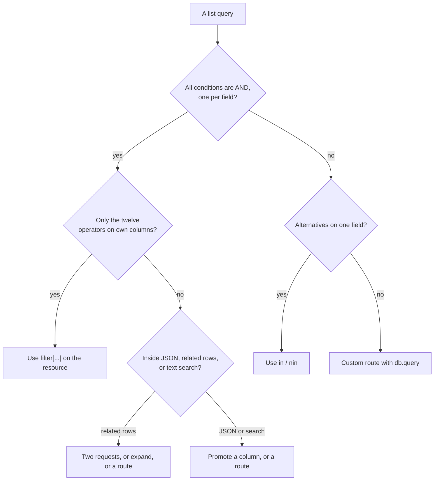

The data API filters a resource by its own columns. A question about a related table, such as "which live posts have a comment containing `urgent`", is two requests, and the second filters by `in` on the keys the first returned. With `posts` and `comments` related by `post_id`:

```text
GET /rest/v1/comments?filter[text]=ilike.*urgent*&select=post_id&per_page=200
  ->  total 3:  post_id 1, 3, 3

GET /rest/v1/posts?filter[id]=in.1,3&filter[status]=eq.live&select=title
  ->  total 2:  "A", "C"
```

The first request returns a parent key per matching child, so a parent with two matches appears twice (post 3 above). De-duplicate the keys before the second request. The pattern has three limits:

| Limit | Consequence |
| --- | --- |
| `per_page` is at most 200 | More than 200 matching children need paging through the first request before the second can run |
| The second URL carries every key | Many keys can make a URL too long, see above. Chunk the keys |
| Both reads are separate snapshots | A row can change between them. For a report, tolerate it. For anything stricter, use a route with a join |

The reverse direction, loading the children of a known set of parents, is what `?expand=` does in a single request, with its own cap on the number of children, see [Relations](/data/relations/overview).


## Filters inside flows and functions

A flow reads a resource with the `resource.list` block, and its filters are a smaller language than the query string's. They are a map of field to value, and every entry is an **equality**:

```json
{"block": "resource.list",
 "config": {"resource": "posts", "filters": {"status": "live"}, "sort": "-id", "limit": 2}}
```

```json
GET /rest/v1/live-posts

{"data": [{"id": 4, "title": "D", "status": "live", ...}, {"id": 3, "title": "C", "status": "live", ...}],
 "total": 3, "limit": 2, "offset": 0}
```

The block's output has `data`, `total`, `limit` and `offset`, and it is not subject to the resource's policy, because a flow is trusted. The block has no operators and no `in`. For anything but equality, use the `db.query` block with SQL and parameters, as in the range route above, or filter the list in a later `transform.filter` block, which keeps the items that match a policy-style condition. A function does the same through the runtime's `resource_list`, which takes the same equality map. Neither path accepts the `filter[...]` strings that a client sends.


## What is and is not logged

**Observability** records each request with its method, path, status, caller and the notes added along the way. The **path** is recorded **without the query string**. A request to `/rest/v1/items?filter[qty]=gte.abc&sort=id&per_page=5` that returned `500` appears as a row for `/rest/v1/items`, and a search for `filter` in the **Search path** box finds nothing.

| Consequence | What to do |
| --- | --- |
| You cannot find, from Studio, which filter caused a `500` | Reproduce it from the client's own logs, or log the query string in the client |
| You cannot see which filters are used most | Count them in a client or a proxy that records the full URL |
| The **Request trace** cannot show the filters | Use its time and caller to find the client that sent it |

If filters matter to your operations, record them where they are built, not where they are served.


## Documenting filters for your API's readers

The generated API reference lists the query parameters of the list operation as `page`, `per_page`, `sort`, `select` and `expand`, and nothing about `filter[...]`, because filter keys vary by resource and are not declared. A developer who reads only the reference will not learn that filtering exists, or which fields can be filtered and how. The resource's **Description** is the one free-text place that appears in the reference for the list operation, so it is the natural home for a short note:

```json
{
  "name": "products",
  "description": "Items we sell. Filter with filter[field]=op.value: status (eq, in), stock (gte, lte), title (ilike), released (gte, lte, is.null). One filter per field. Use is.true/is.false for booleans.",
  "fields": [ ... ]
}
```

That sentence appears under the **List products** operation in **API Explorer** and on the public docs page, and it costs nothing to keep in step with the definition. Three habits make it useful: name the fields that are indexed (the ones that are safe to filter on at scale), state the one-filter-per-field rule, and say how to filter booleans, since that is the case people get wrong. Anything more detailed belongs in your own client documentation, with the helper functions from this page.


## A gallery of queries

Real shapes you can start from, each using only what the syntax supports. Replace the resource and field names with your own.

| Goal | Query |
| --- | --- |
| Live products | `filter[status]=live` |
| Live or draft | `filter[status]=in.live,draft` |
| Everything but archived, including unset | Not expressible with one filter. Give `status` a default so it is never null, then `filter[status]=neq.archived` |
| In stock | `filter[stock]=gt.0` |
| Low stock | `filter[stock]=lte.5&filter[stock_alert]=is.true` |
| Name starts with a prefix | `filter[title]=ilike.mug*` |
| Name contains a word | `filter[title]=ilike.*mug*` |
| Created today or later | `filter[created_at]=gte.2026-10-01` |
| Never updated since creation | Not expressible. A column to column comparison does not exist |
| Has no owner | `filter[owner_id]=is.null` |
| Has an owner | `filter[owner_id]=isnot.null` |
| A set of ids | `filter[id]=in.4,8,15` |
| Everything except some ids | `filter[id]=nin.4,8,15` |
| Records of one parent | `filter[post_id]=eq.7` |
| An empty text value | `filter[note]=eq.` |
| Published and flagged | `filter[published]=is.true&filter[flagged]=is.true` |
| Price at least ten | `filter[price]=gte.10` |
| Price between ten and twenty | One bound per request, or a route |
| Newest first, page two, two columns | `sort=-created_at&page=2&per_page=20&select=id,title` |
| After the last key I saw | `filter[id]=gt.1042&sort=id&per_page=100` |
| How many match, without rows | Add `per_page=1` and read `total` |


## Choosing a tool for a query

Most list needs fit the filter syntax. When one does not, the question is which tool fits and what it costs.



The diagram's right-hand edges all end in a route or in a change to the data, and that is the shape of the feature. The filter syntax is for the common, indexable, per-column query. Everything past it moves either to SQL, in a route, or to a better data model.


## Text matching beyond ASCII

Case-insensitive matching is where databases differ most, and it matters for any product with users whose names are not plain English. On SQLite, which Pawabase uses by default for development, `like` and `ilike` fold case only for the 26 ASCII letters. For a resource with these names:

| Stored | Request | Matches |
| --- | --- | --- |
| `Ada`, `ada` | `filter[name]=ilike.ada` | Both: ASCII letters fold |
| `Émile`, `émile` | `filter[name]=ilike.émile` | Only `émile`: the accented capital `É` is not folded |
| `Émile`, `émile` | `filter[name]=ilike.%C3%89mile` | Only `Émile` |
| `Ọlá`, `ọlá` | `filter[name]=ilike.ọlá` | Only `ọlá` |
| `Zoë`, `ZOË` | `filter[name]=ilike.zoë` | Only `Zoë`: `Z` folds, `Ë` does not |
| `Zoë` | `filter[name]=eq.zoë` | Nothing, `eq` is case-sensitive |

A search box that must find `Émile` when someone types `emile` or `ÉMILE` cannot rely on `ilike` on SQLite. PostgreSQL's `ILIKE` and MySQL's collations fold accented letters according to the database's locale and collation, which usually gives the expected result and is not the same as SQLite's, so a behavior seen in development may not hold in production, or the reverse. Three ways to be independent of the database:

| Approach | How | Cost |
| --- | --- | --- |
| A normalized column | Store a lowercased, accent-stripped copy (`name_search`) and filter on it with a lowercased, stripped term | A second field you fill in a route or flow, kept in step with the original |
| Search in a route | Use the database's own full-text or collation features in SQL | A route per search, and database-specific SQL |
| An external search service | Index names there, keep ids in Pawabase, and fetch rows with `in` | A second system |

Also keep in mind that the same word can be stored in two Unicode forms, for example `é` as one character and as `e` plus a combining accent, and neither a filter nor an index treats them as equal. Normalize text to one form on the way in.


## Values and field names are never executed

Filter values are bound as parameters, and a field name is checked against the resource's declared fields before it can reach a query, so a filter cannot be used to inject SQL. These attempts were all harmless:

```text
filter[name]=x' OR '1'='1                       ->  200, no rows: the quote is part of the text being compared
filter[name]='; DROP TABLE people; --           ->  200, no rows: the same
filter[name]=in.',                              ->  200, no rows
filter[name" OR "1"="1]=1                       ->  400  {"error": "bad_request", "message": "cannot filter on unknown field 'name\" OR \"1\"=\"1'"}
```

The table was intact afterwards. The same holds for `sort` and `select`, which take field names and are checked in the same way. Two small notes. The `400` echoes the field name that was sent, so a client that renders error messages as HTML should escape it. And the protection belongs to the resource endpoints: the `db.query` block and the **Database** console run the SQL they are given, so values must be bound as parameters there, see the range route above.


## Filters and the cache

When a resource has a cache time set, a list response is cached under a key that includes the caller and the query string, so each distinct request is cached separately. The key is built from the query parameters **sorted by name**, which has a practical effect that was observed:

```text
GET /rest/v1/people?filter[qty]=gte.5               ->  cache miss
GET /rest/v1/people?filter[qty]=gte.5               ->  cache hit
GET /rest/v1/people?filter[qty]=gte.6               ->  cache miss
GET /rest/v1/people?filter[qty]=gte.5&sort=id       ->  cache miss
GET /rest/v1/people?sort=id&filter[qty]=gte.5       ->  cache hit  (the same parameters in another order)
```

Parameter order does not matter, and the value of each does, so a client that builds the same filter set the same way every time gets hits. A client with free-text input produces a new key for every keystroke, each of which is a miss and a stored entry that lives until its time expires or a write clears them all. That is harmless at small scale and wasteful at large scale, so debounce search boxes, and consider whether a search endpoint should be cached at all. Every write to the resource, from any source that goes through Pawabase, clears every cached list for it, whatever filters they had. See [Caching](/data/caching/overview).


## Differences you will meet across databases

The filter syntax is the same everywhere, and the results are not always. This table collects the differences stated on this page.

| Behavior | SQLite | PostgreSQL | MySQL |
| --- | --- | --- | --- |
| `eq` on text | Case-sensitive | Case-sensitive, by collation | Usually case-insensitive |
| `like` | Case-insensitive for ASCII | Case-sensitive | By collation |
| `ilike` | Same as `like` | Case-insensitive, with locale folding | By collation |
| `like` on a number column | Works, the number is read as text | An error, so `500` | Works |
| `datetime` comparison | Text, so offsets can mislead | Chronological | Chronological, in UTC |
| UUID comparison | Text, lowercase hyphenated | Native, form-insensitive | Text |
| Integer filter with a text value that looks numeric | Converted by the application | Converted by the application | Converted by the application |
| `NULL` ordering in `sort` | First on ascending | Last on ascending | First on ascending |
| Unknown column in a filter | `400`, rejected before the query | `400` | `400` |

The last row is the same on all three because the check is made by Pawabase against the definition and not by the database. An older observation worth knowing: on SQLite a filter on a column that exists in the definition but not yet in the table matched nothing and returned `200`, because SQLite reads an unknown quoted name as a string. PostgreSQL and MySQL return an error for the same query, which surfaces as a `500`.


## A review before a filter-driven screen ships

| Question | Why |
| --- | --- |
| Does every number and date control validate before it builds a filter? | A bad value is a `500`, never a friendly message |
| Are booleans sent as `is.true` and `is.false`? | `eq` returns the wrong rows |
| Is each filtered field indexed, or is the table small? | An unindexed filter is a scan |
| Does the screen survive a `null` `total`? | A per-row policy removes it |
| Does it survive an empty page that is not the last? | The same policy |
| Does a search box debounce? | Each keystroke is a cache entry and a query |
| Is a text search acceptable as `ilike` on your database, with your users' alphabets? | ASCII-only folding on SQLite |
| Can a caller learn something they should not by filtering on a hidden field? | Filters read stored columns |
| Is there a range on one field? | It needs a different design |
| Is the filter set in the URL? | Reloads, links and the back button work |


## The SQL that runs

Seeing the statement makes the rules above concrete, and it is the fastest way to explain a surprising result. These are the statements the data layer issued for the requests shown, captured as they were sent to the database, for a resource whose list policy is `owner` and a caller signed in as user `1`. Values are always parameters (`?`), and never part of the SQL text.

```text
GET /rest/v1/products?filter[status]=eq.live&filter[stock]=gte.10&sort=-created_at&page=2&per_page=2&select=title,stock

SELECT "title","stock","id" FROM "products"
  WHERE "status"=? AND "stock">=? AND "owner_id"=?
  ORDER BY "created_at" DESC LIMIT ? OFFSET ?
  params: ['live', 10, '1', 2, 2]

SELECT COUNT(*) "total" FROM "products"
  WHERE "status"=? AND "stock">=? AND "owner_id"=?
  params: ['live', 10, '1']
```

Reading it from the top: the caller's two filters come first, in the order they were sent, and the policy's own condition `"owner_id"=?` is added last, joined with `AND`. The key (`"id"`) was added to the selected columns without being asked for. The sort became `ORDER BY ... DESC`, and the page became `LIMIT 2 OFFSET 2`, from `page=2` and `per_page=2`. A second statement counts the rows with the same `WHERE`, and that count is the response's `total`.

Other operators produce these conditions:

| Request | Condition | Parameters |
| --- | --- | --- |
| `filter[title]=ilike.*mug*` | `"title" LIKE ?` | `'%mug%'` (the `*` became `%`, and `ILIKE` was not used on SQLite) |
| `filter[stock]=in.1,2,3` | `"stock" IN (?,?,?)` | `1, 2, 3`, each converted to an integer |
| `filter[stock]=nin.1,2` | `"stock" NOT IN (?,?)` | `1, 2` |
| `filter[title]=neq.x` | `"title"<>?` | `'x'` |
| `filter[active]=is.true` | `"active"=?` | `1` on SQLite, `true` on the others |
| `filter[released]=is.null` | `"released" IS NULL` | none |

Three things can be read off them. A boolean `is.true` becomes an ordinary equality against the stored form, which is why `is` is right for booleans. A list becomes one placeholder per element, which is why an empty element fails during conversion. And the order of `ORDER BY` is only what `sort` names, with the key as the default, which is why a filter on an indexed column can still scan, as the plans earlier showed.

Because the policy's condition is a plain `AND`, a request can never see the rows the policy excludes, and a filter that contradicts it is an empty result and not an error. The statement is also what you can paste, parameters filled in, into the **Database** console to see the rows and the plan.
