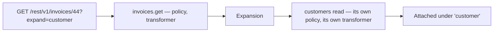
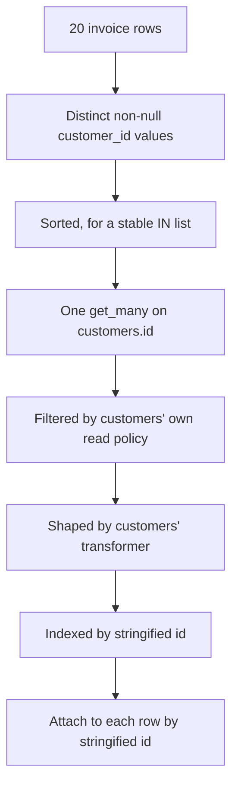
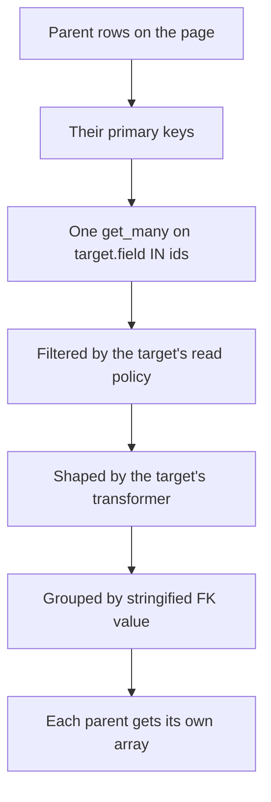
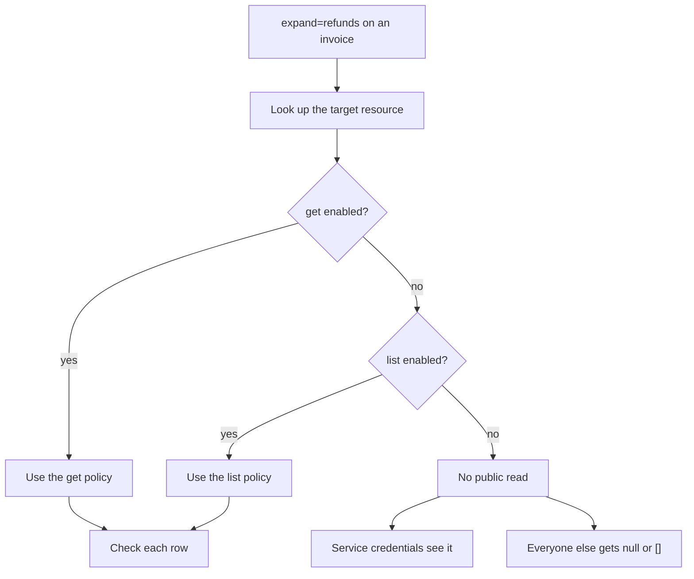

A relation is a declared link from one resource to another, and it does exactly one thing: it powers `?expand=<name>` on `list` and `get`.

It is not a database foreign key constraint. It is not enforced on write. It is not a join, and it does not let you filter one resource by another resource's fields. The best way to hold all of that at once is to think about what expansion actually is: **the platform performing the related resource's own read on your behalf, and attaching the result** — with that read fully subject to the related resource's own policy and its own transformer.



That diagram is the whole page. Everything below is detail about which read happens, what it costs, and what it refuses to do.

<CardGroup cols={3}>
  <Card title="Read-time only" icon="eye">Nothing about a relation affects migrate, validation or the write path. It is a hint about navigation.</Card>
  <Card title="Governed by the target" icon="shield-check">Expanded rows answer to the target resource's own read policy. An expansion must not become a side door.</Card>
  <Card title="Batched, not joined" icon="layers">One extra query per relation for the whole page. No join, no row multiplication, no N+1.</Card>
</CardGroup>

## The declaration

```json
{"name": "customer", "resource": "customers", "field": "customer_id", "type": "belongs_to"}
```

| Key | Meaning |
| --- | --- |
| `name` | The key the expanded data appears under in the response, and the name you write in `?expand=` |
| `resource` | The related resource's name |
| `field` | The foreign key column — on *this* resource for `belongs_to`, on the *related* resource for `has_many` |
| `type` | `belongs_to` or `has_many`; defaults to `belongs_to` if omitted |

<Warning>
Saving a relation validates only that `name`, `resource` and `field` are present and that `type` is one of the two legal values. It does **not** check that `resource` names a resource that exists, or that `field` is a real column on either side. A typo saves cleanly and fails the first time somebody writes `?expand=`.
</Warning>


## `belongs_to`: the key is here

`belongs_to` means *this* resource's table holds the foreign key. An `invoices` resource with a `customer_id` column pointing at `customers.id` declares:

```json
{"name": "customer", "resource": "customers", "field": "customer_id", "type": "belongs_to"}
```

```bash
curl "$GW/rest/v1/invoices/44?expand=customer" \
  -H "apikey: $PK" -H "Authorization: Bearer $TOKEN"
```

```json
{
  "id": 44,
  "customer_id": 12,
  "amount_cents": 210000,
  "status": "overdue",
  "customer": {"id": 12, "name": "Ada Okafor", "email": "ada@example.com"}
}
```

The expanded value replaces nothing — the foreign key stays in the response and the related row is added alongside it under the relation's `name`. That is deliberate: the client can see both the key and the target, which makes it possible to render a link without a second request even when the expansion was refused and came back `null`.

### How the expansion actually runs

On a `list` with `expand=customer`, for a page of twenty invoices:



| Step | What happens |
| --- | --- |
| Collect | The distinct, non-null values of `customer_id` across the page |
| Cap | The `IN` query is capped at `MAX_PAGE_SIZE` — 200 |
| Fetch | One `get_many` against the target's primary key |
| Filter | Each fetched row is checked against the **target's** read policy |
| Shape | Surviving rows go through the **target's** transformer |
| Attach | Matched by `str(id)`, so an integer `12` and a string `"12"` match |

One extra query for the whole page, not one per row. A page of twenty invoices pointing at four customers is one `SELECT ... WHERE id IN (4 values)`.

The stringified comparison is what makes mixed representations safe. Rows decoded from different columns can produce an integer on one side and a string on the other, and a naive equality check would silently miss every match.

<Note>
The 200 cap is `MAX_PAGE_SIZE`, the same ceiling as `per_page`. Since `per_page` cannot exceed 200, a page can contribute at most 200 distinct ids anyway — so in practice the cap is never the binding constraint for `belongs_to`. It matters for `has_many`, where it is not.
</Note>


## `has_many`: the key is over there

`has_many` means the *target's* table holds the foreign key pointing back at this resource. A `customers` resource with a matching relation to `invoices`:

```json
{"name": "invoices", "resource": "invoices", "field": "customer_id", "type": "has_many"}
```

```bash
curl "$GW/rest/v1/customers/12?expand=invoices" \
  -H "apikey: $PK" -H "Authorization: Bearer $TOKEN"
```

```json
{
  "id": 12,
  "name": "Ada Okafor",
  "invoices": [
    {"id": 44, "customer_id": 12, "amount_cents": 210000, "status": "overdue"},
    {"id": 51, "customer_id": 12, "amount_cents": 15800, "status": "paid"}
  ]
}
```

Note the label in the picker: **Foreign key on `<target>`**. That is the whole distinction, and it is the single most common thing to get backwards.

| | `belongs_to` | `has_many` |
| --- | --- | --- |
| The `field` is a column on | This resource | The target resource |
| The response key holds | One object, or `null` | An array, possibly empty |
| Typical name | Singular: `customer`, `author` | Plural: `invoices`, `line_items` |
| Rows fetched | The distinct referenced ids | Every child row matching any parent in the page |

### How the expansion runs



One query for the whole page again. The children come back in a single result set and are grouped in memory by `str(child[FK]) == str(parent[primary_key])`, with the same stringified comparison that makes `belongs_to` robust.

A parent with no children gets an empty array — not `null`, not a missing key. That distinction matters to a client: `[]` means "this parent has none", while `null` on a `belongs_to` means "I cannot tell you".

### The 200 cap, and why it bites here

`get_many` runs with `limit=MAX_PAGE_SIZE` — 200. For `has_many`, that limit is on **child rows across the entire page**, not per parent.

| Page | Children per parent | Rows fetched | What happens |
| --- | --- | --- | --- |
| 20 parents | 5 | 100 | All of them |
| 20 parents | 10 | 200 | All of them, exactly at the cap |
| 20 parents | 11 | 220 | **Truncated at 200.** The last parents get empty arrays |
| 1 parent | 5000 | 5000 | Truncated at 200 |

That last row is the important one. A `has_many` expansion on a single `get` is capped at 200 children, and nothing in the response tells you it happened — the array simply has 200 entries and stops.

<Warning>
A truncated `has_many` looks exactly like a complete one. There is no `has_more`, no total, no indication that rows were dropped. If a parent can have more children than the cap, do not expand it — query the child resource directly with `?filter[<fk>]=eq.<id>`, which paginates properly and reports a total.
</Warning>


## Why Pawabase does not create real foreign keys

This is the design decision most worth understanding, because it looks like an omission until you know what the platform is for.

A database foreign key constraint says three things at once: that the column may not be null, that the referenced row must exist, and that deleting the referenced row is either forbidden or cascades. All three are enforced by the database, at write time, on every write path — including the ones you did not write.

Pawabase's resource layer enforces none of them, and the consequences are worth being explicit about:

| You get | You do not get |
| --- | --- |
| A declared link usable by `?expand=` | A guarantee that a dangling reference is impossible |
| Batched expansion without N+1 | Cascade behaviour on delete |
| The freedom to point at a row that does not exist yet | The freedom to delete a parent without touching children — which is the other half |
| A relation that survives a table rename | A guarantee that the two tables agree about a value |

The reasoning runs through all four rows. A workflow that creates an invoice and its lines in one transaction may insert the invoice before the customer row exists, in a staging import, or in a migration where the order is genuinely reversed. Cascade delete is the more dangerous half: silently removing rows because a parent disappeared is a behaviour nobody chooses deliberately and everybody discovers in production.

<Note>
Pawabase also never creates a database index for a relation's foreign key column. `indexed: true` on the field does that, and `migrate` is what applies it. A `has_many` expansion over an unindexed foreign key is a full scan of the child table.
</Note>

### What this means in practice

Nothing stops a dangling key from being written, and nothing stops a parent from being deleted with children pointing at it. Both produce a `belongs_to` expansion of `null` — a dangling key on one side, and on the other a `has_many` array that simply omits the orphan.

If your product needs real referential integrity, the options are:

| Option | What it costs |
| --- | --- |
| Declare the relationship and add the constraint yourself in the Database console | The constraint is real, and it lives outside everything the definition describes |
| Model orphans explicitly — a `status` of `orphaned`, or a soft delete on the parent | No constraint needed, and every read has to account for the state |
| Validate in the flow that writes the child | A check at write time rather than a guarantee at the storage layer |
| Accept it, and let the expansion return `null` | Fine when a dangling key means "not set yet", alarming when it means corruption |

The last row is the honest default. Many product relationships are legitimately incomplete at times, and a database constraint would fight that. The cost is that "the key is wrong" and "the row is hidden" become the same observation, and you have to decide in advance which of those your product can tolerate.


## The rule that matters most

Every expanded row answers to the **target** resource's own read policy, and is shaped by the **target's** transformer. Not the resource you are querying — the one you are expanding into.

The lookup order for the governing settings is:

1. The target's `get` settings, if `get` is enabled.
2. Otherwise the target's `list` settings, if `list` is enabled.
3. Otherwise the default policy `authenticated` — but see the next paragraph, because step 3 only applies when one of the first two existed with no policy of its own.
4. If the target has neither `get` nor `list` enabled, there is no public read at all, and **only service credentials** see the expansion. Everyone else gets `null` or `[]`.



This is deliberate, and the reasoning is worth stating because it is the security property that makes expansion safe to expose: **an expansion must not be a side door around the target's policy.** Without it, any resource with a relation to a sensitive resource becomes a read path to it, and the sensitive resource's carefully written policy would be irrelevant.

The consequence for a client is that a perfectly readable parent can have an unreadable relation. In the invoicing example, `invoices?expand=customer` returns `customer: null` for a caller whose credential does not satisfy the `customers` read policy — while `invoices?expand=lines` is fully populated for the same caller if they pass the `invoice_lines` policy. Each relation is evaluated independently, against its own target.

<Warning>
Turning off `get` and `list` on a target does not hide the rows from a service credential, and it does not hide them from Studio's own record editor either. It hides them from ordinary callers. If a relation exists to a resource whose rows are sensitive, the correct answer is to remove the relation rather than to rely on the target having no public read — because that is a property of the target's definition, and the target's definition is editable by someone who may not know the relation exists.
</Warning>
