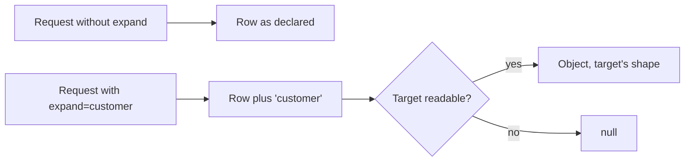
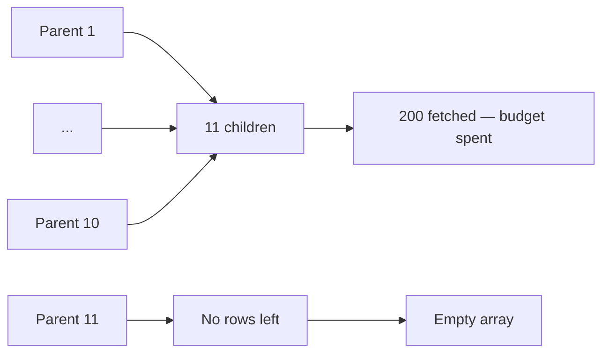

The `visible_tickets` policy referenced above is the ordinary shape for this kind of product, and it is worth writing out because it shows how relations and policies coexist without either one reaching the other.

```json
// visible_tickets
{
  "name": "visible_tickets",
  "condition": {
    "any": [
      { "eq": ["$record.requester_id", "$auth.user_id"] },
      { "role": "agent" }
    ]
  }
}
```

Read it as: a caller may see a ticket if they opened it, **or** if they hold the `agent` role. `any` is one of the three policy combinators, alongside `all` and `not`.

Two things to notice about how this interacts with expansion:

**Only one branch can push down.** `{"eq": ["$record.requester_id", "$auth.user_id"]}` is an equality between a record field and a known value, so it can become a SQL filter. `{"role": "agent"}` is about the caller and not the record, so it cannot — which means the pushdown splits the condition and the part that cannot be expressed in SQL stays as a per-row check on the page.

<Note>
A policy built entirely from record equalities pushes down completely and keeps `total` exact. One that mixes a record condition with a role or permission condition does not, and `total` comes back `null` on a list. That is not a flaw in the policy — it is the honest consequence of a rule with two halves, one about the caller and one about the row. See [Policy pushdown](/policies/pushdown).
</Note>

**Expansion still uses the target's policy.** A customer who passes `visible_tickets` sees `requester` expanded if they may read that user row, and `assignee` expanded if they may read the agent's — which is usually the same answer, but is decided by the `users` resource's own read policy rather than by anything on the ticket.


## The messages expansion, in practice

```bash
curl "$GW/rest/v1/tickets/8812?expand=requester,assignee,messages" \
  -H "apikey: $PK" -H "Authorization: Bearer $TOKEN"
```

Three extra queries, four statements in total. What comes back depends entirely on whose credential it is:

**A customer who opened the ticket.** `requester` expands — it is themselves. `assignee` expands if they may read that user's row. `messages` returns only the rows `visible_messages` allows them, which for a customer means `visibility = customer` and nothing internal.

**An agent.** All three expand. `messages` includes internal notes.

**An anonymous caller.** The ticket itself is refused by `visible_tickets` before expansion is reached, so there is no response to inspect.

```json
{
  "id": 8812,
  "requester_id": "6f1c9a2e-4b7d-4a11-9c33-8e2f5b6d1a90",
  "assignee_id": "a1d2e3f4-5566-7788-99aa-bbccddeeff00",
  "subject": "Export fails at 90%",
  "status": "pending",
  "priority": "high",
  "requester": {"id": "6f1c9a2e-...", "name": "Ada Okafor"},
  "assignee": {"id": "a1d2e3f4-...", "name": "Sam Rivera"},
  "messages": [
    {"id": 1, "ticket_id": 8812, "visibility": "customer", "body": "It times out every time."},
    {"id": 2, "ticket_id": 8812, "visibility": "internal", "body": "Reproduced on 4 GB exports."}
  ]
}
```

Note that the second message is present because this response was fetched by an agent. The same request from the customer returns a `messages` array of length one, with no marker that anything was removed.

<Warning>
This is the behaviour to design around rather than against. A client that renders "2 messages" from an expansion will show the wrong count to a customer on a long ticket, silently, forever. Message counts and message paging belong to a filtered `list` on `ticket_messages`, where the policy applies the same way and the total is honest.
</Warning>


## What this example teaches about relations

Four conclusions, each of them general.

**Two relations to one target is normal.** `requester` and `assignee` are both `belongs_to` `users`, on different columns, with different names. The relation is between two *fields*, not between two resources, and the resource pair being identical is incidental.

**The `has_many` is the one to be careful with.** `messages` is exactly the shape that is convenient and wrong for a long list: capped at 200, filtered by the target's policy, unordered beyond the target's default. It is right for a ticket with a handful of messages and wrong for a ticket with a year of them.

**The owner's field is doing the authorisation work.** `owner_field: requester_id` is what makes `requester_id` trustworthy, and `visible_tickets`' first branch is what makes it useful for reads. Neither alone is sufficient — the owner field stops forgery, the policy stops reading.

**The message resource exists because of growth and access, not because of relations.** Putting messages in an `array` on the ticket would have been simpler to define and worse in three specific ways: the ticket row grows without bound, adding a message rewrites the whole row, and there would be no way to give messages their own read policy so internal notes stay internal.

<Info>
The last point generalises. Whenever a child needs access rules its parent does not, the child is a resource. `visibility` on `ticket_messages` is only enforceable because messages are rows with their own policy — an array element has no policy of its own and is visible exactly when its parent is.
</Info>


## A design checklist for a set of relations

Before a set of relations goes into an environment, six questions have answers. None of them is answered by the platform, which is why they are worth asking yourself.

| Question | Why it matters | The wrong answer looks like |
| --- | --- | --- |
| Which table holds each foreign key? | Determines `belongs_to` versus `has_many` | An expansion that is always `null` or `[]` |
| Is every foreign key column indexed? | `has_many` reads it on every expanded request | An expansion that is inexplicably slow |
| Is any `has_many` unbounded per parent? | The 200 cap truncates without warning | A list that shows 200 of 5,000 |
| Does any target have `get` and `list` both off? | Only service credentials see the expansion | A relation that is always `null` for clients |
| Does any target have a transformer? | Expanded rows are shaped by it, not by the field list | Keys that do not match the target's fields |
| Is any relation unused? | Each is a query path with no owner | A definition nobody fully sees |

The third row is the one that causes real incidents rather than real confusion, because truncation is invisible. If you cannot bound the children per parent, treat the `has_many` as a display convenience and make the countable path available alongside it.

<Note>
Indexing the foreign key column is a field-level setting, not a relation-level one: `indexed: true` on the field, applied by migrate. A relation declaration does not and cannot create it.
</Note>


## The four properties, restated

Everything on this page reduces to four properties, and it is worth being able to state them without reference to the documentation.

**A relation is read-time only.** It is a key in the `relations` array. It does not participate in validation, does not appear in any write path, and does not cause migrate to create anything. Nothing about a write changes because a relation exists.

**`belongs_to` and `has_many` differ only in where the key column is.** Everything else — the response shape, the query, the cost — follows mechanically from that one fact, which is why the Studio picker relabels itself when you change the kind.

**The target's read policy decides what appears, and the target's transformer decides its shape.** The parent's policy governs the parent and nothing else. There is no path from an expansion to a row its target would refuse, and that is structural: the only route from the fetch to the response goes through the target's own readability check.

**Expansion is capped at 200 fetched rows and marks nothing when it hits the cap.** For `belongs_to` that cap is unreachable, because a page cannot exceed `per_page` and `per_page` cannot exceed 200. For `has_many` it is the most important thing to know on this page.

| | `belongs_to` | `has_many` |
| --- | --- | --- |
| Cap reachable in practice | No | Yes |
| Missing data is marked | No — `null` | No — the row is simply absent |
| Result of a missing key | `null` | The row is omitted from the array |

<Warning>
Every one of those last two rows is silent. There is no `truncated` flag, no `has_more`, no placeholder and no count anywhere in the response. The only way to know whether an expansion is complete is to not depend on it being complete.
</Warning>


## Expansion and the response contract

A relation changes the shape of a response, which makes it a contract change even though it is a query-parameter change. Two consequences follow.

**An expansion is opt-in per request.** Nothing is expanded unless it is asked for, so adding a relation to a resource does not change any existing response. That is the good property, and it is why relations can be added without a version bump.

**The response keys are fixed by the declaration.** If a relation named `customer` exists, `?expand=customer` puts an object there. Clients that read `order.customer.name` are depending on the relation, the target's transformer, and the target's policy all continuing to behave as they do today.



The `null` branch is the one to design around. A client must be able to render every relation key without knowing whether it will be present-and-populated or present-and-null — and, for a `has_many`, present-with-fewer-rows-than-it-expects.

<Warning>
A `belongs_to` key is always present once the relation is declared, even when the value is `null`. Clients can rely on the key existing. They cannot rely on the object inside it.
</Warning>


## Expansion across a page, and what varies

On a `list`, expansion is applied per relation across the whole page, not per row. That is the source of both its efficiency and its two sharp edges.

| Property | Consequence on a list |
| --- | --- |
| One query per relation | Adding a relation adds one query regardless of page size |
| Rows are grouped after fetching | A `has_many` groups all children of the page in memory |
| The cap is on total children | Late parents in the page can come back empty |
| Missing children are dropped | A parent's array length varies with the caller's permissions |

The third row is worth restating concretely, because "late parents come back empty" is counter-intuitive. With 20 parents and 11 children each, the query fetches 200 rows. If the children are ordered so that the first ten parents' children fill that budget, the last ten parents receive `[]` — not a partial array, an empty one.



<Note>
The same effect applies to a `get` with a single parent and more than 200 children: the array holds 200 and stops. Nothing in the response indicates it, and reducing `per_page` does not help because there is no `per_page` on a `get`.
</Note>

### Mitigations, in order of preference

| Situation | The right answer |
| --- | --- |
| A parent with more than 200 children | Query the child resource with `?filter[<fk>]=eq.<id>` and paginate |
| A list where children push past the cap | Do not expand; query the child resource once for the whole page's parents using `in` |
| A count that must be exact | The filtered `list`'s `total`, never `array.length` |
| A preview of the first few children | Expanding is fine — just do not treat the length as a count |

The second row is worth spelling out because it is the natural fix and it uses a feature you already have:

```bash
# Instead of expanding children across a page of 20 parents:
curl "$GW/rest/v1/orders?per_page=20&expand=line_items"

# Fetch the children for the whole page in one query, paginated, with a total:
curl "$GW/rest/v1/line_items?filter[order_id]=in.901,902,903&per_page=50"
```

That is one query instead of one, but it returns 50 rows with a `total` rather than an uncounted array capped at 200 — and the caller controls the page size.

<Note>
`in` splits its value on commas, which is what makes a client-generated `in` list practical. The dots in a filter value are parsed with `partition(".")`, so a value containing a dot works for `in` and `nin` but not for most other operators.
</Note>


## Declaring relations outside Studio

The relations array is ordinary data, so the platform API accepts it the same way it accepts the rest of the definition. Nothing about a relation requires the form.

```json
{
  "name": "orders",
  "fields": [
    {"name": "customer_id", "type": "integer", "required": true, "indexed": true}
  ],
  "operations": {
    "list": {"enabled": true, "policy": "own_orders"},
    "get": {"enabled": true, "policy": "own_orders"}
  },
  "relations": [
    {"name": "customer", "resource": "customers", "field": "customer_id", "type": "belongs_to"},
    {"name": "reorder", "resource": "orders", "field": "reordered_from_id", "type": "belongs_to"}
  ],
  "owner_field": "customer_id"
}
```

Two things are worth noticing about writing this by hand rather than in the form.

**`type` may be omitted.** It defaults to `belongs_to`, which is the right default because the key-on-this-table case is the more common one and the more common mistake is declaring it that way when it is not.

**A self-referential relation needs no special syntax.** The second declaration above points `orders` at `orders`, resolved by name like any other target. Expansion resolves it one level, which is exactly the behaviour a reorder link wants: `GET /rest/v1/orders/901?expand=reorder` returns the order this one was created from.

| Relation shape | Declaration |
| --- | --- |
| Self-reference | `"resource"` is the resource's own name |
| Two relations to one target | Two entries with the same `resource`, different `field` and `name` |
| A relation to a resource defined later | Order of definition does not matter; both are resolved at compile time |

<Note>
Because relations are resolved when the environment is compiled rather than when they are saved, adding a relation to a resource that already exists is a safe, ordinary edit. It changes no existing response, because expansion is opt-in per request.
</Note>


## Verifying a relation

Since nothing about a relation is checked at save time, verification is your responsibility, and it is cheap. Three checks, in the order that finds the most problems.

**Read the declaration.** Two things to confirm by eye: that `field` is a column on the side the `type` implies, and that `resource` names a resource that exists in this environment. Both mistakes save without complaint.

**Check the target's read operations.** If the target has neither `get` nor `list` enabled, the expansion is invisible to every client. If it has `get` enabled, that policy governs — and it may not be the policy you assumed.

**Expand it once, on both kinds.**

```bash
# A belongs_to, on a single record.
curl "$GW/rest/v1/orders/901?expand=customer" -H "apikey: $PK"

# A has_many, on a single record — and check the count against the child resource.
curl "$GW/rest/v1/customers/44?expand=orders" -H "apikey: $PK"
curl "$GW/rest/v1/orders?filter[customer_id]=eq.44&per_page=1" -H "apikey: $PK"
```

That last pair is the check that matters for `has_many`. The first request tells you how many orders the expansion produced; the second tells you the real `total` for the same parent. If they differ, you have found the cap or a policy filtering children, and you now know which.

| What the first request shows | What the second shows | Conclusion |
| --- | --- | --- |
| Same count | Same total | Correct, and below the cap |
| 200 | More than 200 | Truncation. Query the child resource directly |
| Fewer | More than zero | Children the caller may not read |
| Empty | Empty | No children, or the kind is backwards |
| Empty | Some | The kind is backwards, or `field` names the wrong column |

<Warning>
Do that comparison with the credential your clients actually use. Verifying as an operator or a service credential proves the declaration resolves, and says nothing about whether an ordinary caller sees anything.
</Warning>


## The declaration is a promise about two resources

A relation is the only setting on a resource that makes a claim about something you do not own. The target's shape, its policy, its transformer and its row count are all outside the resource you are editing, and a relation asserts that those are things you want in your response.

That framing makes the review question obvious: for each declared relation, ask whether the *target's* definition is one you would want a client of the *parent* to see. The answer is sometimes no, and the answer can change without anyone touching the parent.

| The target has | The expansion is safe because |
| --- | --- |
| `get` or `list` enabled with an appropriate policy | Its own rules already decide what a client sees |
| A narrow policy | The parent's callers are filtered by the target's rules |
| A transformer | It shapes the rows, and a `pick` step can limit what is exposed |
| Neither read enabled | Only service credentials see anything — almost certainly not what the relation is for |

The last row is the one to check first when auditing a set of relations. A relation to a target with no public read is dead weight for every client, and it is invisible in the parent's definition because the fact lives in the target's.

<Warning>
Audit relations from both ends. Reading the parent's `relations` array tells you what claims have been made; reading each target's `operations` tells you whether the claim holds. Neither file contains the other.
</Warning>


## Two questions a relation cannot answer for you

Both come up in review, both have answers that require knowing something the relation does not record, and both are cheap to establish when you set the relation up.

**Does the target's policy actually match the parent's callers?** The relation records a resource name. It does not record who will be asking, and the two resources may have entirely different readerships. An `orders` resource read by staff and a `customers` resource readable by anyone are a perfectly ordinary pair, and an expansion between them widens the audience of one to the other by exactly one hop.

The check is not "is the target protected" but "is the target protected *from these callers*". A policy that admits everyone admits the customers viewing their own orders.

**How many children are there, really?** The relation records a column, not a cardinality. A `has_many` to a table with three rows per parent and one to a table with three thousand are declared identically and behave very differently at the 200 cap.

The check is a filtered `list` on the child resource with `per_page=1`, and the `total` in the response is the number. If it is anywhere near 200 for a single parent, or near 200 for a whole page of parents, the expansion is the wrong tool for that screen.

| Question | Where the answer lives |
| --- | --- |
| Who may read the target? | The target's `get` or `list` policy |
| How many children per parent? | A filtered `list` on the child resource, `per_page=1` |
| Does the target reshape rows? | The target's `transformer` |
| Is the foreign key column indexed? | The field's `indexed`, applied by migrate |

<Note>
None of these four facts is in the relation, which is why a relation reads as complete on the form while being a claim about four other things. Recording the answers next to the declaration — in a comment, in the description, or wherever your team keeps such notes — is the difference between a review that takes minutes and one that takes an afternoon.
</Note>
