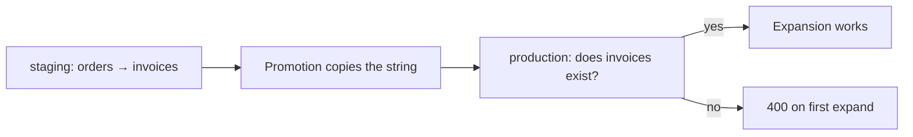

The test is whether the related data is *always wanted alongside* the parent.

| Declare a relation when | Skip it when |
| --- | --- |
| The related row is small and needed on every view | The related data is large or occasional |
| It is the same object every time — a customer, an author, a product | It is a list the user may want filtered, sorted or paged |
| It belongs in the response contract | A separate request would be simpler to cache and to reason about |
| You will expand it on a `get` | You only ever need it on a list, where pagination matters more |

Two failures to avoid at opposite ends.

**Declaring everything.** A resource with six relations invites a client to request `?expand=a,b,c,d,e,f` on a list of 200 rows, and the answer is six extra queries, six policy boundaries, and a response nobody designed. The 200-child cap will silently truncate whichever `has_many` comes last.

**Declaring nothing.** A resource with no relations forces every screen to make two requests and join in the client, and the client has to handle the case where the second request is refused. That is the shape expansion exists to remove.

The reasonable middle is one or two relations on a resource — the ones that are genuinely part of the entity rather than a list of things that happen to point at it.

<Note>
A `has_many` declared for convenience and never expanded has a real cost after all: it is a query path on the child resource, and the child's policy is evaluated against the parent's callers whenever somebody does use it.
</Note>


## The shape of an expansion, in code

The whole algorithm in one place, so the guarantees can be read off the implementation rather than inferred.

```python
async def _expand(state, ctx, spec, rows, names):
    relations = {r["name"]: r for r in spec.relations}
    for name in names:
        relation = relations.get(name)
        if relation is None:
            raise HTTPException(400, f"{spec.name} has no relation {name!r}")

        target = await state.store(relation["resource"])

        if relation.get("type", "belongs_to") == "belongs_to":
            ids = sorted({
                row[relation["field"]]
                for row in rows
                if row.get(relation["field"]) is not None
            }, key=str)
            fetched = await target.get_many(target.spec.primary_key, ids)
            related = {
                str(item[target.spec.primary_key]): item
                for item in await _readable(state, ctx, relation["resource"], fetched)
            }
            for row in rows:
                row[name] = related.get(str(row.get(relation["field"])))

        else:  # has_many
            ids = [row[spec.primary_key] for row in rows]
            children = await _readable(
                state, ctx, relation["resource"],
                await target.get_many(relation["field"], ids),
            )
            for row in rows:
                row[name] = [
                    child for child in children
                    if str(child.get(relation["field"])) == str(row[spec.primary_key])
                ]
```

Five properties fall out of that, and each is a guarantee rather than an accident.

**Null keys are excluded before the query.** The set comprehension filters on `is not None`, so a page of null foreign keys produces no query at all — an empty id list short-circuits `get_many`.

**Ids are sorted for a stable query.** `sorted(..., key=str)` gives postgres a predictable `IN` list, which helps the planner and makes query logs comparable between requests.

**Matching is by stringified key on both sides.** `str(row.get(field))` and `str(item[primary_key])` on one side, `str(child.get(field))` and `str(row[primary_key])` on the other. This is why an integer key and a string key still match.

**`get_many` is always capped.** `limit=MAX_PAGE_SIZE`, 200, for both directions. Harmless for `belongs_to`, consequential for `has_many`.

**`_readable` sits between fetching and attaching.** Every fetched row passes through the target's own read policy and transformer before it can appear in the response. There is no code path that attaches a raw fetched row.

<Warning>
The last property is the security property, and it is worth noticing that it is structural rather than a check someone might forget. Because `_readable` is the only path from `get_many` to a response, there is no version of this code that attaches an unfiltered child.
</Warning>


## What `_readable` does

```python
async def _readable(state, ctx, resource_name, items):
    target = state.resources.get(resource_name)
    settings = None
    if target is not None:
        settings = operation_settings(target, "get") or operation_settings(target, "list")
    if settings is None:
        return items if _is_service(ctx) else []
    policy = settings.get("policy") or DEFAULT_POLICY
    kept = [i for i in items if await state.engine.check(policy, build_policy_context(ctx, record=i))]
    if kept and target.transformer:
        kept = await _present(state, target, ctx, kept)
    return kept
```

Four behaviours, each with a consequence:

| Line | Behaviour | Consequence |
| --- | --- | --- |
| `target = state.resources.get(...)` | An unresolvable target is `None` | `settings` stays `None`, so only service credentials see anything — the same outcome as a target with no public read |
| `get` settings, else `list` | `get` wins when both are enabled | Two policies on the target, and only one of them governs expansion |
| `settings is None` | Return everything to a service credential, nothing to anyone else | A target with both reads off is invisible to ordinary callers |
| The transformer is applied only `if kept` | No work when nothing survived | An empty result does not pay for transformation |

Note what is *not* here: there is no pushdown, no SQL. The policy is checked once per fetched row, in Python, against `build_policy_context(ctx, record=i)` with no `$input`. That is why expansion's policy cost scales with rows fetched rather than rows returned.


## Why the policy is evaluated in Python

The parent resource's `list` policy gets pushed into SQL, so a page of twenty rows costs twenty SQL-level condition evaluations and a correct `total`. Expansion cannot do the same thing, for a reason that is worth being precise about.

The policy's context during expansion contains `$record` but not `$input`. A condition like `{"eq": ["$record.customer_id", "$auth.customer_id"]}` pushes down beautifully in a `list`, because the engine turns it into a SQL equality before the query runs. For expansion, the *target* resource's policy has to be applied to rows that were fetched by a completely different predicate — a list of parent primary keys, or a set of parent ids.

There is no way to merge the parent's `WHERE` clause with the target's policy conditions into one statement without either a join — which the transformer and residual requirements rule out — or reordering the query so the target is fetched first, which would mean fetching every row the target's policy allows rather than the ones referenced.

So expansion evaluates the target's policy per row, after the fetch. Two consequences:

| | Parent `list` policy | Expansion policy |
| --- | --- | --- |
| Evaluated | In SQL, per row the database returns | In Python, per row the target's query returned |
| Pushdown | Yes, when the conditions are equalities | Never |
| Affects `total` | Yes, possibly null | No — there is no count |
| Cost scales with | Rows the database examined | Rows the target's query returned |

The practical effect is that a target whose policy has a residual is more expensive to expand than one whose policy is a simple equality, and neither is visible in the response.

<Note>
This is also why expansion cannot leak through timing or counts in the way a naive join could. The rows that are filtered out were genuinely fetched and genuinely evaluated; there is no count, no offset arithmetic and no ordering in the response that reflects them.
</Note>


## Choosing the kind from the shape of the data

A practical test, using only what you can see in the two definitions.

Ask where the foreign key column lives:

| You observe | The relation is |
| --- | --- |
| This resource has a column that references the target's primary key | `belongs_to`, with `field` set to that column |
| The target resource has a column that references this resource's primary key | `has_many`, with `field` set to that column |
| Both | Declare both — they are two different relationships and both are legitimate |
| Neither | There is no relation. The link is a `json` field, a computed value, or it does not exist |

The "both" row is the one that confuses people most often, and it is completely normal. An `orders` table with a `customer_id` and a `referred_by_customer_id` has two `belongs_to` relations to `customers`. An `invoices` table referenced by `invoice_lines` has a `has_many` towards `invoice_lines`, and its own `customer_id` gives a `belongs_to` towards `customers`. Both directions, one resource, different columns.

In Studio the equivalent test is the picker itself: choose **Belongs to** and the form offers *this* resource's fields; choose **Has many** and it offers the *target's* fields. Pick the kind whose list contains the column you actually have.

<Warning>
Choosing the kind and then picking a field from the wrong list is the single most common relation mistake, and it fails quietly. The declaration saves, the request saves, and the expansion is empty or null forever. If an expansion is empty, swap the kind before you look at anything else.
</Warning>


## Relations across environments

A relation is resolved by name, in the environment being compiled. That has two implications that are easy to miss the first time you promote a set of definitions.

**Promotion copies the declaration, not the resolution.** The `resource` key is a string. If `orders` in production declares a relation to `invoices` and the `invoices` resource exists in production but was never promoted alongside it, the definition is valid, the save succeeds, and the expansion fails on first use.

**Renaming is not available, which is what makes this tractable.** The resource name is fixed once created, so a promoted relation's target cannot silently drift. It either exists under that name in the target environment or it does not.



The failure is a `400` with a message naming the resource that has no such relation, not a null and not a `500` — so it is at least loud, and at the first request rather than at save time.

<Note>
Promote resources, schemas, policies and flows as a set. A relation whose target and a policy whose reference both live in staging and neither in production is a definition that is complete in one environment and broken in the other, and that asymmetry is invisible until a client asks for the expansion.
</Note>


## What a relation is not for

Three things a relation is regularly expected to do, and none of them are in scope.

**Referential integrity.** Covered above: no constraint, no cascade, no guarantee. If you need it, it comes from the database.

**Filtering across resources.** `?filter[customer.name]=Ada` is a `400`, because the dotted string is checked as a literal field name on `orders` and no such field exists. The equivalent is two queries and a join in your client, or a [flow](/flows/overview).

**Joining for aggregation.** There is no count-of, sum-of or group-by available through a relation. "How many invoices does this customer have" is a `list` on `invoices` filtered by `customer_id`, which gives you a real `total` rather than an expansion array you would have to count yourself.

```bash
# The expansion gives you the children, capped at 200, with no total.
curl "$GW/rest/v1/customers/44?expand=invoices" -H "apikey: $PK"

# The filtered list gives you a page and a real total.
curl "$GW/rest/v1/invoices?filter[customer_id]=eq.44&per_page=1" -H "apikey: $PK"
```

<Warning>
Counting the elements of an expanded `has_many` array is the most tempting wrong thing to do here. The array is capped at 200 children across the page, and children the caller may not read are absent — so the count is wrong in two independent ways and there is nothing in the response to tell you which.
</Warning>


## Where to go next

<CardGroup cols={2}>
  <Card title="Resources" icon="table-properties" href="/data/resources/overview" />
  <Card title="Defining resources" icon="plus" href="/data/defining-resources/overview" />
  <Card title="Filtering" icon="filter" href="/data/filtering/overview" />
  <Card title="Sorting and pagination" icon="sort" href="/data/sorting-pagination/overview" />
  <Card title="Custom routes" icon="route" href="/data/custom-routes/overview" />
  <Card title="Field types" icon="type" href="/data/field-types/overview" />
  <Card title="Schemas" icon="code-2" href="/data/schemas/overview" />
  <Card title="Policies" icon="shield-check" href="/policies/overview" />
  <Card title="Policy pushdown" icon="arrow-down-to-line" href="/policies/pushdown" />
  <Card title="Your database" icon="hard-drive" href="/data/your-database/overview" />
</CardGroup>
