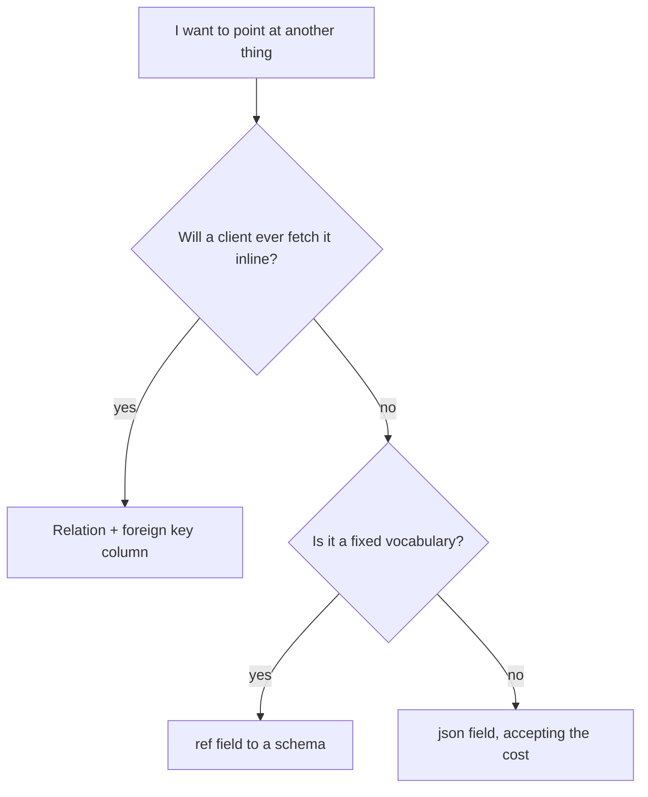

The parameter is a comma-separated list of relation names, and it works on both `list` and `get`.

```bash
curl "$GW/rest/v1/orders?expand=customer,line_items&per_page=50" \
  -H "apikey: $PK" -H "Authorization: Bearer $TOKEN"
```

Names are matched against the `relations` array of the resource you are querying, exactly. They are case-sensitive, and they are the relation's `name`, not the target resource's name — a relation named `author` pointing at `users` is expanded as `author`.

Expanding several relations costs one query each, in the order they appear:

| Request | Queries |
| --- | --- |
| `?expand=customer` | 2 — the list, plus one for customers |
| `?expand=customer,line_items` | 3 |
| `?expand=a,b,c,d` | 5 |

Each expansion runs after the page is fetched and after any policy residual has been applied, so it operates on the rows the caller can actually see. A residual that removed eight of twenty rows leaves twelve ids to expand.

<Note>
The expansion is not part of the response for `select`. Because the primary key is always appended to your selection, expansion still works with `?select=...` — but the *target's* rows are fetched in full and then shaped by the target's transformer, not reduced to the columns you selected on the parent.
</Note>

### An unknown relation name is a 400

If a name in `expand` matches no declared relation, the whole request fails:

```text
400 posts has no relation 'comments'
```

The message names the resource and the relation you asked for. This is a `400` rather than being ignored, which is the right call: silently dropping an unknown expansion would return a response that looks complete and is missing data, and the client would have no way to tell.

The same strictness applies to a name that exists on a different resource. Relation names are per-resource, so `?expand=comments` on `posts` and `?expand=comments` on `videos` can refer to entirely different resources.

<Warning>
Because there is no depth syntax, `?expand=customer.account` is a `400` with a message about a relation literally named `customer.account` — the dot is part of the name being looked up. Expansion resolves exactly one level. A second hop is a second request against the target.
</Warning>

### What you cannot do with a relation

A relation is not a query path. These are the three things people try and the two alternatives that exist:

| You want | `?expand=` gives you | Do this instead |
| --- | --- | --- |
| Filter by a related resource's field | Nothing. The dotted name is checked as a literal field on the resource you are querying, and it does not exist there, so it is a `400` | Query the other resource directly, filtering on its own fields |
| Sort by a related resource's field | Nothing | Same |
| Join in the response body | One level of related data, keyed by relation name | Nested expansion via two requests, or a transformer |

There is no `$or`, no negation and no nested filter grouping in the filter language either, so a cross-resource condition such as "invoices for customers in region EU" is two queries and a join in your client, or a flow that does it server-side. See [Filtering](/data/filtering/overview) for what the filter language does support.


## Cost, stated plainly

Expansion is a query, not a join. For a list of twenty rows with two relations expanded, that is three queries against the database where one would do.

| | Without `expand` | With two relations |
| --- | --- | --- |
| Queries for a 20-row list | 2 — the page and the count | 4 |
| Rows returned | 20 | 20, plus up to 40 related |
| Response size | Small | Potentially large |
| Policy evaluations | 20 | 20, plus every related row |

Two of those rows deserve emphasis.

**The policy evaluations are per related row.** Expansion does not push the target's policy into SQL; it fetches candidates and then checks each one in Python. For a `has_many` with 200 children, that is 200 policy evaluations per request.

**The response size is unbounded in the way that matters.** A `belongs_to` adds one object per row, so a page of 200 rows with a wide target can be many times the size of the page itself. `has_many` is worse, because the cap is on total children rather than per parent.

### Why not a join

Three reasons, and each one is a decision you might disagree with if you only saw the result.

**The target's policy may not be expressible in SQL for this query.** Expansion has to run the target's read policy, and when that policy contains a residual — any condition that is not an equality against a record field — the filtering happens in Python against rows that have already been fetched. A join would have to push the condition into the `WHERE` clause to be correct, which is exactly what a residual cannot do.

**The target's transformer runs per row, in Python.** A transformer can `omit`, `pick`, `set`, `rename` and `case`, and a `set` step renders a template with the policy context. None of that has a SQL equivalent, so the rows have to come back before they can be shaped.

**`has_many` multiplies rows.** A join that returns twenty invoices with their lines produces a result set whose length depends on the data, which then breaks the pagination you already applied. Expansion deliberately avoids that by keeping the page and the children separate.

The cost of those three guarantees is one query per relation. The benefit is that a relation can never change the meaning of a page.

<Note>
Because expansion runs after the residual, a policy that removes rows also removes their expansions from consideration. You never expand a row the caller cannot see, so there is no timing or count-based way to infer that a hidden row exists.
</Note>


## Declaring relations in Studio

Under **Build → Resources**, the **Relations** section of a resource's form. Its description reads "Include related rows with `?expand=name`." Each relation is a card:

| Control | Setting | Notes |
| --- | --- | --- |
| **Name** | `name` | Monospace, placeholder `author`. Becomes the response key and the `?expand=` name |
| **Kind** | `type` | A two-way choice: **Belongs to** or **Has many** |
| **Resource** | `resource` | A picker over the environment's resources. Not optional |
| Foreign key picker | `field` | Label and options both change with the kind |
| Trash | — | Labelled **Remove relation** |

The relabelled foreign-key picker is the useful part:

| Kind | Label | Options offered |
| --- | --- | --- |
| Belongs to | **Foreign key here** | This resource's own fields |
| Has many | **Foreign key on `<target>`** | The chosen target's fields |

So the form is showing you, at the moment you pick the kind, exactly which side of the relationship owns the key. Picking the target resource populates the right list of fields for `has_many`. This is the single most effective guard against getting the direction backwards, and it is worth using rather than reasoning from memory.

**Add relation** appends a card pre-filled with `{name: "", type: "belongs_to", resource: "", field: ""}`.


## Naming relations

The relation's `name` is a response key and a query parameter, so it deserves the same care as a field name.

| Convention | Example | Why |
| --- | --- | --- |
| `belongs_to` is singular | `customer`, `author`, `account` | It holds one object; a singular name makes `null` read naturally |
| `has_many` is plural | `invoices`, `line_items`, `tags` | It holds an array |
| Match the field where you can | field `customer_id` → name `customer` | Makes the two declarations recognisable as a pair at a glance |
| Avoid abbreviations | `cust` | The name is public; the field is an implementation detail |

The last row is the one people regret. A relation name is part of the response contract and part of every client that reads it, and abbreviations that were obvious when the table was small are noise once a dozen engineers are calling the API.

<Note>
Two relations may point at the same target with different keys — `primary_author` and `secondary_author` both `belongs_to` `users`, on `customer_id` and `referred_by_id`. That is legitimate and expansion handles it independently, at the cost of a second query.
</Note>


## Relation, ref field, or json field

Choosing how to record a link between two things is a decision you make in the field list, and there are three shapes available. Picking the wrong one produces a model that is hard to query, hard to validate, or impossible to expand.

| | Relation + foreign key field | `ref` field | `json` field |
| --- | --- | --- | --- |
| Stores | An id in a real column | An id in a real column | An id inside a JSON document |
| Expandable | Yes, with `?expand=` | No | No |
| Filterable by the target's fields | No | No | No |
| Filterable by the id | Yes, because it is a column | Yes | No |
| Enforced by the database | No | No | No |
| Use when | The target is a resource you will read | The target is a schema you validate against | There is no single target |

### Reach for a relation when you will expand it

A foreign key column plus a relation is the only combination that gives you a navigable link. If the plan is for a client to fetch the parent and have the related row arrive with it, this is the shape.

```json
{
  "fields": [
    {"name": "customer_id", "type": "uuid", "required": true, "indexed": true}
  ],
  "relations": [
    {"name": "customer", "resource": "customers", "field": "customer_id", "type": "belongs_to"}
  ]
}
```

`indexed: true` on the column is not decoration for this shape. A `belongs_to` expansion fetches by the target's primary key, so the index that matters is on the *target* — but any list that filters by `customer_id` needs this one, and a `has_many` declared on the other side reads this column for every parent.

### Reach for a `ref` field when the target is a schema, not a resource

A `ref` field validates its value against a named [schema](/data/schemas/overview) — a reusable shape rather than a table with rows. It is the right answer when the thing you are pointing at is a fixed vocabulary rather than a record: a country code from a `countries` schema, a currency from a `currencies` schema, a status from a `ticket_states` schema.

```json
{"name": "currency", "type": "ref", "schema": "currencies", "required": true}
```

The validator compiles the referenced schema into the field's type, so the value is checked against the schema at request time. What you do not get is a row to expand: `ref` is not a resource, so there is nothing for a relation to point at.

<Warning>
A `ref` field without a `schema` is refused at save time. And a `ref` to a resource name is not a substitute for a relation — it validates a shape, it does not fetch anything.
</Warning>

### Reach for a `json` field when there is no single target

A `json` field is the honest choice for a genuinely polymorphic or composite link: an attachment that points at a file in storage or a row in a resource, a settings block, a snapshot of a third party's payload.

The cost is total. Filters cannot reach inside a `json`, `array` or `object` column at all — not with a partial match, not with a containment operator, not with a path syntax. So a `json` field cannot be filtered on, sorted by, or indexed, and if you find yourself needing to, the modelling decision was wrong rather than the query.



<Note>
There is also an `object` field for a nested structure you want validated key by key — a `line_items` array of objects with a `sku` and a `quantity`. That is a different question from "how do I point at another row", and it is the right tool when the shape is data rather than a reference.
</Note>


## Policies and relations

A relation has no policy of its own. The policy that governs the expanded rows is the target's, and that is the whole of the model.

What this means in practice, for each direction:

| Situation | Result |
| --- | --- |
| Target's `get` is enabled with a policy the caller passes | Full expansion |
| Target's `get` is enabled with a policy the caller fails | `null` for `belongs_to`; the row is absent from `has_many` arrays |
| Target's `get` is off, `list` is on | The `list` policy governs |
| Target's `get` and `list` are both on | `get` wins; its policy is used |
| Target has neither enabled | Only service credentials see anything; everyone else gets `null` or `[]` |
| Target has a transformer | The transformer shapes every expanded row |
| Target has neither enabled nor a transformer, and the caller is a service credential | Everything is returned |

Two things follow that are easy to miss.

**A `has_many` array can be shorter than the truth, with no indication.** Unreadable children are simply absent from the array. There is no placeholder, no count of hidden rows, no `null` entry. A parent with three children where the caller can read two gets a two-element array, and the response is indistinguishable from a parent with two children.

**A relation is not a way to share a policy.** If you want the same rule on both resources, write it once as a named policy and reference it from both operation sets — do not rely on the expansion inheriting anything from the parent.


## Relations versus foreign keys you write yourself

The two ideas overlap enough to be worth separating explicitly, because "we already have foreign keys" is a reasonable objection that turns out to be about a different thing.

| | A Pawabase relation | A database foreign key |
| --- | --- | --- |
| Lives in | The resource definition, as data | The table schema |
| Enforced by | Nothing | The database, on every write |
| Prevents a null key | No | Yes, with `NOT NULL` |
| Prevents a dangling key | No | Yes |
| Affects delete | No | Can forbid it or cascade it |
| Powers `?expand=` | Yes | No |
| Survives `migrate` | It is not schema, so nothing to migrate | It is schema, and `migrate` never touches it |
| Editable without a deploy | Yes | No |

The word doing the work in that table is *prevents*. A foreign key is a guarantee; a relation is a convenience. Neither substitutes for the other, and having both is a perfectly reasonable design.

### A design that uses both

The realistic pattern for a product that cares about integrity:

| Layer | What it provides |
| --- | --- |
| `customer_id` column, `integer` or `uuid`, `indexed: true` | The value, and a fast lookup for the expansion and for filters |
| A relation `belongs_to` `customers` | The navigable link for `?expand=` |
| A real foreign key constraint, added in the Database console | The integrity guarantee |
| A policy on `create` that checks the referenced row exists | A friendly error instead of a constraint violation |

What you gain is a model that is pleasant to read through the API and still cannot be corrupted. What it costs is that one of the four layers lives outside the definition, which means it is not promoted with it and not visible in the JSON. Someone cloning the resource into another environment gets the first three layers and has to remember the fourth.

<Warning>
That last point is the real cost. A constraint added by hand is invisible to `migrate`, invisible in the definition, and invisible in promotion — so it exists in production and not in staging until someone notices. If you add one, record it somewhere the next person will look, and check it after every environment rebuild.
</Warning>

### When a real constraint is the wrong answer

Even when you want integrity, a constraint is sometimes the wrong tool:

| Situation | Why a constraint does not help |
| --- | --- |
| The relationship is legitimately optional for a period | `NOT NULL` fights the workflow |
| The referenced row is created after the child | Insert order within a transaction is yours to choose, but a migration or import may not be |
| You need soft-deleted parents to remain valid | The row is gone from the database's point of view while the product still considers it present |
| Rows arrive by import or by raw SQL | The constraint only holds for writes that go through it |

That last row is the sharp edge. Raw SQL in the Database console bypasses the model layer entirely, so a constraint is the only thing standing between a bad import and a corrupted relationship — which is an argument *for* the constraint, provided the import is written to respect it.
