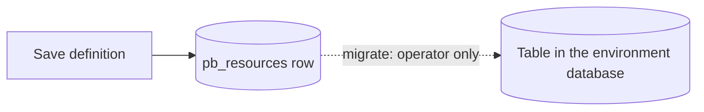

The fastest way to understand which setting answers which question is to watch one real resource get built. Take an invoicing product with three resources and one action. Customers place orders; an invoice belongs to a customer and has lines. The interesting constraints are commercial rather than technical: a customer sees only their own invoices, an internal user sees all of them, nobody edits an issued invoice by PATCHing it, and totals are computed rather than trusted.

### `customers`

```json
{
  "name": "customers",
  "description": "People and companies that can be invoiced.",
  "primary_key": "id",
  "id_type": "uuid",
  "fields": [
    {"name": "name", "type": "string", "required": true, "max_length": 200},
    {"name": "email", "type": "email", "required": true, "unique": true},
    {"name": "payment_terms_days", "type": "integer", "default": 30, "minimum": 0}
  ],
  "operations": {
    "list": {"enabled": true, "policy": "staff_only"},
    "get": {"enabled": true, "policy": "staff_only"},
    "create": {"enabled": true, "policy": "staff_only"},
    "update": {"enabled": true, "policy": "staff_only"},
    "delete": {"enabled": false, "policy": null}
  },
  "transformer": null,
  "cache_ttl": 60,
  "rate_limit": {"limit": 120, "window": 60},
  "events": true,
  "realtime": false,
  "timestamps": true,
  "owner_field": null,
  "tags": ["billing"]
}
```

`id_type` is `uuid` because customers get created from an import as well as from the app, and because customer ids end up in emailed invoice links where sequential integers leak volume information.

`list` and `get` are both `staff_only` — a role gate with no record conditions. Because it has nothing to do with a row, it pushes nothing down and refuses outright with `403` for everyone else, before any query runs.

`delete` is off. Customers are archived by a route in this product, never deleted; leaving `delete` registered would mean one careless client call could remove a customer with twenty years of invoice history.

`email` carries `unique: true`, so migrate creates a unique index. Until that migration has actually run, the constraint is only documentation.

`cache_ttl` is 60 because a customer record changes rarely and is read on every invoice screen.

`owner_field` is null. The owner of an invoice is the account that owes it, not the staff member who typed it, so ownership belongs in an `account_id` column and a policy rather than in this setting.

### `invoices`

```json
{
  "name": "invoices",
  "description": "Customer invoices. Totals are computed server-side.",
  "primary_key": "id",
  "id_type": "integer",
  "fields": [
    {"name": "customer_id", "type": "uuid", "required": true, "indexed": true},
    {"name": "status", "type": "string", "enum": ["draft", "issued", "paid", "void"], "default": "draft"},
    {"name": "total_cents", "type": "integer", "required": true, "minimum": 0},
    {"name": "due_on", "type": "date"},
    {"name": "notes", "type": "text", "max_length": 2000}
  ],
  "operations": {
    "list": {"enabled": true, "policy": "own_invoices"},
    "get": {"enabled": true, "policy": "own_invoices"},
    "create": {"enabled": false, "policy": null},
    "update": {"enabled": false, "policy": null},
    "delete": {"enabled": false, "policy": null}
  },
  "relations": [
    {"name": "customer", "resource": "customers", "field": "customer_id", "type": "belongs_to"},
    {"name": "lines", "resource": "invoice_lines", "field": "invoice_id", "type": "has_many"}
  ],
  "transformer": "invoice_summary",
  "cache_ttl": 0,
  "rate_limit": {},
  "events": true,
  "realtime": true,
  "timestamps": true,
  "owner_field": "user_id",
  "tags": ["billing"]
}
```

`customer_id` is a `uuid` field even though `invoices` has an integer primary key. Field types and the primary key type are independent, and a foreign key has to match the type of the row it points at — which on postgres means a real `UUID` column compared against a `UUID` column.

`status` is an `enum`, and an `enum` overrides the declared type entirely at compile time: the field becomes a `Literal` of exactly those four values. The database column is still a string; the validation is what narrows it.

`create`, `update` and `delete` are all off, and that is the most consequential decision in the definition. An invoice is issued by a flow, not by a client, because issuing one involves computing a total, writing lines, applying payment terms and emitting `invoices.issued`. Turning `create` on would mean every one of those rules has to survive being bypassed.

`owner_field` is `user_id` even though `create` is off, because a flow's `resource.*` block and Studio's record editor both run through the same create path — a draft created in Studio still needs an owner.

`transformer` is a named transformer rather than an inline one, because the same shaping is also needed on the issuing route's response.

`realtime` is on here and off on `customers`: an invoice status change is something a customer watching a payment screen wants pushed, while a customer's own name is not.

### `invoice_lines`

```json
{
  "name": "invoice_lines",
  "description": "One line of an invoice.",
  "fields": [
    {"name": "invoice_id", "type": "integer", "required": true, "indexed": true},
    {"name": "description", "type": "string", "required": true, "max_length": 500},
    {"name": "quantity", "type": "integer", "required": true, "minimum": 1},
    {"name": "unit_price_cents", "type": "integer", "required": true, "minimum": 0}
  ],
  "operations": {
    "list": {"enabled": true, "policy": "own_invoices"},
    "get": {"enabled": false, "policy": null},
    "create": {"enabled": false, "policy": null},
    "update": {"enabled": false, "policy": null},
    "delete": {"enabled": false, "policy": null}
  },
  "events": true,
  "timestamps": false,
  "tags": ["billing"]
}
```

Lines are read through the invoice — `GET /rest/v1/invoices/44?expand=lines` — and written by the issuing flow. Exposing `list` on lines directly is a convenience for the finance team's reporting queries; exposing `get`, `create`, `update` and `delete` would let a client edit an issued invoice's contents one line at a time, which is precisely the invariant the issuing flow exists to protect.

`timestamps` is off here. A line has no lifecycle of its own — its meaning comes from the invoice around it — and two timestamp columns per line is two columns maintained on every write for no reader.

<Note>
Both `belongs_to` and `has_many` are declared on `invoices`, pointing in opposite directions: `customer_id` is a foreign key here, `invoice_id` is a foreign key on `invoice_lines`. Getting the direction wrong produces an expansion that is always empty, or a query against a column that does not exist. [Relations](/data/relations/overview) explains how to tell which is which from the shape alone.
</Note>

### The action that is not a resource update

With `invoices.create` off, issuing an invoice needs an entry point. It is a custom route:

```text
POST /rest/v1/invoices/{id}/issue
```

Its policy is a role gate rather than an ownership check, because issuing is a staff action. Its handler is a flow, and the flow's shape is what makes the invariant hold:

```text
load the invoice with its lines
      ↓
require status is draft            → else 409, nothing is written
      ↓
require the caller is staff         → else 403
      ↓
compute total from the lines
      ↓
write total_cents and due_on
      ↓
set status to issued
      ↓
emit invoices.issued
      ↓
return {"data": {"id": ..., "status": "issued", "total_cents": ...}}
```

The point of the route is that no row in the database is ever in a state the flow did not put it in. A client cannot PATCH `status` to `issued` because `update` is not served. A client cannot create an invoice with a forged `total_cents` because `create` is not served. Every state change to an invoice goes through a flow whose run history records who did it and why.

That is the difference between a resource and an action, stated as an invariant rather than as a feature list.


## When to reach for a resource rather than something else

It is worth being explicit about the cases where a resource is the wrong tool, because reaching for one anyway is a common and expensive mistake.

| If the thing you are modelling… | Use |
| --- | --- |
| Has an identity, a set of fields, and independent read/write access rules | A resource |
| Is an action with side effects, not a state | A [custom route](/data/custom-routes/overview) backed by a flow |
| Has computed fields derived from other fields | A flow that writes them, with the write operations off |
| Changes over time in response to an event | A [flow](/flows/overview) triggered by that event |
| Is not yours — it belongs to another system | An integration, not a resource |
| Is a file | A storage bucket |

### Computed fields are the most common trap

A `total_cents` on an invoice is derivable from its lines. Declaring it and letting clients write it creates a resource where the stored value and the lines can disagree, and nothing in the system will notice.

There are three ways out, in increasing order of control:

| Approach | What it looks like | What it costs |
| --- | --- | --- |
| Let clients write it | `total_cents` on the resource, `create` and `update` on | Nothing, and the invariant is unenforceable |
| Make it write-only, compute in a flow before writing | Field declared, write operations off, flow writes it | The field still exists in the read model |
| Do not store it | No field; the transformer or the route computes it at read time | Every read recomputes; you cannot filter or sort on it |

The middle option is the pragmatic one for most products. The third is worth considering when the value is genuinely derivable and you never need to query by it — but note that a `json` field or a `set` step in a transformer is the only way to have it in the response at all, because a transformer is the only place that can compute a value that is not a column.

<Warning>
If you do store a computed value and want to filter on it, it must be a real column. A value produced by a transformer or a `set` step does not exist at query time, so `?filter[total_cents]=gt.10000` is a `400` even though `total_cents` is plainly visible in every response.
</Warning>


## The table, and where it comes from

Saving a definition writes a row to the platform database. It does not touch your data. The table appears only when you run the resource's migration, which is a separate, explicit, operator-only action audited as `resource.migrated`.



Migrate is additive only, and it behaves differently depending on whether the table is there:

| Situation | What migrate does |
| --- | --- |
| The table does not exist | `CREATE TABLE IF NOT EXISTS` with the primary key, every declared field, the timestamp columns, then the indexes |
| The table exists | For each declared field not present in the live table, `ALTER TABLE ... ADD COLUMN` |
| A field was removed from the definition | Nothing. The column stays |
| A field's type changed | Nothing. The column is not retyped |
| A field was renamed | Nothing. You get the old column plus a new one |
| Any `indexed` or `unique` field | `CREATE INDEX` / `CREATE UNIQUE INDEX`, named `ix_<table>_<column>` truncated to 60 characters |

The design decision is explicit in the code that does it: changing a column's type, dropping a column or renaming one is a decision for a person reading a migration diff, not a button.

That has a direct consequence for how you sequence work on a live resource. Saving a definition is safe and immediate — existing traffic against the resource's other fields is unaffected, because nothing in the database changed yet. Running the migration is the part that touches production data. Between the two, the API accepts writes against the new definition while the database does not yet have the column.

<Warning>
Adding a `required` field with no default to a live resource creates a window where existing rows have no value for it and new creates must supply one. Migrate adds the column as nullable; `required` is enforced on create, never retroactively against rows already in the table. Give the field a `default`, or backfill it in a flow, before you make it required.
</Warning>

`field_map` — the set of names Pawabase will accept in `filter[...]`, `sort=` and `select=` — includes the primary key, the timestamp columns when timestamps are on, and `owner_field`, whether or not you declared them as fields.

### The environment database is separate from Pawabase's own

Your resource tables live in the environment's data database, reached through the URL in **Settings → Infrastructure**. Pawabase's own platform database — projects, environments, keys, definitions, audit, observability — is a different database entirely. Nothing you do to a resource table can corrupt the definitions; nothing you do to a definition is a data migration.

If the environment has no `database_url` configured, resources land in the platform default, and Studio's **Build → Database** page will say "platform default" rather than "your database". See [Your database](/data/your-database/overview).


## Choosing settings you will not regret

A few decisions have consequences that are hard to walk back. These are the ones worth a deliberate pause.

| Decision | Reversible? | What to think about |
| --- | --- | --- |
| Resource `name` | No — the field is disabled once created | It is a permanent URL segment referenced by relations, events and flows |
| `id_type` | Only by manual DDL after the table exists | It determines your column type, your JSON id type, and whether a malformed id is a 404 |
| `primary_key` | Only by manual DDL | It is in every response, every `select`, every expansion |
| `table` | Yes, in the definition | Repointing it at a different table changes what the resource reads entirely |
| Turning an operation off | Yes | Safe, and it does not undo past writes |
| Turning an operation on | Yes | **Not** safe if the policy is wrong; this is the moment data starts being written |
| `owner_field` | Yes | Adding it later leaves existing rows with a null owner, which no `owner` policy will match |
| `cache_ttl` | Yes | Cheap to change; the cost is a cache stampede on the first request after raising it |
| `transformer` | Yes | It changes the response contract, so it is a breaking change for clients even though it is a one-field edit |

The pattern to notice: **everything about the shape of a record is expensive to change, and everything about who may touch it is cheap.** That is the right way round, because shape changes are visible to clients and access changes are not.

### A note on `table`

`table` defaults to the resource name, and it exists so you can expose a table that already exists. That is the migration path for a database you did not create with Pawabase: point `table` at the existing table, declare the fields you want to expose, run migrate (which adds only what is missing), and enable the operations you want. You get filtering, policies and OpenAPI over a table whose contents came from somewhere else.

The field list is then a *view* over that table, not a claim about all of it. A column present in the database but absent from the field list is invisible to the API, unfilterable, and unsortable — but still there, and still readable by raw SQL in the console.
