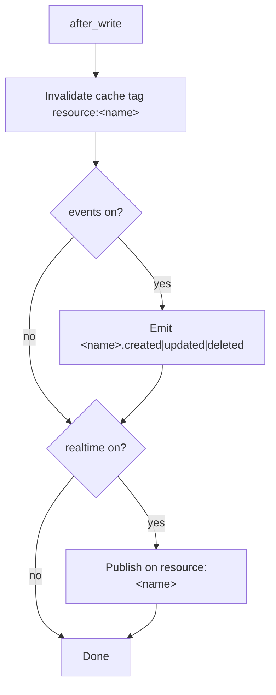

Resource errors do **not** use the platform's `{message, code}` envelope. The data plane returns the exception's `detail` verbatim as the JSON body, so the shapes are much flatter than you may expect elsewhere in Pawabase.

| Status | Body shape | Example |
| --- | --- | --- |
| `400`, `401`, `403`, `404` | A bare JSON string | `"Not found"` |
| `422` | A bare JSON array, one entry per invalid field | see below |
| `429` | A bare JSON string | `"rate limit exceeded"` |

```json
[
  {
    "type": "greater_than_equal",
    "loc": ["amount_cents"],
    "msg": "Input should be greater than or equal to 0",
    "input": -5,
    "url": "https://errors.pydantic.dev/2.x/v/greater_than_equal"
  }
]
```

That `422` body is Pydantic's own error list, not a Pawabase shape. Each entry names the failure `type`, the `loc` path to the field, a human `msg`, the offending `input`, and a documentation `url`.

<Warning>
Write the client's error handling against these bare shapes, not against `{message}`. A client written for the control plane's envelope will render every resource error as `undefined`. See [Errors](/reference/errors) for the platform-wide reference and for which of the two you are looking at.
</Warning>

Because errors are bare strings, a client that wants to distinguish "no such record" from "you may not see it" has nothing to branch on: both are `404` with the body `"Not found"`. That is intentional. If your application needs to tell those apart for a user-facing message, decide it in a custom route where you control the response, not by scraping the message here.

### What each operation can return

| Status | `list` | `get` | `create` | `update` | `delete` |
| --- | --- | --- | --- | --- | --- |
| `200` | Yes, the page envelope | Yes, the record | — | Yes, the record | — |
| `201` | — | — | Yes, the created record | — | — |
| `204` | — | — | — | — | Yes, no body |
| `400` | Unknown filter field, unknown sort field | Unknown `expand` name | Malformed query values | Unknown `expand` name | Non-digit id on an integer resource |
| `401` | Missing or invalid credentials | Same | Same, and required when an `owner_field` is set | Same | Same |
| `403` | Key lacks `resource:read`, or the policy refuses | Key lacks `resource:read` | Key lacks `resource:write`, or the policy refuses | Key lacks `resource:write`, or an authenticated caller is refused | Key lacks `resource:write`, or an authenticated caller is refused |
| `404` | — | No such record, or the policy hides it | — | No such record | No such record |
| `422` | `page` below 1, or `per_page` above 200 | — | Field validation failed | Field validation failed | — |
| `429` | `rate_limit` exhausted | Same | Same | Same | Same |

The `400` cases are worth spelling out, because they are `SqlError` messages from the store rather than validation:

| Message | Cause |
| --- | --- |
| `"cannot filter on unknown field 'status'"` | The name is not in the `field_map` — the primary key, declared fields, timestamp columns and `owner_field` are the whole list |
| `"cannot sort on unknown field 'total'"` | Same check on `sort`. Common when a transformer renames an output key |
| `"is/isnot take null, true or false"` | `?filter[x]=is.something` — the `is` and `isnot` operators accept only those three literals |

A `422` from `list` is about parameter bounds, not about fields. Unknown fields are `400`.

<Note>
Filtering can only address declared fields. That includes `id`, `created_at` and `updated_at` when timestamps are on, and `owner_field` whether or not you declared it as a field — so `?filter[created_at]=gte.2026-01-01` works on a resource where `created_at` appears nowhere in the field list.
</Note>

### Status codes are not uniform, on purpose

`get` answers `404` for every refusal. `update` and `delete` answer `404` for a missing record and `403` for an authenticated caller's policy refusal. `create` answers `403` for a policy refusal with no existence to hide.

| Operation | Record does not exist | Policy refuses on that record | Policy refuses outright |
| --- | --- | --- | --- |
| `get` | `404` | `404` | `403` |
| `update` | `404` | `403` signed in, `404` anonymous | `403` |
| `delete` | `404` | `403` signed in, `404` anonymous | `403` |
| `create` | — | — | `403`, or `401` when an `owner_field` is set and there is no session |

There is a third column because policies fail in two distinct ways. A condition with no record in it — a role gate, say — refuses *outright*, and the gate answers `403` before any query runs. A condition that compares a record field to the caller can only be decided against a specific row, so it produces `404` on a read and `403` or `404` on a write depending on whether the caller is authenticated.

The reasoning behind the asymmetry: a caller already holding an id has shown they know the record exists, so hiding it buys nothing and makes their debugging worse. A caller probing ids learns nothing either way, so `404` is the safe answer there.

<Warning>
There is no `409` on the resource write path. A uniqueness violation surfaces as whatever your database driver raises, so do not build a client that branches on `409` for `create` — catch it at the storage layer instead, or better, prevent it with an `enum`-constrained field or a `unique: true` field you have actually migrated.
</Warning>


## What happens after a write

Every write to a resource — REST, a flow's `resource.*` block, a function, a `db.transaction`, or Studio's own record editor — runs the same `after_write` hook, in this order:



| Step | Condition | What happens |
| --- | --- | --- |
| 1. Cache invalidation | Always | Drops the whole `resource:<name>` tag, whichever field changed |
| 2. Event emission | `events` is true (default) | Emits `<name>.created`, `.updated` or `.deleted` |
| 3. Realtime publish | `realtime` is true (default false) | Publishes the same payload on `resource:<name>` |

The event payload is the same object in both cases:

```json
{
  "resource": "invoices",
  "change": "updated",
  "record": {"id": 44, "customer_id": 12, "amount_cents": 210000, "status": "sent"}
}
```

It is delivered along with the actor and the request id, so a flow reacting to `invoices.updated` can tell *who* changed the row and correlate it with the request that did it.

<Note>
Realtime is best-effort. A publish failure is logged as a warning and the write still stands. If a realtime message is load-bearing for your application, drive it from an event and a flow instead.
</Note>

### `updated` fires on every write, not only on real change

`after_write` is called after the SQL runs, not after a comparison. A `PATCH` that sets `status` to the value it already held still emits `invoices.updated`. If your flow triggers expensive work on that event, either compare before you write in a flow, or make the flow's own condition check the value it cares about.

### Deletes emit the pre-delete record

The `deleted` event carries the record as it looked immediately before removal, not `null`. That is deliberate — a flow reacting to `subscription.deleted` usually wants to know *what* was cancelled, and a payload of `null` would force it to query a row that no longer exists.


## Studio's own record editor is not a side door

Operators can browse and edit rows directly from Studio, and those writes bypass the resource's policies — they run with service rights. They do **not** bypass the side effects: the same `after_write` path runs, so cache invalidation, events and realtime are identical to a public API write.

The practical implication is that a row edited by an administrator in Studio will fire `invoices.updated` at your flows, with the operator as the actor. If a flow assumes every `updated` event came from a customer, that assumption is wrong.


## Resources versus custom routes

A resource and a custom route are both served under `/rest/v1`, both can carry a policy, and both can have a transformer, a rate limit, cache and tags. The difference is not decoration.

| | Resource | Custom route |
| --- | --- | --- |
| Path | Fixed: `/<name>` and `/<name>/{id}` | Yours: `/orders/{id}/pay` |
| Shape | Your field list | A named schema, an inline field list, or nothing |
| Operations | Five, individually switched | One method and path |
| Policy | One per operation | One per route |
| Handler | The platform's store | A flow or a Python function |
| Validation | Compiled from fields | Compiled from the input schema or fields |
| Request validation | Field constraints, enums, types | Whatever the schema says |
| Side effects | Cache, events, realtime, after_write | Cache and rate limit; events only if your handler writes |
| Collision rule | — | A path that would shadow `/<resource>` or `/<resource>/{id}` is refused with `422` |

### Which to reach for

Use a **resource** when the thing you are modelling is a row with an identity, a lifecycle, and fields the client genuinely needs to read or write. You get validation, filtering, sorting, pagination, expansion, caching, events and OpenAPI for free, and every one of those is a feature you would otherwise have to build.

Use a **custom route** when the request is an *action* rather than a *state*: submit an order, refund a payment, close a ticket, recalculate a total. These have a shape that does not fit a generic `update` — they check the current status, they may change several rows atomically, they emit a different event, and they are authorized by a role rather than by ownership.

The mistake to avoid is modelling an action as a writable field. A `status` column that clients PATCH from `draft` to `approved` means the transition rules live in every client and in the `update` policy, where they cannot be tested in one place. A `POST /purchase-requests/{id}/approve` route backed by a flow puts the rules in the flow, where the run history records who approved what and what the flow decided.

<Warning>
A route path that shadows a resource's own routes is rejected at save time — `/orders` or `/orders/{id}` when a resource called `orders` exists. This is a `422`, not a silent override.
</Warning>

<CardGroup cols={2}>
  <Card title="Defining resources" icon="plus" href="/data/defining-resources/overview" />
  <Card title="Field types" icon="type" href="/data/field-types/overview" />
  <Card title="Filtering" icon="filter" href="/data/filtering/overview" />
  <Card title="Sorting and pagination" icon="sort" href="/data/sorting-pagination/overview" />
  <Card title="Relations" icon="link" href="/data/relations/overview" />
  <Card title="Custom routes" icon="route" href="/data/custom-routes/overview" />
  <Card title="Transformers" icon="wand" href="/data/transformers/overview" />
  <Card title="Migrations" icon="arrow-right" href="/data/migrations/overview" />
</CardGroup>
