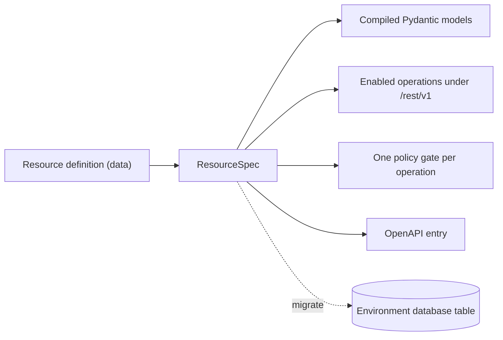

A resource is three things at once, and separating them before looking at any setting will make everything else easier.

## Get started

Create the client once (see [Connect your app](/connect)), then:

<CodeGroup>
```typescript TypeScript
import { createClient } from "@pawabase/client";

const pawabase = createClient({ url: "https://api.example.com", apiKey: "pb_pk_…" });

const task = await pawabase.from("tasks").create({ title: "Write the docs", done: false });
const { data: open } = await pawabase.from("tasks").eq("done", false).order("created_at", "desc");
await pawabase.from("tasks").update(task.id, { done: true });
```

```python Python
from pawabase import Pawabase

pb = Pawabase("https://api.example.com", "pb_pk_…")

task = pb.from_("tasks").create(title="Write the docs", done=False)
open_tasks = pb.from_("tasks").eq("done", False).order("created_at", "desc").execute()
pb.from_("tasks").update(task["id"], done=True)
```
</CodeGroup>

The first is an **entity**: a table in the environment's database plus a declaration of what a row in that table contains. The second is a **set of REST operations** — `list`, `get`, `create`, `update`, `delete` — of which any subset may exist. The third is a **policy per operation**: a separate access rule attached to each of those operations, so reading and writing are authorized independently.

None of this is code. A resource is a row in the platform's own database (`pb_resources`) holding a JSON body. Pawabase reads that row, compiles a request model, a response model, a route and a policy gate for each enabled operation, and mounts the result under `/rest/v1/<name>`. Saving a definition changes the environment's next compiled state; there is no build artefact and no deploy.



<CardGroup cols={3}>
  <Card title="An entity" icon="table">A table, a primary key, and a typed field list. That field list is simultaneously the validation rule, the JSON shape, and the migration plan.</Card>
  <Card title="An operation set" icon="list-checks">Five possible operations. Each exists only if you switch it on, and each is registered independently of the others.</Card>
  <Card title="A policy per operation" icon="shield-check">Not one rule for the resource — one rule per operation. `get` and `list` can disagree. `create` and `update` can disagree.</Card>
</CardGroup>

## Definitions as data

Most backend frameworks make a resource an artefact of a code review: a model class, a migration, a serializer, a view, a permission class. Pawabase inverts that. The definition is data, and the same data drives the validator, the SQL builder, the OpenAPI document, and the access gate.

The consequences of that inversion are worth stating plainly, because they change how you work:

| Because a definition is data… | you get… |
| --- | --- |
| It can be edited without a deploy | Saving in Studio changes the next compiled state of the environment |
| It can be diffed and promoted | `staging → production` copies the definition itself, not the table |
| It can be validated as a whole | A reserved name, a bad field name, a bad policy reference or a bad transformer is refused at save time with `422` |
| It can be inspected as raw JSON | The **JSON** tab shows exactly the body the platform stores; there is no second source of truth |
| It can be backed out of | Removing a field stops exposing it through the API; it does not drop the column |

<Note>
Promotion copies the definition. It does not run the migration on the target environment. Run the migration on the target yourself, exactly as you would have on the source. See [Migrations](/data/migrations/overview).
</Note>


## The URL surface

Every resource contributes the same small, predictable set of paths. There is no per-resource path configuration; the name *is* the path.

| Method | Path | Operation |
| --- | --- | --- |
| `GET` | `/rest/v1/<name>` | `list` |
| `GET` | `/rest/v1/<name>/{id}` | `get` |
| `POST` | `/rest/v1/<name>` | `create` |
| `PATCH` | `/rest/v1/<name>/{id}` | `update` |
| `DELETE` | `/rest/v1/<name>/{id}` | `delete` |

`PUT` is also registered on the item path and behaves identically to `PATCH`, but it is excluded from the published schema, so PATCH is the documented partial update. A client generated from the OpenAPI document will only ever see `PATCH`.

<Info>
The version segment is real but shallow. The data-plane prefix matches `/rest/(?P<version>v[1-9][0-9]*)`, so `v1`, `v2` and so on are syntactically valid. Resources are served under `v1`.
</Info>

Because the name is the path, renaming a resource is a breaking change for every client. Studio enforces that for you: the **Name** input is disabled once the resource exists, with the hint "Fixed once created; other definitions refer to it by name." Relations, event subscriptions and flow blocks all reference resources by name, and those references are resolved by name when the environment is compiled.

### Naming rules

| Thing | Pattern | What happens if you break it |
| --- | --- | --- |
| Resource `name` | `^[a-z][a-z0-9_]{0,62}$` | Refused with `422` |
| `table` | `^[A-Za-z_][A-Za-z0-9_]{0,62}$` | Refused with `422` |
| `primary_key` | `^[A-Za-z_][A-Za-z0-9_]{0,62}$` | Refused with `422` |
| `owner_field` | `^[A-Za-z_][A-Za-z0-9_]{0,62}$` | Refused with `422` |
| Field `name` | `^[A-Za-z_][A-Za-z0-9_]{0,62}$` | `validate_fields` fails; the save is refused with `422` |

Resource names are lower-case letters, digits and underscores, starting with a letter — so `orders`, `invoice_lines` and `v2_reports` are fine, while `Orders`, `order-lines` and `2fa_codes` are not. Table names, primary key names and owner field names use the wider SQL identifier rule, so they may start with an underscore or an upper-case letter. Field names follow that same wider rule.

Every identifier that reaches SQL passes through `check_identifier()`, and every query is parameterised: values never enter SQL by string formatting. That is a guarantee about safety rather than naming, but it is why the patterns above exist at all.

### Reserved names

```text
docs, openapi.json, x, rpc, health, internal, platform
```

Pawabase's own routes sit at the top level of `/rest/v1`, so a resource sharing one of those names would collide with them. Saving a resource called `health` is refused with `'health' is reserved`. Nothing else is reserved — `users`, `resources` and `spaces` are ordinary names you are free to use.


## The five operations, and why they start off

`OPERATIONS = ("list", "get", "create", "update", "delete")`. An operation is registered only when its `enabled` setting is truthy. There is no default-on behaviour and no inheritance: a brand-new resource serves no endpoints at all until you switch something on.

| Operation | Serves | Default | What is missing while it is off |
| --- | --- | --- | --- |
| `list` | `GET /rest/v1/<name>` | Off | Collections: pagination, sorting, filtering, `select` |
| `get` | `GET /rest/v1/<name>/{id}` | Off | Single-record reads by id |
| `create` | `POST /rest/v1/<name>` | Off | Client-side inserts |
| `update` | `PATCH /rest/v1/<name>/{id}` | Off | Partial updates |
| `delete` | `DELETE /rest/v1/<name>/{id>` | Off | Removal |

This default is deliberate and it is the most useful thing to internalise. A resource is a *description* of an entity; turning an operation on is a separate, explicit statement that this entity has become part of your public surface.

A `support_tickets` resource with only `list` and `get` enabled is a read-only catalogue: no client can mutate it, no client can enumerate it more broadly than the `list` policy allows, and there is no accidental write path to reason about later. It also makes staging safer than enabling everything and locking it down afterwards — you can define the full shape of an entity, migrate the table, seed it, build the read side, and only then decide who may write, with the write operations still physically absent from the routes.

<Warning>
Turning an operation off does not undo writes that already happened. It stops future calls. Rows created while `create` was enabled stay in the table.
</Warning>

Operations that are off are also absent from the OpenAPI document. A client generated from the spec will not offer a `delete` method for a resource whose `delete` is off, which means the surface your SDK sees is the surface you actually enabled.

### List query parameters

`list` accepts exactly these query parameters, with these bounds:

<ResponseField name="page" type="int" default="1">
Page number, from 1. `ge=1`. A `page` below 1 is a `422`.
</ResponseField>

<ResponseField name="per_page" type="int" default="20">
Records per page. `ge=1`, `le=200`. The ceiling is `MAX_PAGE_SIZE = 200`; asking for more is a `422`.
</ResponseField>

<ResponseField name="sort" type="string">
Comma-separated fields; prefix with `-` for descending. Whitespace around each name is stripped.
</ResponseField>

<ResponseField name="select" type="string">
Comma-separated fields to return. If the primary key is not in your list it is appended for you, because identity and expansion both depend on it.
</ResponseField>

<ResponseField name="expand" type="string">
Comma-separated relations to include. See [Relations](/data/relations/overview).
</ResponseField>

Plus any number of `filter[<field>]=<operator>.<value>` parameters, described in full in [Filtering](/data/filtering/overview).

`get` takes exactly one query parameter, `expand`. `create` and `update` take a JSON body validated against the compiled model. `delete` takes nothing and returns `204 No Content`.

<Note>
Pagination is offset-based: `offset = (page - 1) * per_page`. There is no cursor pagination, so deep offsets get slower as the table grows and page numbers can shift under concurrent writes. If you need stable traversal over a large table, sort by a monotonic column explicitly — the default ordering is primary key ascending, which is stable but not business-meaningful.
</Note>

<Info>
Every `list` request costs two queries, not one: the page itself, plus a separate `COUNT(*)` over the same `WHERE` clause to fill `total`. The exception is the case described below, where a policy residual makes an exact count impossible.
</Info>


## Resource field reference

Every key below is part of the stored definition. Defaults are the API defaults; Studio writes the same values into the body.

| Key | Type | Default | What it controls |
| --- | --- | --- | --- |
| `name` | varchar(128) | — | The API name and the `/rest/v1/<name>` path segment |
| `description` | text | `""` | The route summary shown in OpenAPI |
| `table` | varchar(128) | `name` | The table in the environment database; stored as `body.table or body.name` |
| `primary_key` | varchar(64) | `id` | The column that identifies a record |
| `id_type` | varchar(16) | `ulid` | `ulid` or `uuid` for new resources (`integer` only on resources created before ULIDs); affects id coercion and column DDL |
| `fields` | JSON | `[]` | The field definitions, stored in the database column `fields_` |
| `operations` | JSON | `{}` | Per operation, `{"enabled": bool, "policy": ref}` |
| `relations` | JSON | `[]` | `[{"name", "resource", "field", "type"}]` |
| `transformer` | JSON | `null` | A transformer name (string), an inline definition (dict), or `null` |
| `cache_ttl` | int | `0` | Response cache lifetime in seconds; `0` means off. Studio accepts 0–86400 |
| `rate_limit` | JSON | `{}` | `{"limit": n, "window": s}`, or `{}` for no limit |
| `events` | bool | `true` | Publish `<resource>.created`, `.updated`, `.deleted` |
| `realtime` | bool | `false` | Publish to the `resource:<name>` channel |
| `timestamps` | bool | `true` | Maintain `created_at` and `updated_at` |
| `owner_field` | varchar(64) | `null` | A column set to the caller's user id on create |
| `tags` | JSON | `[]` | Extra OpenAPI tags, so the resource groups with related endpoints |

A resource is unique per `(environment, name)`. Two resources in one environment cannot share a name, because the name is the URL.

### How the definition groups

| Group | Keys | The question it answers |
| --- | --- | --- |
| Identity | `name`, `description`, `table`, `primary_key`, `id_type` | What is this thing, and where does it live? |
| Shape | `fields` | What is in a row, and what counts as a valid row? |
| Access | `operations` | Which endpoints exist, and who may call each? |
| Graph | `relations` | What may be pulled in with `?expand=`? |
| Behaviour | `owner_field`, `timestamps`, `events`, `realtime`, `transformer`, `cache_ttl`, `rate_limit`, `tags` | What happens around the read and the write? |

`transformer` is the one key with three legal shapes: a reference to a stored transformer by name, an inline definition dict, or `null`. A dict is validated at save time — unknown step names, a non-list `omit` or `pick`, a non-object `set` or `rename`, and a `case` that is neither `camel` nor `snake` are all refused. See [Transformers](/data/transformers/overview).
