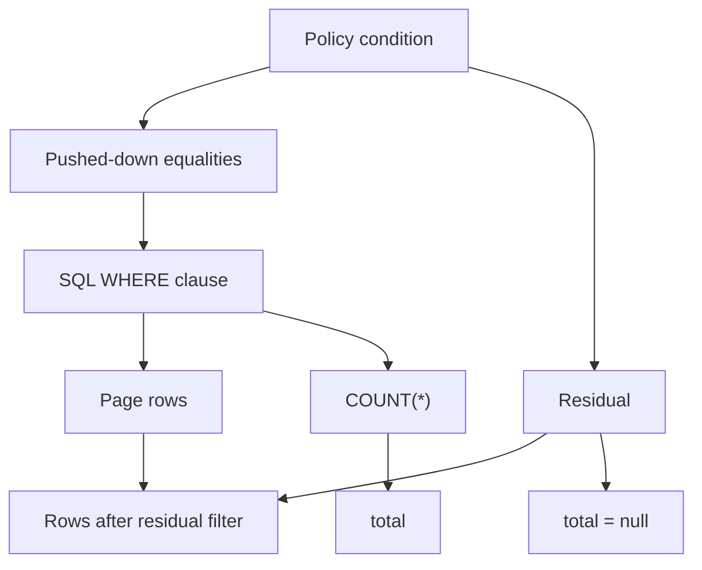

`rate_limit` is `{}` — no limit — or `{"limit": n, "window": s}`. In Studio it is a **Rate limit** switch that, once on, exposes two number inputs reading "requests per / seconds". Switching it on seeds the default `{limit: 60, window: 60}`.

| Property | Value |
| --- | --- |
| Counting basis | Per caller, counted across all gateway instances |
| Namespace | `rl:<project ref>:<environment>:<resource name>` |
| Exhausted result | `429` |
| Validation | A non-empty `rate_limit` must contain a `limit`, or the save is refused |

The namespace is per resource, not per project. That is the right granularity for the common case — a search-heavy resource can have a tighter bucket than a lookup table — but it also means a client that fans out across twenty resources can issue twenty times your intended ceiling. If you are protecting a database rather than an endpoint, put the tightest limit on the resources that are actually expensive.

<Warning>
`rate_limit` on a resource does not cover custom routes. Routes carry their own `rate_limit` with their own namespace. See [Custom routes](/data/custom-routes/overview).
</Warning>


## Response caching

`cache_ttl` is a whole number of seconds, `0` meaning off, and Studio accepts 0 to 86400 — up to a day.

The cache keys are per resource, per shape, and **always include the caller's identity**:

| Operation | Key |
| --- | --- |
| `get` | `res:<resource>:get:<sha256 of [identity, key role, id, expand]>` |
| `list` | `res:<resource>:list:<sha256 of [identity, role, sorted query params]>` |

Identity is the caller's `user.identity`, or the literal string `anon` when there is no user. The key's role is folded in as well. That is deliberate: cached reads never cross users, so there is no class of bug where one account sees another's page because their filters happened to hash the same.

Invalidation is by tag. Every cached entry for a resource is stored under the tag `resource:<name>`, and **any** write to that resource invalidates the whole tag — regardless of which field changed. A one-character edit to a single row drops the entire cached read surface for that resource.

<Note>
The cache is Sillo's cache. It is backed by Redis when `PAWABASE_REDIS_URL` is set; otherwise it is an in-process store, which means each API process keeps its own copy and a multi-process deployment serves different cache states per process until a write propagates.
</Note>

Writes performed as raw SQL in Studio's Database console are the exception: they invalidate **every** resource's cache tag, not just one, because the console cannot know for certain which resource a table belongs to.


## Request and response shapes

Every operation below is described by exactly what goes in, what comes out, and what can go wrong. Field names in the examples are illustrative; substitute your own.

### `list`

```bash
curl "$GW/rest/v1/invoices?filter[status]=eq.overdue&sort=-due_on&page=1&per_page=20" \
  -H "apikey: $PK" -H "Authorization: Bearer $TOKEN"
```

<ResponseField name="data" type="array">
The rows, each shaped by the read model. With a transformer, each row is the transformer's output instead.
</ResponseField>

<ResponseField name="page" type="int">
Echoes back the page that was served, so a client can confirm what it got.
</ResponseField>

<ResponseField name="per_page" type="int">
Echoes back the page size that was served.
</ResponseField>

<ResponseField name="total" type="integer | null">
The number of matching rows, or `null` when an exact count is not computable. See below.
</ResponseField>

```json
{
  "data": [
    {
      "id": 44,
      "customer_id": 12,
      "amount_cents": 210000,
      "status": "overdue",
      "due_on": "2026-03-01",
      "created_at": "2026-02-01T09:14:00+00:00",
      "updated_at": "2026-02-14T16:03:11+00:00"
    }
  ],
  "page": 1,
  "per_page": 20,
  "total": 7
}
```

An empty result set is not an error. `{"data": [], "page": 1, "per_page": 20, "total": 0}` is a perfectly normal answer to a filter that matched nothing.

The `id` column is always present even if you ask for `?select=amount_cents` — the primary key is appended to the selection for you, because identity and expansion both depend on it.

### Why `total` can be `null`

`total` is filled by a separate `COUNT(*)` over the same `WHERE` clause as the page query. That count is only honest if the policy's conditions are fully expressible in SQL.

Pawabase's policy engine splits a condition into two parts. Equalities between a record field and a known value — `{"eq": ["$record.owner_id", "$auth.user_id"]}` — are **pushed down** into `WHERE`, and the count is correct. Anything else that depends on the record is a **residual**, checked row by row in Python after the page has been fetched.



When a residual is active, the database count includes rows the residual would have removed, so reporting it would be reporting a number that is wrong for this caller. Pawabase sets `total` to `null` instead. This is not a failure and not a missing feature; it is the honest answer when an exact total cannot be produced without evaluating every row in the table.

<Tip>
Design policies so that their record-level conditions are equalities against caller identity. `{"owner": "user_id"}` and `{"eq": ["$record.account_id", "$auth.account_id"]}` both push down cleanly and keep pagination and `total` correct. See [Policy pushdown](/policies/pushdown).
</Tip>

`get` re-checks the plan against the loaded record rather than trusting the query. If the record does not exist, or if the plan's pushed-down filters do not match it, or if the residual refuses it, the answer is **404** — for every caller, authenticated or not. A `get` never returns `403`, because refusing to show a record's existence is the stronger privacy position and it costs nothing here.

### `get`

```bash
curl "$GW/rest/v1/invoices/44" \
  -H "apikey: $PK" -H "Authorization: Bearer $TOKEN"
```

```json
{
  "id": 44,
  "customer_id": 12,
  "amount_cents": 210000,
  "status": "overdue",
  "due_on": "2026-03-01",
  "created_at": "2026-02-01T09:14:00+00:00",
  "updated_at": "2026-02-14T16:03:11+00:00"
}
```

One record, one object, no envelope. The only query parameter is `expand`.

### `create`

```bash
curl -X POST "$GW/rest/v1/invoices" \
  -H "apikey: $PK" -H "Authorization: Bearer $TOKEN" \
  -H "Content-Type: application/json" \
  -d '{"customer_id": 12, "amount_cents": 210000, "due_on": "2026-03-01"}'
```

```json
{
  "id": 51,
  "customer_id": 12,
  "amount_cents": 210000,
  "status": "draft",
  "due_on": "2026-03-01",
  "created_at": "2026-02-14T16:03:11+00:00",
  "updated_at": "2026-02-14T16:03:11+00:00"
}
```

Success is **201**, and the body is the created record, read model and all — so the response includes the primary key the database assigned and the defaults the platform filled in. You do not need a follow-up `get` to learn the id.

Two behaviours are worth knowing because they are not visible in the request:

- **Unknown fields are refused.** The create model is compiled with `extra="forbid"`, so a typo'd key is a validation error rather than a silently ignored value.
- **Defaults are applied, and they are applied server-side.** Unset fields with a `default` come back filled in, so `status` above is `draft` even though the body never mentioned it.

<Note>
`read_only` fields are dropped from the create model, so sending `id` or `created_at` does not set them — they are not accepted and not honoured. See [Defining resources](/data/defining-resources/overview).
</Note>

### `update`

```bash
curl -X PATCH "$GW/rest/v1/invoices/44" \
  -H "apikey: $PK" -H "Authorization: Bearer $TOKEN" \
  -H "Content-Type: application/json" \
  -d '{"status": "sent"}'
```

```json
{
  "id": 44,
  "customer_id": 12,
  "amount_cents": 210000,
  "status": "sent",
  "due_on": "2026-03-01",
  "created_at": "2026-02-01T09:14:00+00:00",
  "updated_at": "2026-02-14T16:05:40+00:00"
}
```

`PATCH` is genuinely partial, and the mechanism is worth knowing: the update model is compiled with every field optional, and the payload is dumped with `exclude_unset=True`. Only keys present in the request reach the database. Sending `{"status": "sent"}` does not null out `amount_cents` — it never appears in the patch.

To deliberately clear a value, send it as `null`. That is different from omitting it, and the difference is the whole point of a partial update.

`owner_field`, if set, is popped from the patch before the policy runs, so ownership cannot be reassigned this way.

### `delete`

```bash
curl -X DELETE "$GW/rest/v1/invoices/44" \
  -H "apikey: $PK" -H "Authorization: Bearer $TOKEN"
```

**204 No Content**, no body. A client must not attempt to parse a response here; treat it as null.

Deletion is a hard delete. There is no soft-delete flag anywhere in the resource model. If you need recoverable deletion, model it yourself: a `status` field with a `deleted_at`, or a `deleted` boolean, and a policy that refuses to return rows where it is set. That is more work, and it is the only way to get the behaviour.

<Warning>
On `update` and `delete`, a missing record is `404` before the policy is evaluated at all. A policy refusal is `404` for an anonymous caller and `403` for an authenticated one — someone who already knows the row exists gets told they may not touch it. Write both assertions into your tests, because the distinction is easy to get wrong by accident.
</Warning>


## How a transformer changes the envelope

A transformer reshapes records on their way out. When a resource has one, the shape of the response is the transformer's shape rather than the field list's shape.

For single-record operations — `get`, `create`, `update` — the body *is* the transformed object. Whatever the transformer produced is what you receive, with no envelope and no fixed keys.

For `list` there is a subtlety worth being precise about: the envelope keys are still present, because they are built by the route, but the items inside `data` are transformed, and the generated page model is dropped so OpenAPI does not claim a fixed record schema.

```json
{
  "data": [
    {"reference": "INV-2026-0044", "total": {"amount": "2100.00", "currency": "GBP"}, "state": "overdue"}
  ],
  "page": 1,
  "per_page": 20,
  "total": 7
}
```

The practical consequences for a client:

| Without a transformer | With a transformer |
| --- | --- |
| Response fields are known from the field list | Response fields are whatever the transformer emits |
| Generated SDKs have typed response models | Generated SDKs see an untyped or `any` response |
| Field-level documentation in OpenAPI is accurate | OpenAPI cannot describe the record body |
| `select`, `filter` and `sort` line up with what you receive | `select` still chooses database columns; what you receive may be a different set |

That last row is the one that bites. A transformer runs *after* the row is read, so `?select=author_id` narrows what is fetched from the database and then a transformer may still add `author` from context or drop keys entirely. Filtering and sorting always address database columns; a transformer renames things after the fact, so a `sort=total` that matches a transformed output key will be a `400`.

<Warning>
A transformer named in a resource must resolve at request time. Resolution order is: a Python transformer registered in the process under `@transformer("name")` wins first; then a stored transformer of that name in the environment; otherwise you get a `TransformerError` — "unknown transformer 'name'". A resource can therefore break at read time if a process-level transformer disappears on a deploy.
</Warning>

Steps always run in a fixed order regardless of how they are written in the JSON: `omit`, `pick`, `set`, `rename`, `case`. Writing them in a different order in the definition does not change the result, which is worth knowing before you spend time debugging a pipeline. See [Transformers](/data/transformers/overview).
