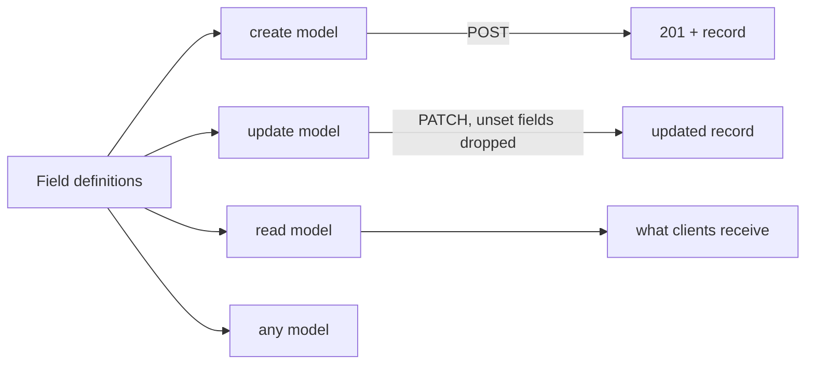
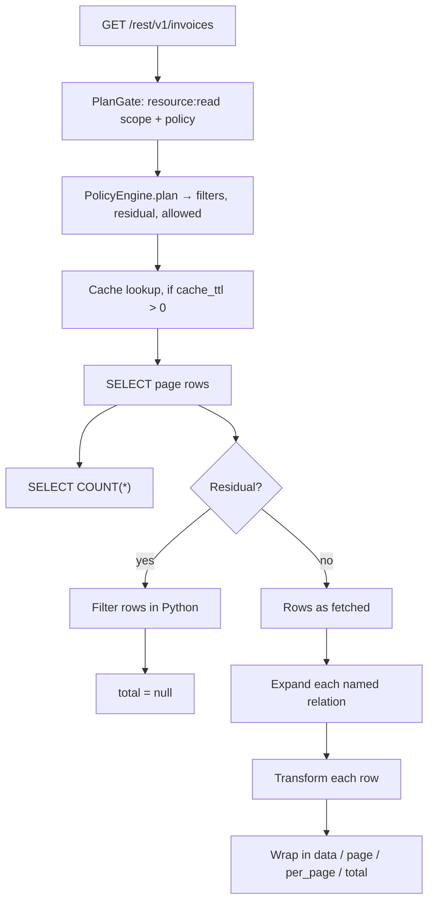

Every resource field list is compiled four times, once per mode, and each mode answers a different question. Understanding which mode does what turns a pile of confusing validation behaviour into four simple rules.

| Mode | Used for | `required` | `read_only` | `write_only` | Unknown keys |
| --- | --- | --- | --- | --- | --- |
| `create` | `POST` | Enforced | Dropped | Kept | **Rejected** |
| `update` | `PATCH` / `PUT` | Ignored | Dropped | Kept | Rejected |
| `read` | Responses | n/a | Kept | **Dropped** | Allowed |
| `any` | Types only | Ignored | — | — | — |

### `create`: strict, and deliberately so

The create model rejects unknown keys. A typo — `amountCent` instead of `amount_cents` — is a `422` naming the offending field, not a row that silently lacks the value you meant to set. For a write path this is the right trade: the caller is creating something that does not exist yet, so there is no legitimate reason to accept a field you did not declare.

`read_only` fields are dropped, so sending `id` or `created_at` neither sets them nor errors.

### `update`: everything optional, nothing unset applied

Every field is optional in the update model, and the payload is dumped with `exclude_unset=True`. That is the whole mechanism behind PATCH semantics: only keys actually present in the request reach the database.

The distinction that matters to a client:

| Request body | Effect |
| --- | --- |
| `{"status": "sent"}` | Only `status` is written |
| `{"status": null}` | `status` is explicitly set to null |
| `{}` | Nothing is written, but the update still runs and still fires `updated` |

That last row is a small trap: an empty PATCH is a no-op write, not a no-op request.

### `read`: what clients are allowed to see

The read model drops `write_only` fields and allows extra keys. A `password_hash` marked `write_only` is accepted on the way in and absent from every response, which is the correct way to handle a secret hash in a row you also need to read.

It also includes the primary key as a `read_only` field, whether or not you declared it, which is why `id` always appears in responses and in the OpenAPI schema.

### Nullability follows from required

On `create`, a field is nullable unless it is required — `spec.get("nullable", not required)`. On `update`, `read` and `any`, nullable is forced true, because a partial update can always legitimately omit something and a response can legitimately contain a column that is null in the database.

That is why a non-required field accepts `null` on create and why a required one does not, and why the rule stops applying the moment you switch to PATCH.

<Warning>
A `required` field with no `default` is required on create. A `required` field *with* a `default` is not, because a default satisfies it — the requiredness only bites when there is nothing to fall back on. Set defaults deliberately: they are applied server-side on every create, including creates from flows and Studio, and not only from REST.
</Warning>

## How the read model and the response are built

The read model is compiled from your fields plus the primary key, and it is what OpenAPI publishes for `get`, `update` and `create`'s `201`. Two consequences follow.

**The response can contain more than your fields suggest.** The primary key and the timestamp columns are in there whether you declared them or not, and any column present in the database but absent from the field list is *not* — the model drops unknown keys on the way out, so the response is a projection of the definition, not of the table.

**`read_only` and `write_only` are the two levers you have over that projection.** There is no "private column" concept beyond them: a field that is neither appears in requests and in responses.

| Field marking | Accepted on create/update | Present in responses |
| --- | --- | --- |
| Neither | Yes | Yes |
| `read_only` | No | Yes |
| `write_only` | Yes | No |

The primary key is implicitly `read_only`. That is why sending `id` in a create body does not let you choose your own primary key value, even on a uuid resource where you might expect to.

## A note on reading data back

The resource you are building is a definition over a table, and the table is the authority. Every read you make through the API is a projection of the definition; every read you make through **Build → Database** is a look at the table itself. The two disagreeing is not a bug, and knowing which one you are looking at explains most surprises.

Studio's database browser shows each column as a `name: type` badge with a key on the primary key and a row count in the card title. Rows are decoded without field-type knowledge, which means a JSON column may come back as its raw string rather than as a parsed object — a display artefact of the console, not a sign that the stored value is wrong.

## Frequently asked questions

<AccordionGroup>
<Accordion title="Can a resource have zero fields?">
Yes. A resource always has an implicit primary key and, unless `timestamps` is false, `created_at` and `updated_at`, so an empty field list still produces a real table once migrated. It is a legitimate starting point for a resource whose shape you have not decided yet — define the key, migrate, add fields, migrate again.
</Accordion>
<Accordion title="Can I rename a resource?">
Not in place. The **Name** input is disabled once created. Create a new resource with the desired name and point its `table` at the existing table, so no data moves. Then turn the old one's operations off. The window in which both exist is the only period in which both names resolve.
</Accordion>
<Accordion title="What happens if I edit a field's constraints, say by adding minimum?">
Nothing to existing data, immediately. Constraints are enforced by the compiled model on the *next* request, not retroactively against rows already in the table. A row that would now fail validation stays exactly as it is in the database; it cannot be written back through the API until it satisfies the new rule. Adding `required` is the exception that matters: it applies to new creates only, and says nothing about existing rows.
</Accordion>
<Accordion title="Why is there no 409 for a duplicate?">
Because uniqueness is the database's job on this path, and a constraint violation surfaces as the driver's own error rather than as a mapped status. If you need a clean answer, enforce it in a `create` policy that checks for an existing row, or put `unique: true` on the field and handle the driver error in your client.
</Accordion>
<Accordion title="Can two resources share one table?">
Nothing prevents it. Two definitions with the same `table` and different `fields` produce two different views over the same rows, each with its own policies and its own operations. This is occasionally useful for exposing a private view and a public one of the same data. It is also a good way to end up with two caches that invalidate independently and a stale read on one of them.
</Accordion>
<Accordion title="Does the resource name have to match the table name?">
No. `table` defaults to `name` and exists precisely so it need not. Remember that a custom route cannot shadow `/<resource>` or `/<resource>/{id}`, so a table-backed view and a route on the same table need different paths.
</Accordion>
<Accordion title="Do I need to run migrate before the API works?">
For a table Pawabase created, yes — saving the definition compiles the models and routes, but the columns do not exist until migrate has run. For a pre-existing table with the columns already there, migrate is how you add anything missing and create the indexes; without it, `indexed` and `unique` are declarations with no effect.
</Accordion>
<Accordion title="Can I promote a single resource?">
Promotion copies definitions as a set — resources, schemas, policies and the rest. The environment's version counter is bumped either way. If you want one resource to differ between staging and production, that is a design signal: either the difference is environment configuration, or the two environments have outgrown having the same shape.
</Accordion>
</AccordionGroup>

## Where to go next

<CardGroup cols={2}>
  <Card title="Defining resources" icon="plus" href="/data/defining-resources/overview" />
  <Card title="Field types" icon="type" href="/data/field-types/overview" />
  <Card title="Relations" icon="link" href="/data/relations/overview" />
  <Card title="Filtering" icon="filter" href="/data/filtering/overview" />
  <Card title="Sorting and pagination" icon="sort" href="/data/sorting-pagination/overview" />
  <Card title="Transformers" icon="wand" href="/data/transformers/overview" />
  <Card title="Custom routes" icon="route" href="/data/custom-routes/overview" />
  <Card title="Migrations" icon="arrow-right" href="/data/migrations/overview" />
  <Card title="Policies" icon="shield-check" href="/policies/overview" />
  <Card title="Resource events" icon="zap" href="/data/resource-events/overview" />
  <Card title="Caching" icon="database" href="/data/caching/overview" />
  <Card title="Validation" icon="check" href="/data/validation/overview" />
</CardGroup>

## The shape of a list request, end to end

Putting the pieces together, a single `GET /rest/v1/invoices` with filters, sorting, a selection, an expansion and pagination does the following:

Four things about that diagram are worth internalising because they each have a cost:

**The policy runs before the query, not after.** `plan()` splits the condition into pushed-down filters and a residual, and the filters join the `WHERE` clause. A policy that is entirely push-down-eligible costs nothing beyond the filter it adds; a policy with a residual costs a Python evaluation per row on the page.

**The count is a separate statement.** Two round trips for every list, not one. There is no configuration that changes this; it is what makes `total` possible.

**Expansion is a query per relation, after the page.** Not a join. The number of queries for `?expand=a,b` on a list of 50 rows is three, regardless of how many rows there are — which is the good news — and it is still three more than you paid for.

**Transformation is per row.** On a list it runs over the page's rows; on `get` over the single record. A transformer that is expensive in Python is expensive on every read.

## Keeping the read side honest

A few habits make a resource's read surface predictable, which matters more as the number of resources grows.

**Declare only fields you mean to expose.** Every declared field is a filter target, a sort target and a column in the published schema. A field you added for a one-off flow and never removed is now part of your public contract and part of every list query's cost.

**Mark secrets `write_only`.** A password hash, a provider token, an internal risk score. The field is still stored, still validated, still indexable if you need it — it never appears in a response. Confirm it once in the generated OpenAPI and you never have to think about it again.

**Mark server-maintained columns `read_only`.** Computed totals, denormalised counters, fields a background job owns. `read_only` keeps them out of the create and update models, so no client can write them even if a policy is too loose to stop them.

**Give every list a default sort that means something.** The default ordering is primary key ascending. That is stable and it is meaningless. If a resource is going to be listed more than once in a product, decide now whether it sorts by `-created_at` or by a domain field, and put that in the client — or expose the resource through a route if the sort needs to be dynamic.

**Decide the id type before the first row exists.** Everything downstream — URLs your users bookmark, foreign keys pointing at it, cache keys, exports — assumes one or the other, and the conversion is manual DDL.

## Where a resource stops being the answer

The boundary is worth stating positively, because resources are so much cheaper to build that it is easy to keep pushing work into them.

A resource is the right tool while the question is "what are the rows matching this filter, and may this caller see them?" It stops being the right tool when the question acquires any of these words: *and then*, *only if*, *atomically*, *and notify*, *and charge*, *calculated*.

| The question contains | Reach for |
| --- | --- |
| and then | A [flow](/flows/overview) with a `resource.*` block |
| only if | A policy, or a route whose flow checks before writing |
| atomically | A `db.transaction` inside a flow |
| and notify | An [event](/data/resource-events/overview) and a flow |
| and charge | A flow calling an integration |
| calculated | A flow writing it, or a transformer producing it |

Nothing on the right-hand list is a criticism of resources. It is the boundary of what a definition over a table can express, and knowing where it falls is most of what makes resource design feel predictable.

## The vocabulary, precisely

A few terms are used throughout this section in a specific sense, and drifting from them causes most of the confusion in this area.

**Resource** — the stored definition. One row in `pb_resources`, unique per environment and name.

**ResourceSpec** — the compiled form of that definition: the field list resolved into a `field_map`, a primary key, an id type and a table name. This is what the routes and the store actually use.

**Operation** — one of the five names. An operation is *registered* if and only if its `enabled` setting is truthy, and a registered operation becomes a route.

**Field** — one entry in the field list. A field is simultaneously a validation rule, a response key, a filter and sort target, and a migration instruction. Those five roles are why field editing feels consequential: changing one field can change all five.

**Relation** — a declared navigation hint for `?expand=`. Not a constraint, not a join, not a filter path. [Relations](/data/relations/overview).

**Transformer** — a reshaping step applied to records on the way out. It changes the response contract without changing storage or validation.

**Migration** — the operator action that makes the table match the definition. Additive only.

**Policy** — a stored condition evaluated against the caller, the record and the request. Referenced per operation. [Policies](/policies/overview).

**Owner field** — a column the server sets from the caller's identity on create and removes from the patch on update.

Each of those has a specific behaviour at request time, and each is worth reading about at the point where you use it rather than at the point where you define it.

<Note>
The [mental model](/concepts/mental-model) page places resources in the wider picture — which question they answer, and how they relate to policies, flows, events and realtime. This page is the reference for what a resource does once you have decided it is the right tool.
</Note>
