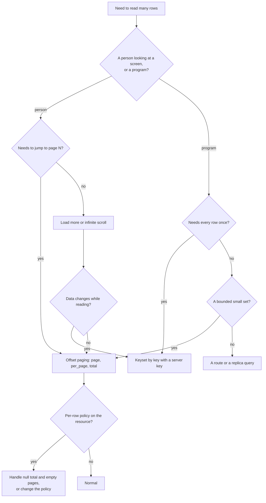

A list ordered by `-updated_at` shows what changed last, and it has a property that `-created_at` does not: the order itself is changed by the edits people make. Every update, including `PATCH {}`, sets `updated_at` to now, so the row that was edited jumps to the top.

For an offset-paged screen, that is the repeat-and-skip problem at its worst, since the data does not merely grow at one end but rearranges. A user on page 2 who edits a row there sees it vanish from page 2, and a later load of page 1 shows it first. A row can be seen twice, or missed, as other users edit. Three ways to cope:

| Approach | Behavior |
| --- | --- |
| Accept it for a "what's new" view | A feed of recent changes is meant to move. Show a "refresh" affordance and do not promise stable pages |
| Order by `created_at` and show an "updated" badge | A stable order, with the change as information on the row |
| Page by a version you control | Add a field that your own code increments, and which an edit does not change for the purpose of ordering |

Empty `PATCH` bodies make this worse, because they count as updates. A client that saves a form on blur, whether or not anything changed, moves its own row to the top of every "recently updated" list. See [Validation](/data/validation/overview) for why an empty update is an update.


## Manual ordering

Drag-and-drop lists need a stored order, and a `sort` on a `position` field gives it. The design question is how to keep positions unique and cheap to change.

| Scheme | How | Cost |
| --- | --- | --- |
| Dense integers | `position` 1, 2, 3 | Inserting or moving a row renumbers every row after it, which is many writes |
| Gapped integers | `position` 1000, 2000, 3000 | A move picks the midpoint of its neighbors, and rebalancing is needed only when the gap runs out |
| Fractional numbers | `position` 1.0, 2.0, then 1.5 between them | One write per move. A `number` is a float, so repeated halving eventually runs out of precision |
| A text rank | A string that sorts between its neighbors | One write per move, no precision limit, and a rule for generating the string |

The gapped scheme is the simplest to reason about. The list is read with:

```text
GET /rest/v1/tasks?filter[list_id]=eq.7&sort=position,id
```

A move is a single `PATCH` to the moved row, with the midpoint of the rows it now sits between:

```text
PATCH /rest/v1/tasks/42  {"position": 1500}
```

The sort ends in `id` so two rows that ever receive the same position still have a fixed order. Concurrent moves of the same row are last-write-wins, and two users inserting at the same place can compute the same midpoint, which the tiebreak absorbs. Index `position` (together with the list column, by hand, if the table is large), and add a periodic renumbering for lists that have exhausted a gap. Because `sort=position` is a sort on one field, it pages normally, and keyset paging works too if the cursor is `(position, id)`, which needs a route, since the filter syntax cannot express the two-column condition.


## Putting it together: a server-paged table

A table that sorts, filters and pages on the server touches every part of this page. This component keeps its whole state in the URL, builds the request from it with the helpers above, and handles a `null` total and an empty page:

```typescript
import { useEffect, useState } from "react";
import { buildFilters } from "./filters";            // from the filtering page
import { sortParam, toggleSort, type SortTerm } from "./sort";
import { pageInfo } from "./pageInfo";

type State = { status: string | null; q: string; sort: SortTerm[]; page: number; perPage: number };

export function useTable(base: string, key: string, resource: string, state: State) {
  const [result, setResult] = useState<{ rows: any[]; total: number | null; error?: string; loading: boolean }>(
    { rows: [], total: 0, loading: true });

  useEffect(() => {
    const filters: Record<string, any> = {};
    if (state.status) filters.status = state.status;
    if (state.q.trim()) filters.title = ["ilike", `*${state.q.trim()}*`];

    const query = [
      buildFilters(filters),
      `sort=${encodeURIComponent(sortParam(state.sort))}`,
      `page=${state.page}`,
      `per_page=${state.perPage}`,
    ].filter(Boolean).join("&");

    const controller = new AbortController();
    const timer = setTimeout(async () => {
      try {
        const res = await fetch(`${base}/rest/v1/${resource}?${query}`, { headers: { apikey: key }, signal: controller.signal });
        const body = await res.json();
        if (!res.ok) throw new Error(typeof body === "string" ? body : body.message ?? `HTTP ${res.status}`);
        setResult({ rows: body.data, total: body.total, loading: false });
      } catch (e: any) {
        if (e.name !== "AbortError") setResult((r) => ({ ...r, loading: false, error: e.message }));
      }
    }, 200);
    return () => { clearTimeout(timer); controller.abort(); };
  }, [base, key, resource, state.status, state.q, state.page, state.perPage, JSON.stringify(state.sort)]);

  return result;
}

export function footer(total: number | null, rows: number, state: { page: number; perPage: number }) {
  const info = pageInfo(total, state.page, state.perPage);
  if (!info.known) {
    // A per-row policy applies: no total. Offer paging without a count.
    return { label: `${rows} shown`, canPrev: state.page > 1, canNext: rows > 0 };
  }
  return { label: `${info.from}–${info.to} of ${total}`, canPrev: !!info.hasPrev, canNext: !!info.hasNext };
}
```

The choices that matter: the sort always ends in the key, so columns that tie do not reorder; the filter and sort come from state and nothing else, so reload and share work; `page` is reset to 1 where a filter or sort changes (in the code that updates `state`); an unknown `total` falls back to "N shown" with a next button that stays enabled while the current page is non-empty, which tolerates empty pages in the middle at the cost of a possible empty last click; and the request is debounced and aborted so fast typing cannot show an old result.


## Showing a page with an unknown total

A `null` total changes the interface. The usual page-number control cannot be drawn, and these are the alternatives, in order of how little they promise:

| Control | Shows | When it is right |
| --- | --- | --- |
| "Previous" and "Next" | No numbers | The residual case, with a bounded number of rows |
| "Load more" | A growing list | Feeds, where position does not matter |
| "N shown" with a next button | The count so far | A table the user scans |
| A numbered control from a second request | Numbers | Not possible without a count. If the number matters, change the policy |

A number of pages that is a guess is worse than no number: it will be wrong exactly when the policy removes rows, which is the case where it is `null`. Do not estimate.


## Questions about ordering, transformers and expansion

<AccordionGroup>
  <Accordion title="Does a transformer change the envelope?">
    No. A resource with a transformer returns the same `data`, `page`, `per_page` and `total`, with each row reshaped. The generated document stops describing the rows, but the paging fields are the same.
  </Accordion>
  <Accordion title="Can I page through expand results?">
    Only by paging the parents. The children of a page are limited to 200 in total. To page the children themselves, request them as their own list with a filter on the parent key.
  </Accordion>
  <Accordion title="Why is per_page capped at 200 and not configurable?">
    It is a platform limit on rows per request, enforced in the query parameter and again in the data layer, so a flow's `resource.list` is capped as well.
  </Accordion>
  <Accordion title="Is there a way to ask for all the rows?">
    No. Page through them with keyset paging and a secret key. The loop is a few lines and survives restarts.
  </Accordion>
  <Accordion title="Does sorting by a field I did not select work?">
    Yes. Sorting happens in the database over all columns, and `select` only limits what is returned. You can sort by `created_at` and select only `title`.
  </Accordion>
  <Accordion title="Do page and per_page apply to the Records tab?">
    No. The tab always loads the first twenty records and has no pager. Use **Database** to browse a table, or the API for what clients see.
  </Accordion>
  <Accordion title="Why does the same page return different rows a minute later?">
    The list is read fresh on each request, so writes between them change the slices, unless the response was served from the cache, in which case it can be older. A write clears the cached pages.
  </Accordion>
  <Accordion title="Can I use sort and filter on fields of type array or json?">
    A `json` or `array` field can be named in `sort`, and it compares the stored text, which has no useful meaning. It can be filtered only with `is.null`. See [Field types](/data/field-types/overview).
  </Accordion>
  <Accordion title="How do I count rows by group, or sum a column?">
    The data API has no aggregates. Use a route with `db.query` (`GROUP BY`, `SUM`) or a query in the **Database** console.
  </Accordion>
</AccordionGroup>


## The SQL for each parameter

The statements the data layer sends make every rule above visible. These were captured for a `products` resource, one request each:

```text
GET /rest/v1/products
  SELECT * FROM "products" ORDER BY "id" ASC LIMIT ? OFFSET ?                 params: [20, 0]
  SELECT COUNT(*) "total" FROM "products"

GET /rest/v1/products?sort=-price
  SELECT * FROM "products" ORDER BY "price" DESC LIMIT ? OFFSET ?             params: [20, 0]

GET /rest/v1/products?sort=title,-stock
  SELECT * FROM "products" ORDER BY "title" ASC,"stock" DESC LIMIT ? OFFSET ? params: [20, 0]

GET /rest/v1/products?sort=price&page=3&per_page=5
  SELECT * FROM "products" ORDER BY "price" ASC LIMIT ? OFFSET ?              params: [5, 10]

GET /rest/v1/products?select=title&sort=-created_at,id
  SELECT "title","id" FROM "products" ORDER BY "created_at" DESC,"id" ASC LIMIT ? OFFSET ?

GET /rest/v1/products?page=2&per_page=1&filter[stock]=gte.1
  SELECT * FROM "products" WHERE "stock">=? ORDER BY "id" ASC LIMIT ? OFFSET ?   params: [1, 1, 1]
  SELECT COUNT(*) "total" FROM "products" WHERE "stock">=?                      params: [1]
```

| Observation | Meaning |
| --- | --- |
| With no `sort`, the order is `ORDER BY "id" ASC` | The default is the key |
| With a `sort`, **only** the named fields are ordered | The key is not added as a tiebreak. `sort=-price` is `ORDER BY "price" DESC` and nothing more, so ties are the database's to break |
| `page=3, per_page=5` is `LIMIT 5 OFFSET 10` | The offset is `(page - 1) × per_page` |
| The count has the same `WHERE` and no `ORDER BY` | It is cheaper than the page for a large unindexed sort, and it is a separate pass over the filtered rows |
| `select` adds the key to the column list | The key is always returned |
| Everything is a bound parameter | Page size and offset are values, never text in the statement |

The second row is the one to act on. A client that always sends `sort` with a non-unique field and no key at the end is relying on the database's tie order, which is the same query plan most days and a different one after a statistics update or an index change. Make the key the last term in your own client's `sort`, as a rule.


## Client library pitfalls

HTTP libraries build query strings from maps and lists, and a list value becomes a repeated parameter. For `sort` that is wrong, because a repeated parameter keeps only the last. These are the forms that work and the ones that do not.

| In the library | Produces | Result |
| --- | --- | --- |
| `params={"sort": "status,-created_at,id"}` | `sort=status%2C-created_at%2Cid` | Correct: one parameter, comma-separated |
| `params={"sort": ["status", "-created_at"]}` | `sort=status&sort=-created_at` | **Only `-created_at` applies** |
| `new URLSearchParams({ sort: "a,b" })` | `sort=a%2Cb` | Correct |
| `searchParams.append("sort", "a"); searchParams.append("sort", "b")` | `sort=a&sort=b` | **Only `b` applies** |
| `params={"per_page": 20, "page": 2}` | `per_page=20&page=2` | Correct |
| `params={"filter[id]": "gt.5"}` | `filter%5Bid%5D=gt.5` | Correct: encoded brackets are accepted |

When a value is a list, join it with commas yourself. The same advice applies to `select` and `expand`, which are comma-separated by definition, and to `filter[...]` lists for `in`.


## Choosing a paging method



The decision is mostly about who reads and whether the data changes. A person who needs "page 7" needs offset paging and accepts its drift. A program that needs every row once needs keyset paging. And the per-row policy question applies to every branch that ends in offset paging.


## Watching list performance in Studio

**Observability** records the duration of every request, and a slow list shows up there before users complain. The request table has a **Duration** column, a status filter, and a **Search path** box, and the **Request trace** for a row shows the duration and the caller. The query string is not recorded, so the slow request's `page` and `sort` are not visible. Three habits make a slow list findable:

| Habit | Why |
| --- | --- |
| Look at durations by path, newest first | A path whose durations grow over weeks is a sort or a filter that has stopped scaling |
| Reproduce a slow request in **API Explorer** with the same `sort` and `page` | The **Response** card shows the status and body, and the elapsed time is on the row in **Observability** |
| Check the plan with `EXPLAIN` in the **Database** console | It shows whether the sort used an index, and what to add |

The cost of an unindexed sort rises with the size of the table and with the page number. A rule of thumb from the measurements above: when a list endpoint's median duration is more than ten times its first-page duration for the deepest page a user can reach, the sort needs an index or the list needs keyset paging.


## How large a table can offset paging serve

The measurements give a sense of where each method stops being comfortable, on one machine with SQLite and 200,000 rows, so scale the numbers to your own database and hardware.

| Workload | At 200,000 rows | What to do as it grows |
| --- | --- | --- |
| Page 1 of anything on an indexed or key order | 5 to 12 ms | Nothing, this does not degrade |
| Deep page on the key | About 17 ms | Nothing until the offset reaches many millions |
| Page 1 of an unindexed sort | 27 to 120 ms | Index it before the table passes about 100,000 rows |
| Deep page of an unindexed sort | 470 to 1,400 ms | Index it, or stop offering deep pages |
| Keyset by key | 5 ms at any depth | Nothing |
| A count of a filtered set | 6 ms with an index | Index the filtered column |

The numbers move with the machine and the database, and their ratios hold. A page-1 request on a good order is flat as the table grows, and every other cost grows with rows or with the page number. The two fixes that matter are an index on the sorted column and a switch to keyset paging for programs.
