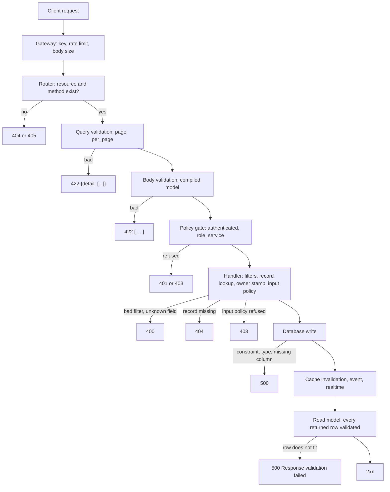

Everything so far checks data. Pawabase also checks the definitions that describe the data, and it does so at two moments with two different results.

### On save: refused with a message

When you click **Save changes** or **Create resource**, the Platform API validates the definition before storing it, and refuses with a `422` whose body is a plain message. Studio shows the message as an error toast. These are the messages returned for the mistakes that were tried.

| What was saved | Message |
| --- | --- |
| A name that is not lowercase letters, digits and underscores starting with a letter | A pattern error naming `name` and `^[a-z][a-z0-9_]{0,62}$` |
| A reserved name: `docs`, `openapi.json`, `x`, `rpc`, `health`, `internal`, `platform` | `'docs' is reserved` |
| A field name with a space, hyphen or leading digit | `fields[0]: name must be a letter or underscore followed by letters, digits or underscores` |
| An unknown field type | `fields[0]: unknown type 'decimal'` |
| The same field name twice | `fields[1]: duplicate field 'a'` |
| A `ref` field with no `schema` | `fields[0]: a ref field names a schema` |
| A `pattern` that is not a valid regular expression | `fields[0]: invalid pattern: missing ), unterminated subpattern at position 0` |
| A relation missing `name`, `resource` or `field` | `relations[0] needs name, resource and field` |
| A relation whose type is not `belongs_to` or `has_many` | `relations[0].type is belongs_to or has_many` |
| A rate limit with no `limit` | `rate_limit needs a limit` |
| An operation policy that does not exist | `operations.list.policy: unknown policy 'nope'` |
| A `cache_ttl` above 86400, or negative | A range error naming `cache_ttl` and `86400` |
| An inline transformer with an unknown step | `transformer: unknown transformer step 'x'; expected one of omit, pick, set, rename, case` |
| A route path that is not valid | `path must look like /orders/{id}/pay` |
| A route path that would replace a resource's own routes | `the path would shadow a resource's own routes (/<resource> or /<resource>/{id})` |
| A route input schema that does not exist | `input_schema: no schema 'nope'` |

Notice what is not on that list. The save does not check that a `default` fits its field, that an `enum` default is in the list, that a named transformer exists (only an inline one is checked), that a relation's `resource` and `field` exist, that a `ref` points at a real schema, or that the table has been created. Those are discovered later, either by the compile step below or by the first request.

The form catches the cheapest mistakes before the request is sent. The footer shows a hint beside the disabled **Create resource** button (`Add a name.` or `Every field needs a name.`), the name input of a field row turns red as you type an invalid name, and the **JSON** tab reports `The JSON has an error. Fix it on the JSON tab.` for text that does not parse. The server's checks are the authoritative ones, and the same list applies to a definition written to the Platform API directly.

### On compile: reported as a problem

A definition that saved can still fail to compile into routes. The compiled application is rebuilt lazily, the next time a request arrives after a definition changed, and a failure there does not stop the environment. The broken part is skipped and a message is recorded. These are listed on **Overview** under **Definitions with problems**.

| Cause | Problem text | Effect |
| --- | --- | --- |
| A `ref` to a schema that does not exist | `schema Dangling: field 'x' refers to unknown schema 'Nope'` | The schema is left out |
| A resource that uses such a schema | `resource uses_dangling: field 'l' refers to unknown schema 'Dangling'` | That resource's routes return `404`. Other resources keep working |
| A field named like the primary key | `resource sp1: fields[2]: duplicate field 'id'` | The resource's routes return `404` |
| A route that would shadow a resource | `route GET /orders: shadows a resource route` | The route is not registered |
| A route that cannot compile | `route POST /x: …` followed by the reason | The route is not registered |

A problem is a quiet failure. The save succeeded, the Studio sheet closed, and the only sign is a resource that answers `404`. Open **Overview** after any change that touches `ref` fields, relations or names, and read the list.

<Warning>
A schema that refers to itself, directly or through other schemas, is not a problem entry. It is a failure of the whole environment. Saving a schema `Loop` with a field `{"type": "ref", "schema": "Loop"}` made every request to that environment return `500`, including requests to resources that have nothing to do with it, and **Overview** itself returned `500` while it was in place. Deleting the schema from **Schemas** restores the environment. A cycle of two schemas that refer to each other behaves the same way. See [Schemas](/data/schemas/overview).
</Warning>


## Where validation shows up in Studio

Validation is not a screen. It is a property of the field list, so it appears wherever a field list is edited or exercised.

| Where in Studio | What you do there | What it tells you about validation |
| --- | --- | --- |
| **Resources**, then a resource, **Configure**, **Fields** | Declare types and constraints | This is the definition of the gate. The **Required** checkbox and **More options** write the keys |
| The same sheet, **JSON** tab | Edit the stored definition directly | The only place to set `unique`, `indexed`, defaults for JSON types and any key the form does not offer |
| **API Explorer** | Send a real request with the generated body | The quickest way to see a real `422`. Edit the starting body to break one rule at a time |
| The same, **Response** card | Read the status, headers and body | Shows the exact error shape, including `loc`, `type` and `ctx` |
| **Resources**, **Records** tab | Create and edit rows | Skips the models. The only checks are the database's own and unknown keys |
| **Overview**, **Definitions with problems** | Read the list | Compile-time failures that the save did not catch |
| **Observability** | Read request logs | A `422` is a client error. A rising rate of `500` on writes points at database refusals |
| **Database** | Run SQL | Find and repair rows that no longer fit the definition |

The loop for working on a constraint is short: change the field under **Fields**, **Save changes**, open **API Explorer**, send a request that breaks the rule, and read the body. Because the compiled application rebuilds on the next request after a change, the new rule is in effect immediately.


## Validation under load: what a bad request costs

A request that fails validation is still a request. It reaches the gateway, passes the key check, and is counted by the resource's rate limit before the body is read. With a limit of three requests per window on a resource, three invalid bodies were each answered `422` and the fourth was answered `429`:

```text
invalid body #1  ->  422
invalid body #2  ->  422
invalid body #3  ->  422
invalid body #4  ->  429  {"error": "rate_limit_exceeded", "message": "Too many requests. Slow down and retry later.", "retry_after": 20}
```

Two practical points follow. A client that retries a `422` in a loop will exhaust its allowance on requests that cannot succeed, and then be refused for valid ones, so it should not retry client errors. And the per-caller limit protects the platform from a single noisy caller, but a public endpoint that anyone can call anonymously is limited per caller identity, so a script that fans out over many addresses is not stopped by it. The limit, how it is counted and the headers it sends are in [Rate limits and CORS](/reference/rate-limits-and-cors).

In **Observability**, a rising count of `422` responses on a write endpoint is a signal about clients (a bad deploy, a form that sends the wrong type), while a rising count of `500` on the same endpoint is a signal about data or the database (a unique violation, an unmigrated column). Reading the two apart is the main reason to keep the distinction between "refused by validation" and "refused by the database" visible, which is what the custom-route pattern earlier on this page does.


## Layering rules: where each kind of rule belongs

Validation is one layer in a stack, and rules placed in the wrong layer are either unenforced or unreadable. This table places the common rules. Each of the policy recipes in it was run against a real resource.

| Rule | Belongs in | Why |
| --- | --- | --- |
| A value is a string, number, date | The field's `type` | The cheapest check, and it documents the API |
| A value is within a fixed range or length, or from a fixed list | `minimum`, `maximum`, `min_length`, `max_length`, `enum` | A `422` that names the limit |
| A value has a shape | `pattern` | A `422` with the pattern in `ctx` |
| A field must be present on create | `required` | `missing` on create |
| A field must stay non-null on update | An update policy, or a database `NOT NULL` | `PATCH` accepts `null` for everything |
| A field must not change after create | An update policy comparing `$input` to `$record` | See the recipe below |
| A value is limited for some callers and not others | A policy on `$input` and a role | See the recipe below |
| A field is required only when another has a value | A policy on `$input` | The field list cannot express a condition |
| Two fields must relate (`min` less than or equal to `max`) | A policy on `$input` | The same |
| A value must be unique | A `unique` field, plus a check in a route for a `409` | The index is the guarantee and the route is the message |
| A value must be normalized (lowercase, trimmed) | A route or a flow, before the write | Models validate and do not transform |
| A write is allowed only in some states | A route that runs the check and the write together | A policy sees one request, not the history |

### Recipes, from the verified runs

The policies below are real conditions that were saved under **Policies** and assigned to the operations named. Each result is from a request.

**A limit for most callers, none for staff.** The `create` policy:

```json
{"any": [{"role": "staff"}, {"lte": ["$input.qty", 10]}]}
```

```text
signed in, qty 5      ->  201
signed in, qty 50     ->  403  "policy 'qty_cap' refused"
role staff, qty 50    ->  201
```

**A field that cannot change after create.** The `update` policy passes when the key is not in the body, or when it equals the stored value:

```json
{"any": [
  {"not": {"exists": "$input.sku"}},
  {"eq": ["$input.sku", "$record.sku"]}
]}
```

```text
PATCH {"sku": "A", "qty": 6}   (unchanged)  ->  200
PATCH {"sku": "Z"}             (changed)    ->  403  "policy 'immutable_sku' refused"
PATCH {"qty": 7}               (no sku)     ->  200
```

**A field required only in some states.** The `create` policy requires `tracking` whenever `status` is `shipped`:

```json
{"any": [
  {"ne": ["$input.status", "shipped"]},
  {"exists": "$input.tracking"}
]}
```

```text
{"sku": "s", "status": "shipped"}                        ->  403
{"sku": "s", "status": "shipped", "tracking": "T1"}      ->  201
{"sku": "s"}                                             ->  201   (status absent, the first branch is true)
```

**Two fields that must be ordered.** The `create` policy:

```json
{"lte": ["$input.min", "$input.max"]}
```

```text
{"sku": "r", "min": 1, "max": 5}   ->  201
{"sku": "r", "min": 9, "max": 5}   ->  403
{"sku": "r"}                       ->  403   (both absent, so the comparison is false)
```

The last result is the trap in every cross-field rule: a missing value makes a comparison false. If the pair is optional, add a branch for absence, `{"any": [{"not": {"exists": "$input.min"}}, {"lte": [...]}]}`.

Every one of these returns `403` with the policy's name, and none tells the client which field was the problem. That is the cost of putting a rule in a policy: the reason is a policy name. If the client needs to point at a field, put the check in a route and answer with a `422` or a `409` that names it, as in the unique-value route earlier. See [Policies](/policies/overview), [Conditions](/policies/conditions) and [Recipes](/policies/recipes) for the full language.

### Normalization is not validation

A model checks a value and never rewrites it, apart from the conversions that come with the type (`"5"` to `5`, a UUID to lowercase, a date to its canonical form). Trimming, lowercasing an email, stripping a phone number to digits and collapsing whitespace are normalizations, and none of them happens in a resource. If you need them, the options are the client, a flow behind a route (`transform.map` before `resource.create`), or a function. Do it before the write, because a `unique` index on a column compares exactly what is stored.


## How the layers fit together



Read the diagram as a list of places where an answer can be produced. A single bad request is answered at the first place it fails, which is why the same body can be a `422` for an anonymous caller and a `201` for a signed-in one only when the body is the same and the policy differs, never the other way around. Everything the diagram marks as a `500` is a case that an earlier layer could have caught, and each is a prompt to add a check at the layer before it.

### One create, traced through every layer

A signed-in caller, user `1`, creates a note in a resource with an **Owner field** and a `create` policy of `authenticated`. This is what each layer does with `POST /rest/v1/notes {"body": "mine", "owner_id": "99"}`, in order:

```text
gateway          key resolves to project acme, environment development; rate limit counted
router           POST /rest/v1/notes exists
query            nothing typed to check
body model       {"body": "mine", "owner_id": "99"} fits the create model       (owner_id is declared and writable)
policy gate      authenticated: the bearer token is valid                         (no record yet, so decided now)
handler          data = {"body": "mine", "owner_id": "99"}
                 owner stamping: owner_id replaced with "1"                       (the caller's identity wins)
                 create policy re-checked with record and input = data           (passes)
store            INSERT INTO notes (body, owner_id, created_at, updated_at) ...
side effects     cached lists for notes invalidated; notes.created emitted; realtime if enabled
response         201 {"id": 1, "body": "mine", "owner_id": "1", ...}
```

The request log for this call records `notes: {"api_version": "v1", "policy": "authenticated", "events": ["notes.created"], "resource": "notes.created"}`. The same call with a body that breaks a rule stops at the **body model** line, and its log row has only `api_version`, which is how the two are told apart in **Observability**.
