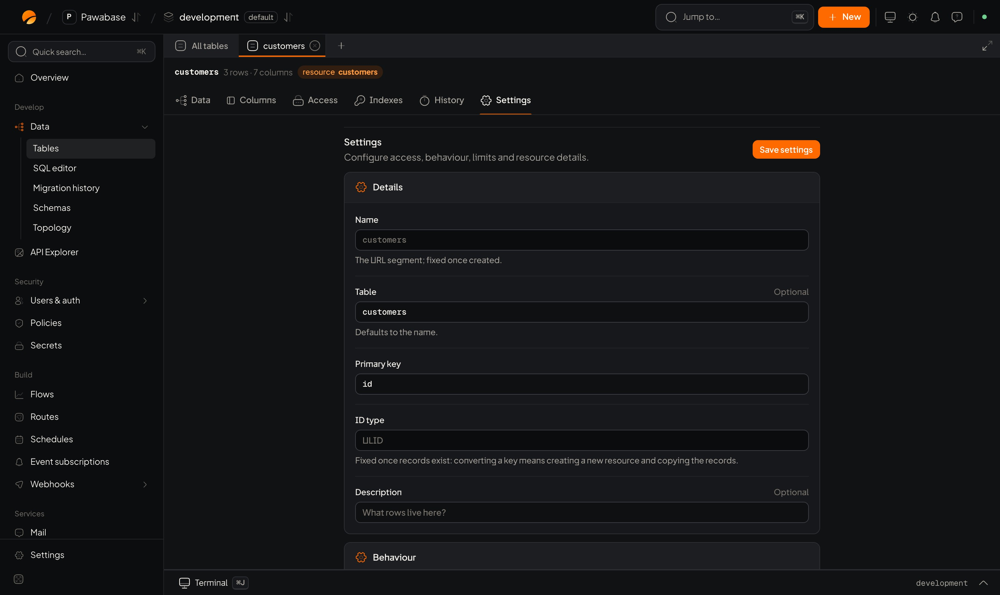

A table's **Settings** tab (and the definition behind it) holds everything that isn't a column or an access rule. This page is the map; each setting links to the page that explains it.

<Frame caption="A table with no resource has only Delete table under Settings; define a resource to get the full settings.">
  
</Frame>

## Details

| Setting in Studio | Key | Meaning |
| --- | --- | --- |
| **Name** | `name` | The resource's name and API path. Lowercase, digits, underscores |
| **Display name** | none | A friendly label in Studio |
| **Description** | `description` | Appears in the API docs |
| **Table** | `table` | The database table. Defaults to the name. Set it to serve an existing table |
| **Primary key** | `primary_key` | The key column. Default `id` |
| **ID type** | `id_type` | `ulid`, `uuid` or `integer`. See [Ids and timestamps](/database/ids-and-timestamps) |
| **Tags** | `tags` | Groups endpoints in the API docs |

## Behaviour

| Setting | Key | Meaning |
| --- | --- | --- |
| **Timestamps** | `timestamps` | Maintain `created_at` and `updated_at`. Default on |
| **Owner field** | `owner_field` | Filled with the caller's user id on create. See [Ids and timestamps](/database/ids-and-timestamps#the-owner-column) |
| **Emit events** | `events` | Emit `<name>.created`, `.updated`, `.deleted`. Default on |
| **Broadcast changes** | `realtime` | Push row changes to realtime subscribers. Default off |
| **Capture changes made outside the API** | `capture` | Also announce writes from SQL, other services and migrations, using database triggers. Events and realtime then come from the database |
| **Cache responses** | `cache_ttl` | Seconds to reuse list and get responses. 0 turns caching off; up to a day (86400) |
| **Rate limit** | `rate_limit` | Requests allowed per caller in a window. Per caller, counted across all gateway instances |

Details: [Events and realtime](/database/events-and-realtime), [Caching and rate limits](/database/caching-and-rate-limits).

## Relations

See [Relations](/database/relations). *Include related rows with `?expand=name`.*

## Columns, Access, Indexes

Their own tabs: [Columns and types](/database/columns-and-types), [Access](/database/access), [Indexes](/database/indexes).

## Who may do what

The **Access** tab sets, for each of the five operations (`list`, `get`, `create`, `update`, `delete`), whether it's **served at all** and which **rule** applies. A new table created in the definition has **every operation off** until you switch it on, so nothing is exposed by accident. The table editor in Studio switches them on for you with a sensible starting rule. See [Access](/database/access).

`list` also holds the table's **search fields**: up to 10 text fields that `?q=` searches. See [Filter](/database/filter).

## All of it as one definition

Everything on this page, plus columns, rules, relations and indexes, is one **resource definition**. You can read and write it with the [management client](/tools/management-client) or define it as code with [infrastructure as code](/tools/iac/tables).

```json
{
  "name": "orders",
  "description": "Customer orders",
  "table": "orders",
  "primary_key": "id",
  "id_type": "ulid",
  "fields": [
    { "name": "customer_id", "type": "ulid", "required": true, "indexed": true },
    { "name": "total", "type": "number" },
    { "name": "status", "type": "string", "enum": ["pending", "paid", "shipped"], "default": "pending" }
  ],
  "operations": {
    "list":   { "enabled": true, "policy": "own_orders", "search": { "fields": ["status"] } },
    "get":    { "enabled": true, "policy": "own_orders" },
    "create": { "enabled": true, "policy": "authenticated" },
    "update": { "enabled": true, "policy": "own_orders" },
    "delete": { "enabled": false }
  },
  "relations": [ { "name": "customer", "type": "belongs_to", "resource": "customers", "field": "customer_id" } ],
  "indexes": [ { "columns": ["customer_id", "created_at"] } ],
  "owner_field": "customer_id",
  "timestamps": true,
  "events": true,
  "realtime": false,
  "capture": false,
  "cache_ttl": 0,
  "rate_limit": { "limit": 60, "window": 60 },
  "tags": ["commerce"]
}
```

| Key | Meaning | Default |
| --- | --- | --- |
| `name` | The API name: lowercase letter first, then lowercase letters, digits and underscores, up to 63 characters | required |
| `description` | Shown in the API reference | empty |
| `table` | The database table it serves | the name |
| `primary_key` | The key column | `id` |
| `id_type` | `ulid`, `uuid` or `integer` | `ulid` |
| `fields` | The columns. See [Columns and types](/database/columns-and-types). | none |
| `operations` | Per operation: `enabled`, `policy`, and for `list` a `search` | all off |
| `relations` | `belongs_to` and `has_many` links. See [Relations](/database/relations). | none |
| `indexes` | See [Indexes](/database/indexes) | none |
| `owner_field` | Filled with the signed-in caller's id on create | none |
| `timestamps` | Maintain `created_at` and `updated_at` | `true` |
| `events` | Emit `<name>.created/updated/deleted` | `true` |
| `realtime` | Broadcast changes to [record subscribers](/realtime/record-changes) | `false` |
| `capture` | Also announce changes made outside the API, using database triggers | `false` |
| `cache_ttl` | Seconds to cache `list` and `get`, 0 to 86,400 | `0` |
| `rate_limit` | `{ "limit": requests, "window": seconds }` per caller; `window` defaults to 60 | none |
| `tags` | Group endpoints in the API reference | none |

## Copy a definition between environments

A definition is plain JSON, so you can read it from one environment and create it in another with a secret key that can manage both:

<CodeGroup>
```typescript TypeScript
import { manage } from "@pawabase/client/manage";

const from = manage(pawabase, "development");
const to = manage(pawabase, "staging");
const orders = await from.resources.getOne("orders");
await to.resources.create(orders);
```

```python Python
orders = pb.manage.environment("development").resources.get_one("orders")
pb.manage.environment("staging").resources.create(orders)
```
</CodeGroup>

For many at once, use [promote](/environments/promote), which also shows what will change first.

<CardGroup cols={2}>
  <Card title="Tables and resources" icon="table" href="/database/tables-and-resources">Create and sync.</Card>
  <Card title="Access" icon="shield-check" href="/database/access">The rules.</Card>
</CardGroup>
