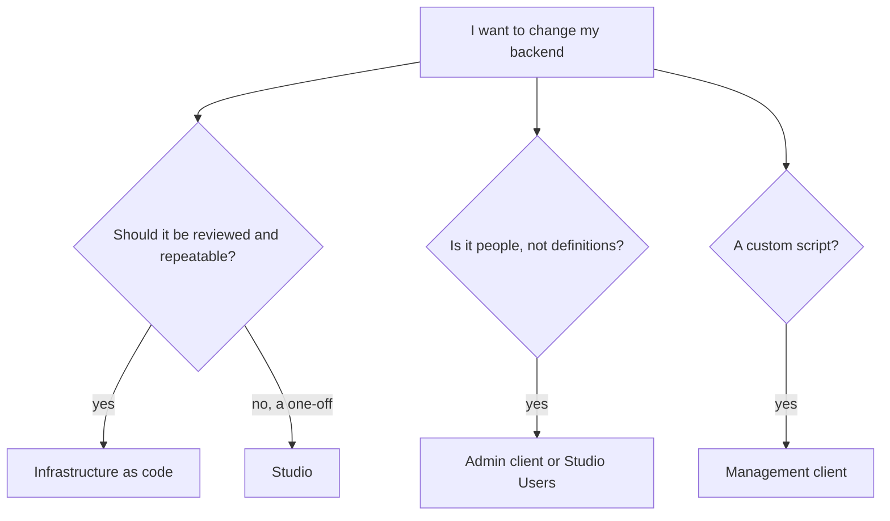

The **Developers** tab is for working on **your own** backend from outside Studio: describe it in code and deploy it from CI, move it between environments as a blueprint, script changes with the SDK clients, or let an AI assistant work in it through MCP.

Building a product that works with **other people's** Pawabase organizations (an IDE, an AI app builder, a hosting platform)? That's [Integrations](/integrations/overview): OAuth, the Management API and platform apps.

| Tool | What it does | Use it when |
| --- | --- | --- |
| [**AI assistants (MCP)**](/mcp/overview) | Connect Claude, Codex, Cursor, VS Code, or a custom AI client to a Pawabase environment | You want an assistant to inspect or build in a project |
| [**Infrastructure as code**](/iac/overview) | Describe a whole backend (tables, rules, flows, routes, schedules, webhooks, buckets, mail templates) as code, then validate, plan, emulate and deploy it | You want your backend in version control and deployed by CI |
| [**The `pawabase` command**](/iac/commands) | `init`, `validate`, `plan`, `deploy`, `emulate`, `whoami` | Day-to-day work with IaC |
| [**Management client**](/developers/management-client) | Change environments and definitions from your own scripts, with a secret key | Custom tooling, seeding, one-off migrations |
| [**Admin client**](/developers/admin-client) | Manage users, roles, organizations and sessions from a trusted server | Back-office tools, onboarding scripts |
| [**CI/CD**](/iac/ci-cd) | GitHub Actions workflows that validate on pull requests and deploy on merge | Automated releases |
| [**Blueprints**](/developers/blueprints) | A whole backend in one zip: export it, install it into an empty environment | Copying a backend between environments, templates |

<Note>
Infrastructure as code is available for **Python** today (`pawabase-iac`). Every example is written in a tab so a **TypeScript** tab can sit beside the Python one when that package ships; the concepts, commands and files are the same.
</Note>

## Studio and code are the same thing

A definition made in Studio and the same definition made in code are identical data. You can:

- **Start in Studio, move to code:** build something visually, then recreate it in code and use `pawabase plan` to confirm there are no differences.
- **Start in code:** deploy, then open Studio to see what was created and watch it run.
- **Mix:** keep some things (users, secrets, provider keys) in Studio and the rest in code. `merge` mode (the default) never deletes what your code doesn't mention.

## Which tool for which job

<CardGroup cols={2}>
  <Card title="MCP" icon="bot-message-square" href="/mcp/overview">Connect an AI assistant with a scoped key.</Card>
  <Card title="Infrastructure as code" icon="file-code" href="/iac/overview">Your backend, in Python.</Card>
  <Card title="Quickstart" icon="rocket" href="/iac/quickstart">Deploy something in ten minutes.</Card>
  <Card title="Management client" icon="server" href="/developers/management-client">Scripts with a secret key.</Card>
  <Card title="CI/CD" icon="workflow" href="/iac/ci-cd">Deploy on merge.</Card>
</CardGroup>
